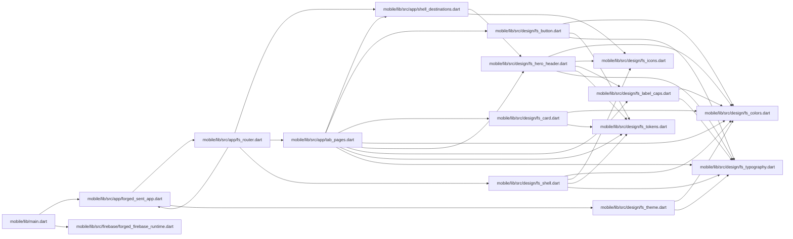

# Flutter code map

> Generated from checked-in Dart files. Do not edit this file manually.
> To refresh: python3 tooling/architecture/generate.py --write
> CI runs the same command with --check to detect drift.

## Actual Dart imports

## Declared classes and functions

### mobile/lib/main.dart

- fn main()

### mobile/lib/src/app/forged_sent_app.dart

- class ForgedSentApp
- class _ForgedSentAppState
- fn dispose()
- fn build()
- class FoundationHomeScreen

### mobile/lib/src/app/fs_router.dart

- No classes or named methods matched by the simple inventory parser

### mobile/lib/src/app/shell_destinations.dart

- class ShellDestination

### mobile/lib/src/app/tab_pages.dart

- fn heroDateLine()
- class _ShellPage
- fn build()
- class _PlaceholderCard
- class TodayPlaceholderPage
- class TabPlaceholderPage

### mobile/lib/src/design/fs_button.dart

- class FsButton
- fn build()

### mobile/lib/src/design/fs_card.dart

- class FsCard
- fn build()

### mobile/lib/src/design/fs_colors.dart

- class FsColors

### mobile/lib/src/design/fs_hero_header.dart

- class FsHeroAction
- class FsHeroHeader
- fn build()
- class _HeroBackdrop
- class _RidgePainter
- fn paint()
- fn shouldRepaint()
- class _HeroActions
- class _HeroRoundButton

### mobile/lib/src/design/fs_icons.dart

- class FsIconData
- class FsIcon
- fn build()
- class _FsIconPainter
- fn paint()
- fn shouldRepaint()

### mobile/lib/src/design/fs_label_caps.dart

- class FsLabelCaps
- fn build()

### mobile/lib/src/design/fs_shell.dart

- class FsShellDestination
- class FsShell
- fn build()
- class _BrandBar
- class _TabBar
- class _Tab

### mobile/lib/src/design/fs_theme.dart

- No classes or named methods matched by the simple inventory parser

### mobile/lib/src/design/fs_tokens.dart

- No classes or named methods matched by the simple inventory parser

### mobile/lib/src/design/fs_typography.dart

- No classes or named methods matched by the simple inventory parser

### mobile/lib/src/firebase/forged_firebase_runtime.dart

- class ForgedFirebaseRuntime
- fn emulatorRequested()
- fn emulatorHost()
- fn connectEmulators()

## Limitations

This is a lexical source inventory, not a compiler AST or runtime call graph.
It does not discover anonymous callbacks, reflection, dependency injection,
Firebase rules or dynamic dispatch. Use SYSTEM.md for architectural intent
and use Flutter analysis and tests for behavior.
