# Flutter code map

> Generated from checked-in Dart files. Do not edit this file manually.
> To refresh: python3 tooling/architecture/generate.py --write
> CI runs the same command with --check to detect drift.

## Actual Dart imports

```mermaid
flowchart LR
    N0["mobile/lib/main.dart"]
    N1["mobile/lib/src/app/forged_sent_app.dart"]
    N2["mobile/lib/src/app/fs_router.dart"]
    N3["mobile/lib/src/app/local_store.dart"]
    N4["mobile/lib/src/app/open_local_store.dart"]
    N5["mobile/lib/src/app/open_local_store_native.dart"]
    N6["mobile/lib/src/app/open_local_store_web.dart"]
    N7["mobile/lib/src/app/shell_destinations.dart"]
    N8["mobile/lib/src/app/tab_pages.dart"]
    N9["mobile/lib/src/core/clock.dart"]
    N10["mobile/lib/src/core/date_text.dart"]
    N11["mobile/lib/src/core/event_id.dart"]
    N12["mobile/lib/src/core/local_date.dart"]
    N13["mobile/lib/src/core/time_text.dart"]
    N14["mobile/lib/src/design/fs_balanced.dart"]
    N15["mobile/lib/src/design/fs_box_row.dart"]
    N16["mobile/lib/src/design/fs_button.dart"]
    N17["mobile/lib/src/design/fs_card.dart"]
    N18["mobile/lib/src/design/fs_chevron_row.dart"]
    N19["mobile/lib/src/design/fs_colors.dart"]
    N20["mobile/lib/src/design/fs_dialog.dart"]
    N21["mobile/lib/src/design/fs_hero_header.dart"]
    N22["mobile/lib/src/design/fs_icons.dart"]
    N23["mobile/lib/src/design/fs_label_caps.dart"]
    N24["mobile/lib/src/design/fs_marks.dart"]
    N25["mobile/lib/src/design/fs_number_field.dart"]
    N26["mobile/lib/src/design/fs_page_bar.dart"]
    N27["mobile/lib/src/design/fs_progress_ring.dart"]
    N28["mobile/lib/src/design/fs_ruled.dart"]
    N29["mobile/lib/src/design/fs_scripture.dart"]
    N30["mobile/lib/src/design/fs_section_head.dart"]
    N31["mobile/lib/src/design/fs_segmented.dart"]
    N32["mobile/lib/src/design/fs_shell.dart"]
    N33["mobile/lib/src/design/fs_tag.dart"]
    N34["mobile/lib/src/design/fs_text_area.dart"]
    N35["mobile/lib/src/design/fs_theme.dart"]
    N36["mobile/lib/src/design/fs_tokens.dart"]
    N37["mobile/lib/src/design/fs_typography.dart"]
    N38["mobile/lib/src/design/fs_typography_workout.dart"]
    N39["mobile/lib/src/features/devotional/data/devotional_library.dart"]
    N40["mobile/lib/src/features/devotional/domain/devotional.dart"]
    N41["mobile/lib/src/features/devotional/domain/scripture_reference.dart"]
    N42["mobile/lib/src/features/devotional/presentation/devotional_page.dart"]
    N43["mobile/lib/src/features/journal/data/drift_journal_repository.dart"]
    N44["mobile/lib/src/features/journal/data/journal_body_codec.dart"]
    N45["mobile/lib/src/features/journal/data/journal_repository.dart"]
    N46["mobile/lib/src/features/journal/data/memory_journal_repository.dart"]
    N47["mobile/lib/src/features/journal/domain/journal_entry.dart"]
    N48["mobile/lib/src/features/journal/presentation/journal_entry_page.dart"]
    N49["mobile/lib/src/features/journal/presentation/journal_page.dart"]
    N50["mobile/lib/src/features/journal/presentation/journal_view_model.dart"]
    N51["mobile/lib/src/features/journal/presentation/write_it_down.dart"]
    N52["mobile/lib/src/features/settings/data/settings_repository.dart"]
    N53["mobile/lib/src/features/settings/presentation/settings_page.dart"]
    N54["mobile/lib/src/features/today/data/day_repository.dart"]
    N55["mobile/lib/src/features/today/data/drift_day_repository.dart"]
    N56["mobile/lib/src/features/today/data/memory_day_repository.dart"]
    N57["mobile/lib/src/features/today/data/today_content.dart"]
    N58["mobile/lib/src/features/today/domain/completion_event.dart"]
    N59["mobile/lib/src/features/today/domain/day_box.dart"]
    N60["mobile/lib/src/features/today/domain/streak.dart"]
    N61["mobile/lib/src/features/today/presentation/today_page.dart"]
    N62["mobile/lib/src/features/today/presentation/today_view_model.dart"]
    N63["mobile/lib/src/features/workout/data/drift_workout_repository.dart"]
    N64["mobile/lib/src/features/workout/data/memory_workout_repository.dart"]
    N65["mobile/lib/src/features/workout/data/workout_library.dart"]
    N66["mobile/lib/src/features/workout/data/workout_repository.dart"]
    N67["mobile/lib/src/features/workout/domain/prescription.dart"]
    N68["mobile/lib/src/features/workout/domain/workout_plan.dart"]
    N69["mobile/lib/src/features/workout/domain/workout_session.dart"]
    N70["mobile/lib/src/features/workout/presentation/train_page.dart"]
    N71["mobile/lib/src/features/workout/presentation/train_view_model.dart"]
    N72["mobile/lib/src/features/workout/presentation/workout_page.dart"]
    N73["mobile/lib/src/features/workout/presentation/workout_prayer_dialog.dart"]
    N74["mobile/lib/src/features/workout/presentation/workout_view_model.dart"]
    N75["mobile/lib/src/firebase/forged_firebase_runtime.dart"]
    N76["mobile/lib/src/storage/app_database.dart"]
    N77["mobile/lib/src/storage/app_database.g.dart"]
    N78["mobile/lib/src/storage/app_database.steps.dart"]
    N79["mobile/lib/src/storage/native_storage.dart"]
    N0 --> N1
    N0 --> N3
    N0 --> N4
    N0 --> N9
    N0 --> N75
    N1 --> N2
    N1 --> N9
    N1 --> N35
    N2 --> N1
    N2 --> N7
    N2 --> N8
    N2 --> N12
    N2 --> N32
    N2 --> N42
    N2 --> N48
    N2 --> N49
    N2 --> N53
    N2 --> N61
    N2 --> N70
    N2 --> N72
    N3 --> N45
    N3 --> N46
    N3 --> N52
    N3 --> N54
    N3 --> N56
    N3 --> N64
    N3 --> N66
    N4 --> N3
    N5 --> N3
    N5 --> N43
    N5 --> N52
    N5 --> N55
    N5 --> N63
    N5 --> N79
    N6 --> N3
    N7 --> N21
    N7 --> N22
    N8 --> N7
    N8 --> N17
    N8 --> N19
    N8 --> N21
    N8 --> N23
    N8 --> N36
    N8 --> N37
    N9 --> N12
    N10 --> N12
    N13 --> N12
    N15 --> N19
    N15 --> N36
    N15 --> N37
    N16 --> N19
    N16 --> N36
    N16 --> N37
    N17 --> N19
    N17 --> N36
    N18 --> N19
    N18 --> N24
    N18 --> N36
    N18 --> N37
    N18 --> N38
    N20 --> N19
    N20 --> N23
    N20 --> N36
    N20 --> N37
    N20 --> N38
    N21 --> N14
    N21 --> N19
    N21 --> N22
    N21 --> N23
    N21 --> N33
    N21 --> N36
    N21 --> N37
    N23 --> N19
    N23 --> N37
    N25 --> N19
    N25 --> N36
    N25 --> N38
    N26 --> N16
    N26 --> N19
    N26 --> N23
    N26 --> N37
    N27 --> N19
    N27 --> N37
    N29 --> N19
    N29 --> N23
    N29 --> N28
    N29 --> N37
    N30 --> N19
    N30 --> N36
    N30 --> N37
    N31 --> N16
    N32 --> N19
    N32 --> N22
    N32 --> N36
    N32 --> N37
    N33 --> N19
    N33 --> N22
    N33 --> N37
    N34 --> N19
    N34 --> N36
    N34 --> N37
    N35 --> N19
    N35 --> N37
    N38 --> N37
    N39 --> N12
    N39 --> N40
    N40 --> N12
    N42 --> N9
    N42 --> N10
    N42 --> N12
    N42 --> N16
    N42 --> N19
    N42 --> N21
    N42 --> N22
    N42 --> N26
    N42 --> N28
    N42 --> N29
    N42 --> N31
    N42 --> N33
    N42 --> N36
    N42 --> N37
    N42 --> N40
    N42 --> N51
    N42 --> N62
    N43 --> N12
    N43 --> N44
    N43 --> N45
    N43 --> N47
    N43 --> N76
    N45 --> N47
    N46 --> N45
    N46 --> N47
    N47 --> N12
    N48 --> N9
    N48 --> N10
    N48 --> N11
    N48 --> N16
    N48 --> N19
    N48 --> N23
    N48 --> N26
    N48 --> N28
    N48 --> N30
    N48 --> N34
    N48 --> N36
    N48 --> N37
    N48 --> N47
    N48 --> N50
    N49 --> N9
    N49 --> N16
    N49 --> N19
    N49 --> N21
    N49 --> N23
    N49 --> N26
    N49 --> N36
    N49 --> N37
    N49 --> N47
    N49 --> N50
    N50 --> N3
    N50 --> N9
    N50 --> N10
    N50 --> N11
    N50 --> N12
    N50 --> N47
    N51 --> N16
    N51 --> N17
    N51 --> N19
    N51 --> N28
    N51 --> N34
    N51 --> N37
    N51 --> N47
    N51 --> N50
    N52 --> N76
    N53 --> N16
    N53 --> N17
    N53 --> N19
    N53 --> N21
    N53 --> N26
    N53 --> N30
    N53 --> N36
    N53 --> N37
    N53 --> N40
    N53 --> N62
    N54 --> N12
    N54 --> N58
    N55 --> N12
    N55 --> N54
    N55 --> N58
    N55 --> N76
    N56 --> N12
    N56 --> N54
    N56 --> N58
    N57 --> N12
    N57 --> N39
    N57 --> N58
    N57 --> N59
    N58 --> N12
    N59 --> N12
    N60 --> N12
    N60 --> N58
    N61 --> N9
    N61 --> N10
    N61 --> N15
    N61 --> N16
    N61 --> N17
    N61 --> N19
    N61 --> N21
    N61 --> N23
    N61 --> N27
    N61 --> N30
    N61 --> N36
    N61 --> N37
    N61 --> N58
    N61 --> N59
    N61 --> N62
    N62 --> N3
    N62 --> N9
    N62 --> N11
    N62 --> N12
    N62 --> N39
    N62 --> N40
    N62 --> N57
    N62 --> N58
    N62 --> N59
    N62 --> N60
    N63 --> N12
    N63 --> N54
    N63 --> N58
    N63 --> N66
    N63 --> N67
    N63 --> N68
    N63 --> N69
    N63 --> N76
    N64 --> N12
    N64 --> N54
    N64 --> N58
    N64 --> N66
    N64 --> N67
    N64 --> N68
    N64 --> N69
    N65 --> N12
    N65 --> N67
    N65 --> N68
    N66 --> N12
    N66 --> N68
    N66 --> N69
    N68 --> N12
    N69 --> N12
    N69 --> N67
    N70 --> N7
    N70 --> N10
    N70 --> N12
    N70 --> N13
    N70 --> N16
    N70 --> N17
    N70 --> N18
    N70 --> N19
    N70 --> N21
    N70 --> N23
    N70 --> N30
    N70 --> N36
    N70 --> N37
    N70 --> N38
    N70 --> N71
    N71 --> N3
    N71 --> N9
    N71 --> N10
    N71 --> N12
    N71 --> N58
    N71 --> N65
    N71 --> N68
    N71 --> N69
    N71 --> N74
    N72 --> N9
    N72 --> N10
    N72 --> N12
    N72 --> N13
    N72 --> N16
    N72 --> N19
    N72 --> N20
    N72 --> N23
    N72 --> N24
    N72 --> N25
    N72 --> N26
    N72 --> N36
    N72 --> N37
    N72 --> N38
    N72 --> N65
    N72 --> N67
    N72 --> N69
    N72 --> N73
    N72 --> N74
    N73 --> N16
    N73 --> N19
    N73 --> N20
    N73 --> N38
    N74 --> N3
    N74 --> N9
    N74 --> N10
    N74 --> N11
    N74 --> N12
    N74 --> N65
    N74 --> N66
    N74 --> N67
    N74 --> N68
    N74 --> N69
    N76 --> N78
    N79 --> N11
    N79 --> N76
```

## Declared classes and functions

### mobile/lib/main.dart

- fn main()
- fn startApp()
- fn start()

### mobile/lib/src/app/forged_sent_app.dart

- class ForgedSentApp
- class _ForgedSentAppState
- fn initState()
- fn dispose()
- fn build()
- class FoundationHomeScreen

### mobile/lib/src/app/fs_router.dart

- fn _topPageHoldsHim()

### mobile/lib/src/app/local_store.dart

- class LocalStore

### mobile/lib/src/app/open_local_store.dart

- fn openLocalStore()
- fn openLocalStoreOrFallback()
- fn Function()

### mobile/lib/src/app/open_local_store_native.dart

- fn openLocalStore()
- fn openLocalStoreIn()

### mobile/lib/src/app/open_local_store_web.dart

- fn openLocalStore()

### mobile/lib/src/app/shell_destinations.dart

- class ShellDestination
- fn journalEntryPath()
- fn workoutPath()

### mobile/lib/src/app/tab_pages.dart

- class _ShellPage
- fn build()
- class _PlaceholderCard
- class TabPlaceholderPage

### mobile/lib/src/core/clock.dart

- class SystemClock
- class TodayDate
- fn refresh()
- fn _scheduleMidnight()

### mobile/lib/src/core/date_text.dart

- fn weekdayName()
- fn monthAndDay()
- fn heroDateLine()
- fn shortDate()
- fn clockTime()

### mobile/lib/src/core/event_id.dart

- fn newEventId()

### mobile/lib/src/core/local_date.dart

- class LocalDate
- fn iso()
- fn monthDayKey()
- fn weekday()
- fn dayOfYear()
- fn _two()
- fn compareTo()
- fn hashCode()
- fn toString()

### mobile/lib/src/core/time_text.dart

- fn shortWeekdayName()
- fn shortMonthAndDay()
- fn minutesAndSeconds()
- fn elapsedText()

### mobile/lib/src/design/fs_balanced.dart

- class FsBalanced
- class _RenderBalanced
- fn performLayout()

### mobile/lib/src/design/fs_box_row.dart

- class FsBoxRow
- fn build()
- class _Box
- class _CheckPainter
- fn paint()
- fn shouldRepaint()

### mobile/lib/src/design/fs_button.dart

- class FsButton
- fn build()

### mobile/lib/src/design/fs_card.dart

- class FsCard
- fn build()

### mobile/lib/src/design/fs_chevron_row.dart

- class FsChevronRow
- fn build()

### mobile/lib/src/design/fs_colors.dart

- class FsColors

### mobile/lib/src/design/fs_dialog.dart

- class FsDialog
- fn build()

### mobile/lib/src/design/fs_hero_header.dart

- class FsHeroAction
- class FsHeroHeader
- fn build()
- class FsReadingHeader
- class FsHeroBackdrop
- class _RidgePainter
- fn paint()
- fn shouldRepaint()
- class _HeroActions
- class _HeroRoundButton

### mobile/lib/src/design/fs_icons.dart

- class FsIconData
- class FsIcon
- fn build()
- class _FsIconPainter
- fn paint()
- fn shouldRepaint()

### mobile/lib/src/design/fs_label_caps.dart

- class FsLabelCaps
- fn build()

### mobile/lib/src/design/fs_marks.dart

- class FsCheckMark
- fn build()
- class _CheckPainter
- fn paint()
- fn shouldRepaint()
- class FsLockMark
- class _LockPainter

### mobile/lib/src/design/fs_number_field.dart

- class FsNumberField
- fn format()
- class _FsNumberFieldState
- fn didUpdateWidget()
- fn dispose()
- fn _onFocus()
- fn build()

### mobile/lib/src/design/fs_page_bar.dart

- class FsPageBar
- fn build()

### mobile/lib/src/design/fs_progress_ring.dart

- class FsProgressRing
- fn build()
- class _RingPainter
- fn paint()
- fn shouldRepaint()

### mobile/lib/src/design/fs_ruled.dart

- class FsRuled
- fn build()

### mobile/lib/src/design/fs_scripture.dart

- class FsScripture
- fn build()

### mobile/lib/src/design/fs_section_head.dart

- class FsSectionHead
- fn build()
- class FsTally
- class FsMeter

### mobile/lib/src/design/fs_segmented.dart

- class FsSegment
- class FsSegmented
- fn build()

### mobile/lib/src/design/fs_shell.dart

- class FsShellDestination
- class FsShell
- fn build()
- class _BrandBar
- class _TabBar
- class _Tab

### mobile/lib/src/design/fs_tag.dart

- class FsTag
- fn build()

### mobile/lib/src/design/fs_text_area.dart

- class FsTextArea
- fn build()
- class FsCodeUnitLimit
- fn fit()

### mobile/lib/src/design/fs_theme.dart

- No classes or named methods matched by the simple inventory parser

### mobile/lib/src/design/fs_tokens.dart

- No classes or named methods matched by the simple inventory parser

### mobile/lib/src/design/fs_typography.dart

- No classes or named methods matched by the simple inventory parser

### mobile/lib/src/design/fs_typography_workout.dart

- No classes or named methods matched by the simple inventory parser

### mobile/lib/src/features/devotional/data/devotional_library.dart

- class DevotionalLibrary
- fn load()
- fn length()

### mobile/lib/src/features/devotional/domain/devotional.dart

- fn of()
- class Devotional
- fn readingKeyFor()

### mobile/lib/src/features/devotional/domain/scripture_reference.dart

- No classes or named methods matched by the simple inventory parser

### mobile/lib/src/features/devotional/presentation/devotional_page.dart

- class DevotionalPage
- class _DevotionalPageState
- fn dispose()
- fn _onMetrics()
- fn _onNewDay()
- fn _amen()
- fn _undo()
- fn build()
- class _Section
- class _End
- class _Plain

### mobile/lib/src/features/journal/data/drift_journal_repository.dart

- class DriftJournalRepository
- fn durable()
- fn entry()
- fn apply()
- fn _apply()
- fn _row()

### mobile/lib/src/features/journal/data/journal_body_codec.dart

- fn encode()
- fn decode()
- class PlainJournalBodyCodec
- fn format()
- class JournalFormatException
- fn toString()

### mobile/lib/src/features/journal/data/journal_repository.dart

- fn entry()
- fn apply()
- class JournalStoreFailure
- fn toString()
- class StoredJournalChange

### mobile/lib/src/features/journal/data/memory_journal_repository.dart

- class MemoryJournalRepository
- fn durable()
- fn entry()
- fn apply()
- fn newestFirst()

### mobile/lib/src/features/journal/domain/journal_entry.dart

- class JournalEntry
- fn toString()
- class JournalChange
- fn guarded()

### mobile/lib/src/features/journal/presentation/journal_entry_page.dart

- class JournalEntryPage
- class _JournalEntryPageState
- fn dispose()
- fn _save()
- fn _goOnAsNewEntry()
- fn _hasUnsavedWords()
- fn _delete()
- fn build()
- fn _leave()
- fn _plain()

### mobile/lib/src/features/journal/presentation/journal_page.dart

- fn journalPreview()
- class JournalPage
- fn build()
- class _EntryRow

### mobile/lib/src/features/journal/presentation/journal_view_model.dart

- fn journalWhen()
- class DevotionalDraft
- fn separate()
- class DevotionalDraftNotifier
- fn typed()
- fn save()
- fn discard()
- class JournalActions
- fn delete()

### mobile/lib/src/features/journal/presentation/write_it_down.dart

- class WriteItDown
- class _WriteItDownState
- fn initState()
- fn dispose()
- fn _onDraft()
- fn _discard()
- fn build()

### mobile/lib/src/features/settings/data/settings_repository.dart

- fn watchShowPreviewPoints()
- fn setShowPreviewPoints()
- class DriftSettingsRepository
- class MemorySettingsRepository

### mobile/lib/src/features/settings/presentation/settings_page.dart

- class SettingsPage
- class _SettingsPageState
- fn _setShowPoints()
- fn build()

### mobile/lib/src/features/today/data/day_repository.dart

- fn watchDay()
- fn record()

### mobile/lib/src/features/today/data/drift_day_repository.dart

- class DriftDayRepository
- fn durable()
- fn watchDay()
- fn record()
- fn _stateRow()

### mobile/lib/src/features/today/data/memory_day_repository.dart

- class MemoryDayRepository
- fn durable()
- fn watchDay()
- fn record()

### mobile/lib/src/features/today/data/today_content.dart

- class TodayContent
- fn load()
- fn missionFor()

### mobile/lib/src/features/today/domain/completion_event.dart

- class CompletionEvent
- class ItemState
- fn hashCode()
- class DayRecord
- fn isDone()
- fn _sameItems()

### mobile/lib/src/features/today/domain/day_box.dart

- class DayBox
- fn active()
- fn missionLineFor()

### mobile/lib/src/features/today/domain/streak.dart

- class StreakRule
- fn _counts()
- fn length()

### mobile/lib/src/features/today/presentation/today_page.dart

- fn pointsLabel()
- fn streakLine()
- class TodayPage
- fn build()
- class _ProgressPanel
- class _BoxesCard
- fn _row()
- class _LoadingCard
- class _LoadFailedCard

### mobile/lib/src/features/today/presentation/today_view_model.dart

- class BoxView
- fn toDo()
- class TodayView
- fn total()
- fn doneCount()
- fn devotionalDone()
- class TodayViewModel
- fn build()
- fn isDone()
- fn retry()
- fn completeDevotional()
- fn undoDevotional()
- fn _record()
- fn setShowPreviewPoints()

### mobile/lib/src/features/workout/data/drift_workout_repository.dart

- class DriftWorkoutRepository
- fn durable()
- fn watchPlan()
- fn ensurePlan()
- fn savePlan()
- fn watchSession()
- fn readSession()
- fn watchOpenSession()
- fn startSession()
- fn _updateSet()
- fn setReps()
- fn setWeight()
- fn setTicked()
- fn _exerciseInOpenSession()
- fn addSet()
- fn removeSet()
- fn setRest()
- fn finishSession()
- fn emit()
- fn _session()

### mobile/lib/src/features/workout/data/memory_workout_repository.dart

- class MemoryWorkoutRepository
- fn durable()
- fn watchPlan()
- fn ensurePlan()
- fn savePlan()
- fn watchSession()
- fn readSession()
- fn watchOpenSession()
- fn startSession()
- fn setReps()
- fn setWeight()
- fn setTicked()
- fn addSet()
- fn removeSet()
- fn _replaceSets()
- fn setRest()
- fn finishSession()
- fn _changeSet()

### mobile/lib/src/features/workout/data/workout_library.dart

- class WorkoutLibrary
- fn load()
- fn nameFor()

### mobile/lib/src/features/workout/data/workout_repository.dart

- fn watchPlan()
- fn ensurePlan()
- fn savePlan()
- fn watchSession()
- fn readSession()
- fn watchOpenSession()
- fn startSession()
- fn setReps()
- fn setWeight()
- fn setTicked()
- fn addSet()
- fn removeSet()
- fn setRest()
- fn finishSession()

### mobile/lib/src/features/workout/domain/prescription.dart

- class SetPlan
- fn count()
- fn plannedSetCount()
- fn restSecondsIn()
- fn isSupersetFirst()
- fn restBaseFor()

### mobile/lib/src/features/workout/domain/workout_plan.dart

- class WorkoutPlan
- fn indexFor()
- fn hashCode()
- fn _sameList()
- fn _weekdayAfter()
- fn _daysBetween()
- class PlannedExercise
- class PlannedWorkout
- class PlanDay
- fn isTrain()
- fn isRest()

### mobile/lib/src/features/workout/domain/workout_session.dart

- class SessionSet
- fn isBlank()
- class RestState
- class SessionExercise
- fn hasRestTimer()
- fn plannedSets()
- fn canAddSet()
- fn isAdded()
- fn canRemove()
- fn isLogged()
- class WorkoutSession
- fn finished()
- class SessionTotals
- class NewSession
- class LastTime
- class LastSet
- class SetIssue
- class FinishCheck
- fn onlyBlanks()
- fn clear()

### mobile/lib/src/features/workout/presentation/train_page.dart

- class TrainPage
- fn build()
- class _CarriedOverCard
- class _TodayCard
- class _WeekCard
- class _Weekday
- class _LoadingCard
- class _LoadFailedCard

### mobile/lib/src/features/workout/presentation/train_view_model.dart

- class TrainDay
- fn opens()
- fn dim()
- class TrainView
- class TrainViewModel
- fn build()
- fn retry()

### mobile/lib/src/features/workout/presentation/workout_page.dart

- fn _repsChange()
- fn _weightChange()
- fn _tickChange()
- fn _restChange()
- fn _rowsChange()
- fn _isSetChange()
- fn _unsavedIn()
- class WorkoutPage
- class _WorkoutPageState
- fn initState()
- fn dispose()
- fn _flush()
- fn _mark()
- fn _track()
- fn _setChangesStored()
- fn _removeSet()
- fn _start()
- fn _finish()
- fn _toTop()
- fn build()
- fn _meta()
- class _Notice
- class _EverySecond
- class _EverySecondState
- fn didUpdateWidget()
- fn _sync()
- class _ClockBar
- class _ExerciseFrame
- fn _setText()
- class _LiveExercise
- fn _offersRemove()
- fn _targetLine()
- class _BeingRemoved
- class _LastTimeLine
- class _SetRow
- fn _ramp()
- class _LoggedMark
- class _TickRow
- class _RestBar
- class _LockedSummary
- fn _thousands()
- class _Stat
- class _SummaryExercise
- class _FinishCheckDialog

### mobile/lib/src/features/workout/presentation/workout_prayer_dialog.dart

- fn showWorkoutPrayer()
- class WorkoutPrayerDialog
- fn build()

### mobile/lib/src/features/workout/presentation/workout_view_model.dart

- class PlannedLine
- class WorkoutView
- fn canStart()
- fn live()
- fn locked()
- class WorkoutWrites
- fn add()
- fn settled()
- fn waiting()
- class WorkoutViewModel
- fn build()
- fn retry()
- fn start()
- fn _write()
- fn flush()
- fn storedSession()
- fn setReps()
- fn setWeight()
- fn setTicked()
- fn addSet()
- fn removeSet()
- fn startRest()
- fn pauseRest()
- fn resetRest()
- fn adjustRest()
- fn _setRest()
- fn finish()
- class _Rest

### mobile/lib/src/firebase/forged_firebase_runtime.dart

- class ForgedFirebaseRuntime
- fn emulatorRequested()
- fn emulatorHost()
- fn connectEmulators()

### mobile/lib/src/storage/app_database.dart

- class CompletionEvents
- class DayStates
- class AppSettings
- class JournalEntries
- class JournalEntryRow
- fn toString()
- class JournalChanges
- class WorkoutPlans
- class WorkoutSessions
- class WorkoutExercises
- class WorkoutSets
- class AppDatabase
- fn schemaVersion()
- fn _exists()

### mobile/lib/src/storage/app_database.g.dart

- fn aliasedName()
- fn actualTableName()
- class CompletionEventRow
- fn toString()
- fn hashCode()
- class CompletionEventsCompanion
- class DayStateRow
- class DayStatesCompanion
- class AppSettingRow
- class AppSettingsCompanion
- class JournalEntriesCompanion
- class JournalChangeRow
- class JournalChangesCompanion
- class WorkoutPlanRow
- class WorkoutPlansCompanion
- class WorkoutSessionRow
- class WorkoutSessionsCompanion
- class WorkoutExerciseRow
- class WorkoutExercisesCompanion
- class WorkoutSetRow
- class WorkoutSetsCompanion
- class _

### mobile/lib/src/storage/app_database.steps.dart

- class Shape0
- class Shape1
- class Shape2
- class Shape3
- class Shape4
- class Shape5
- class Shape6
- class Shape7
- class Shape8

### mobile/lib/src/storage/native_storage.dart

- fn appDataDirectory()
- fn useAppTemporaryDirectoryForSqlite()
- fn loadOrCreateLocalProfileId()
- fn Function()
- fn openCheckedAppDatabase()

## Limitations

This is a lexical source inventory, not a compiler AST or runtime call graph.
It does not discover anonymous callbacks, reflection, dependency injection,
Firebase rules or dynamic dispatch. Use SYSTEM.md for architectural intent
and use Flutter analysis and tests for behavior.
