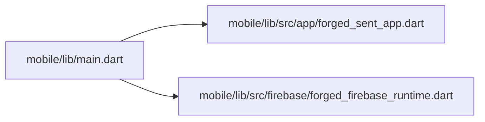

# Flutter code map

> Generated from checked-in Dart files. Do not edit this file manually.
> To refresh: python3 tooling/architecture/generate.py --write
> CI runs the same command with --check to detect drift.

## Actual Dart imports

## Declared classes and functions

### mobile/lib/main.dart

- fn main()

### mobile/lib/src/app/forged_sent_app.dart

- class ForgedSentApp
- fn build()
- class FoundationHomeScreen

### mobile/lib/src/firebase/forged_firebase_runtime.dart

- class ForgedFirebaseRuntime
- fn emulatorRequested()
- fn emulatorHost()
- fn connectEmulators()

## Limitations

This is a lexical source inventory, not a compiler AST or runtime call graph.
It does not discover anonymous callbacks, reflection, dependency injection,
Firebase rules or dynamic dispatch. Use SYSTEM.md for architectural intent
and use Flutter analysis and tests for behavior.
