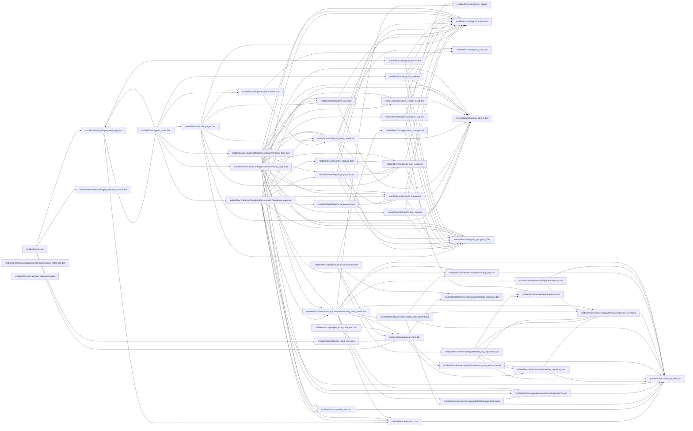

# Flutter code map

> Generated from checked-in Dart files. Do not edit this file manually.
> To refresh: python3 tooling/architecture/generate.py --write
> CI runs the same command with --check to detect drift.

## Actual Dart imports

## Declared classes and functions

### mobile/lib/main.dart

- fn main()
- fn start()

### mobile/lib/src/app/forged_sent_app.dart

- class ForgedSentApp
- class _ForgedSentAppState
- fn initState()
- fn dispose()
- fn build()
- class FoundationHomeScreen

### mobile/lib/src/app/fs_router.dart

- No classes or named methods matched by the simple inventory parser

### mobile/lib/src/app/local_store.dart

- class LocalStore

### mobile/lib/src/app/open_local_store.dart

- fn openLocalStore()

### mobile/lib/src/app/open_local_store_native.dart

- fn openLocalStore()
- fn openLocalStoreIn()

### mobile/lib/src/app/open_local_store_web.dart

- fn openLocalStore()

### mobile/lib/src/app/shell_destinations.dart

- class ShellDestination

### mobile/lib/src/app/tab_pages.dart

- class _ShellPage
- fn build()
- class _PlaceholderCard
- class TabPlaceholderPage

### mobile/lib/src/core/clock.dart

- class SystemClock
- class TodayDate
- fn refresh()
- fn _scheduleMidnight()

### mobile/lib/src/core/date_text.dart

- fn weekdayName()
- fn monthAndDay()
- fn heroDateLine()

### mobile/lib/src/core/event_id.dart

- fn newEventId()

### mobile/lib/src/core/local_date.dart

- class LocalDate
- fn iso()
- fn monthDayKey()
- fn weekday()
- fn dayOfYear()
- fn _two()
- fn compareTo()
- fn hashCode()
- fn toString()

### mobile/lib/src/design/fs_box_row.dart

- class FsBoxRow
- fn build()
- class _Box
- class _CheckPainter
- fn paint()
- fn shouldRepaint()

### mobile/lib/src/design/fs_button.dart

- class FsButton
- fn build()

### mobile/lib/src/design/fs_card.dart

- class FsCard
- fn build()

### mobile/lib/src/design/fs_colors.dart

- class FsColors

### mobile/lib/src/design/fs_hero_header.dart

- class FsHeroAction
- class FsHeroHeader
- fn build()
- class FsReadingHeader
- class FsHeroBackdrop
- class _RidgePainter
- fn paint()
- fn shouldRepaint()
- class _HeroActions
- class _HeroRoundButton

### mobile/lib/src/design/fs_icons.dart

- class FsIconData
- class FsIcon
- fn build()
- class _FsIconPainter
- fn paint()
- fn shouldRepaint()

### mobile/lib/src/design/fs_label_caps.dart

- class FsLabelCaps
- fn build()

### mobile/lib/src/design/fs_page_bar.dart

- class FsPageBar
- fn build()

### mobile/lib/src/design/fs_progress_ring.dart

- class FsProgressRing
- fn build()
- class _RingPainter
- fn paint()
- fn shouldRepaint()

### mobile/lib/src/design/fs_scripture.dart

- class FsScripture
- fn build()

### mobile/lib/src/design/fs_section_head.dart

- class FsSectionHead
- fn build()
- class FsTally
- class FsMeter

### mobile/lib/src/design/fs_segmented.dart

- class FsSegment
- class FsSegmented
- fn build()

### mobile/lib/src/design/fs_shell.dart

- class FsShellDestination
- class FsShell
- fn build()
- class _BrandBar
- class _TabBar
- class _Tab

### mobile/lib/src/design/fs_theme.dart

- No classes or named methods matched by the simple inventory parser

### mobile/lib/src/design/fs_tokens.dart

- No classes or named methods matched by the simple inventory parser

### mobile/lib/src/design/fs_typography.dart

- No classes or named methods matched by the simple inventory parser

### mobile/lib/src/features/devotional/data/devotional_library.dart

- class DevotionalLibrary
- fn load()
- fn length()

### mobile/lib/src/features/devotional/domain/devotional.dart

- fn of()
- class Devotional
- fn readingKeyFor()

### mobile/lib/src/features/devotional/domain/scripture_reference.dart

- No classes or named methods matched by the simple inventory parser

### mobile/lib/src/features/devotional/presentation/devotional_page.dart

- class DevotionalPage
- class _DevotionalPageState
- fn dispose()
- fn _onMetrics()
- fn _onNewDay()
- fn _amen()
- fn _undo()
- fn build()
- class _Section
- class _End
- class _Plain

### mobile/lib/src/features/settings/data/settings_repository.dart

- fn watchShowPreviewPoints()
- fn setShowPreviewPoints()
- class DriftSettingsRepository
- class MemorySettingsRepository

### mobile/lib/src/features/settings/presentation/settings_page.dart

- class SettingsPage
- fn build()

### mobile/lib/src/features/today/data/day_repository.dart

- fn watchDay()
- fn record()

### mobile/lib/src/features/today/data/drift_day_repository.dart

- class DriftDayRepository
- fn durable()
- fn watchDay()
- fn record()
- fn _stateRow()

### mobile/lib/src/features/today/data/memory_day_repository.dart

- class MemoryDayRepository
- fn durable()
- fn watchDay()
- fn record()

### mobile/lib/src/features/today/data/today_content.dart

- class TodayContent
- fn load()
- fn missionFor()

### mobile/lib/src/features/today/domain/completion_event.dart

- class CompletionEvent
- class ItemState
- fn hashCode()
- class DayRecord
- fn isDone()
- fn _sameItems()

### mobile/lib/src/features/today/domain/day_box.dart

- class DayBox
- fn active()
- fn missionLineFor()

### mobile/lib/src/features/today/domain/streak.dart

- class StreakRule
- fn _counts()
- fn length()

### mobile/lib/src/features/today/presentation/today_page.dart

- fn pointsLabel()
- fn streakLine()
- class TodayPage
- fn build()
- class _ProgressPanel
- class _BoxesCard
- fn _row()
- class _LoadingCard
- class _LoadFailedCard

### mobile/lib/src/features/today/presentation/today_view_model.dart

- class BoxView
- class TodayView
- fn total()
- fn doneCount()
- fn devotionalDone()
- class TodayViewModel
- fn build()
- fn retry()
- fn completeDevotional()
- fn undoDevotional()
- fn _record()
- fn setShowPreviewPoints()

### mobile/lib/src/firebase/forged_firebase_runtime.dart

- class ForgedFirebaseRuntime
- fn emulatorRequested()
- fn emulatorHost()
- fn connectEmulators()

### mobile/lib/src/storage/app_database.dart

- class CompletionEvents
- class DayStates
- class AppSettings
- class AppDatabase
- fn schemaVersion()

### mobile/lib/src/storage/app_database.g.dart

- fn aliasedName()
- fn actualTableName()
- class CompletionEventRow
- fn toString()
- fn hashCode()
- class CompletionEventsCompanion
- class DayStateRow
- class DayStatesCompanion
- class AppSettingRow
- class AppSettingsCompanion
- class _

### mobile/lib/src/storage/native_storage.dart

- fn appDataDirectory()
- fn useAppTemporaryDirectoryForSqlite()
- fn loadOrCreateLocalProfileId()
- fn Function()

## Limitations

This is a lexical source inventory, not a compiler AST or runtime call graph.
It does not discover anonymous callbacks, reflection, dependency injection,
Firebase rules or dynamic dispatch. Use SYSTEM.md for architectural intent
and use Flutter analysis and tests for behavior.
