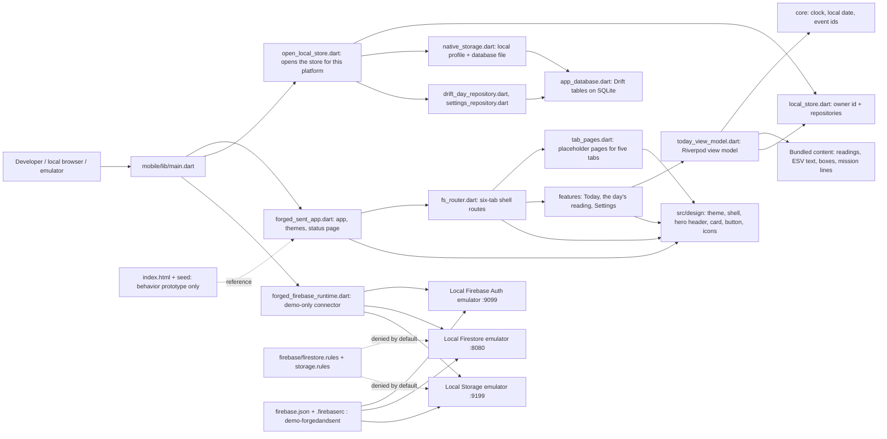
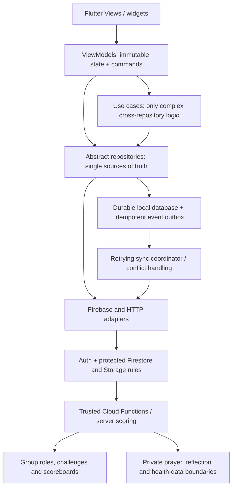
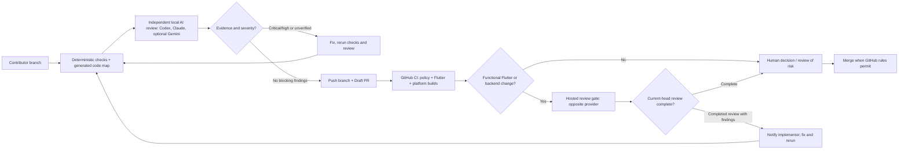

# Forged & Sent system architecture

**Status:** foundation only, not a deployed production system. This page is the architectural source of truth for *intended component boundaries*. [CODE-MAP.md](CODE-MAP.md) is generated from actual Dart source to show implemented file imports and functions.

## What exists today (`main`, since PR #4)

**Implemented:** `main()` selects preview or emulator mode and rejects cloud mode; `ForgedFirebaseRuntime.connectEmulators()` attaches client SDKs to local endpoints and performs anonymous Auth smoke sign-in. `ForgedSentApp` opens the six-tab shell from build step S0: a go_router `StatefulShellRoute` with one stack per tab, drawn by the design system under `mobile/lib/src/design/` in an explicit dark and an explicit light theme, with bundled fonts and the hero photograph. Fuel, Train, Walk, Board and Rally are placeholders. `FoundationHomeScreen` is the developer status page, reached from Settings and shown first when a start-up check fails. Local Firestore and Storage rules allow authenticated developer smoke paths and deny other paths. That smoke permission is **not** suitable for production data.

**Today and the day's reading (build step S1):** `main()` opens the member's local store before the first frame. On a phone that is one SQLite file per owner, through Drift; before sign-in the owner is a local profile made on first launch (decision Q10). Today shows the date, the mission line, a progress ring and the day's boxes; the devotional box opens the day's bundled reading, and Amen records a completion event and the day's state in one transaction. A Riverpod view model combines the day's record, the streak, the bundled content and one setting. Time comes from one injected clock and days are a `LocalDate`, so Today moves to the new day at local midnight and when the app is resumed. The web preview has no database: it keeps the day in memory and says so. Nothing in this path imports a Firebase SDK, and nothing is sent anywhere. Contract: [Today and the day's devotional](../features/today-devotional/feature.md).

**Native hosts:** `mobile/android/` and `mobile/ios/` are committed Flutter 3.47.8 template hosts (`com.forgedandsent`, project `forged_and_sent`). The only customization is the ADR-0002 Android Network Security Configuration: `src/main/res/xml/network_security_config.xml` (referenced from the main manifest) blocks cleartext for all hosts in main, profile and release builds on every supported API level (minSdk 24), and the same-named debug overlay in `mobile/android/app/src/debug/res/xml/` additionally permits cleartext HTTP only to the Android Emulator host alias `10.0.2.2`. They contain no custom native code, added permissions, Firebase native config or signing material; the Dart entrypoint and emulator-first runtime above are unchanged. A local Windows debug APK build passed. iOS has not been built from the committed host. Web and desktop hosts remain temporary and git-ignored.

**Not implemented or validated:** an outbox or any sync of the locally stored events, real group membership, workout features, the private data model, server-authoritative scoring, DEV/PROD deployment, and authenticated role authorization. Nothing the app records leaves the device. Do not infer these from the diagram.

## Planned target architecture (design intent, not present code)

**Direction:** UI depends on view models, view models on repositories (and optional use cases), repositories on data sources. Firebase SDK types stay out of views and domain interfaces. Local durable events precede an offline action being represented as safely saved. All group authorization and score authority are enforced on trusted backends.

**Accepted client stack (partly implemented):** [ADR-0005](ADR-0005-flutter-client-stack.md) selects Riverpod for presentation state and composition, go_router for navigation, and Drift/native SQLite for the durable local event store. All three are in `mobile/pubspec.yaml` at exact versions. go_router drives the tab shell (step S0). Riverpod holds presentation state, and Drift stores the day's completion events in the member's SQLite file (step S1). The planned diagram does not imply working sync.

**ADR set that is not on `main`:** ADR-0001 to ADR-0019 on branch `arch/firebase-reconciliation` (commit `0d21d21`, under `docs/adr/`) are not on `main`. Their numbers collide with `main`'s ADR-0001 to ADR-0005 in this folder, which are different documents, so a number alone does not say which ADR is meant. The [Decisions](../reviews/2026-11-10-prototype-to-flutter/01-DECISIONS.md) page records which of those decisions the maintainer carries forward.

## Engineering and review pipeline

Review agents are **advisory**: their findings are evidence, not human approvals. A tool that wrote a change is not counted as an independent reviewer of that change. Local hooks are bypassable. GitHub `ci-gate` is active; the separate `flutter-ai-review` required-status ruleset is **disabled** while its producer is implemented and tested. Once activated, GitHub rules can require the coordinator's status, but the models still do not approve or merge PRs. Codex reviews use the connected Codex GitHub account; Claude reviews use the maintainer's `CLAUDE_CODE_OAUTH_TOKEN` repository secret. Verified same-repository Dependabot PRs use the Codex route through a trusted default-branch dispatch, bypassing the usual PR-author collaborator check only for that route. The scheduled reconciler has `actions: write` to dispatch a gate run when native Codex evidence appears or a new Dependabot PR head needs its initial run. The trusted publisher job grants `pull-requests: write` for the implementor comment and `statuses: write` for commit statuses. A PR #48 branch-targeted run posted failure handoffs with this scope; clean PASS handoff and final success still need hosted verification. A same-event main-ref dispatch with `issues: write` alone also received HTTP 403, while the branch-targeted run with added PR write posted handoffs. The narrowed PR-write-only scope has not been hosted-tested. For a functional PASS, the publisher first posts `pending`. The notifier posts or deduplicates the handoff, rechecks PR identity, unique head, run ownership and native Codex evidence when applicable, then writes final `success`. A failed handoff or final write leaves an existing pending status in place. If the initial pending write fails, the notifier refuses to finalize; the check may be absent rather than pending. The local publisher API wrapper limits calls to PR/status/evidence reads, handoff comment posts and commit-status posts; it rejects PR review and state-mutation endpoints. Automatic runs use the default-branch workflow. Manual branch-targeted acceptance uses that branch's workflow permissions but checks out publisher code from the default branch, so it cannot host-test unmerged Python changes. The coordinator must bind review evidence to the current PR head and base. Classification errors before review are visible in the workflow status. See [ADR-0004](ADR-0004-hosted-ai-review-gate.md) for trust limits. No model may silently log into cloud Firebase, deploy, push to `main`, approve its own PR, or bypass branch protection.

## Architecture maintenance contract

1. Before adding a new view, domain repository, service, data store, backend boundary or permission model, update **this** page in the same PR, and add an ADR for lasting tradeoffs.
2. Run `python3 tooling/architecture/generate.py --write` after changing `mobile/lib/**`. Commit the generated [CODE-MAP.md](CODE-MAP.md). CI runs `--check` and rejects stale maps.
3. A diagram edge means a dependency only when the arrow corresponds to real source imports; the target-design diagram is explicitly conceptual.
4. Update test coverage and README/START_HERE.md when the developer workflow changes. Never represent emulator smoke checks as production-ready authorization.
5. Reviewers must inspect the diagram against code and flag any disagreement as a finding. Use the [architecture review skill](../../.agents/skills/flutter-architecture-review/SKILL.md).

## Key file entry points

| Role | Source |
|---|---|
| Flutter startup | `mobile/lib/main.dart` |
| App, themes and developer status page | `mobile/lib/src/app/forged_sent_app.dart` |
| Tab shell routes and placeholder pages | `mobile/lib/src/app/fs_router.dart`, `mobile/lib/src/app/shell_destinations.dart`, `mobile/lib/src/app/tab_pages.dart` |
| Today, the day's reading and Settings | `mobile/lib/src/features/today/`, `mobile/lib/src/features/devotional/`, `mobile/lib/src/features/settings/` ([feature contract](../features/today-devotional/feature.md)) |
| Local date, clock and event ids | `mobile/lib/src/core/` |
| Local storage: Drift tables, the local profile, the database file, and the store the app is given | `mobile/lib/src/storage/`, `mobile/lib/src/app/local_store.dart`, `mobile/lib/src/app/open_local_store.dart` |
| Design system: tokens, themes, shell, components, icons | `mobile/lib/src/design/` ([design system page](../design/DESIGN-SYSTEM.md)) |
| Bundled fonts, hero photograph and content | `mobile/assets/` (sources and checksums in `mobile/assets/SOURCES.md`) |
| Local emulator adapter | `mobile/lib/src/firebase/forged_firebase_runtime.dart` |
| Android host (template + network security policy) | `mobile/android/app/build.gradle.kts`, `mobile/android/app/src/main/AndroidManifest.xml`, `mobile/android/app/src/main/res/xml/network_security_config.xml`, `mobile/android/app/src/debug/res/xml/network_security_config.xml` |
| iOS host (template) | `mobile/ios/Runner.xcodeproj/project.pbxproj`, `mobile/ios/Runner/Info.plist` |
| Firebase emulator config | `firebase.json`, `.firebaserc` |
| Rules | `firebase/firestore.rules`, `firebase/storage.rules` |
| Required checks | `.github/workflows/ci-gate.yml` |
| Staged hosted review coordinator | `.github/workflows/flutter-ai-review.yml`, `tooling/review/github_gate.py`, `tooling/review/flutter_scope.py`, `tooling/review/reconcile_codex.py`, `tooling/review/notify_implementor.py` |
| Developer bootstraps | `tooling/windows/**`, `tooling/macos/**`, `tooling/shell/**` |
| Independent reviewers | `tooling/review/**`, `.agents/skills/**`, `.claude/skills/**` |
| Current symbol map | `docs/architecture/CODE-MAP.md` |

## Standards and source references

- Flutter [architecture guide](https://docs.flutter.dev/app-architecture/guide) and [recommendations](https://docs.flutter.dev/app-architecture/recommendations).
- Firebase [Security Rules unit tests](https://firebase.google.com/docs/rules/unit-tests).
- The existing [mobile architecture ADR](ADR-0001-mobile-foundation.md) and [emulator-first ADR](ADR-0002-emulator-first-firebase.md).

## Open this architecture as an interactive website

Use the one-click `launchers/windows/more/Architecture Atlas.cmd` or `launchers/mac/more/Architecture Atlas.command` launcher from a real Git clone. The offline [Architecture Atlas](explorer/README.md) shows clickable current/planned/process diagrams, an every-tracked-file source inventory, detected functions and their source lines, import/reference relationships, reverse dependencies, and the complete checked-in Markdown documents in a safe reader. You can also download the `forged-sent-architecture-atlas` artifact from the latest PR CI run.

`docs/architecture/explorer/model.json` holds curated component/function descriptions. `tooling/architecture/build_explorer.py` reads the actual current repo and generates `build/architecture-explorer/index.html` plus its self-contained assets. Do not confuse lexical file mentions with verified call relationships. The generated site intentionally excludes the huge content bodies of archived prototype versions.
