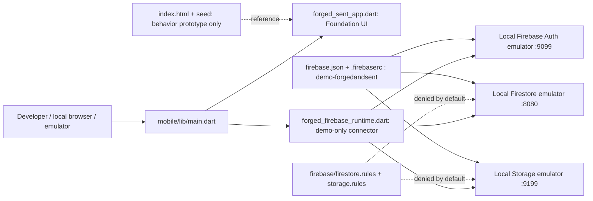
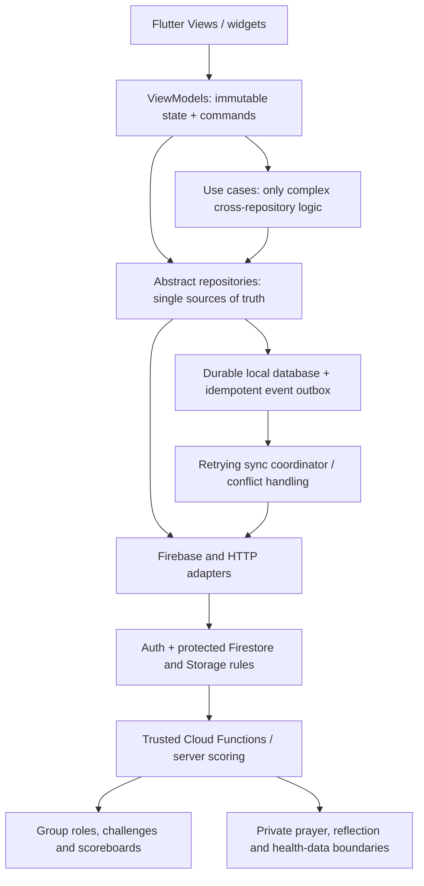
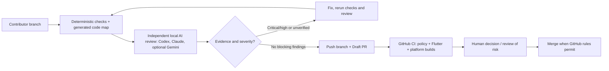

# Forged & Sent system architecture

**Status:** foundation only, not a deployed production system. This page is the architectural source of truth for *intended component boundaries*. [CODE-MAP.md](CODE-MAP.md) is generated from actual Dart source to show implemented file imports and functions.

## What exists today (PR #4)

**Implemented:** `main()` selects preview or emulator mode and rejects cloud mode; `ForgedFirebaseRuntime.connectEmulators()` attaches client SDKs to local endpoints and performs anonymous Auth smoke sign-in. `ForgedSentApp`/`FoundationHomeScreen` show the foundation status. Local Firestore and Storage rules allow authenticated developer smoke paths and deny other paths. That smoke permission is **not** suitable for production data.

**Not implemented or validated:** durable offline outbox, real group membership, actual workout/devotional features, private data model, server-authoritative scoring, DEV/PROD deployment, and authenticated role authorization. Do not infer these from the diagram.

## Planned target architecture (design intent, not present code)

**Direction:** UI depends on view models, view models on repositories (and optional use cases), repositories on data sources. Firebase SDK types stay out of views and domain interfaces. Local durable events precede an offline action being represented as safely saved. All group authorization and score authority are enforced on trusted backends.

## Engineering and review pipeline

Review agents are **advisory**. A tool that wrote a change is not counted as an independent reviewer of that change. Local hooks are bypassable; GitHub `ci-gate` and server rules are the actual automated protections. No model may silently log into cloud Firebase, deploy, push to `main`, approve its own PR, or bypass branch protection.

## Architecture maintenance contract

1. Before adding a new view, domain repository, service, data store, backend boundary or permission model, update **this** page in the same PR, and add an ADR for lasting tradeoffs.
2. Run `python3 tooling/architecture/generate.py --write` after changing `mobile/lib/**`. Commit the generated [CODE-MAP.md](CODE-MAP.md). CI runs `--check` and rejects stale maps.
3. A diagram edge means a dependency only when the arrow corresponds to real source imports; the target-design diagram is explicitly conceptual.
4. Update test coverage and README/START_HERE.md when the developer workflow changes. Never represent emulator smoke checks as production-ready authorization.
5. Reviewers must inspect the diagram against code and flag any disagreement as a finding. Use the [architecture review skill](../../.agents/skills/flutter-architecture-review/SKILL.md).

## Key file entry points

| Role | Source |
|---|---|
| Flutter startup | `mobile/lib/main.dart` |
| Foundation widgets | `mobile/lib/src/app/forged_sent_app.dart` |
| Local emulator adapter | `mobile/lib/src/firebase/forged_firebase_runtime.dart` |
| Firebase emulator config | `firebase.json`, `.firebaserc` |
| Rules | `firebase/firestore.rules`, `firebase/storage.rules` |
| Required checks | `.github/workflows/ci-gate.yml` |
| Developer bootstraps | `tooling/windows/**`, `tooling/macos/**`, `tooling/shell/**` |
| Independent reviewers | `tooling/review/**`, `.agents/skills/**`, `.claude/skills/**` |
| Current symbol map | `docs/architecture/CODE-MAP.md` |

## Standards and source references

- Flutter [architecture guide](https://docs.flutter.dev/app-architecture/guide) and [recommendations](https://docs.flutter.dev/app-architecture/recommendations).
- Firebase [Security Rules unit tests](https://firebase.google.com/docs/rules/unit-tests).
- The existing [mobile architecture ADR](ADR-0001-mobile-foundation.md) and [emulator-first ADR](ADR-0002-emulator-first-firebase.md).

## Open this architecture as an interactive website

Use the one-click `ARCHITECTURE-WINDOWS.cmd` or `ARCHITECTURE-MAC.command` launcher from a real Git clone. The offline [Architecture Atlas](explorer/README.md) shows clickable current/planned/process diagrams, an every-tracked-file source inventory, detected functions and their source lines, import/reference relationships and reverse dependencies. You can also download the `forged-sent-architecture-atlas` artifact from the latest PR CI run.

`docs/architecture/explorer/model.json` holds curated component/function descriptions. `tooling/architecture/build_explorer.py` reads the actual current repo and generates `build/architecture-explorer/index.html` plus its self-contained assets. Do not confuse lexical file mentions with verified call relationships. The generated site intentionally excludes the huge content bodies of archived prototype versions.
