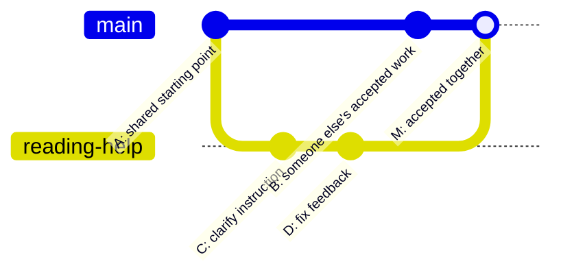

# Forged & Sent Git basics (Windows and Mac)

> [!TIP] The short version
> **Git** records checkpoints. **GitHub** shares them. A **branch** is a named line of work. A **worktree** is the folder where you work on that line.

Part of [Project 101](PROJECT-101.md). A **commit** is a saved checkpoint; a **draft pull request (PR)** is a proposed change for discussion before merging.

| Word | Everyday meaning |
|---|---|
| Repository / repo | Project files plus their history |
| Save | Write your file to disk |
| Stage | Choose the edits for the next checkpoint |
| Commit | Record that checkpoint locally |
| Diff | Show what changed |
| Push | Upload commits to a remote, such as GitHub |
| Fetch | Download remote history without merging into your branch |
| Pull | Fetch and integrate changes; `--ff-only` refuses divergent history |
| Merge | Combine accepted work into a target branch |
| Clone / fork | A local repository copy / a separate hosted repository |

**Save is not commit. Commit is not push. Push is not release.**

## The two-minute picture: leave main, propose, come back

Think of **main** as our shared recipe book. Your branch is where you try one recipe change. A **pull request** asks: “Should this change go into the shared book?” Other services call this a **merge request**; this project uses GitHub's term, **PR**.



**Read left to right.** Dots are commits. The lower line is the task branch. Main can keep moving while we work. The joining point shows the accepted changes combined. This is a teaching example of a merge commit; squash/rebase options can produce a different-looking history. It does not prescribe this repo's merge method.

The PR is **a conversation around the branch's changes**, not another dot and not the branch itself:

**Branch → edit → commit → push → draft PR → checks + feedback → maintainer merges → refresh local main.**

Opening the PR does not change main. Pushing more commits to its source branch updates the same PR. A PR can also close without merging. After a hosted merge, your local main folder stays on its old files until you update it safely.

### Why we do each part

| Step | Why it earns its place | What your friend can do |
|---|---|---|
| One small branch | Keeps unfinished work out of shared main and makes the change understandable | Pick one assigned WORK row |
| Separate worktree | Lets us keep main and the task open in separate folders | Check the folder and branch before editing |
| Commits | Give us named checkpoints and a history of what changed | Read the diff; stage only intended files |
| Draft PR | Puts purpose, diff, discussion and evidence in one place before acceptance | Compare the promise with Files changed |
| CI | Repeats defined checks so we do not depend on memory | Read the failing job and first useful error |
| Independent reviewer | Can notice assumptions the author missed; tests cannot ask every product question | Ask “Does it solve the task? What could break?” |
| Maintainer merge | Makes an explicit decision to put the accepted change into shared main | Report findings; leave that decision to the maintainer |
| Matching docs and WORK row | Keeps the instructions consistent with what people can actually run | Include the explanation in the same change |

> [!IMPORTANT] Our actual review rules
> Review is useful, but a separate human approval is **not required** by this project's documented solo-maintainer policy. Local AI review is advisory and optional; an author cannot independently review its own work. Required `ci-gate` checks still matter. Agents never approve or merge. The hosted Claude review and staged, disabled functional AI gate are different paths. See [AGENTS.md](../../AGENTS.md) and [AI review workflow](AI-REVIEW-WORKFLOW.md); a diagram does not override them.

### A 90-second talk track

1. **Point to A:** “We both start from the same shared version.”
2. **Trace the lower line:** “You improve one instruction on your branch. Main is unaffected. These dots are saved commits.”
3. **Point to B:** “Meanwhile, I can finish another task. Your work does not freeze everyone else's.”
4. **Pause before M:** “You push and open a draft PR. We see exactly what changed. CI repeats checks; a reviewer asks whether the change makes sense. Fixes update this same PR.”
5. **Point to M:** “When the change is acceptable and required checks pass, the maintainer merges it. If edits conflict, we resolve the intended result and check it again first.”
6. **Point to your local folder:** “We refresh local main to get the result. A merge is not an app-store release.”

**Teach-back:** “If you push a branch but nobody merges it, did main change?” **No.** “Does a green check prove the screen makes sense?” **No; run it and inspect it too.**

Optional visual reading: [Git's illustrated branching and merging chapter](https://git-scm.com/book/en/v2/Git-Branching-Basic-Branching-and-Merging) and [GitHub's branch-and-PR flow](https://docs.github.com/en/get-started/using-github/github-flow). The project rules above take precedence over generic tutorials.

If you're new to development, use **[FIRST-CONTRIBUTION.md](FIRST-CONTRIBUTION.md)**. It walks through VS Code Source Control on either operating system; no special terminal aliases are needed.

## Open or refresh the repo

Start with `git status` and `git worktree list`. In the checkout that already owns **main**, and after checking local changes, use `git pull --ff-only`. In a task worktree, `git fetch origin` updates remote references without switching your files. Do not try to switch a second worktree to main when another folder already owns it.

In a single clone with no other worktree owning main, `git switch main` returns to main when Git can preserve your local changes. Then `git pull --ff-only` updates it. Never discard edits to make switching work.

If you have no clone, first `git clone https://github.com/Forged-Sent/ForgedAndSentFitness.git`. Never discard uncommitted changes to make branch switching work. If Git says "diverged", "conflict", or "detached HEAD", read the diagnostics or ask an assistant before proceeding.

## Branches and worktrees: one history, several workbenches

A branch does not make a second folder. Switching branches changes the tracked files in the current folder. A linked worktree provides another folder with its own files and staging area while sharing Git history. Normally each branch is checked out in only one worktree. Uncommitted edits stay in their own folder; they do not automatically appear elsewhere.

**Example for a new task**, from an existing repo root. Choose an unused branch and folder name:

```sh
git status
git fetch origin
git worktree add -b docs/my-first-help ../ForgedAndSentFitness-my-first-help origin/main
cd ../ForgedAndSentFitness-my-first-help
git status
```

**Expect:** a new folder on `docs/my-first-help`. Open **that folder** in VS Code and your agent. Your main folder stays on main. Two worktrees may still share ports and external services; run only the intended app/backend instance.

**Testing an open PR without disturbing your work:** replace `42` with the actual PR number and choose unused names:

```sh
git fetch origin pull/42/head:review/pr-42
git worktree add ../ForgedAndSentFitness-pr-42 review/pr-42
```

Open that folder and inspect the diff before running code. This is separate from normal onboarding. After finishing, preserve needed changes and use `git worktree remove` on the clean test worktree from another folder; do not force-remove work or delete folders at random.

Source: [Git worktree documentation](https://git-scm.com/docs/git-worktree).

## Save a change

A fresh Git install needs a commit identity. From your own clone, choose a display name and email:

```sh
git config --local user.name "Your Name"
git config --local user.email "your-github-noreply-email"
```

You can find your GitHub noreply address in GitHub email settings. This identity is recorded publicly in commits, so do **not** enter private credentials; a personal email is optional. The wizard can help with this step.

Use VS Code Source Control to create a branch, inspect a diff, stage files, commit, and publish. GitHub Pull Requests can open a **Draft** PR. `ci-gate` must pass. External human/AI approval is not mandatory for this solo-maintainer project.

Windows PowerShell users also have `fs-start`, `fs-save`, `fs-sync`, `fs-share`, `fs-status`, `fs-undo` and `fs-help` in the project VS Code terminal. Mac users use the same GUI workflow rather than trying Windows-only aliases.

> [!NOTE] Know what a shortcut does
> `fs-save "message"` stages **all changes** and commits after its checks. Inspect `git status` and `git diff` first. `fs-share` runs checks, **pushes** the branch and opens a draft PR. It is not a local-save button. For a partial commit, stage selected files in VS Code instead.

## A small change, end to end

In your task branch, edit one assigned documentation sentence. Inspect and stage just that file:

```sh
git diff
git add docs/development/PROJECT-101.md
git diff --staged
git commit -m "docs: clarify the first-run lesson"
```

Replace the file and message with your real change. Run its relevant checks first. To share as a human contributor with repository access, use **Publish Branch** in VS Code and create a draft PR. Inspect the PR's **Files changed** and **Checks** tabs. New commits update the PR and rerun applicable checks.

A conflict means Git needs help combining edits. Preserve the work, read both changes and ask the maintainer if intent is unclear. Do not choose “ours/theirs” blindly. The maintainer owns the merge decision under current project rules.

To publish directly to `Forged-Sent`, request repository write access. Otherwise create a fork, publish to your fork and open a PR back to `Forged-Sent:main`.

Never push directly to `main`. Never share tokens, passwords or production data with AI.
