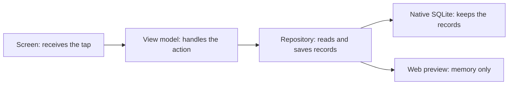

# Forged & Sent 101

> [!TIP] Start here. One step at a time.
> **Goal:** run the app, explain one saved action, and help with one small change.
> **Time:** 25 minutes on an already-set-up computer. First-time installation is separate.
> **Keep open:** this page, [run commands](RUN-COMMANDS.md), and VS Code.

## The 25-minute route

| Time | Do | You are done when… |
|---|---|---|
| 0–3 min | Read “What we are building” below | You can separate the prototype from Flutter |
| 3–10 min | Open [run commands](RUN-COMMANDS.md) and run browser preview | You can open the reading and stop the app yourself |
| 10–14 min | Follow “What Amen does” below | You know where the record lives |
| 14–18 min | Open [Git 101](GIT-101.md) | You can explain branch versus worktree |
| 18–22 min | Read “Helping with a task” below | You can give an agent a bounded request |
| 22–25 min | Open [the Obsidian guide](OBSIDIAN-101.md) | You can find the work row, decision and next action |

**Short on time?** Do browser preview, Git basics and the first review prompt. Android and Firebase are the second lesson.

## 1. What we are building

**The goal:** a faith-centered fitness and accountability app for adult men's groups. Daily devotionals, training and encouragement belong together. Private reflections and health information must stay private.

**Three different things live here:**

| Thing | Think of it as | Where |
|---|---|---|
| HTML prototype | A model of the product's behavior and appearance | Root `index.html`, `seed/`, historical `versions/` |
| Flutter app | The actual Android/iOS client being built | `mobile/` |
| Developer workspace | The workshop: docs, checks, setup and review tools | `docs/`, `tooling/`, `.github/` |

> [!NOTE] Built versus planned
> The reviewed baseline has the six-tab shell, Today, devotional reading, limited Settings and durable native devotional saves. Five tabs are placeholders. Workouts, journal, real groups, cloud sync and server scoring are future slices on this baseline.
> Before teaching a later revision, open [Prototype parity](../knowledge/PROTOTYPE-PARITY.md) and [WORK](../knowledge/WORK.md). Work on another branch is not automatically in your folder.

## 2. Run it yourself

Go to [Run commands](RUN-COMMANDS.md). Start with **A: browser preview**.

**Try:** open Today, open the devotional, scroll to its end, tap Amen, then return to Today. Try Undo. The other boxes are intentionally inactive.

**Say back:** “In Chrome this is a preview. Refreshing can lose its in-memory state. Testing a save across a restart needs the native app.”

## 3. What Amen does

Architecture means giving each part one clear job:



1. The **screen** is the front desk. It displays the reading and accepts the tap.
2. The **view model** is the coordinator. It checks the day and creates a completion event.
3. The **repository** is the records clerk. It writes the event and the day's state together.
4. **Drift/SQLite** is the filing cabinet on a native device. It keeps the result after the app closes.

Nothing in this devotional path syncs to the cloud yet. Firebase's local practice services are a separate connection check.

| Name | Its job here |
|---|---|
| Flutter / Dart | Build the interface / write its behavior |
| Riverpod | Keep screen state and dependencies connected |
| go_router | Move between screens and tab stacks |
| Drift / SQLite | Access and store native local records |
| Firebase emulators | Run practice Auth, Firestore and Storage locally |
| Git / GitHub | Record versions / share proposed changes |
| GitHub Actions | Run repeatable checks on changes |
| Obsidian | Read and edit the project's Markdown notes |

For deeper questions: [system architecture](../architecture/SYSTEM.md). The [Architecture Atlas](../architecture/explorer/README.md) is a clickable reference, not required reading before your first run.

## 4. Decisions already made

| Decision | What it means for your task |
|---|---|
| Flutter for Android and iOS | Do not start a React Native or Capacitor replacement |
| Riverpod, go_router, Drift | Use the selected stack rather than adding a competing one |
| Local durability before sync | A web refresh is not the acceptance test for native saving |
| Emulator-first development | No production Firebase credentials needed for this lesson |
| Private data stays private | Do not put prayers, reflections or body data into shared group queries |
| Trusted backend will own group access and scoring | Prototype point totals are not production authority |
| Small vertical slices | Finish one user action with evidence before expanding scope |

The detailed [Decisions page](../reviews/2026-11-10-prototype-to-flutter/01-DECISIONS.md) records product answers. [ADRs](../architecture/SYSTEM.md#planned-target-architecture-design-intent-not-present-code) record architecture choices. **An accepted direction can still need implementation.** For example, proposed agent merge permissions are pending policy work; current `AGENTS.md` still prohibits agent merges.

## 5. Helping with a task

**Choose one lane:**

| You can help by… | A small first task |
|---|---|
| Testing | Reproduce a confusing screen and record exact steps |
| Improving docs | Clarify one instruction you could not follow |
| Reviewing | Compare a PR's promise with its diff and test evidence |
| Building with an agent | Implement one agreed, bounded change on its own branch |

### The whole loop

1. **Pick:** find the assigned row in [WORK](../knowledge/WORK.md). Read its next action and linked prompt.
2. **Prepare:** use your own branch/worktree. Check `git status`. Open that folder in VS Code and the coding agent.
3. **Describe:** say what should change, allowed files, what must remain true and how you will check it.
4. **Build:** one writer handles that task. You can run the app and inspect the result yourself.
5. **Check:** run the relevant commands in [Run commands](RUN-COMMANDS.md#e-check-a-change). Capture failures rather than guessing.
6. **Review:** for an optional second opinion, ask an eligible non-author reviewer to inspect the exact change. Review is advice, not a merge permission.
7. **Share:** inspect the diff, commit, publish the feature branch and open a draft PR. [First contribution](FIRST-CONTRIBUTION.md) gives the VS Code clicks.
8. **Finish:** the PR includes the relevant work-row/doc updates, regenerated board views and test evidence. The maintainer decides when to merge. Refresh the main dashboard afterward.

**CI** means continuous integration: the computer checks that the proposed change still fits. This repo's `ci-gate` collects policy, documentation and applicable app/platform/rules checks. Some jobs skip when their paths are unaffected. Green checks do not mean store release, complete features or physical-device testing.

**Why all these steps?** Open the [two-minute Git picture and talk track](GIT-101.md#the-two-minute-picture-leave-main-propose-come-back). It follows one change away from main and back, and explains why the PR, reviewer and checks each help.

### The agents, without the mystery

| Role | What it does | What it does not prove |
|---|---|---|
| Builder, usually Claude Code under the recorded run settings | Reads the task, changes files, runs checks | That its own review is independent |
| Reviewer, usually Codex when Claude wrote the change | Checks the exact diff and reports evidence | That a comment approves or merges the PR |
| Coordinator, only when you ask for coordinated work | Splits a larger task and keeps ownership clear | That several agents may edit the same files safely |
| You and the maintainer | Define the outcome, inspect behavior, decide scope and acceptance | That an agent's “done” substitutes for evidence |

If Codex writes, use an eligible Claude reviewer. Follow actual tool availability and the repo's review rules. Model names, subscriptions and installed integrations vary; this guide does not assume a particular paid tier. Copilot/Gemini rule files do not prove those services are enabled.

`AGENTS.md` supplies shared rules. Claude's `CLAUDE.md` imports them. A **skill** is a reusable task recipe. **MCP** is a connector to a tool or documentation source. A chat inside Obsidian is optional and is not configured by these notes.

### Copy a prompt

**Understand first, without edits:**

```text
Read AGENTS.md and my assigned row in docs/knowledge/WORK.md.
Task: [row name]. Explain the goal in five plain-language bullets.
Verify the branch and current implementation. Identify relevant files,
decisions and checks. Make no edits. Separate facts from proposals.
```

**Build one small thing:**

```text
In this task worktree, implement [specific outcome].
Read AGENTS.md, the WORK row [name], and its linked contract first.
Scope: [allowed files or feature]. Preserve [important behavior].
Done means: [visible result] and [specific checks].
Use one writer. Ask about unresolved product decisions.
Keep the matching docs and work row accurate in this change.
Do not push, merge, deploy or install additional tools.
Finish with changed files, checks actually run and NOT VERIFIED items.
```

**Review someone else's change:**

```text
Read-only review of [branch/PR and exact commit]. Compare it with [task].
Report only actionable findings with file/line, impact and evidence.
Check current-versus-planned claims, tests and documentation too.
Do not edit or submit comments. State what you could not verify.
```

**When something fails:**

```text
I ran [exact command] from [folder] on [branch and commit].
Expected: [result]. Actual: [result]. Error: [first relevant error].
Diagnose before editing. Explain the cause and smallest proposed fix.
Do not include credentials or personal data in the report.
```

## 6. Your first useful check

> [!TIP] Ten-minute contribution, no coding required
> Run the preview. Find one confusing label or instruction. Write the steps to reproduce it, expected result, actual result, OS, branch and commit. Add a screenshot using synthetic data. Ask the maintainer which work row it belongs to.

**Teach-back:** explain Save versus Commit versus Push; branch versus worktree; Android emulator versus Firebase emulator; local save versus cloud sync; a green check versus a release.

## Freshness and evidence

The app facts in this course were reconciled against fetched `origin/main` at `9177cb79bda31e576f3c037ba0a63ee693838cad` on 2026-11-13. The Obsidian instructions also cover the generated board tooling included with this course. The command recipes were checked against scripts and official CLI docs, not all launched on every platform during this documentation update.

Before each lesson: `git status`, `git log -1 --oneline`, check the current [parity table](../knowledge/PROTOTYPE-PARITY.md), then refresh [live status](OBSIDIAN-101.md#refresh-without-copying-status-by-hand). Use the current [SDK pin](../../tooling/versions.json). Historical notes and other branches are evidence of earlier/proposed work, not current behavior. [Flutter CLI reference](https://docs.flutter.dev/reference/flutter-cli).
