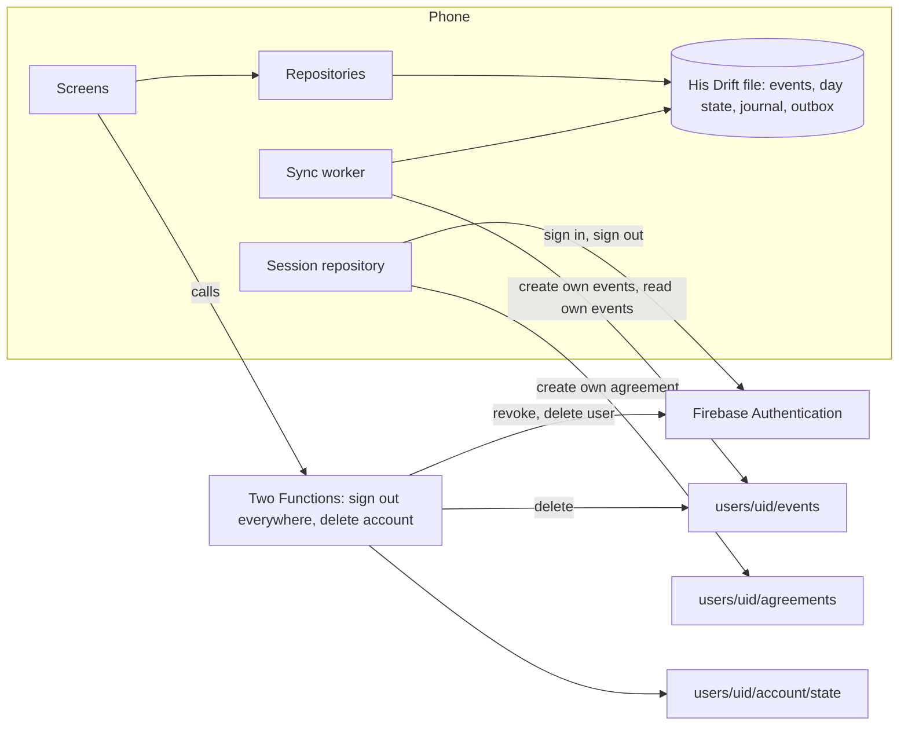

# S4a design: sign-in, his own data on his account, sign-out, account deletion

Design for [FNS-005](requirements.md). **Proposed, not approved, and not built.** The canonical metadata, the decisions and the open items (O1 to O5) are on the [requirements page](requirements.md). Work order and tests are in [tasks](tasks.md).

Everything below is a proposal unless it says "decided". Paths, field names and Function names are proposals for the implementing pull requests to confirm or change in review; the boundaries they express are the contract.

## Trust boundaries

- The phone is trusted for one thing: to say what its own owner tapped.
- Rules are the only guard between a client and Firestore. The two Functions use the Admin SDK, so rules do not protect against a mistake in them; their own checks are listed below and tested.
- No Function reads the content of an event in S4a. Nothing is scored.
- The journal, fasting and body data stay inside the phone box in this diagram. The sync worker reads the events table and no other.

## Sign-in and the session

All of this section is **proposed**. It follows the [sign-in design](../../design/sign-in.md), which the maintainer has said to treat as not yet approved by him.

- **Providers.** Firebase Authentication with Apple, Google, and email and password. The 18+ terms checkbox is in front of all three. No app lock: once signed in, he stays signed in on that phone until he signs out.
- **Email accounts.** Email is the user id. A verification link is sent on sign-up. Minimum 8 characters and a common-password check. "Forgot password" by email. Nothing in S4a waits for the email to be verified; whether joining a group needs it is parked with S4b.
- **Recent sign-in** is required before account deletion or a password change.
- **Where the Firebase types stop.** A `SessionRepository` in application code exposes "signed out", "signed in as (uid, display name)", sign-in and sign-out. Only its Firebase adapter imports the Auth SDK. Screens and view models never do (`AGENTS.md`, working agreement 5).
- **Agreement.** `users/{uid}/agreements/{version}` is created by the owner, once per version, with the server's time. He can read it. Nobody can change it. A new version prompts again. The text is a marked placeholder in S4a (O5).
- **Settings › Sign-in & security** shows: the sign-in method, Change password (email accounts only), the agreement he accepted, Sign out of this phone, Sign out and erase this phone, Sign out everywhere, Delete account. It has no list of devices: per-device sign-out is decided later (decided 2026-11-19).

## The signed-out profile and adoption

Decided: Q10 (a man may use the app before signing in, and the local profile is adopted at first sign-in). Decided 2026-11-19: when the account and the phone both have days, keep both and never ask about any of them. Decided 2026-11-19: when a man signs in on a phone whose signed-out profile holds something, he is asked once, "Are these yours?". "No" leaves that data untouched as a signed-out profile; it is never deleted and never merged.

Proposed:

- **One signed-out profile per phone.** It is the local profile S1 already makes: its own database file, shown whenever nobody is signed in. Signing in never destroys it.
- **It is open to whoever holds the phone.** No sign-in protects it. That is Q10, and it is unchanged.
- **"Holds something"** means it has at least one thing a man entered: a completion event, a journal entry, or a row of any other table of his that is on `main` when this is built. Settings alone do not count.

At a successful sign-in:

1. **The account's file is opened**, or made if this is his first sign-in on this phone.
2. **If the signed-out profile holds nothing**, he is asked nothing and nothing moves.
3. **If it holds something, he is asked once: "Are these yours?"** The question says how much there is (so many days, so many journal entries) and shows none of it.
   - **Yes.** Everything in the signed-out profile moves into his account's file, by the three steps below. The signed-out profile is left empty. His days are put in the outbox. The journal moves on the phone and is not sent (Q8).
   - **No.** Nothing moves and nothing is deleted. The data stays in the signed-out profile exactly as it was, and is there again when nobody is signed in. While he is signed in, no screen, query or repository reaches it.
   - Closing the question without answering is No.
   - He is not asked again about the same data. After a No, the app asks that account again only when the signed-out profile holds something made after his answer (O4).
4. **If his account already has events on the server**, they are downloaded (below) and stored beside the phone's own. Rule R2 gives each box its state. He is not asked about any box.

**The move, after Yes.** Two files cannot share one transaction, so the move has three steps, each safe to repeat:

1. Write into the signed-out profile's file that it is being moved to this uid. From now on no other account can take it.
2. In one transaction on the account's file, copy every row across and record that this profile was moved. Events are inserted if their id is absent and put in the outbox. Event ids do not change, so sending them is idempotent.
3. Empty the signed-out profile.

On every start, before any sign-in is offered, the app finishes a move that was interrupted: a profile marked for a uid is copied into that uid's file if the record of the move is missing, and then emptied. Nothing is dropped silently: for each table that is on `main` when this is built, the implementing pull request says how its rows move and tests it, and stops to ask if a table cannot be moved without a choice.

- Sign-in that fails or is cancelled asks nothing and moves nothing.
- The question prevents an accident, not a theft. A man who answers Yes to data that is not his takes it. He could already read it: a signed-out profile is open to whoever holds the phone.

## His events on his account

Decided: completion events are sent once; the document id equals the event id; events are create-only (P08; journey J4; option A for the key).

Proposed:

- **What is sent.** One document per completion event at `users/{uid}/events/{eventId}` with exactly these fields: `id` (equal to the document id; a UUID in lowercase, as S1 already makes them), `owner` (equal to the uid), `localDate`, `item`, `done`, `tappedAtUtc`, `utcOffsetMinutes`, `replaces` (an event id or null), `chainLength`, `schema`, and `receivedAt`, which the rules require to equal the server's time. Nothing else is accepted: no text, no note, no points.
- **Why under `users/{uid}`.** An event is the man's own fact. Under his own path, no query by anyone else can return it. When groups exist (S4b) it still must not move under a group path.
- **The outbox is in Drift.** Each event row has a **send state**: pending, uploaded, refused (with the reason) or blocked. It is written in the same transaction as the event. The Firestore SDK's own offline queue is not relied on to remember anything (`AGENTS.md`: Firebase's cache alone is not durable enough). Proposed: the SDK's offline persistence is turned off, so nothing of his is stored on the phone outside his file.
- **Uploaded means the server holds the event.** It does not mean scored. There is no "accepted" or "counted" state in S4a, because nothing on the server looks at the event.
- **Sending.** The sync worker runs when the app starts, when the network returns and after each new event. For each pending event, oldest first, it creates the document. **An event is sent only after the event it replaces is uploaded**, so the server never holds an event whose chain it cannot hold. Then:
  - created: mark uploaded;
  - denied: a create-only rule denies a replay in the same way as any other denial, so the phone cannot tell which it was from the error. It reads that id back from his own path, **from the server and never from a cache**. If a document is there and the fields the phone wrote equal the local event's, mark uploaded. `receivedAt` is left out of the comparison: the server sets it, and a replay's time differs from the first attempt's. If a document is there and differs, mark refused with "id in use" and report it, since that can only be a defect. If the server answers that no document is there, the create itself was refused: mark refused with the denial and do not retry unchanged;
  - no answer, to the create or to the read-back: leave the event pending and try again later, with a growing wait. An event is never marked uploaded or refused without an answer from the server.
- **A refused event blocks what follows it.** Every later event for that box on that day that replaces it, directly or through others, is marked blocked and is not sent: another device could never confirm it under R2. A refusal should not happen with an honest client and correct rules, so it is reported as a defect. The box on this phone is still right. His other devices do not see the blocked taps, and the app says so: in Settings, and in the warning before "Sign out and erase this phone", which counts blocked events with unsent ones.
- **Send-once in what sense.** The network may deliver a create more than once. The event exists once, because its id is its key.
- **Who is asked to wait.** Nobody. The box is checked from the local transaction, as in S1.

### A second device

- **Download.** Three steps, so that no event is missed for good. Receiving an event it already holds changes nothing. A downloaded event is stored with send state uploaded.
  1. *The usual path.* A device asks for its owner's events with `receivedAt` later than the newest it has stored, less an overlap of a few minutes, because two creates can be committed in a different order from their times. This is fast and is not complete on its own.
  2. *A missing event is fetched by its id.* A provisional event names the event it waits for. After each download the device reads each such id directly. This repairs exactly the case that would leave a tap uncounted.
  3. *A full pass.* At each sign-in on a device, and then at most once a week, the device reads all of his events and stores any it lacks. This catches an event the usual path skipped and nothing else pointed to.
- **Day state is worked out on each device.** Whenever events are stored, from a tap or from a download, the device works out the state of each affected (owner, date, item) with rule R2, in the same transaction, and writes the day state row S1 already has. R2 depends only on the events held, so two devices holding the same events show the same boxes with no server step.
- **The three states** of R2 (confirmed, provisional, rejected) are worked out on the phone as the [architecture page](../../reviews/2026-11-10-prototype-to-flutter/07-ARCHITECTURE.md) defines them. A provisional event waits for its missing event to be downloaded. A rejected event is kept and counts for nothing.
- **Migration.** The event table gains `chainLength`. The migration fills it for existing rows by following the replacement links within each owner, date and item, not from S1's counter.
- **The server does not check chain lengths in S4a.** A false one harms only the sender's own boxes, and every device rejects it. S4b's scoring must run the same check before it gives credit.

## Firestore rules as a table

"Own" means the uid in the path equals `request.auth.uid`. "Function" is not governed by rules; the column says what it does. Anything not in this table is denied to every client.

Every "Own" row also requires both of these, read from `users/{uid}/account/state` in one document read: the session began after the last "Sign out everywhere", and the account is not being deleted.

- **When a session began** is the token's `auth_time`, the moment he signed in. It does not change when a token is refreshed, so a phone that refreshes its token after the cutoff is still refused. Times are whole seconds: a session passes only if it began in a later second than the cutoff. A sign-in in the same second is refused, and he signs in again.
- **A missing state document** means there has been no "Sign out everywhere" and no deletion: the request is judged on the rest of its row. Nothing has to be created when an account is made.
- **The smoke path** exists today for the emulator check, and the tests assert it on its own. In S4a its rule gains the same two conditions as every "Own" row, and account deletion removes what is under it, so nothing of his is left there. Before any ruleset is used with a cloud project the path is removed, and a test asserts that it is then denied.

| Resource | Actor | Read | Write (create or update) | Delete |
|---|---|---|---|---|
| `users/{uid}/events/{eventId}` | Signed-out | No | No | No |
| | Own | Yes | Create only, when the document id equals `id` and is a lowercase UUID, `owner` equals the uid, the fields are exactly the allowed ones with the right types and bounded lengths, and `receivedAt` is the server's time. Never update | No |
| | Any other signed-in man | No | No | No |
| | Function | Never reads the content | Never | Only in account deletion |
| `users/{uid}/agreements/{version}` | Own | Yes | Create only, with the server's time. Never update | No |
| | Anyone else, signed in or not | No | No | No |
| | Function | No | No | Only in account deletion |
| `users/{uid}/account/state` | Own | Yes | No | No |
| | Anyone else, signed in or not | No | No | No |
| | Function | Reads | Writes: the time of "Sign out everywhere"; the deletion marker | Removes the marker after deletion (below) |
| `groups/**` and every other path, and all of Storage | Any client | No | No | No |
| Collection-group queries over any of the above | Any client | No | | |
| `developer_smoke/{uid}/**` (exists today, emulator only) | Own | Yes | Yes | Yes |
| | Function | No | No | Only in account deletion |

Each request reads at most one extra document (`account/state`).

## Sign-out and account switching: what stays on the device

Decided: a second account on the same phone sees none of the first account's data (build plan S4). Decided 2026-11-19: at sign-out his file is kept, locked to his account, and there is a separate "Sign out and erase this phone".

Proposed:

- **Sign out of this phone.** In this order: stop the sync worker and cancel every listener; close his database file; throw away every provider that held his data (architecture 5.7); sign out of Firebase Authentication. No read or write is made as the wrong user.
- **Locked to his account** means: the file is tied to his uid, and the app opens it only after a successful sign-in as that uid. No screen, query or repository can reach it otherwise. It is not encrypted (Q8 leaves that for later), and the requirements page says so under the cases that are not stopped.
- **Unsent events at sign-out** stay in his file. He is told how many before he signs out, and they are sent at his next sign-in (O3).
- **After sign-out** the app shows the phone's signed-out profile, which can be used without signing in (O3, Q10). It is empty, or holds what a "No" left there. Signing in as another account opens that account's file or makes a new one. No query can reach across files.
- **Sign out and erase this phone.** He is told what will be lost: any unsent or blocked days, and his journal, which exists nowhere else. It works without a network. After he confirms, the erase is done so that it finishes even if the app is killed halfway:
  1. Write an **erase record** for his uid in a small file outside his database, and flush it to disk. From this moment the app treats his file as gone.
  2. Stop the sync worker, cancel every listener, close his file, and throw away every provider that held his data.
  3. Sign out of Firebase Authentication.
  4. Delete his database file and its side files.
  5. Remove the erase record.

  **On every start, before anything else**, the app looks for an erase record: before a session is restored, before any account's file is opened, and before sync starts. If there is one, it runs steps 2 to 5 again; each is safe to repeat. So a kill at any point ends the same way: no file, no session, and nothing downloaded into a new file. If the file cannot be deleted, the record stays, his file is never opened, and the app says so and tries again at the next start.
- **Erasing the phone does not delete his account.** Days already sent stay on his account and come back if he signs in again. The journal and any unsent days do not.
- **Sign out everywhere.** A Function, called by the signed-in man, writes the current time to `users/{uid}/account/state` as the cutoff and then revokes his refresh tokens. The rules compare the moment each request's session began with the cutoff, so his other phones are refused at once, not after their tokens run out, and a token refreshed between the two steps does not get through. Both Functions make the same comparison themselves and check that the token is not revoked, because rules do not apply to them. The phone he used signs out as above. Each other phone shows the signed-out state when it next reaches the server; its file stays, locked. It needs a network; "Sign out of this phone" does not.

| On the phone | Sign out of this phone | Sign out and erase this phone |
|---|---|---|
| His database file (events, day state, journal) | Kept, closed; opened again only when he signs in to the same account | Deleted |
| Unsent events | Kept in his file; sent at his next sign-in | Lost, after a warning that names them |
| Anything of his in memory | Thrown away | Thrown away |
| What the app shows next | The phone's signed-out profile | The phone's signed-out profile |

## Account deletion

Decided 2026-11-19: account deletion is part of S4a. Finding L4 asks for one server-side deletion routine with a test that lists every owned path.

Proposed: a request the man makes, and a worker that needs no client.

**The request**, a Function called by the signed-in man:

1. **Checks.** He is signed in; his session began after the last "Sign out everywhere"; his token has not been revoked; he signed in within the last few minutes (the sign-in design's "recent sign-in"; proposed: five). Otherwise the app asks him to sign in again first.
2. **Close the door and record the request.** Write the deletion marker to `users/{uid}/account/state`: that deletion was requested, when, and how far it has got. From this moment the rules refuse every read and write by any phone of his, whatever token it holds. The marker is the durable record of the request; everything after this step works from it.

**The worker**, a Function started by the marker and also run by a scheduled sweep. It uses no token of his and needs no second request, so it can finish a deletion that was interrupted at any point:

3. **Revoke** his refresh tokens.
4. **Delete** every document under `users/{uid}`, subcollections included, **except `account/state`**, and everything under `developer_smoke/{uid}` where that path exists. Deleting a document does not delete its subcollections, so the routine walks them. The list of paths is the rules table's, and the test fails if the table gains a path the routine does not know. The marker records that the data is gone.
5. **Delete the Firebase Authentication user.** The marker records it.
6. **Remove the marker** once no token issued before the request can still be valid (proposed: two hours after step 5). Until then the marker holds a uid, the times and the progress, and nothing else of his.

- Each step is safe to repeat. The sweep picks up any marker whose deletion is not finished and carries on from the step it records.
- The marker stays in place from step 2 to step 6. That is what stops a phone with a still-valid token from writing an event after the data has been deleted.

**His file on the phone where he deletes** (decided 2026-11-19): he is warned, then his file on that phone is erased. The warning says that his journal is in that file and exists nowhere else. No export is offered: the app has none, and S4a does not add one.

1. An erase record is written for his uid, marked "waiting for the server", before the request is sent.
2. The request is sent. When the server answers that it has recorded the deletion, the mark is taken off and the erase runs as in "Sign out and erase this phone".
3. If the server refuses, or cannot be reached, the record is removed and nothing on the phone changes.
4. On a start that finds a record still marked "waiting for the server", the app asks the server whether his account is being deleted or is gone. Yes: the erase runs. No: the record is removed and nothing is erased. No answer: his file stays closed and the app asks again later.

**His other phones** are not erased. Their files stay closed, and can no longer be opened because the account is gone. Removing the app removes them. S4a adds no other way (O1).

- Neither Function reads the content of what it deletes.

## The earlier draft's six review findings

One contract for the whole of S4 was drafted and reviewed on 2026-11-19, and never published. Its second review left six findings. Each is dealt with here or carried to S4b, where it applies.

| # | Finding | What happened to it |
|---|---|---|
| 1 | High. Standings documents carried each man's ledger revision, so a peer could see that he had done something private | S4a has no standings and no document another man can read. Carried to the [S4b stub](../groups-teams-board/requirements.md) as a constraint: revisions live in server-only data |
| 2 | High. Standings were not tied to the roster they were computed from | S4a has no roster. Carried to the S4b stub as a constraint |
| 3 | High. A removed member, offline, could be shown cached standings | S4a has no board. Proposed here: the Firestore SDK's cache is turned off, so nothing is shown from it. Carried to the S4b stub as a constraint: membership is confirmed by the server before any board data is shown |
| 4 | Medium. The read-back after a denied create had to be a server read, and an unanswered read-back had to leave the event pending | Fixed, under "Sending" above and in the tests |
| 5 | Medium. "Accepted" was written before scoring committed, and the phone had no state for it | Fixed for S4a by removing it: the phone's states are pending, uploaded, refused and blocked, and nothing on the server marks an event. Carried to the S4b stub: "counted" is written only after scoring commits, and the phone has a name for every value the server can write |
| 6 | Low. The board row "Say which unreplaced completion event wins" still said "before P08 runs" | Fixed: the row is rewritten in the same pull request as this contract |

## Options considered

| Question | Chosen in this draft | Other option | Why |
|---|---|---|---|
| Where events live | Under `users/{uid}` | Under a group path | An event is his own fact, and for the devotional it is his faith participation |
| How a denied create that was a replay is told from a real refusal | Read the id back from the server and compare the fields | Allow an update that changes nothing | Keeps the rule strictly create-only, as P08 words it |
| Where day state is worked out | On each device, with R2 | On the server | R2 needs only the events. A server step would add a Function that reads his events, with nothing to score yet |
| How a second device finds new events | A server time on each event and a cursor with an overlap | Listen to the whole collection | The collection grows every day; the cursor reads only what is new |
| The Firestore SDK's offline cache | Off | On, cleared at sign-out | The outbox is in Drift. With the cache off, nothing of his is on the phone outside his file |
| How "Sign out everywhere" takes effect | A stored time the rules compare with the token | Revoking tokens only | A token already issued stays valid for up to an hour after revocation |
| His file at sign-out | Kept, locked (decided 2026-11-19) | Erased | The journal exists nowhere else (Q8) |

## Not verified in this design

- No rule, Function or app code exists. The rules table has not been written as rules or run against the emulator.
- The cursor's overlap is a design choice, not a measured one.
- How the common-password check is done was not designed.
- Whether a scheduled sweep can be exercised in the emulator the way step 6 of account deletion needs was not checked.
- Apple and Google sign-in against the real providers cannot be exercised until a cloud project exists. The emulator accepts mock ID tokens for both (checked in the documentation, not run).
