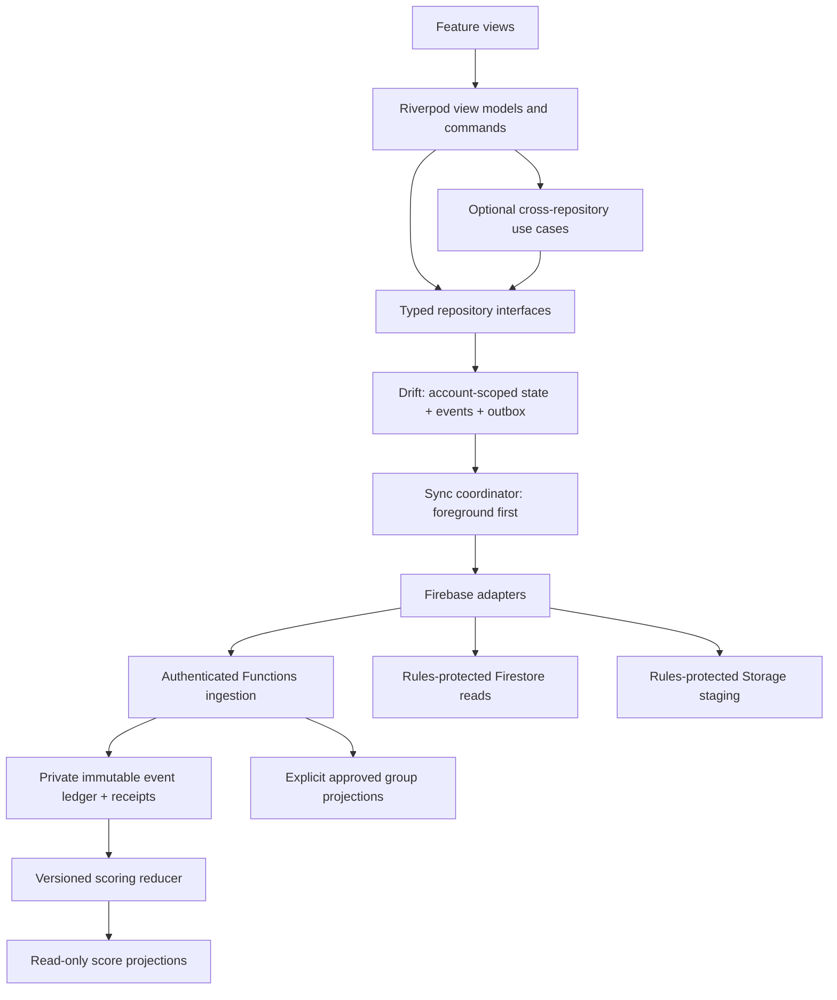
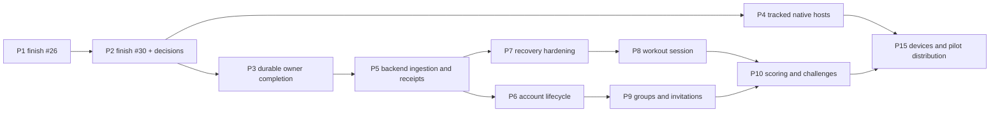

> Historical snapshot; recommendations remain proposals. Operational successor: [CURRENT](../../CURRENT.md). Original body follows unchanged.

# Forged & Sent: execution blueprint

Prepared November 5, 2026 (America/Phoenix). Status: **proposal for maintainer decision**, not accepted ADRs or implementation authorization. No repository files, branches, GitHub objects, cloud resources, or existing local changes were modified to produce this report. Supporting evidence: [GitHub audit](github-audit.md), [44-row prototype parity inventory](prototype-audit.md), and [architecture/tool research](architecture-research.md). This blueprint governs the proposed sequence where a research annex offers a different sequencing suggestion.

## A. Current-state audit

### Baselines and evidence

| Baseline | Observed value |
|---|---|
| Workspace | `C:\ws_c\ForgedAndSentFitness` |
| Local branch / HEAD | `pr4-workstation-test` / `c8e1267832e686206166a545a78dcbff5839c0ac` |
| Current remote main | `60b9f5de11b1a1074b921ee26ae68fb3c3e7228d` |
| Local remote | Old owner URL `sfcsmithc-afk/ForgedAndSentFitness`; live repository is `Forged-Sent/ForgedAndSentFitness` |
| Local versus main | Three commits behind; eight differing files concern Mac/onboarding/README changes. Core prototype/mobile/CI/review source matches. |
| Prototype | Main and local `index.html` share blob `dc8f0340d0e16cc48a7dd5d929d06d67ef82eab9`. |
| Existing local work | Modified `GEMINI.md`; untracked skills, Obsidian config, review material, logs and other files. Preserved. |

Sources: [main at audited SHA](https://github.com/Forged-Sent/ForgedAndSentFitness/tree/60b9f5de11b1a1074b921ee26ae68fb3c3e7228d), [PR #4](https://github.com/Forged-Sent/ForgedAndSentFitness/pull/4), and `github-audit.md` in this packet. GitHub status is a snapshot; recheck before each task or push.

### What is actually present

| Area | Classification | Evidence and implication |
|---|---|---|
| HTML product | Implemented behavioral prototype | `index.html`, `seed/**`, archived `versions/**`; extensive UI and Artifact-dependent adapters. Neither permissions nor client scores are production authority. |
| Flutter | Implemented foundation only | Three application source files: `main.dart`, `src/app/forged_sent_app.dart`, `src/firebase/forged_firebase_runtime.dart`; two widget tests. No production feature repositories, local database, router, or state-management package. |
| Firebase | Implemented local smoke configuration | `firebase.json`, `.firebaserc`, `firebase/firestore.rules`, `firebase/storage.rules`; demo Auth/Firestore/Storage connectivity. Smoke paths are not the member security model. |
| Backend services | Proposed | No implemented production Functions, invitation service, event ingestion, trusted scoring, moderation, RAG, or notification dispatch. |
| Offline | Partial in prototype; absent in Flutter | Proof clips have IndexedDB recovery. General workout save errors can be swallowed. No transactional Flutter event/outbox or account-isolated recovery. |
| Hosts | Interim generated CI hosts | Android debug and unsigned iOS simulator jobs exist. Reviewed tracked native hosts, release signing, store distribution and real-device certification remain unfinished. |
| CI | Implemented and observed successful | Main run `42002107363` succeeded; PR #4 run `41999595970` passed all 12 jobs. Scope-dependent jobs can skip; green CI does not prove every product flow. |
| Governance | Substantial existing system | `AGENTS.md`, provider instruction files, four canonical project skills and mirrors, `.github/agents`, `.claude/agents`, `tooling/review/review.py`, policy checks and shell helpers. Reuse. |
| Architecture | Existing canonical system | `SYSTEM.md`, ADR-0001/0002, generated `CODE-MAP.md`, Explorer model/build. Lexical symbol/reference indexing is not a runtime call graph. |
| Knowledge / contracts | Open work | #26 provides Git-backed knowledge/platform planning; #30 stacks Obsidian workflows and feature contracts on #26. Not merged product policy. |

Live ruleset `26264138` requires `ci-gate`, zero approving reviews, and no bypass actors. Up-to-date strict checks and conversation resolution are not server-required in the observed configuration. The agent policy separately requires closed/outdated review threads before an authorized push. Never conflate local instructions with enforcement. See [rulesets](https://github.com/Forged-Sent/ForgedAndSentFitness/rules).

### Reconcile existing work

1. Preserve #3's developer foundation and #4's emulator, CI, launcher and review work. Their scope is foundation, not a completed mobile app.
2. Finish #26 on current main; retain its knowledge convention and Proposed ADR-0003. Correct obsolete “Draft PR #4” and “hosts belong to PR #4” statements without claiming native certification. Do not add another knowledge system.
3. Keep #30 stacked until #26 lands; then retarget/rebase with human-managed Git actions and verify the resulting exact diff. Preserve its `docs/features/<slug>/requirements.md`, `design.md`, `tasks.md` contract scheme. Capture the first runtime slice there.
4. Triage other open PRs separately. Unmerged prototype additions (including mentor/journal, campaign search, supersets/bodyweight work) are candidate behavior, not an approved parity baseline. Freeze each migration contract to an immutable source SHA.
5. Do not sweep local untracked skills into either PR. Decide which belong in the project, check licensing and compatibility, and mirror only selected canonical material. Existing four project skills remain the default.

Observed local checks: code-map freshness PASS; skill mirror check FAIL with 25 additional local skill mismatches; review `--dry-run` STOPPED because untracked files are excluded. No paid review was invoked. Emulator port inspection found no listeners at the expected ports; emulator integration was not exercised in this audit. Prototype inspection was static: no generated preview existed and no browser workflow was run. The follow-up research consistency check could not complete because that subagent hit its usage limit; no independent approval is claimed. See supporting reports for runtime/tool diagnostics and browser limitations.

## B. Recommended architecture

Choose a feature-first Flutter application, Riverpod for view-model state and dependency composition, go_router for routing, immutable explicitly typed Dart models, Drift/SQLite for durable native state, and Firebase Auth/Firestore/Functions/Storage for managed identity and trusted shared services. These are **recommended dependency decisions requiring maintainer acceptance**, not packages already installed. Retain existing pinned toolchains; resolve exact compatible package versions in the implementation PR and commit lockfiles. Avoid a broad package upgrade while adding the first slice.

Use hand-written small models initially; add serialization generation only where repetition justifies it. Do not combine Riverpod with another service locator or state framework. Use repositories for data ownership; add use cases only for genuinely cross-repository workflows. Cloud Functions use TypeScript with a locked supported Node runtime, selected against official Firebase support at implementation time. No microservices, event bus platform, vector database or extra orchestration server is needed for the first pilot.



This is a proposed dependency diagram, not implemented source relationships. The device repository owns user-observable local state; the server owns authorization, accepted shared outcomes and score projections. Firestore cache is a useful read optimization, never the sole guarantee that an action was saved.

### Boundaries and data model

| Path / service (proposed) | Owner and authority | Allowed access |
|---|---|---|
| `users/{uid}/profile` | User private account profile | Owner reads; validated owner changes; only explicitly selected public fields projected separately. |
| `users/{uid}/events/{eventId}` | Immutable accepted event ledger | Owner reads; Functions create; client cannot overwrite accepted facts or score. |
| `users/{uid}/private/*` | Reflections, private prayer, nutrition, injuries, measurements | Owner only by default; group roles confer no read access. Prefer separate explicit collections over ambiguous wildcard schemas in final rules. |
| `users/{uid}/progress/*` | Private derived progress | Owner reads; server updates accepted projections. Local provisional progress is visibly pending. |
| `groups/{gid}/members/{uid}` | Trusted membership and effective role | Members receive only necessary directory fields; role mutations via validated backend; no arbitrary client group assignment. |
| `groups/{gid}/teams/*` | Group organization | Scoped member reads; owner/admin writes via server commands under an approved role matrix. |
| `groups/{gid}/activity/*` | Deliberately shared events | Member reads only while authorized; payload excludes private source fields. User sharing intent does not bypass membership checks. |
| `groups/{gid}/scoreboards/*` | Server projections | Members read; only server writes. Store scoring policy/version and provenance. |
| Invitations | Server-generated token digest, expiry, uses and group | No broad token query. Redeem through authenticated transaction; rate limit; replay and revoked-token tests. |
| `content/*`, campaigns | Published, versioned approved content | Audience-scoped reads; editorial administration on backend. Draft content is separate. |
| Storage private uploads | Owner prefix, staged metadata and lifecycle | Owner upload with type/size controls; server validates/finalizes; sharing mediated by membership. Avoid permanent public download URLs. |

Exact collections are contract proposals; do not implement generic wildcard allow rules from this table. Rules protect direct SDK access. Admin SDK bypasses rules, so every Function must independently validate caller, membership, role, schema, size and business policy. Membership revocation is rechecked at processing time. Historical offline private facts may remain private while group publication is denied; no silent reassignment to another group.

Account partitioning is not database encryption. Before storing real reflections or health data, approve and test device-at-rest protection, OS backup exclusions, key lifecycle and local erase behavior. Recommend OS-protected app storage plus an encrypted database/keychain-backed key design after compatible library evaluation; do not claim Drift alone provides encryption. The first slice uses synthetic data until this boundary is accepted. Export/deletion must inventory events, media, weights, membership, posts and derived projections rather than copy the prototype's incomplete cleanup routine. Shared summaries must exclude unapproved fasting/nutrition inference fields. Revocation cannot erase already-downloaded content from a disconnected device; minimize group caching and communicate this limit.

### Durable write and recovery protocol

1. Allocate stable random `eventId`, `uid`, schema version, device identifier and per-device sequence before persistence. Keep event time, recorded time and server acceptance time distinct. Device clocks never establish trusted scoring eligibility alone.
2. Commit event, local projection and outbox row in **one SQLite transaction**. Only then show “saved on this device.” A failed disk write must show failure, not successful completion.
3. Sync by authenticated UID. Never upload account A's queue while account B is active. Sign-out/account deletion has an explicit retention and erase policy; pending data must be disclosed before any destructive action.
4. Ingest with `(uid,eventId)` as deduplication key and canonical payload hash. Same ID/same payload returns the original receipt; same ID/different payload is a conflict, never a second score.
5. In a server transaction create the accepted event and receipt once. For small bounded projections update atomically; larger asynchronous reducers maintain their own processed-event ledger. Retry-safe processing is mandatory because triggers may repeat or arrive out of order.
6. Persist the receipt before deleting the local outbox row. A crash after server commit and before local acknowledgment safely retries. Track pending, uploading, accepted, retryable, blocked and permanently rejected states separately.
7. Use bounded exponential backoff with jitter, retry on app start/resume/connectivity/auth recovery and provide “sync now.” Permission failures pause for user action; invalid data is inspectable/recoverable, not an endless retry loop.
8. Media files live in app-owned durable storage before success is reported; database rows reference stable paths. Separate upload, verification and finalization. Recovery scans reconcile missing files, orphan uploads and expired sessions.
9. Claim queued work with expiring database leases; recover abandoned leases on restart. Account changes cancel workers. Concurrent-worker tests verify that this coordination and server deduplication jointly preserve correctness.

Use foreground sync as the correctness path. Android WorkManager and iOS BGTaskScheduler can opportunistically retry; the OS controls timing and can withhold execution. Never promise completion while an iPhone app is force-quit. Show queue state and sync on next launch. Timers persist start/end instants rather than relying on callbacks continuing in the background. [Apple background tasks](https://developer.apple.com/documentation/backgroundtasks), [Android persistent work](https://developer.android.com/develop/background-work/background-tasks/persistent-work).

### Environments, platforms and services

- **Preview:** fake repositories, synthetic public content, clearly labelled; no proof of backend behavior. Keep Flutter web as a preview target initially, not a certified offline production target.
- **Contributor/emulator:** existing demo project and loopback launchers. Add Functions emulator only when ingestion exists. Native debug-only networking exemptions; no cloud fallback when emulators fail.
- **DEV:** separate managed project, maintainer-controlled least privilege, synthetic accounts/data, authorized CI deploys. Both developers can use shared DEV from separate networks without depending on either home computer. Not a prerequisite for local implementation.
- **PROD:** separate project and buckets; workload identity, protected deployment environment, human release action, restrictive logging and backup policy. Production credentials never go to reviewers.
- **Native hosts:** tracked Android/iOS hosts with stable approved IDs, pinned CI-compatible build tools and debug/release separation. Android signing keys and Apple team/profiles stay in approved secret storage. macOS/Xcode is required for iOS builds; Windows cannot certify iOS.
- **Notifications:** local reminders first; later FCM server dispatch, user preference enforcement, token rotation, quiet hours, permission denial and deep-link checks. No prayer or health text on lock screens by default.
- **Diagnostics:** structured redacted operational events with event IDs and failure classes; never log prayer/reflection/meal bodies, tokens or full request payloads. Recommend Crashlytics only after telemetry consent/retention approval. No extra Sentry service.
- **Health:** optional adapters behind feature flags and narrow permissions; HealthKit/Health Connect later, read minimum approved fields. Permission denial/revocation is normal. Health-derived scoring requires a distinct fraud and product policy.
- **AI/RAG:** defer until approved content and authorization are stable. Server broker validates access before retrieval; index public/approved content first. Treat retrieved text as untrusted instructions; enforce document-level audience filtering before and after retrieval. No embedding private prayer/health data by default, no model-owned permissions, no provider keys in clients. Record provider/retention/budget choices before enabling.

Canonical adoption: extend `SYSTEM.md`; keep ADR-0001/0002; finish Proposed ADR-0003 from #26. Allocate the next free ADR numbers only after reconciliation for client state/persistence, event sync/ownership, and trusted shared projections. Keep decisions Proposed until the maintainer records acceptance. This report is input to those documents, not a second permanent architecture source.

Documentation grounding: [Flutter recommendations](https://docs.flutter.dev/app-architecture/recommendations), [Riverpod](https://riverpod.dev/docs/introduction/why_riverpod), [Drift transactions](https://drift.simonbinder.eu/dart_api/transactions/), [Firebase trigger limitations](https://firebase.google.com/docs/functions/firestore-events). The research annex records Context7 verification and version limitations.

## C. Proposed folder/file skeleton

Keep existing root structure and emulator/test tooling. New paths below are proposed, not claims that they exist.

```text
mobile/
  android/                         # reviewed native host
  ios/                             # reviewed native host
  lib/main.dart
  lib/src/app/
    forged_sent_app.dart
    bootstrap.dart                 # environment and composition root
    router.dart
  lib/src/core/
    environment/app_environment.dart
    persistence/app_database.dart  # Drift schema, migrations
    persistence/tables/{events,outbox,receipts}.dart
    sync/sync_coordinator.dart
    sync/retry_policy.dart
    diagnostics/redacted_logger.dart
  lib/src/firebase/forged_firebase_runtime.dart  # evolve existing adapter
  lib/src/features/
    devotionals/
      presentation/{devotional_screen,devotional_view_model}.dart
      domain/{devotional,completion_event,devotional_repository}.dart
      data/{local_devotional_repository,firebase_event_gateway}.dart
    auth/{presentation,domain,data}/
    training/{presentation,application,domain,data}/
    groups/{presentation,application,domain,data}/
    # nutrition, challenges, community, campaigns etc only when implemented
  test/{core,features}/
  integration_test/{completion_recovery,account_isolation}_test.dart
functions/
  package.json + lockfile
  tsconfig.json
  src/index.ts
  src/auth/require_caller.ts
  src/events/{ingest_event,validate_event,project_progress}.ts
  src/groups/{redeem_invite,authorize_membership}.ts
  src/scoring/{policy,reduce_event}.ts
  test/{events,groups,scoring}/
firebase/
  firestore.rules
  firestore.indexes.json
  storage.rules
tooling/firebase/tests/             # reuse existing adversarial rules suite
contracts/events/v1/                # wire schemas + good/bad JSON fixtures
docs/features/<slug>/               # #30 contract: requirements/design/tasks
docs/architecture/                  # SYSTEM, ADRs, generated map, Explorer
docs/knowledge/                     # adopt actual #26 structure; no duplicate wiki
```

Do not create empty feature folders in advance. Cross-language wire fixtures validate both Dart serialization and server validation; JSON shape checks do not replace authorization or business invariants. Feature-private data sources stay in their feature. Only shared database/sync infrastructure belongs in core. Expose minimal typed interfaces instead of exporting Firebase snapshots.

## D. MCP capability and usage matrix

“Configured,” “executable found,” “read call succeeded,” and “end-to-end verified” are separate states.

| Capability | Observed state | Agent / useful task | Permission, limitation and default |
|---|---|---|---|
| GitHub connector | Live repository/PR reads succeeded | Lead, reviewer: refs, diff, checks, history | Read by default. Mutations need task authorization; no approval/merge by agents. |
| `gh` CLI | Read API calls succeeded, including rulesets | Lead: fields missing from connector | Existing auth only; never print tokens. Fallback rather than duplicate server. |
| Context7 | Resolve/query succeeded for framework research | Author and architect: current API contracts | Public queries only; pin compatible versions in code. Default. |
| Dart MCP | Initially advertised, later absent from tool inventory | Flutter author: analyze, LSP, diagnostics | Connection/live app NOT VERIFIED. Do not call installed SDK evidence a working MCP. Default when connected. |
| Flutter/Dart CLI | Pinned SDK found; PATH points at different SDK | Author/QA: deterministic checks/builds | Use project launcher/pinned SDK. No installs required for this audit. Default. |
| Firebase emulator CLI/tests | Config, installed CLI and tests inspected; no running endpoints observed | Backend/security: local integration and negative access tests | Demo projects only; no login/deploy. Actual run in this audit NOT VERIFIED. Default local tool, not cloud MCP. |
| Playwright MCP | Configured pinned launcher, not exposed as connected tool here | Parity/QA: HTML workflows/screenshots | Isolated browser, local synthetic data. Connectivity NOT VERIFIED. Optional until needed. |
| Computer-use browser | Available alternative surface | Parity reviewer: visual inspection | Availability alone is not a tested workflow; see prototype annex. Never infer Artifact integration from mock UI. |
| Codex orchestration | Current agent and research subagents operational | Lead/writer/research roles | No claim that research agents are independent code reviewers. Default chosen assistant. |
| Codex/Claude/Gemini CLI | Versions succeed; Codex login verified, Claude unauthenticated, Gemini auth unverified | Independent advisory review | Model eligibility/billing/sandbox and full runner execution NOT VERIFIED here. Claude is not presently ready; human authenticates or selects another verified reviewer. Never start paid review automatically. |
| Review runner | Existing bounded diff, author exclusion, JSON validation | Lead + non-author reviewer | Dry-run blocked on dirty/untracked workspace. Reuse isolated clean checkout. Default preparation, reviews per agreed process. |
| Obsidian MCP | Root listing succeeded but is personal vault | Knowledge steward only after project vault verified | Do not write project notes there. Optional viewer, Git remains canonical. |
| Maestro | Optional example/launcher, live capability unverified | QA: later device flows | Device access required; no replacement for native tests. Optional. |
| Figma | Optional configuration, not connected/verified | Designer only if approved designs need it | Avoid new dependency now. |
| Firebase cloud MCP | Absent by policy | None for contributor/reviewer | Restricted; do not add. Deployment through separately approved CI. |
| Other connected services | Unrelated tools advertised | None | Gmail, personal Drive, budgets, CAD, pets, etc offer no benefit to this task; do not access. |

Repository config lives in `.mcp.json`, `.codex/config.toml`, `.vscode/mcp.json`, optional examples and `tooling/mcp/launch.mjs`. Repository Codex sandbox settings do not prove the current host session's permissions: this session has broader filesystem access. Verify effective permissions, not just configuration text.

Local version trap: PATH Flutter is 3.44.8 / Dart 3.12.2; project SDK at `C:\Users\Cornw\develop\flutter` reports Flutter 3.47.8 / Dart 3.13.7. PATH Java is 17; installed Java 21 is found by the project's helper. Use existing selection machinery before proposing tool reinstalls.

## E. Multi-agent development model

Use Astra as the coordinating role, as requested. Record the actual model identity when launching; this audit does not claim the current parent model is Astra. Interchangeable role contracts and version-controlled handoffs matter more than vendor names.

| Responsibility | Default assignment | Scope |
|---|---|---|
| Lead architect/orchestrator | Astra, when explicitly selected and available | Base SHA, decisions, dependency queue, task contract, integration and evidence ledger. No parallel edits to owned files. |
| Flutter author | One Codex coding agent | One feature branch, typed UI/repository work and tests. |
| Backend author | One Codex or Claude author | Separate branch only when schema interfaces are agreed; otherwise same vertical-slice writer owns both ends. |
| Architecture reviewer | Non-author Claude; Codex if Claude authored | Read-only exact diff plus approved contracts and relevant context. |
| Security reviewer | Second non-author provider, Gemini only if isolation/auth are verified | Threat cases, Admin/rules boundaries, private data and abuse. Not a substitute for emulator tests. |
| QA reviewer | Non-author reviewer role; deterministic runner for evidence | Failure injection, device matrix, accessible layouts and regression selection. |
| Parity reviewer | Separate read-only agent or human | Pinned prototype behavior and explicit deviations, not copying insecure implementation. |
| Knowledge steward | Lead at task closure | Contract status, ADRs, actual code map, next-ready task and handoff. |

Default concurrency: lead plus one writer; add one reviewer after tests. Use a second reviewer for Auth, privacy, scoring and destructive migrations. Research can run in parallel, as it did here. Do not claim same-author model research as independent review. No benchmark evidence here establishes one vendor as universally best; evaluate correctness on a small representative task, latency, access and actual billed usage. Set a per-task review budget; do not purchase subscriptions or invent current prices.

The user-requested process adds a non-author review step for meaningful changes and a second specialist for high risk. Treat this as the proposed team workflow; live GitHub still enforces only deterministic checks, not AI consensus. If the chosen reviewer is unavailable, record NOT VERIFIED and ask the maintainer to choose a verified alternative or explicitly waive that process step. Never forge a PASS or change the author identity to bypass `review.py`.

## F. Engineering rulebook

Adopt these refinements into existing `AGENTS.md` and referenced workflow docs after approval; do not create a competing rules file.

1. Authority: current explicit maintainer decisions within safety constraints; accepted ADRs and AGENTS policy; approved feature contracts; implemented interfaces/tests; prototype behavior as reference. Conflicts are raised explicitly. A proposed ADR or code comment cannot grant permissions.
2. Record base/main SHA, feature contract and owner before edits. Use one writer per branch and explicit file ownership. Fresh work uses an isolated checkout; preserve unrelated working changes.
3. Keep contract scope small: behavior, ownership, inputs/outputs, failures, offline states, acceptance tests, exclusions and dependencies. Follow #30's actual approved schema after it lands.
4. Widgets depend on view models and domain types, not Firebase SDKs. Backend commands validate every caller and payload. Test doubles support tests but do not establish feature completion.
5. Persist before reporting saved. Stable event IDs, transactional outbox, per-account separation, replay-safe server receipt, observable pending/rejected states are compulsory for durable actions.
6. No invented score rules, roles, sharing defaults, health permissions or notification behavior. Use approved contracts; explicit unknowns block only dependent work.
7. Never send secrets or real member data to review models. No production credentials, deployments, cloud login, branch protection changes, agent approval or merge.
8. Run deterministic checks before review. Reviewer findings require severity, path/line, concrete impact and correction. Bind reports to exact HEAD/diff and invalidate after changes.
9. Maintain SYSTEM/ADR/Explorer when boundaries change; regenerate CODE-MAP for Dart changes. Sync selected canonical skills to mirrors. Do not label proposed nodes implemented.
10. Every draft PR records changed areas, commands/results, source/head SHAs, privacy impact, manual evidence, review status and unverified work. Screens rendering is not completion.
11. Use `fs-start`, `fs-save`, `fs-sync`, `fs-share`, `fs-status` for contributor workflow after checking their behavior against agent policy. Helpers cannot authorize pushes. For a new PR with no prior PR head/check, the current push policy has a bootstrap ambiguity: maintainer publishes the initial branch/draft, or explicitly revises policy. Do not silently treat a nonexistent check as green.
12. Final handoff lives in Git/GitHub: current status, exact SHA, tests, findings, blockers and next ready task. Obsidian is a view over those files.

Use the four existing project skills: Flutter vertical slice, architecture review, Firebase security review and independent review. Use specific Dart/widget test skills only if adopted and applicable. No blanket import of every installed skill.

## G. Feature parity and dependency matrix

The accompanying **prototype-audit.md** is the detailed source-traced inventory and acceptance matrix. Its line references apply to the audited main blob. This table sets production sequencing; detailed subfeatures must remain in that annex and then migrate into #30 contracts.

| Feature | Flutter workflows / backend | Ownership, offline and errors | Dependency / priority / acceptance |
|---|---|---|---|
| Today | Daily cards, progress, next activity, resume | Private daily projection; cached content, pending status, timezone boundaries | Completion ledger first / P0; restart restores pending completion and no double progress. |
| Devotionals | Browse/read, search, completion, optional reflection | Versioned approved text; reflection private; safe independent timing | Content + durable events / P0; offline read/complete/reopen/replay once, no compulsory prayer input. |
| Training | Plan, session, exercise substitutions, sets/reps/load, timers, history, mobility | Private session facts; durable incremental edits and resume; no score trust | Event protocol / P0; kill during session, recover sets/timer, reject invalid values, preserve failures. |
| Nutrition | Meals, targets, hydration, preferences and summaries | Private by default; owner-only storage; no less-eating points | Private ownership / P2; cross-user deny, edit/retry, units/timezone handling, no leaderboard leak. |
| Challenges | Enrollment, requirements, submissions, proof and adjudication | Approved event evidence; media durable; server eligibility | Groups + ingestion + media / P1; spoof/replay/revoked member tests, pending proof recovery. |
| Leaderboards | Group/team standings and history | Server-only score writes, member-scoped reads, cached stale label | Versioned scoring after events / P1; duplicate/order/rebuild fixtures yield same totals. |
| Campaigns | Browse, join, progression, group campaign administration | Published content and membership-scoped progress; cached reading | Devotional/training + groups / P1; access/end dates/retry and content-version tests. |
| Community | Feed, shared prayer, comments/reactions, moderation | Explicit sharing separate from private prayers; moderation commands | Membership + consent + abuse policy / P1; private-to-shared boundary, removal, report/block and denied former-member access. |
| Profiles | Account, display directory, goals, preferences, history | Public projection allowlist; injuries/measurements stay private | Auth/ownership / P0; account switch and forbidden-field projection tests. |
| Settings | Privacy, accessibility, units, reminder preferences, export/delete | Owner settings; device versus cloud setting separation | Auth + policy / P0 basic, P1 lifecycle; denial/revocation/logout/pending data tests. |
| Owner tools | Members, roles, teams, invitations, content/challenge administration | Backend capability checks; UI visibility is convenience only | Membership/role contract / P1; direct API attacks fail, role escalation and self-demotion handled. |
| AI | Existing Ask/search and generated-content affordances reviewed separately | Keyword search is not RAG; provider broker only later, approved data | Content/access + AI approval / P2; unauthorized retrieval, prompt injection, citation and outage tests. |
| Native | Timer/lifecycle, camera/proof, notifications, health, distribution | Permission-minimal adapters, durable media, OS scheduling limits | Hosts + respective contracts / P1/P2; physical device revoke/background/termination matrix. |
| Youth/family/mentor variants | Present or pending prototype concepts | Adult pilot boundary; no automatic production enablement | Explicit future product decision / deferred; adult builds have no reachable youth workflow. |

Every row requires source-specific acceptance tests from the annex, not just the one representative gate above. Freeze behavior per contract; a future prototype merge does not silently expand an in-flight Flutter PR. Reconcile intentional native improvements in the contract's deviation list.

## H. Ordered implementation roadmap

Milestones: M0 reconcile and decide; M1 prove one durable owner flow; M2 reliable daily training; M3 trusted groups/competition; M4 community and optional integrations; M5 pilot operations. Ship a testable capability at each runtime milestone. Do not postpone offline correctness until after a broad frontend port.

Critical path:



The next three packages are P1, P2 and P3. They are executable in dependency order after the stated decisions; P2 can be prepared on its existing stack immediately. They are not falsely advertised as three independent merge-ready tasks. Native host work can run independently after platform approval. Later work splits further if review scope becomes excessive.

For every candidate below, **common DoD** means: contract accepted, exact focused diff, relevant deterministic checks pass, required independent review performed or explicit process exception recorded, docs/map current, draft PR contains real test results and unverified items, no private-data exposure, human handles publication/merge under policy. “Rollback” means a new reviewed revert or feature disablement; never destructive reset, unsafe schema downgrade or force-push. **Common tools:** GitHub read APIs/gh, existing review runner, Context7 for API changes; Flutter/Dart CLI and emulator suite where applicable.

| PR | Goal, dependencies and exact expected areas | Author / review / implementation | Tests, acceptance and risk / rollback |
|---|---|---|---|
| P1: Reconcile knowledge foundation (#26) | M0; current main; existing #26 changed files, `docs/development/START_HERE.md`, platform ADR-0003 and knowledge tooling | Knowledge writer; non-author architecture reviewer; finish existing diff, remove stale status, retain Proposed decisions | Existing knowledge/policy/tool tests and clean-checkout setup; one canonical source. Risk stale merge assumptions; revert documentation/tool change. No app capability claimed. |
| P2: Finalize contracts and first-slice design (#30) | P1; #30 files, `docs/features/devotional-completion/{requirements,design,tasks}.md`, SYSTEM and next free ADRs | Architect writer; independent architecture + security review of data boundary; adopt contract validation, record accepted decisions only | Existing contract/knowledge validation, deliberate invalid-contract fixtures, link/path checks; approvals/source_sha enforced. Risk approval laundering; preserve Proposed status. Revert new template/tool change without erasing history. |
| P3: Save and resume one devotional completion locally | P2 + state/persistence approval; `mobile/lib/src/features/devotionals/**`, core persistence, app composition, tests, lockfile and architecture docs | Flutter writer; non-author architecture reviewer plus data-isolation review; real Drift repository and synthetic versioned content | Atomic save, reopen database, double tap, disk failure, UID separation and accessible states. Runtime offline capability on supported test target; server sync explicitly not yet complete. Additive schema; retain data if UI disabled. |
| P4: Commit reviewed Android/iOS hosts | P2 platform IDs/build approval; `mobile/android/**`, `mobile/ios/**`, CI host-generation sections, platform ADR | Platform author; architecture/QA reviewer; replace generation only when tracked hosts build equivalently | Android debug and unsigned simulator builds; release excludes debug cleartext; actual device boot evidence later. Risk signing/config drift; revert host/CI change, never commit signing material. |
| P5: Accept owner events exactly once | P3; `functions/**`, `contracts/events/v1/**`, `firebase.json`, rules, gateway, sync coordinator, `tooling/firebase/tests/**`, CI scope | One full-slice author; security + architecture reviewers; authenticated emulator ingestion and receipt reconciliation | Same-ID replay, payload conflict, A/B isolation, invalid schema, unauthorized caller, crash after remote commit; real Flutter→emulator→receipt flow. Risk Admin bypass; deny by default, disable endpoint, preserve accepted events. |
| P6: Establish pilot account lifecycle | P5 + authentication decision; `features/auth/**`, server account commands, rules, routing, device credential handling | Full-slice author; security + QA reviewers | Sign-in/out, expired credentials, reauth, A→B switch, pending queue, export/delete workflow and offline deletion constraints. Risk account loss/data leakage; disable new registrations, preserve existing identity mapping. |
| P7: Harden sync and migration recovery | P5/P6; `core/sync/**`, database migrations, integration tests, diagnostics | Flutter author; QA + security reviewer | Kill/restart at every write boundary; out-of-order, retry/backoff, network flaps, upgrade migration, full disk; zero lost acknowledged local events. Risk stranded queue; forward repair and inspectable recovery, no dropping database. |
| P8: Complete workout session and Today progress | P7 + approved exercise content; `features/training/**`, Today/devotional projections and event schema | Flutter writer with agreed server contract; parity + architecture reviewers | Incremental sets, timers, substitutions, resume, optional scripture order, invalid data, idempotent completion, timezone fixtures. Risk unsafe exercise assumptions; feature flag session type, preserve history. |
| P9: Secure groups, roles and invitations | P6; `features/groups/**`, `functions/src/groups/**`, rules/indexes/tests | Backend/full-slice author; two security/architecture reviewers | Cross-group denial, expiry/replay, role escalation, revocation queued offline, concurrent last-owner change. Risk broad private queries; disable invitations, preserve audited memberships. |
| P10: Versioned scoring and one challenge | P8/P9 + scoring approval; `functions/src/scoring/**`, challenges/leaderboard features, fixtures | Backend writer; security + parity reviewer | Duplicate and ordering invariance, version cutoff, late/rejected events, unauthorized score writes, rebuild comparison. Risk unfair results; freeze affected challenge and rebuild from immutable ledger under approved policy. |
| P11: Durable proof media | P7/P9 + moderation/retention approval; media adapters, Storage rules, upload/finalize Functions | Full-slice writer; security + device QA | Interrupted upload, restart, missing local file, type/size violation, unverified proof cannot score, orphan cleanup. Risk sensitive media; disable uploads, revoke access, retain only policy-allowed data. |
| P12: Campaigns and community moderation | P8/P9/P11 + sharing/moderation policy; campaign/community features, content/admin/moderation Functions | Separate focused writers sequentially if scope large; parity + security reviewers | Published audience/version, join/retry, explicit shared prayer, reports/block/removal, private content absent in feed queries. Risk harassment/leakage; disable posting, preserve moderation evidence per retention policy. |
| P13: Private nutrition and measurements | P6/P7 + product bounds; nutrition/profile private repositories and schemas | Flutter writer; privacy + QA reviewers | Owner-only positive/negative reads, edits/recovery, units, no group projection, no restriction-based points. Risk health inference; hide feature without destroying private exportable records. |
| P14: Reminders and optional native integrations | P4/P6/P7 + communication/health approval; platform adapters, notification service, settings | Platform writer; privacy + physical-device QA | Permission denial/revocation, quiet hours, token rotation, generic lock-screen text, background limits, health deletion; add health as separate PR if needed. Risk intrusive communication; remote kill switches and local opt-out. |
| P15: DEV distribution and pilot readiness | P4–P12 pilot-required features, approved DEV/PROD budget/identities; deployment workflows, runbooks and device evidence | Release author; security + QA review; human deploys approved environments | Signed device installs/upgrades, production deny tests in controlled staging, restore drill, monitoring, export/delete, full pilot journey. Risk deployment/config errors; versioned release rollback with compatible database schema. |
| P16: Approved-content AI retrieval pilot | P9/P12/P15 + AI consent/provider/budget approval; server retrieval adapter, citations and evaluation fixtures | Backend writer; security + content QA | Unauthorized document injection/retrieval, malicious source instructions, citation grounding, provider outage/quotas, private-content exclusion. Risk data disclosure/cost; disabled by default and server kill switch. Not required for first men's-group pilot. |

Independent workstreams: content licensing/curation and manual parity review can proceed after M0; native hosts after platform decisions; group backend after account/schema contracts while workout UI proceeds; no parallel writers change shared database migrations, router or wire schemas without lead sequencing. Cloud provisioning is deferred until a local vertical slice proves value.

## I. First three PR execution packages

### P1 — Finish #26: one reliable knowledge and platform baseline

**Why first:** #26 already carries the reconciliation foundation. A new competing plan PR would duplicate it; #30 depends on it. The deliverable should be a small finished handoff, not more infrastructure design.

**Base and scope:** current main `60b9f5d…`; existing #26 head observed `1c6160c…`. Recheck full current head, changed paths, reviews and CI before authoring. Use the existing #26 branch in a clean isolated checkout; do not alter the dirty workstation branch. Read #26's exact tree and preserve intended knowledge tooling. Correct obsolete PR #4 status, document current-vs-planned hosts, retain ADR-0003 as Proposed until the human decides. Avoid importing untracked workstation assets.

**Author:** one Codex knowledge/tooling writer coordinated by Astra. **Reviewer:** non-author Claude architecture reviewer, read-only exact diff, once authenticated/sandboxed execution is verified. Tools: GitHub connector, gh read fallback, Python knowledge/policy tests, architecture generator, review runner; Context7 only if changing API-dependent tooling.

**Exact acceptance:**

1. At the final head, no onboarding text represents #4 as an open draft or generated native hosts as certified product hosts; historical statements are explicitly historical.
2. A new contributor can locate START_HERE → SYSTEM → accepted/proposed ADRs → knowledge index without Obsidian or private paths.
3. ADR-0003 states Android/iOS production intent, web preview and deferred desktop; approval metadata reflects a real decision, otherwise remains Proposed.
4. Run `python tooling/policy/check.py`, `python tooling/skills/sync.py --check`, `python tooling/architecture/generate.py --check`, `python tooling/architecture/build_explorer.py --check`, `python tooling/knowledge/check.py`, and `python -m unittest discover -s tooling/knowledge -p 'test_*.py' -v`. The knowledge paths are verified in #26, not present on audited main. Run `python tooling/review/review.py --dry-run --base <verified-main-sha>` on the exact clean diff.
5. A deliberate broken link/invalid record in a temporary test fixture is rejected by the validator; normal corpus passes. Existing launchers and demo defaults remain unchanged unless an explicit tested fix is in scope.
6. Reviewer records path/line findings; author resolves confirmed problems; final CI `ci-gate` is green at the reviewed head. Human controls publication/merge.

**Working capability afterward:** a verified, Git-backed place to resume tasks and understand platform scope. No claim of new mobile functionality. **Unblocks:** #30 finalization and first-slice contract. **Rollback:** reviewed revert of this tooling/docs diff; retain audit history. **Not verified until run:** clean contributor walkthrough and all new-head checks.

### P2 — Finish #30: enforceable contracts plus approved first slice

**Dependencies:** P1 merge; ADR/dependency/privacy decisions below. While stacked, preparation can proceed against #26's exact head; final merge candidate must be checked against actual main. Scope: existing #30 paths, one `docs/features/devotional-completion` contract, SYSTEM and proposed ADRs. Obsidian remains optional, with its repository vault positively identified before use.

**Author:** architecture/knowledge writer. **Reviewers:** non-author architecture and security reviewers for ownership/offline boundaries. Tools: GitHub, Python validators, Context7, existing review infrastructure. No runtime package installation, cloud account or paid service.

**Implementation:** use #30's requirements/design/tasks schema, record immutable main source SHA, list prototype deviations, define `CompletionEvent`/receipt and repository commands, describe one transactional local write and future ingestion protocol. Separate “contract accepted,” “implementation pending,” “tested” and “released.” Record Riverpod/Drift/router recommendations as Proposed until the human accepts them. Account identifiers in the initial local/demo test are synthetic and are not production authentication approval.

**Exact acceptance:** validator passes the valid contract; rejects nonexistent/off-main `source_sha`, missing required high-risk files, missing owner, missing approval metadata where required, dangling paths and implemented status without required evidence. Reviewers verify approval authenticity and test truth against actual records; a schema validator cannot establish these. Run `python tooling/knowledge/check.py`, `python -m unittest discover -s tooling/knowledge -p 'test_*.py' -v`, and `python -m unittest discover -s tooling/preview -p 'test_*.py' -v`, plus existing policy/skills/map/Explorer checks. Test the preview's loopback/Host/path restrictions and occupied-port behavior; perform Windows/Mac person-run launch checks and record any unavailable OS as NOT VERIFIED. A reviewer can trace each acceptance test to one requirement and each proposed data field to owner/reader/writer. The contract explicitly forbids shared prayer/score writes and identifies sign-out/retention decisions. Preview workflow is exercised in a disposable checkout with synthetic content and reported separately from Artifact connectivity. Git-backed docs work without the Obsidian plugin.

**DoD:** common DoD plus actual maintainer decisions recorded. **Working capability:** another agent can implement the slice from files alone. **Unblocks:** P3 and approved host work P4. **Risks/rollback:** do not automate approval or mark proposed behavior accepted; revert validator/template regression while preserving decisions/history. Personal-vault connectivity is not project-vault validation.

### P3 — Durable devotional completion on one supported native target

**Dependencies:** P2 and dependency/retention decisions; use existing interim generated hosts for local development if P4 has not landed. Keep native-host changes out of this PR. Scope: app composition, one devotional feature, shared Drift database/outbox infrastructure, unit/widget/integration tests, lockfile, SYSTEM/CODE-MAP/Explorer. Do not create all future feature directories.

**Author:** one Codex Flutter writer. **Reviewers:** non-author architecture reviewer and privacy/data-isolation reviewer. Tools: pinned Flutter/Dart CLI, Dart MCP when verified, Context7, GitHub and review runner. No Firebase deployment.

**Repository contract:** load one versioned synthetic devotional; observe local completion; submit completion for current synthetic/demo UID; expose saved/pending/failure status. Use real on-disk Drift in persistence integration tests. Fakes are limited to boundary tests. The outbox schema is ready for P5 but no server sync success is shown until a real receipt exists.

**Exact acceptance tests:**

1. Complete once → exactly one event, one outbox row and one local projection in a single committed transaction.
2. Simulate a failure before commit → none of those three records persist and UI shows failure/retry.
3. Double-tap the same completion command → one semantic completion; stable command/event identity prevents duplicate queue entries.
4. Close database, terminate/relaunch app, reopen same disk path → completion remains saved and visibly pending; no hidden fake repository.
5. Account A completes; switch to B → B cannot observe or enqueue A's event; switch back restores A's pending record. Sign-out behavior matches approved retention policy.
6. Offline app startup and content reading work from the seeded local asset; no network call is required to save.
7. Widget test covers loading, saved-on-device, pending-sync, storage-failure and retry states; semantics announce status and large-text layout does not overflow.
8. Optional reflection can be skipped; completion works independently of workout timing. No private text appears in logs.
9. `flutter analyze --no-pub`, `flutter test --no-pub`, migration/schema tests and one actual native termination/relaunch scenario pass. Run the repository's pinned dependency setup first and verify lockfile stability. Record device/emulator, OS and exact command/evidence.
10. Policy/skills/map/Explorer checks and exact-diff independent reviews pass at final head. Server receipt, cloud sync, production Auth and iOS physical behavior remain explicitly NOT VERIFIED in this PR.

**Working capability:** a real devotional completion survives app restart on the tested target and honestly reports pending sync. This is a completed local capability, not a completed cloud-synced feature. **Unblocks:** P5 authenticated emulator ingestion. **Rollback:** disable completion entry point if necessary while retaining the additive local schema and exportable queue; never delete pending user data to resolve a migration failure.

## J. Operating playbook and measurable reliability

### Repeatable task cycle

**Start:** lead reads GitHub main/open PRs/checks/threads, verifies base SHA and dependency merges, reads AGENTS/START_HERE/SYSTEM/relevant ADRs/contracts, checks effective tools and credentials, chooses one writer and review assignments. Record scope, acceptance tests, file ownership, decisions and budget in the existing task record. Work from a clean isolated checkout; never “clean up” unrelated local files.

**Build:** implement the smallest real flow, keep API/wire fixtures agreed, run relevant cheap checks, then integration and risk-specific tests. Update contract evidence and diagrams as code changes. Review exact proposed diff via existing runner after dry-run succeeds. Resolve confirmed issues; rerun affected tests and review when the diff changes.

**Publish:** prepare draft description and evidence first. Human publishes the initial branch/draft under current bootstrap constraints. Later agent pushes require explicit session authorization, every PR thread resolved/outdated as verified on GitHub, and green current-head `ci-gate` or a push fixing its failure. No agent approves, merges or force-pushes. A human alone decides merge after required checks.

**Close:** store PR URL/full SHA, executed commands and result/log paths, manual device evidence, findings/disposition, unverified coverage, contract/ADR state, rollout/recovery instructions and next ready task. The next session starts from this record, not chat memory. Mark a milestone complete only when its end-to-end acceptance gate passes.

Suggested handoff fields in the existing #26/#30 format: task ID; owner/author/provider; base/head/source SHA; contract; status; changed files; tests executed; evidence URLs; reviewer and diff hash; unresolved findings; privacy implications; decisions needed; rollback; next task. Avoid a parallel tracker when GitHub issue/PR plus contract tasks already provide these fields.

### Minimum test matrix

| Area | Deterministic CI minimum | Physical/manual evidence |
|---|---|---|
| View models/domain | Command/state/error tests, boundary-value fixtures | Product behavior and safe exercise/faith timing review |
| Widgets/layout | Loading/error/retry, text scaling, semantics, narrow/wide layouts | TalkBack/VoiceOver, keyboard/focus where applicable, contrast and actual small-screen use |
| Backend | Emulator ingestion/receipt/reducer tests; schema negative fixtures | Shared DEV smoke after approved deployment |
| Rules/Auth | Owner allow, unauthenticated deny, other-user deny, cross-group deny, revoked role, private fields absent | Account recovery and actual sign-in provider flows |
| Offline | Transaction rollback, duplicate/out-of-order, network loss, disk reopen, UID isolation, migrations | Kill/process death/reboot, low storage, permission revocation on Android and iOS |
| Media | Upload/finalize state transitions, type/size denial, orphan handling | Camera interruption, real uploads, background suspension and local-file recovery |
| Scores | Golden policy-version fixtures; replay/rebuild equivalence; no client writes | Maintainer validates representative challenge outcomes |
| Full flow | Sign-in → content → completion → accepted receipt → authorized progress; logout and retry | Two accounts/two devices, airplane mode and later resume |
| Release | Signed-build configuration checks, dependency/secret checks, migration fixtures | Install/upgrade signed build on physical devices; restore/export/delete drill |

Add new Functions/contract paths to CI path-scope tests when those files appear; otherwise a new backend file could escape its intended job. Preserve deterministic lockfiles, current action pins and aggregate gate. Do not count a skipped platform job as a platform test.

### Proposed six-month adult men's-group pilot gates

These are target acceptance thresholds for maintainer approval, not measured current performance:

- Zero known release-blocking security, data-loss or core-workflow defects; zero unresolved critical/high findings without a documented determination that the finding is invalid. Lower issues have owners and dates.
- 100% pass of the named critical journeys on the agreed oldest-supported and current Android/iOS versions, including at least one physical Android and one physical iPhone; two member accounts and an administrator tested across groups.
- No lost acknowledged local completions across at least 100 deterministic crash/retry scenarios and a physical-device interruption script; duplicate ingestion creates exactly one accepted outcome in every replay fixture.
- Online foreground sync target: 95% of ordinary completion receipts within 30 seconds under a documented healthy-network test profile; all queued small events drain within two minutes after authenticated foreground recovery in that profile. Background delivery has no timing guarantee.
- Cross-user/group/private-data negative matrix fully passes; Admin endpoints tested separately; no private prayer/reflection/health content in group query fixtures or sampled operational logs.
- Migration from the previous pilot build preserves all queued events; rollback/forward-repair and backup restore drills demonstrate recovery. Propose cloud-data RPO ≤24 hours and RTO ≤24 hours for pilot, with explicit treatment of unsynced device-only data.
- Internal soak of at least two weeks with ≥99.5% crash-free sessions if telemetry is approved, no unresolved event-loss incident, and a manual incident log if telemetry is declined. This threshold is a proposal, not existing telemetry.
- Approved content rights, adult-only onboarding, retention/export/delete policy, moderation owner, notification consent, support contact and incident response are documented before inviting real members.
- Human release owner confirms signing/distribution, budget alerts, scoped access, restore access and rollback procedure. Review weekly during pilot; rehearse restore monthly and recheck critical journeys on each release. Do not wait six months to discover recovery failures.

## K. Risks and decisions requiring approval

### Decide now to unblock P2/P3

1. **Client dependencies:** accept Riverpod + go_router + Drift, simple immutable Dart types and TypeScript Functions; exact compatible versions locked in their PRs. Rationale: one state/DI mechanism, typed routes, durable transactional local writes, and an established managed backend.
2. **Platform scope:** Android/iOS production first, web preview only, desktop deferred. Confirm package/bundle identifiers and Apple/Android ownership before P4. Do not represent proposed ADR-0003 as already accepted.
3. **First product slice:** owner-only devotional completion with optional reflection, no group sharing or scoring; durable local save followed by authenticated emulator sync. Approve account-scoped pending-data retention and sign-out behavior before real accounts are used.

### Decide at the dependency point, not all today

- Before P6: pilot authentication provider(s), account recovery, session policy, export/deletion and retention; recommended start is one Firebase-supported provider with verified identity, not anonymous production membership. Anonymous Auth remains a demo smoke mechanism.
- Before P9/P10: invitation eligibility, role capability table, group sharing opt-in, scoring formulas/late events/appeals. Preserve no spirituality-quality scoring and no points for eating less.
- Before P11/P12: proof and prayer-sharing retention, moderation authority, reporting/blocking and abuse response.
- Before P14: reminder channels/quiet hours, health data scope and consent; keep health optional and off by default.
- Before DEV/PROD: project ownership, region, budget, telemetry/retention and deployment authority. No paid service or cloud provisioning follows from accepting this document alone.
- Before P16: provider, content licensing, data egress/retention, model cost ceiling and evaluation gate; no private-content retrieval by default.

Critical risks are premature permission/scoring porting, unacknowledged local-save loss, account-switch queue leakage, relying on background scheduling, pending PR drift, and treating CI or generated hosts as device certification. Each has a named gate above. The initial-push policy ambiguity needs a maintainer-owned publication path or deliberate policy clarification; this blueprint does not silently amend it.

**Single highest-value next PR: finish #26 (P1), then finalize #30 and immediately build P3.** Astra coordinates; one Codex writer implements; non-author Claude reviews after verified access. Use GitHub reads, existing Python validators and review tooling. Acceptance is the six explicit P1 tests above. The result is a trustworthy reusable task baseline, unblocking #30—not a claim of new app functionality. The first new runtime capability is P3's durable completion, and P5 then proves real authenticated frontend-to-backend synchronization.

Please approve or amend the three “Decide now” recommendations. Approval adopts direction for the next scoped work; it does not authorize GitHub pushes, production deployment, paid services, or an entire unattended roadmap.
