> **Historical document. Superseded in part (2026-10-27).** The production direction approved on 2026-10-27 selects **Firebase**.
> This review's Supabase/PostgreSQL recommendation (its ADR-003, D.4, E.3, F schema) is **Rejected**, superseded by
> `docs/adr/ADR-0003`. Its "no video in v1" and "no faith points" positions are superseded by ADR-0010 and ADR-0012.
> Its risk findings (B), prototype inventory (C) and fitness, faith and scoring analysis remain valid evidence.
> Current source of truth: `docs/architecture/` (see `docs/architecture/00-reconciliation-matrix.md`).

# Forged & Sent: Independent Architecture Review

| | |
|---|---|
| **Repository** | [sfcsmithc-afk/ForgedAndSentFitness](https://github.com/sfcsmithc-afk/ForgedAndSentFitness) |
| **HEAD reviewed** | `a71efab75ac81f6a72aea976ce5832595b4856ae` ("v154: Coaching comes from Coach Gideon"), 2026-10-26 21:04 MST |
| **Review date** | 2026-10-26; re-verified at `b66e93e` (v162) on 2026-10-27. All findings hold; see the Addendum for the line map. |
| **Local working copy** | `C:\ws_c\ForgedAndSentFitness` was 2 commits behind (at `a4b0684`, v152). It also has untracked `.agents/skills/` (dart-lang skills), `skills-lock.json` and `logs/`. This review uses `origin/main`. |
| **Branches inspected** | `main`, `forged-iron-reviewed`, `injury-muscles-recording-review`, `workout-library-seed` (unmerged; adds `seed/women/*`, including `cycle-notes.json`) |
| **History** | 147 commits from 2026-10-24 to 2026-10-26: 141 by Curtis Smith, 4 by sfcsmithc-afk (PR merges), 2 by Claude |
| **Method** | Static reading of `index.html` (6,950 lines, 1.89 MB), all `seed/*.json`, `docs/*`, `dev/*`, the git history and the branches. I wrote seed-data validation scripts (`evidence/`). I also checked vendor and platform documentation on 2026-10-26. **I did not run the app.** No runtime behavior was observed. |
| **Scope rule** | No code changes, commits, PRs, dependency installs, or data changes. The only writes are this review folder (uncommitted) and moving aside one stale git lock file, `.git/objects/maintenance.lock`, which my `git fetch` left behind on the local copy. |

## How to read this review

Every significant claim is tagged:

- **[V] Verified**: I confirmed it in the repository at the HEAD above, or in current authoritative documentation (linked).
- **[I] Inferred**: a reasonable reading of the evidence that was not proven by execution.
- **[P] Proposed**: a recommendation that needs owner approval.
- **[U] Unknown**: I could not establish it. Where possible I name the evidence that would settle it.

Severity labels: **CRITICAL** (data loss, privacy breach or integrity failure is likely), **HIGH** (blocks production or causes rework), **MEDIUM** (meaningful debt), **LOW** (polish or hygiene).

Source links point to the reviewed commit. For example, `idx L1631-1792` means [`index.html#L1631-L1792`](https://github.com/sfcsmithc-afk/ForgedAndSentFitness/blob/a71efab/index.html#L1631-L1792). Line numbers count physical lines. Lines 1037, 1794-1796 and 2697-2699 are single lines holding 3 KB to 855 KB of embedded data each.

### Companion files in this folder

| File | Purpose |
|---|---|
| `ARCHITECTURE-REVIEW.md` | This document, sections A-N |
| `diagrams/*.mmd` | The ten Section G diagrams as standalone editable Mermaid, generated from this document |
| `schema/001_preliminary_schema.sql` | Preliminary PostgreSQL DDL with RLS sketches (Section F). Review-only, never applied |
| `proposed-agent-config/` | Draft `AGENTS.md`, `CLAUDE.md`, Claude Code subagents and shared skills (Section J). **Not installed.** |
| `evidence/seed_audit.py`, `evidence/seed_audit.out.txt` | Reproducible checks of the seed data quoted throughout |
| `evidence/decision_matrix.py`, `.out.md` | Section D weighted matrices, including a sensitivity run |
| `evidence/cost_model.py`, `.out.md` | Section D/K cost scenarios with every assumption stated |

---
## A. Executive verdict

### One-paragraph verdict

Forged & Sent is a **well-iterated product prototype with a weak engineering base**. It has a good content library and an architecture that cannot be migrated. The value in the repository is **domain knowledge**: four 52-week training programs built on a coherent 4-week RPE wave, 218 movements with equipment mappings and coaching text, an equipment and injury substitution table, 52 weeks of challenges with movement standards, 366 devotionals, and about 150 rounds of UX decisions made with real users in the loop. The code has almost no reusable value. All 5,300 lines of JavaScript sit in one IIFE in one HTML file. It holds global mutable `state`, embeds 1.3 MB of data, re-renders every page (10 draw functions) on every snapshot, and **trusts the client completely**. Every score, PR, streak, deadline, age bracket and challenge result is computed and written by the browser of the man who benefits from it. The `B` adapter is described as the migration boundary ([README "Architecture"](https://github.com/sfcsmithc-afk/ForgedAndSentFitness/blob/a71efab/README.md)), but it is only a thin rename of the claude.ai `db` API. Business rules do not sit behind it. **Treat the prototype as an executable specification and a source of data. Do not port it.**

### What is genuinely valuable [V]

| Asset | Where | Why it matters |
|---|---|---|
| Training programs Forged, Built, Engine, Warrior | `seed/workouts.json` (365 days × 4), `workout-meta.json`, `workout-themes.json` | The progression model is coherent. It uses 13 four-week blocks, an RPE 7 → 8 → 9 ramp → deload wave, and rotates the lead lift per block (Back Squat → Pause Squat …). Validated: every exercise resolves in `movements.json` (`evidence/seed_audit.out.txt`). |
| Movement library | `seed/movements.json` (218 movements) | Equipment-resolved names for 4 setups, cues, how-to text, muscles and video links. Reusable as-is after licensing review of the video links. |
| Substitutions | `seed/alternates.json` | Reasons are typed (Equipment versus Injury) and carry a disclaimer. This is the right shape for a substitution graph. |
| Challenge program and standards | `seed/weekly-challenges.json`, `movement-standards.json` | 156 challenges, 4 seasons themed on 1 Cor 16:13-14, gauntlet weeks 13/26/39/52, and written rep standards. The standards are the fairness foundation any competition needs. |
| Devotionals | `seed/devotionals.json` | 366 entries with a uniform schema (`ref`, `text`, `prayer`, `reflect`, `act`), all references distinct and well-formed. **Rights and authorship are unknown [U]** (Section 11/F). |
| UX decisions | 154 version files and the commit log | Water coalescing (v11), keeping challenge proof on the device (v151), Sabbath auto-rest (v128), ramp-set rows (v131). These are real usability findings worth carrying forward as requirements. |
| Privacy instincts | Health numbers stay on the phone ([`docs/health-integration.md`](https://github.com/sfcsmithc-afk/ForgedAndSentFitness/blob/a71efab/docs/health-integration.md)); food log is private; report and block exist | The right defaults, even though enforcement is missing. |

### What is fragile [V]

1. **No authorization on most shared collections.** `seed/db-rules.json` declares rules only for `tasks`, `lifts`, `habits`, `profiles` and `chsubs`. Under the claude.ai `db` defaults, signed-in Contributors can overwrite or delete any document in an unruled path (artifact-capabilities runtime contract 0.2.91: "By default signed-in people read shared docs, Contributors (`interact`) and up overwrite/delete"). That covers `checkins`, `posts`, `likes`, `replies`, `ideas` and `reports`. Any member can rewrite another man's day record (his points) or delete his posts. Runtime is not tested; the conclusion follows from the configuration plus platform documentation.
2. **Scoring is client-authoritative and forgeable.** Points come from fields the client writes: `done`, `prs.n`, `steps`, `pbonus` and `fast` (`B.saveDay`, idx L1706). Setting `prs.n` to 20 is worth 500 points (`PR_PTS = 25`, idx L1820; cap of 20 in `normPrs`, idx L1821).
3. **A "Testing: change the date" control is shipped to every user** (idx L1588-1589, L1881-1884, L6714-6721). `todayKey()` returns the chosen date, so `writeDay` writes `checkins/{anyDate}_{uid}`. `chalIsOpen` uses the same clock (idx L4071, checked at L4658), so the control backfills points and reopens closed challenge windows.
4. **History is not stable.** Board totals are recomputed from **current** task point values (idx L4784, `pointsOf` L1920-1924). Challenge brackets are recomputed from the **current** birthday on every save (idx L4677-4683). Changing a task's points or a birthday silently rewrites all-time standings.
5. **A workout in progress can be lost.** Sets are saved by a debounced remote write whose failure is swallowed: `saveWkNow` → `B.saveWorkoutLog(...).catch(noop)` (idx L3102-3108). The workout is one document per date (`workouts/{date}`). No local durable store or outbox is visible in the code. Offline behavior then depends entirely on whatever the claude.ai runtime provides **[U]**.
6. **Coupling to Claude.** Identity (`user.id()` is an artifact-scoped opaque id), storage (`assets`), the database (`db`), food search, nutrition estimates and photo meal estimates (`sample`, idx L1642-1665) all depend on the claude.ai runtime. None of it exists outside claude.ai.

### What requires redesign [P]

The **scoring and competition model** needs an authoritative server, immutable facts, versioned rules and finalization. The **tenancy and authorization model** needs groups, memberships, roles and privacy scopes; today there is one implicit global group. **Training data** should be generated from templates instead of materialized as 1,460 copied day rows. **The faith experience** should become a discipleship loop, where today it is mostly a points box (Section 11).

### Production-readiness assessment

| Dimension | Status | Evidence |
|---|---|---|
| Automated tests | **None [V]** | No test files, test runner, or CI configuration in the repository |
| Build/CI/CD | **None [V]** | Publishing is manual via the claude.ai Artifact tool (README "Running it") |
| Server-side authorization | **Absent for 6+ collections [V]** | `seed/db-rules.json` |
| Data integrity | **Client-trusted [V]** | Section B, risks R1-R4 |
| Offline durability | **Unproven [U]** | No local persistence for sets; behavior depends on the runtime |
| Observability | **None [V]** | Errors swallowed with `catch(noop)` throughout; no logging or telemetry |
| Store readiness | **Not started [V]** | No native project; README "Path to the App Store" |
| Content rights | **Unverified [U]** | Devotional source unattributed; ESV quoted in UI (idx L1170, L2007) |
| **Overall** | **Prototype. Not suitable for real health or prayer data yet.** | |

I make no claim about runtime correctness or real-world reliability, because I executed nothing.

---

## B. Top 15 engineering risks

Rank weighs **severity × likelihood × architectural impact**. "Impact" means how expensive it becomes if it is not fixed before the production architecture is set.

| # | Risk | Sev. | Likelihood | Arch. impact | Evidence |
|---|---|---|---|---|---|
| R1 | **Any member can overwrite or delete other members' shared records.** Unruled paths `checkins`, `posts`, `likes`, `replies`, `ideas`, `reports` fall back to "Contributors overwrite/delete". | CRITICAL | High (any curious member) | High: authorization must be designed in, not added later | `seed/db-rules.json`; platform db defaults (contract 0.2.91) [V config, runtime untested] |
| R2 | **Self-reported, client-computed scoring.** `done`, `prs.n`, `steps`, `pbonus`, `fast` and challenge `attempts[].v` are client-written. PRs are worth 25 points each, up to 20 per day. | CRITICAL for competition | High once prizes or bragging rights exist | Very high: requires a server-authoritative ledger | idx L1706, L1820-1821, L1919-1924, L4136-4160 [V] |
| R3 | **Shipped date-override control.** It backfills any day and defeats challenge deadlines. | CRITICAL | Medium | Medium | idx L1588-1589, L1881-1884, L4071, L4658 [V] |
| R4 | **Retroactive score mutation.** Standings are recomputed from current task points and current birthday; there is no frozen result or rules version. | HIGH | Certain whenever an admin edits a task | High: needs a versioned ruleset and finalized snapshots | idx L4784, L1920-1924, L4119-4124, L4677-4683 [V] |
| R5 | **Lost workouts.** Debounced remote save, swallowed errors, one document per date with last-writer-wins `set()`. | HIGH | High in gyms with poor signal | High: drives the offline architecture | idx L3102-3108, L1724 [V]; runtime offline cache [U] |
| R6 | **Volume and equipment PR inflation.** A "volume PR" means more total lb×reps than any previous day. Adding one extra set triggers it. Switching equipment setup maps Goblet Squat history and Barbell Back Squat to the same generic key `back squat`, so the first barbell day "PRs" on every lift. | HIGH (fairness) | High | Medium | `liftStatsOf` idx L2411-2428, `awardPRs` L2631-2654; generic-name keys L2420 [V] |
| R7 | **Challenge incentives are inverted.** Scaled and Alternate attempts pay a flat 50 and the man keeps `max(flat, standard)`. Anyone below 50% of his bracket leader earns more by also logging a scaled attempt. Solo-bracket men score 100 automatically. Injured men using Alternate are capped at 50. | HIGH (fairness) | Certain | Medium: policy decision plus engine design | idx L4140, L4155-4157; `scoring.status: "proposed"`, `soloBracketScores: 100` in `seed/weekly-challenges.json` [V] |
| R8 | **Rules disagree with implementation.** The seed says the challenge week runs to "Sunday 11:59 PM"; the code closes at Sunday 8:00 AM Arizona (UTC 15:00). The README says the PR bonus is "+2/+1"; the code uses 25. The README says the streak counts devotional days; the code requires every daily box. The README says the calorie box is 90-110%; the code uses goal-based windows. | HIGH | Certain | Medium: rules must live in one versioned source | `seed/weekly-challenges.json` `scoring.weekRunsTo`; idx L4066-4069, L1820, L1926-1935, L1946 [V] |
| R9 | **Private data cannot be exported by the owner.** Members' private food logs, workouts and photos live under `data/users/<id>/`, which the platform documents as "private even from the owner". Member ids are opaque and artifact-scoped. Migration needs each member to export his own data. | HIGH (migration) | Certain | Medium | Platform db and user docs (contract 0.2.91) [V]; no export feature in the app [V] |
| R10 | **Account deletion is incomplete and non-atomic.** It is a client-side sequential loop. It does not delete `chsubs/{uid}`, `data/users/{uid}/seen`, `onboard` or `diag/{uid}`, or the media of challenge proofs. Deleting a post deletes the document but not its media. A failure partway leaves half-deleted data. This fails Apple 5.1.1(v)'s "delete the entire account record and associated personal data". | HIGH | Certain | Medium | idx L1770-1791, L5039, L5967 [V]; [Apple 5.1.1(v)](https://developer.apple.com/help/app-review/guideline-reference/5-1-1-account-deletion) |
| R11 | **No tenancy model.** One implicit global group; Arizona time zone hard-coded for deadlines; device-local date strings for days. Multi-group means new identifiers, new authorization and time-zone semantics. | HIGH | Certain if growth happens | Very high | idx L4065-4070, L1877-1887 [V] |
| R12 | **Content rights and accuracy unverified.** Devotional source "Daily Devotional: 365 Days for Men" has no author, license or permission recorded. The ESV is quoted in UI strings while the README claims BSB. Mission verses carry no translation attribution. | HIGH (legal) | Unknown | Low technically, high for launch | README "Devotionals"; idx L1170, L2007, L2056-2065 [V]; rights [U] |
| R13 | **Spiritual practice is out-weighted and gamified in ways that may undercut the mission.** The devotional is worth 2 points per day and one PR is worth 25. Fasting puts a public "Fasting" tag on the Board (compare Matt 6:16-18). Repentance (w12) and anonymous giving (w50) earn points with photo proof. | HIGH (product) | Certain | Medium | idx L4813, `seed/tasks.json`, challenges w12/w50 [V]; theological reading [I] |
| R14 | **Unbounded client queries and full re-render.** The client subscribes to the entire `likes`, `profiles` and `chsubs` collections and, on Board "All", every check-in since 2000. `drawAll()` calls all 10 page draw functions on every snapshot and every 60 s. On a per-read backend this is a cost bomb (Section D). | MEDIUM | Certain as users grow | Medium | idx L1718, L1743, L1754-1762, L6795-6813, L6825-6948 [V] |
| R15 | **Moderation is a write-only sink.** Reports land in an unruled, all-readable `reports` collection with no reviewer UI; reporter identities are readable by every member. Family challenges ask for photos of wife and children in a shared feed. | MEDIUM-HIGH | Medium | Medium | idx L1753, L5041; `seed/db-rules.json`; challenge `record` fields [V] |

Honorable mentions (not top 15): 164 MB of `versions/` HTML duplicating git history [V]; base64 mountain photo inlined in CSS (idx L1037, 129 KB) [V]; client-side "unique handle" check races (idx L4322) [V]; RPE/RIR intensity stripped from the embedded plan, so deload weeks are invisible and the deload hint (idx L2470-2471) is effectively dead code (Section 12) [V]; AI nutrition estimates presented as numbers (idx L1642-1665) [V].

---

## C. Existing functionality inventory

Legend for **Status**: **Impl** = implemented in the prototype (works in claude.ai per commit history, not verified by me); **Partial** = some behavior present; **Doc-only** = described in docs or seed but not in code; **Missing** = absent.
**Rec.**: Preserve (keep as is) · Extract (lift data or rules out) · Redesign · Replace · Retire.

### C.1 Subsystem inventory

| Subsystem | Status | Location | Dependencies | Reuse | Migration complexity | Technical debt | Security concerns | Rec. |
|---|---|---|---|---|---|---|---|---|
| Backend adapter `B` | Impl | idx L1626-1792 | `window.claude` db/user/assets/sample/downloads | **None** (API shape is Firestore-like and claude-specific) | n/a | Business rules outside it; `B.db.doc` bypass at L5967; `window.claude` bypass at L5922 | Relies on platform rules that are not configured | **Retire**; replace with repository interfaces (Section E) |
| Daily checklist and points | Impl | `derive` L1949-1967, `writeDay` L2035-2054, `pointsOf` L1920-1924 | `tasks` collection, settings | Rules only, as a spec | Medium | Derived boxes mutate the shared record; history recomputed with current points | Forgeable (R2) | **Redesign** as server-side scoring over immutable check-in events |
| Streaks and "Mission complete" | Impl | L1926-1935, L2056-2106 | checks | Copy and verses only | Low | Streak definition contradicts README | — | **Redesign** (grace rules, Section 11) |
| Custom habits (3 slots) | Impl | `habits/{uid}`, L2111-2116 | — | Concept | Low | Fixed 3 slots; self-defined habits earn points equal to group habits | Self-scored | **Redesign**: personal habits private and unscored by default |
| Devotional reader | Impl | L2149-2198; DEVOS L1796 | embedded JSON | **Data**, subject to rights | Low | Calendar-date keyed (`MM-DD`) rather than a plan; scroll-to-bottom gate | — | **Extract** content into a versioned, reviewed asset; redesign the flow |
| Devotional content (366) | Data | `seed/devotionals.json` | — | High, if rights are confirmed | Low | No source, translation or version fields per entry | Copyright [U] | **Extract** after rights review |
| Food log and macros | Impl | L5354-6435; `data/users/<id>/log/days/<date>` | `sample` for search and estimates | UI flows as spec | Medium | Totals stored denormalized beside entries; LLM-generated nutrition | Private path is correct | **Replace** data source (USDA FDC / OFF) and **redesign** entries |
| Food search / photo estimate | Impl | `B.searchFoods`, `B.estimatePhoto` L1650-1665 | claude.ai `sample` | None | — | Non-deterministic numbers with no provenance | Prompt built from user text (low risk) | **Replace** |
| Targets calculator | Impl | L6447-6475 (`calcPlan`) | — | Formula (Mifflin-St Jeor) | Low | 1,500 kcal floor hard-coded | Health-adjacent advice | **Extract** with a clinical-language review |
| Water | Impl | `addWater` L2108, `drawFuel` L2344-2396 | — | Spec | Low | Fixed 3 L for everyone | — | **Redesign** (configurable target, entries rather than a counter) |
| Fasting | Impl | L1969-2033 | settings | Spec | Low | Auto-checks the Calories box (rewards not eating) | Public tag (R13) | **Redesign**: private, unscored, with safety screen |
| Train calendar and plan enrollment | Impl | L2700-2860 | PLAN (L2697) | Rules as spec | Medium | Plan day computed from rest day; moved days stored ad hoc | — | **Redesign** (template + schedule + overrides) |
| Workout logger | Impl | L3080-3236, L3838-3979 | `workouts/{date}` | Spec, very valuable UX | High | One document per date; free-text prescriptions parsed by regex (`parseSets` L3080-3091) | Data loss (R5) | **Redesign** (session aggregate, structured prescription) |
| Rest timer and beeps | Impl | L3118-3216 | WebAudio | Spec | Low | — | — | **Replace** natively |
| PR detection | Impl | L2631-2654 | workout history | Rule spec only | Medium | Generic-name keying; volume PR trivially inflated (R6) | Forgeable | **Redesign** (per movement-variant, e1RM-based) |
| Lift PR board | Impl | L4751-4771 | `profiles.prs` (manually entered) | — | Low | **A second PR source** that disagrees with the workout log | Self-reported | **Retire** manual PRs; derive from logs |
| Exercise swap (equipment/injury) | Impl | L3570-3651; ALT L2698 | `alternates.json` | **Data** high | Low | — | Health-adjacent | **Extract** into a substitution graph |
| Muscle diagrams | Impl | L3242-3346 | — | SVG paths possibly | Low | Second `var B` declared inside `MUSCLE_MAP` (L3302) shadows the adapter name | — | **Replace** with assets |
| Exercise videos | Impl | L3237-3241, movements `video` | YouTube links | Links | Low | Third-party channel links (`channel`, `views` fields) | Licensing/embedding review | **Extract** with review |
| Coaching text ("Coach Gideon") | Impl | L3368-3381, `workout-themes.json` | — | Content | Low | — | Not a credentialed coach; persona framing | **Preserve** as content with editorial review |
| Weekly challenges | Impl | L4012-4168, L4473-4683 | `chsubs/{uid}` single document | **Data** high; rules as spec | High | All attempts for a year in one document; client scoring; no finalization | R2, R3, R7 | **Redesign** (Section 10) |
| Challenge proof upload | Impl | L4027-4056, L4669-4670 | assets, IndexedDB, downloads | UX spec | Medium | 20 MiB cap; no review workflow | Minors' images (R15) | **Redesign**; defer video |
| Kingdom Warrior board | Impl | L4772-4822 | checks | Spec | Medium | Excludes challenge points while the profile includes them | Forgeable | **Redesign** (server standings) |
| Points breakdown on profile | Impl | L4425-4472 | checks, chsubs | Spec | Low | Recomputes every challenge for every view | — | **Replace** with ledger queries |
| "Rally" feed: posts, replies, reactions, @mentions, edit | Impl | L4825-5126 | posts/replies/likes | Spec | Medium | Last 50 posts, last 500 replies globally; `deletePost` leaves media | R1 | **Redesign** (group-scoped) |
| Report and block | Partial | L5041, settings `blocked` | `reports` | Concept | Low | No reviewer, no action, reports world-readable | R15 | **Redesign** with moderation queue |
| Meal-prep ideas board | Impl | `ideas` L1750-1752, L4190-4318 | — | Low | Low | Unruled collection | R1 | **Defer** |
| Progress photos | Impl | L5169-5269, `data/users/<id>/log/photos` | assets | Spec | Medium | Asset visibility semantics [U] | Body images: highest sensitivity | **Redesign** (private bucket, signed URLs) |
| Profiles, handles, avatar/banner | Impl | L4319-4324, L5143-5165, L6674-6713 | `profiles` | Spec | Low | Handle uniqueness checked client-side only | Spoofing races | **Redesign** (unique index) |
| Onboarding and tour | Impl | L5618-5905 | `onboard` | UX spec | Low | — | Collects birthday and body stats early | **Redesign** (progressive disclosure) |
| Reminders | **Doc-only** (times saved, never delivered) | L1563-1568, L6770-6771 | — | — | — | UI says "Notifications turn on when the mobile app launches" | — | **Replace** (local notifications + push) |
| Health integration | **Doc-only / stub** | `window.ForgedHealth` L1798-1815, `docs/health-integration.md` | native bridge that does not exist | Contract idea | Medium | Contract too coarse (no provenance or time ranges) | Health data consent | **Redesign** |
| Account deletion | Partial | L1770-1791 | — | — | — | Incomplete, non-atomic (R10) | Compliance | **Replace** (server job) |
| Theme ("Forged Iron"), loading screen | Impl | L6-1107, `docs/theme-options.html` | Google-font names, base64 image | **Design tokens** | Low | 129 KB image in CSS | — | **Extract** tokens |
| Upload diagnostics | Impl | L5906-5970 | `diag/{uid}` | None | — | Writes diagnostics to a shared, unruled path | Leaks device details | **Retire** |
| Local preview mock | Impl | `dev/mock-claude.js`, `dev/make_preview.py` | — | None | — | In-memory only | — | **Retire** after the Flutter slice exists |
| Version snapshots | Impl | `versions/app-v1..v154.html` (164 MB) | — | Behavior reference | — | Duplicates git; bloats clones | — | **Retire** (tag the commit, move to an archive) |
| Women's program (branch) | Unmerged | `origin/workout-library-seed: seed/women/*` | — | Content | — | Includes `cycle-notes.json` | Menstrual data is special-category health data | **Defer**; requires a privacy design |

### C.2 Capability map against the product brief

| Brief capability | Prototype status | Note |
|---|---|---|
| Daily devotionals | **Impl** (calendar-keyed) | No reading plans, no translation choice |
| Reading plans | **Missing** | |
| Prayer requests, updates, "I prayed" | **Missing** [V] (no prayer-request code; `grep` for "prayer request" returns nothing) | The biggest discipleship gap |
| Reflection journal (private) | **Missing** | The devotional "Reflect" prompt has no place to write |
| Scripture memorization | **Missing** (w17 challenge only) | |
| Group Bible study and discussion | **Missing** | The Rally feed is general purpose |
| Accountability partnerships | **Missing** | |
| Fitness programs and scheduling | **Impl** | |
| Exercise tracking (sets/reps/load) | **Impl** | |
| Exercise alternatives (equipment/injury) | **Impl** | |
| Nutrition, water | **Impl** (LLM-estimated nutrition) | |
| Optional fasting | **Impl** | Scored and public, which is the problem |
| Device integration | **Doc-only** | |
| Goals, habits, streaks, history | **Partial** | |
| Friends and private groups | **Missing** (one global group) | |
| Encouragement and activity feed | **Impl** | |
| Team challenges | **Missing** (individual only) | |
| Seasonal competitions, leaderboards | **Impl** (client-side) | |
| Achievements | **Partial** (PR cards, mission complete) | |
| Video submissions and validation | **Partial** (upload only, no validation) | |
| Notifications, reminders | **Doc-only** | |
| Group conversations / messaging | **Missing** | |
| Offline usability | **Unknown** | |
| Admin tools for leaders | **Missing** (seeded via the developer only) | |

---
## D. Architecture alternatives

### D.1 Mobile client options

| Option | Strengths for *this* product | Weaknesses for *this* product | Verdict |
|---|---|---|---|
| **Flutter / Dart** | One rendering engine, so the heavily custom "Forged Iron" look is identical on both platforms. Mature typed local SQL ([Drift](https://pub.dev/packages/drift)). PowerSync has a Flutter SDK. The [`health`](https://pub.dev/packages/health) plugin 13.3.2 (verified publisher carp.dk) covers steps, workouts, weight, water and nutrition on both HealthKit and Health Connect [V]. The Dart analyzer and sound null safety give AI agents a tight feedback loop. dart-lang's official agent skills are already in your local `.agents/skills` [V]. | No code sharing with a web admin console. No over-the-air JS patching. A smaller hiring pool than React. | **Primary** |
| **React Native + Expo** | Fastest iteration, with EAS Update OTA fixes. TypeScript end to end, so scoring-rule types can be shared with Supabase Edge Functions (Deno/TS) and a future web admin. The largest ecosystem and the most AI training data. | Health needs two libraries (HealthKit and Health Connect) through dev builds [I]. Native-module upgrade churn. Custom-styled UI drifts per platform more than Flutter does. | **Fallback** (see D.4) |
| **Kotlin Multiplatform + native UIs** | Best platform fidelity; shared domain logic in Kotlin. | Two UI codebases for two developers. SwiftUI and Compose expertise both required. | Reject for now |
| **Native Swift + Kotlin** | Best HealthKit/Health Connect access and performance. | Doubles every feature. Not viable for two people. | Reject |
| **Capacitor / PWA** (comparison) | Could wrap today's HTML in days. | Apple Guideline 4.2 risk ([README](https://github.com/sfcsmithc-afk/ForgedAndSentFitness/blob/a71efab/README.md) already flags it). The wrapped code is the code this review says not to keep. Weak background execution and health access. | Reject. Wrapping preserves the problems. |

### D.2 Backend and persistence options

| Option | Strengths | Weaknesses | Verdict |
|---|---|---|---|
| **Supabase (managed PostgreSQL + Auth + Storage + Realtime + Edge Functions)** | The domain is relational: groups ↔ memberships ↔ roles, challenge ↔ submission ↔ review ↔ score event, program ↔ version ↔ session. Row Level Security expresses "member of this group with role ≥ leader" directly. Transactions and constraints give scoring integrity. SQL works for leaderboards and analytics. Migrations live in git. A local stack via the CLI. `pg_dump` is a real exit. | Offline sync is not built in. RLS mistakes are silent (they need tests). Edge Functions are Deno, a second runtime. | **Primary** |
| **Firebase / Firestore** | The best built-in offline cache and sync of any option. FCM. Very low operations. The prototype's document model maps almost one-to-one. | Document model fights the relational core. Rules cannot easily express multi-group role checks without denormalized claims. No server-side joins or aggregates for standings, so you maintain counters by hand. Per-read billing punishes the prototype's subscription patterns (D.3). Weak exit path. | Credible but worse for the scoring and tenancy core |
| **Custom API (e.g., Dart Shelf/Serverpod or Node) + managed Postgres** | Full control; the strongest domain boundaries. | You build auth, storage, signed URLs, push and admin yourself. Too much undifferentiated work for two people at Stage A. | Stage C evolution, not the starting point |
| **Supabase + small independent domain worker** | Same as Supabase, plus a place for scoring finalization, media processing and notification fan-out that you control. | One more deployable. | **The Stage B shape** of the primary choice |
| **Self-hosted** (home server or VPS running Postgres/Supabase) | Cheapest in dollars; full control. | You become the on-call DBA, backup operator and security patcher for deeply personal data. Residential uptime and power. | Reject for production. Fine for a staging mirror. |

### D.3 Weighted decision matrices

Scores run 1-5, weights sum to 100, and the script is reproducible: `evidence/decision_matrix.py`. The weights are my judgment and the scores are relative judgments; neither is measured data.

**Note on the "team proficiency" row.** It assumes at least one of the two developers has shipped Flutter and neither has shipped React Native [I]. Flutter work (WLED Studio) and the dart-lang skills in the local working copy support the first half. The prototype author's framework background is unknown [U]. A sensitivity run follows.

#### Mobile client

| Criterion | Wt | Flutter | RN + Expo | KMP | Native | Capacitor/PWA |
|---|---:|---:|---:|---:|---:|---:|
| Existing team proficiency (assumption) | 10 | 4 | 2 | 1 | 2 | 3 |
| Two devs + AI agents can maintain it | 11 | 4 | 4 | 2 | 1 | 4 |
| Offline-first and local DB maturity | 12 | 5 | 4 | 4 | 4 | 2 |
| HealthKit + Health Connect | 10 | 4 | 4 | 5 | 5 | 3 |
| Long-term maintainability | 10 | 4 | 4 | 4 | 4 | 2 |
| Developer productivity | 9 | 4 | 5 | 2 | 2 | 4 |
| UI consistency iOS/Android | 5 | 5 | 4 | 3 | 2 | 4 |
| Performance | 4 | 4 | 4 | 5 | 5 | 2 |
| Reliability / release stability | 8 | 4 | 4 | 4 | 5 | 3 |
| Community / AI training data | 4 | 4 | 5 | 3 | 4 | 4 |
| Web/admin reuse | 4 | 2 | 4 | 1 | 1 | 5 |
| Initial cost | 2 | 4 | 4 | 2 | 1 | 5 |
| Store-review risk (Apple 4.2) | 5 | 5 | 5 | 5 | 5 | 2 |
| Exit / lock-in | 6 | 4 | 4 | 4 | 4 | 3 |
| **Weighted total** | 100 | **4.14** | **3.98** | 3.24 | 3.28 | 3.10 |

**Sensitivity:** if the team knows React/TypeScript and not Flutter (proficiency 2 versus 4), the result flips to **RN + Expo 4.18 versus Flutter 3.94**. Read the matrix honestly: **without team context, Flutter and Expo are effectively tied.** Team skill decides, so answer question M-Q1 before committing.

#### Backend and persistence

| Criterion | Wt | Supabase | Firebase | Custom + PG | Supabase + worker | Self-host |
|---|---:|---:|---:|---:|---:|---:|
| Fit for relational domain | 14 | 5 | 2 | 5 | 5 | 5 |
| Authorization expressiveness | 12 | 5 | 3 | 4 | 5 | 4 |
| Scoring consistency / transactions | 12 | 5 | 3 | 5 | 5 | 5 |
| Offline sync support | 8 | 3 | 5 | 3 | 3 | 3 |
| Operational burden for 2 devs | 12 | 4 | 5 | 2 | 4 | 1 |
| Cost predictability 100 → 100k | 8 | 4 | 2 | 4 | 4 | 3 |
| Exit strategy / lock-in | 10 | 4 | 2 | 5 | 4 | 5 |
| Realtime feed/chat | 5 | 4 | 5 | 3 | 4 | 3 |
| Auth + storage + push included | 8 | 4 | 5 | 2 | 4 | 2 |
| Analytics / reporting | 6 | 5 | 2 | 5 | 5 | 5 |
| AI-agent friendliness (migrations as code, local dev) | 5 | 5 | 3 | 4 | 4 | 3 |
| **Weighted total** | 100 | **4.41** | 3.28 | 3.89 | **4.36** | 3.64 |

Supabase wins on the criteria that are hardest to retrofit: relational integrity, authorization and scoring transactions. Firebase wins only on offline sync and operations. Section E.4 closes most of the offline gap without a sync product.

### D.4 Recommendation and fallback

- **Primary: Flutter + Supabase (PostgreSQL) + a local SQLite store (Drift) with an outbox.** It wins because (1) the hardest problems are *relational integrity and authorization* (scoring, multi-group privacy), where Postgres + RLS is decisively better than document rules; (2) offline workout logging needs a *real local relational database* with migrations, where Drift is best-in-class; (3) one UI engine suits a heavily themed app built by two people; (4) [V] the `health` package covers both platforms.
- **Fallback A (mobile): React Native + Expo + the same Supabase backend.** Prefer it if (a) neither developer is productive in Dart within the first vertical slice, (b) a web admin or church console becomes a first-release requirement, so shared TypeScript pays off, or (c) you need OTA hotfixes for a fast-moving pilot. The backend decision does not change.
- **Fallback B (backend): Firebase.** Prefer it only if you decide the product is **personal-first with light social features and no authoritative competition**. In that product, offline sync dominates and relational scoring does not matter. That is not the product described.

### D.5 Verified prices and illustrative cost scenarios

**Verified list prices (fetched 2026-10-26)** [V]:

- [Supabase pricing](https://supabase.com/pricing): Pro from $25/month (includes $10 compute credit, which covers one Micro instance), 100,000 MAU, 8 GB database, 100 GB storage and 250 GB egress included. Overage: $0.00325/MAU, $0.125/GB database, $0.0213/GB storage, $0.09/GB egress. Compute: Micro $10, Small $15, Medium $60, Large $110, 2XL $410, 4XL $960. PITR $100/month per 7 days of retention. The **Free plan pauses after 1 week of inactivity and has no backups**, so it is unacceptable even for the pilot's real data.
- [Firebase pricing](https://firebase.google.com/pricing) and [Firestore pricing](https://cloud.google.com/firestore/pricing): free 50k reads, 20k writes and 1 GiB per day, then (default column) $0.03 per 100k reads, $0.09 per 100k writes, $0.01 per 100k deletes. FCM is no-cost. Location-specific rates may differ.
- [PowerSync pricing](https://www.powersync.com/pricing): Free (deactivates after a week of inactivity), Pro from $49/month (30 GB synced, 1,000 peak concurrent clients included).

**Illustrative Supabase scenarios.** `evidence/cost_model.py` states every assumption: 1.5 MB of database per user-year, 4 MB of photos per user-month, 30 MB of video per user-month *if video proof ships*, each media object viewed 8 times, 12 months of retention, and the compute tier chosen per row. These are assumptions to replace with pilot telemetry, not benchmarks.

| Active users | Compute (assumed) | Video proof | DB GB | Media stored (12 mo) | Egress GB/mo | Est. $/month |
|---:|---|---|---:|---:|---:|---:|
| 100 | Micro | no / yes | 0.1 | 5 / 40 GB | 3 / 27 | **$25 / $25** |
| 1,000 | Small | no / yes | 1.5 | 47 / 398 GB | 31 / 266 | **$30 / $38** |
| 10,000 | Large | no / yes | 14.6 | 469 / 3,984 GB | 312 / 2,656 | **$139 / $425** |
| 100,000 | 4XL + PITR | no / yes | 146.5 | 4.7 / 39.8 TB | 3,125 / 26,562 | **$1,449 / $4,307** |

**Two conclusions matter more than the dollar figures:**

1. **Video policy, not vendor choice, is the dominant cost driver.** At 10k users and above, video is 3-4× the bill. Add transcoding (not modeled) and it is more. Deferring video proof (Section I) is also the cheapest architecture decision available.
2. **Query design matters more than vendor.** On Firestore, the prototype's pattern re-reads **every member's check-ins for the last 35 days** on each app open (`watchChecks(lowKey())`, idx L1700-1705, L6813-6823). At 1,000 users and 2 opens a day, that is 1,000 × 35 × 1,000 × 2 = **70M reads/day ≈ $21/day ≈ $630/month** for one listener. Scoped to a 15-man group it is 1.05M/day, about $0.32/day. The same anti-pattern costs CPU and egress on Postgres rather than line-item reads. It has to go either way.

---
## E. Recommended architecture

### E.1 Decisions at a glance [P]

| Concern | Decision | Rationale (one line) | Revisit when |
|---|---|---|---|
| Mobile | **Flutter** (stable channel), iOS + Android only | D.4 | Team proficiency answer (M-Q1) |
| Architecture style | **Feature-first modular monolith, MVVM in the UI, a domain layer only where rules exist** | Avoids ceremony and keeps rules testable | Never wholesale. Per feature |
| State management | **Riverpod** (providers as composition root and DI) | Compile-time-safe overrides make tests and AI edits safer than service locators | — |
| Navigation | **go_router**, typed routes, deep links for invites | Official-team-maintained; supports redirects for auth and onboarding | — |
| Models | **freezed + json_serializable** immutable models; sealed classes for states and results | Exhaustive `switch` catches missed states | — |
| Local DB | **Drift (SQLite, WAL)** + a hand-built **outbox** | Typed SQL, migrations, testable; crash-safe set logging | Adopt PowerSync if many *mutable shared* tables need sync (ADR-007) |
| Backend | **Supabase**: Postgres 15+ + RLS, Auth, Storage, Realtime (feed only), Edge Functions (push, media, health webhooks later) | D.4 | Stage B adds a domain worker |
| Authoritative logic | **Postgres functions (RPC)** for every command that affects score or visibility; SQL views for standings | Close to the data and transactional; one runtime for rules | If rules outgrow SQL, move them to the worker with the same contract tests |
| Rules contract | **Versioned ruleset JSON + golden fixtures**, shared by the Dart preview and SQL | Client "provisional" numbers must equal server numbers | — |
| Content | **Content packages** (programs, devotionals, movements) built by a Dart CLI from source files, validated in CI, versioned, published to Storage, cached on device | Replaces 1.3 MB embedded in HTML | — |
| Push | FCM (Android + iOS via APNs) sent from an Edge Function; local notifications for reminders | Reminders must work offline | — |
| Media | Supabase Storage, private buckets, short-lived signed URLs; **no video in MVP** | Cost and privacy (D.5, E.6) | Stage B, with a transcoding provider |
| Observability | Crash and error reporting (Sentry or Crashlytics; pick one in ADR-010), structured logs with a correlation id, Postgres `audit_log` | Today errors are swallowed (`catch(noop)`) | — |
| Environments | `dev` (local Supabase CLI), `staging`, `prod`: three Supabase projects | Migration testing before prod | — |

### E.2 Client architecture (Flutter)

**Styles evaluated.** *Clean architecture* (entities → use cases → interface adapters → frameworks) is right about dependency direction but produces an interface, a use case and a mapper per CRUD screen, which is pure ceremony for "log water". *Hexagonal* (ports and adapters) gets the key thing right: the backend is an adapter. The prototype's `B` was an attempt at exactly this that failed because the rules lived outside it. *MVVM* fits Flutter's reactive UI and matches Flutter's own [architecture guidance](https://docs.flutter.dev/app-architecture) (views + view models over repositories + services, with an optional domain layer). **Pragmatic choice:** MVVM everywhere, ports-and-adapters at the persistence boundary, and a real domain layer only in the four feature areas with rules: **training** (prescription, progression, PR), **scoring preview**, **sync**, and **privacy scopes**.

**Boundaries required now:**

1. **Repository interfaces at the data boundary.** View models never touch Supabase or Drift types. This is the boundary that `B` was meant to be. It now owns *data access only*, never rules.
2. **A pure-Dart domain package** (`packages/fs_domain`, no Flutter import) for value objects (`LocalDate`, `Load`, `Prescription`), the PR rule, the prescription parser and resolver, ruleset evaluation for previews, and privacy-scope checks. It must be 100% unit-testable without a device.
3. **A sync engine in `core/sync`** that features talk to through `OutboxWriter` and repository streams. Features never call the network directly.
4. **Feature public APIs.** Each feature exports one `api.dart`. Other features may import only that file. CI enforces this with an import-boundary script.

**Boundaries to defer:** use-case classes for simple CRUD, a separate "application" layer per feature, multi-package-per-feature splits, and generic `Either` libraries. A sealed `Result<T>` is enough.

#### Proposed repository layout (monorepo)

```text
forged-and-sent/
├── AGENTS.md                      # canonical agent instructions (Section J)
├── CLAUDE.md                      # imports @AGENTS.md + Claude-specific notes
├── docs/
│   ├── adr/                       # ADR-001 ... (Section L)
│   ├── requirements/              # requirements.yaml (IDs FS-xxx) + traceability export
│   ├── rules/                     # scoring-ruleset-v1.json, policy docs (human-approved)
│   └── architecture/              # this review, C4 and Mermaid sources
├── contracts/                     # SINGLE SOURCE for shared shapes (CODEOWNERS-protected)
│   ├── ruleset.schema.json
│   ├── content-package.schema.json
│   └── golden/                    # scoring + PR golden fixtures (input facts → expected events)
├── supabase/
│   ├── migrations/                # append-only, timestamped SQL
│   ├── functions/                 # edge functions (push-dispatch, media-ingest, ...)
│   ├── tests/                     # pgTAP: RLS matrix, scoring functions, golden fixtures
│   └── seed/                      # dev-only seed (never prod)
├── content/                       # human-edited sources (YAML/JSON) + license metadata
│   ├── programs/ movements/ substitutions/ devotionals/ challenges/ standards/
├── tools/
│   └── fs_content/                # Dart CLI: validate, generate program schedules, package, diff
├── packages/
│   └── fs_domain/                 # pure Dart: value objects, rules, prescription model
├── app/                           # Flutter application
│   ├── lib/
│   │   ├── main_{dev,staging,prod}.dart
│   │   ├── bootstrap.dart         # ProviderScope, error zones, logging, flavors
│   │   ├── core/
│   │   │   ├── auth/  db/ (Drift schema + DAOs)  sync/ (outbox, pull, state machine)
│   │   │   ├── network/ (Supabase client wrapper)  logging/  flags/  routing/  design/ (tokens)
│   │   └── features/
│   │       ├── today/      devotion/   prayer/     habits/
│   │       ├── train/      (program, schedule, session, history, prs)
│   │       ├── nutrition/  groups/     feed/       challenges/
│   │       ├── profile/    settings/   onboarding/
│   │       └── <feature>/
│   │           ├── api.dart            # the ONLY file other features may import
│   │           ├── ui/                 # widgets + view models (Notifier/AsyncNotifier)
│   │           ├── data/               # repository impl, DTOs, Drift DAOs, remote source
│   │           └── domain/             # (only if the feature has rules) entities, policies
│   ├── test/ (unit, widget)   integration_test/   test_fixtures/
└── legacy/prototype/              # frozen index.html + seed snapshot, read-only (Section H)
```

#### Adding a feature without coupling (rules for humans and agents)

1. Create `features/<name>/` with `api.dart`, `ui/` and `data/`. Add `domain/` only if a rule exists that you can write a unit test for.
2. Define the repository interface in `data/` (or `domain/` if rules depend on it). Implement remote and local sources behind it.
3. Cross-feature needs go through the other feature's `api.dart` (a provider or a read-only interface), **never** its `data/` or `ui/`.
4. Shared shapes such as tables, rulesets and content schemas change **only** through `contracts/` or `supabase/migrations/` in a PR labelled `contract-change`, with an ADR reference (Section J.1).
5. Every feature PR ships: view model unit tests, one widget test per screen state (loading, empty, error, data, offline), and repository tests against an in-memory Drift database.

#### Cross-cutting conventions

| Concern | Convention |
|---|---|
| Errors | Data layer throws typed exceptions → repository returns `Result<T, AppFailure>` (`sealed`: `Offline`, `Unauthorized`, `NotFound`, `Validation(field, code)`, `Conflict`, `Unexpected(errorId)`). The UI maps failures to copy. `catch (_) {}` is banned by lint. |
| Logging | `package:logging` → a sink with redaction (no health values, prayer text or food in logs) → crash reporter breadcrumbs. Every outbox item carries a `correlation_id` that is also written to the server `audit_log`. |
| Time | Domain uses `LocalDate` (the user's calendar day) and `Instant` (UTC). A day belongs to the **member's time zone at the time of the event**, stored with the record. **No test-date override in release builds**. A debug-only clock is injected via a provider. |
| Feature flags | `feature_flag` table (global, per group) pulled with config, cached; default **off** when unknown. No third-party flag service at Stage A. |
| Accessibility | Dynamic type, 44 pt targets, semantics labels and a contrast check in widget tests (the prototype already uses `aria-*`; keep that intent). |
| Theming | Port "Forged Iron" as design tokens (`core/design/tokens.dart`) generated from one JSON. No base64 images in code. |

### E.3 Backend architecture (Supabase)

```text
Postgres schemas:
  public        → tables exposed through PostgREST, ALL with RLS enabled + forced
  app_private   → SECURITY DEFINER functions, helper tables (never exposed)
  content       → versioned content packages (read-only to clients)
  audit         → append-only audit_log (insert via trigger/functions only)
Storage buckets (all private):
  avatars            read: members of any shared group   write: owner
  group-media        read: members of the post's group   write: author (via signed upload)
  challenge-evidence read: owner + group leaders/reviewers write: owner, until deadline
  progress-private   read/write: owner ONLY (never group-readable)
  content-packages   read: authenticated
```

**Command model.** Personal, unscored data (food entries, sets inside a session, reflections) uses **direct table writes under owner-only RLS**, which is simple and offline-friendly. Anything that **creates points, changes visibility to others, or depends on a deadline** goes through an RPC function, for example `submit_checkin(event_id, habit_id, local_date, tz, performed_at)`, `finish_session(session_id, ...)`, `submit_attempt(...)`, `review_submission(...)`, `finalize_challenge(...)`. These functions (a) use server `now()` for deadlines, (b) check membership and role, (c) are **idempotent on a client-supplied UUID**, and (d) emit `score_event` rows in the same transaction.

**Why not "just RLS on tables" for scoring:** RLS can say *who* may write a row. It cannot express "points for this row are derived and must not be client-supplied". Score-bearing columns therefore never exist on client-writable tables.

### E.4 Offline-first design

#### Data classes and their offline contract

| Class | Examples | Source of truth | Offline behavior | Conflict policy |
|---|---|---|---|---|
| **1. Owner-private records** | Workout sessions and sets, habit check-ins, water and meal entries, devotional completions, reflections, fasting plan | **Device first**, server replica | Full read/write. Written to SQLite immediately (every set tap commits). Queued in the outbox. | Records are **append-only events** or **single-writer aggregates** (a session is leased to one device). Edits create revisions, so there are no merges to resolve. |
| **2. Reference content** | Programs, schedules, movements, substitutions, devotionals, challenge definitions, standards | Server (versioned packages) | Read-only from cache. The baseline package is **bundled in the app binary**, so first launch works offline. | Immutable versions; the client pins the version it used. |
| **3. Shared social** | Feed posts, comments, reactions, prayer requests and updates | Server | Cached last N per group for reading. New posts and comments go to the outbox as `pending` and show as "Sending…". | Server order wins; the client re-renders on ack. |
| **4. Authoritative competition** | Standings, submission approval, finalized results, challenge windows | **Server only** | Show the last cached value labelled *"as of 7:42 AM"*. Attempts can be **recorded** offline but are **submitted** on reconnect. | The server decides; the client never computes final scores. |

**Requires connectivity:** final rankings, proof review and approval, chat delivery, invitations and joining a group, account deletion, health-data upload (not health *reading*, which is on-device).

#### Crash and termination safety for workouts (requirement FS-TRN-010)

- A `workout_session` row is created locally with `state = in_progress`, `device_id`, `started_at` and a client UUIDv7 **before** the first set is shown.
- Each set change is an `UPDATE` in a SQLite transaction (WAL) with **no debounce**. Debounce is applied only to the *outbox flush*.
- On cold start, a `ResumeSessionGuard` checks for `in_progress` sessions and offers *Resume / Finish / Discard*.
- Rest timers store `rest_started_at` (wall clock) and recompute. They never depend on a running Dart timer surviving backgrounding. Timer-end alerts use local notifications.
- **Two devices:** the session carries `lease_device_id` and `lease_renewed_at`. A second device sees "In progress on another device. Take over?" Takeover bumps `revision`, and the old device's later writes are rejected as `Conflict` and preserved locally as a recoverable copy.

#### Outbox, idempotency and retries

- Every mutation becomes an outbox row `{id (UUIDv7), entity, op, payload, created_at, attempt, next_attempt_at, status, last_error, correlation_id}`.
- Primary keys are generated on the client (UUIDv7) for all class 1 and class 3 records, so a retry is an `INSERT ... ON CONFLICT (id) DO NOTHING`. It is naturally idempotent.
- **Natural-key uniqueness** prevents double completion from two devices: `UNIQUE (user_id, habit_id, local_date)` for check-ins, and `UNIQUE (source_type, source_id, rule_version, kind)` for score events.
- Retry: exponential backoff with full jitter, 2 s → 5 min cap. Triggers are app foreground, connectivity regained, a successful auth refresh, and a periodic background task (best-effort on iOS).
- Errors are classified: *transient* (network, 5xx, 429) → retry; *auth* → refresh, then retry once; *permanent* (validation, 403, conflict) → status `needs_attention` with user-visible resolution, kept rather than dropped. The prototype's `catch(noop)` becomes the opposite: **nothing is ever silently discarded**.
- **Pull:** per-table `updated_at > cursor` incremental pulls for class 3 and 4 caches, plus Realtime only for the open feed screen. **No whole-collection listeners** (R14).

#### Offline challenge attempts and deadlines [P, requires product approval]

The server records `performed_at` (claimed by the client) and `received_at` (server). **Proposed policy:** an attempt counts if `received_at ≤ deadline + grace` (e.g., 2 h) **and** `performed_at` falls within the challenge window. Attempts with `received_at - performed_at > 24 h` are flagged for leader review. Client clocks are not trusted for anything else.

#### Local DB and sync options compared

| Option | Verdict |
|---|---|
| **Drift (SQLite)** + custom outbox | **Chosen.** Typed queries, migrations with schema tests, works offline by definition, no extra vendor. The outbox scope is small because class 1 data is append-only or single-writer. |
| PowerSync (SQLite + server-driven sync rules, Flutter SDK) | Strong option. **Adopt** if you later need bidirectional sync of many *mutable shared* tables (e.g., collaborative group plans). It adds $49+/month and another moving part ([pricing](https://www.powersync.com/pricing)). ADR-007 keeps the door open: Drift tables are designed with UUID keys and `updated_at`, which is PowerSync-compatible. |
| Firestore offline cache | Not applicable once Postgres is chosen. |
| Isar / Hive / ObjectBox | Reject. These are non-relational, and the training and scoring queries are relational. |
| ElectricSQL-style CRDT sync | Overkill. There is no real concurrent editing of the same record in this domain. |

The state machine is in Section G, diagram 8.
### E.5 Competition and scoring: review and proposed engine

#### E.5.1 The rules as implemented [V]

| Rule | Implementation | Consistent? | Fair? | Auditable? | Works at scale? |
|---|---|---|---|---|---|
| Daily boxes: Devotional 2, Workout 3, Motto, Check-In, Water, Calories, Steps 1 each, Weigh-In 1 (Sabbath only), 3 custom habits 1 each (`seed/tasks.json`) | `pointsOf` idx L1920-1924 multiplies **current** `state.tasks` points against historic `done` flags | No: history changes when a task's points change (R4) | Custom habits are self-defined ("No sugar" or "Read 10 pages") yet score the same as shared ones | No: no record of the rules in force on a given day | Recomputed client-side for everyone on every render |
| Auto-checked boxes | `derive` L1949-1967: Water at 101.4 oz; Calories in a goal window; Workout auto-checked on the Sabbath (L1959); Calories auto-checked on a fast day (L1966); Check-In by any post (L5117, L2619) | Partly. The Sabbath rule is principled. The fast rule turns "not eating" into a point. | The fast rule plus a weekly repeat (`setFastWeekly`) yields a free Calories point every chosen weekday | — | — |
| Step bonus | `stepBonus` L1810: +1 per 1,000 steps from 10k to 15k, +0.5 per 1,000 beyond, **uncapped up to 200,000**; manual entry allowed (`openSteps` L5432-5451) | — | **Typing 200,000 steps earns 97.5 points in a day** (`evidence/seed_audit.out.txt`), about a week of every box | No provenance (manual or HealthKit look the same) | — |
| Protein bonus +2 | L1945, L1963-1964 | — | Rewards logging accuracy that cannot be checked | — | — |
| PR bonus 25 per lift per day, up to 20 | `PR_PTS` L1820; `awardPRs` L2631-2654; cap L1821 | README says +2/+1 (R8) | Volume PRs inflate with extra sets; switching equipment setup yields "PRs" because history is keyed by generic movement (R6). New men PR constantly while veterans rarely do, so the system rewards being new rather than being faithful. | List is stored, but recomputation at finish time depends on mutable history | Full history read on every finish (`B.listWorkouts`) |
| Streak | L1926-1935: every daily box checked, consecutive days | README says devotional days (R8) | One missed water target resets a *spiritual* streak; no grace | — | — |
| Weekly challenges: Family flat 50; Iron/Endure 0-100 relative to the bracket leader | `chalStandings` L4136-4160 | Seed `status: "proposed"`; deadline disagrees (R8) | See E.5.2 | Scores move until … forever: no finalization | Recomputed per view for every man and every week (profile L4447-4450) |
| Age brackets | `myBracket` L4119-4124 from the **current** birthday, stored on the whole `chsubs` doc (L4679) | — | Brackets of 1 score 100 (`soloBracketScores`) | Editing a birthday re-brackets every past week | — |
| Two boards | Kingdom Warrior (daily points only, L4772-4822) versus the profile breakdown (daily plus challenges, L4425-4472) | **Unclear which is "the" competition** | — | — | — |
| Lift PR board | Manually typed `profiles.prs` (L4751-4771) | A second PR truth that disagrees with logged workouts | Self-reported | — | — |

#### E.5.2 Challenge incentive problems (concrete) [V]

- **Scaled pays more than trying.** Week 1 Endure "Mile Time Trial": in a bracket whose leader runs 6:30, a man who runs 14:00 at Standard scores `100 × 390/840 = 46`. If he also logs the Scale-Down "Brisk 1 mile walk", he gets `max(50, 46) = 50` (L4140, L4155-4157). Every man below 50% of his leader should log both, and every man is better off walking than racing badly.
- **Injury is penalized.** Alternate (e.g., "Bike 3 miles" for knee/ankle) is flat 50. An injured man can never score above 50, even if his alternate effort is excellent.
- **Small brackets distort everything.** With 15 men in 5 age brackets, many brackets will have 1-3 men. A solo bracket scores 100 for any qualifying effort.
- **Relative scoring is non-monotonic.** Your score *drops* when someone else submits later. Without finalization, Sunday-morning standings can change after the deadline as late writes arrive, and nothing prevents those late writes (R3).
- **Unit and target mismatch.** `chalQualifies` (L4130-4134) enforces minimums only for `reps` and `sec` units. 53 `fastest_time` challenges with `reps` units ("Complete 50 push-ups" for time) store only the time. Nothing records that 50 reps were actually done.

#### E.5.3 Proposed authoritative scoring engine [P]

**Principles.** (1) Clients submit **facts**, never points. (2) Points are a **pure function** `score(facts, ruleset_version)`. (3) Scores are **append-only events**; corrections are new events. (4) Every challenge has a **lifecycle** with a **finalization** step that freezes a signed snapshot. (5) Retries are harmless by construction.

```text
facts (immutable)                    rules (immutable versions)          ledger (append-only)            projections
───────────────────                  ──────────────────────────          ───────────────────             ───────────
habit_checkin(event_id, user,        ruleset(id, version, json,          score_event(id, user, group,     standings_live (view)
  habit, local_date, tz, source)      effective_from, approved_by)        season, challenge?, kind,        standings_snapshot
workout_session(finished, sets…) ──► evaluate(fact, ruleset_vN) ──────►   points, source_type, source_id,  (frozen at finalize,
challenge_attempt(id, mode, value,    • pure SQL function                 rule_version, supersedes?,       content hash)
  performed_at, received_at,          • golden-fixture tested             created_at)
  evidence[])                                                           score_adjustment(id, event?, delta,
review_decision(attempt, status,                                          reason, actor, approved_by)
  reviewer, reason)
```

- **Idempotency:** `score_event UNIQUE (source_type, source_id, rule_version, kind)`. Re-running evaluation for the same fact and version is a no-op. Client retries of `submit_checkin` hit `ON CONFLICT (event_id) DO NOTHING` and return the existing result.
- **Rule changes:** a new `ruleset` version takes effect for **future** seasons or challenge instances by default. **Re-scoring** a past period is an explicit admin command that writes new events with `supersedes = old_event_id` and an audit record, so history shows both.
- **Relative scoring** (if kept) is computed **only at finalization**. Before that the UI shows *provisional rank* plus *your result* and never a moving 0-100.
- **Finalization:** at `deadline + review_window`, a job (pg_cron or the Stage B worker) locks the challenge (`state = finalized`), evaluates, writes events and stores `standings_snapshot` with a SHA-256 of its rows. Appeals reopen as `under_appeal` and produce adjustments, never edits.
- **Team aggregation** (when teams exist): a team score is a view over member events within the season, using a **declared** aggregation (`sum`, `mean of top N`, `participation-weighted`) stored in the ruleset, so a 6-man team versus a 9-man team is settled by rule rather than accident.

#### E.5.4 Fairness and policy proposals requiring product approval [P]

These change established rules, so none should be implemented without sign-off.

| # | Proposal | Replaces | Why |
|---|---|---|---|
| CP-1 | **Divisions, each ranked separately: Standard, Scaled, Adaptive (injury/equipment)**, all on the same 0-100 within the division | Flat 50 for Scaled/Alternate; `max(flat, std)` | Removes the incentive to sandbag; stops penalizing injury |
| CP-2 | **Personal-improvement scoring option:** points versus *your own* benchmark from the same season (retests in seasons 2-4 are already designed in) | Leader-relative only | Fair across age and ability without brackets; matches the seasons' "retest against earlier benchmarks" intent |
| CP-3 | **Minimum bracket size 4**; merge adjacent brackets otherwise | Solo bracket = 100 | Small-group reality |
| CP-4 | **Bracket frozen per season at enrollment** (stored on the season membership) | Recomputed from current birthday | Reproducibility |
| CP-5 | **PR points: weight PR on the same movement *variant* only, e1RM-based (Epley/Brzycki) with a minimum delta; no volume PR points; first 4 weeks establish baselines (no PR points)** | 25 per weight or volume PR | Stops inflation; rewards real progress |
| CP-6 | **Step bonus capped (e.g., +5/day) and only for health-sourced steps**; manual steps earn the box but no bonus | Uncapped manual bonus | Integrity |
| CP-7 | **Evidence policy:** honor system plus leader spot-check for regular weeks; required evidence only on gauntlet weeks 13/26/39/52 and for top-3 finishes | Proof expected on every attempt | Cost, privacy and moderation load (D.5, E.6) |
| CP-8 | **Spiritual practices excluded from public scores** (see E.7) | Devotional, motto and family completion on the Board | Matt 6:1-18; prevents performance spirituality |
| CP-9 | **Fasting removed from scoring and from the Board**; optionally shared with an accountability partner only | Auto-check Calories plus public tag | Matt 6:16-18; safety |
| CP-10 | **One canonical board** per group per season with declared components | Two boards with different totals | Clarity |

#### E.5.5 Abuse and manipulation catalogue

| Vector | Today | After the engine |
|---|---|---|
| Edit own or others' check-ins | Possible (R1, R2) | Facts are owner-only via RPC; points never client-supplied |
| Backdate days / late attempts | Test-date control (R3) | Server `received_at`; `local_date` must be within ±1 day of server date in the member's tz |
| Inflated steps / PRs | 97.5 points/day from steps; volume PRs | CP-5, CP-6; provenance on every fact |
| Sandbagging brackets | Edit birthday | CP-4 |
| Replay or duplicate submissions | Overwrites (no duplicates, but no history either) | Unique keys and an idempotent RPC |
| Collusion in tiny brackets | Solo bracket = 100 | CP-3 |
| Fake evidence (old video) | No checks | Capture-time metadata check + leader review + appeal |

### E.6 Security, privacy and moderation

#### E.6.1 Roles and boundaries [P]

| Role | Can see | Can do | Cannot |
|---|---|---|---|
| **Platform admin** (you) | Operational metadata; content packages; **not** private member data by default | Publish content packages, manage orgs, break-glass access **only via an audited function** with reason | Browse prayer or reflection text, food logs or progress photos without an audited break-glass event |
| **Organization admin** (Stage B, optional) | Its groups' membership and settings | Create groups, appoint leaders | See private member data |
| **Group leader** | Group feed, members' *group-scoped* activity, submissions for review, reports in the group | Invite/remove members, configure group habits and challenges, review evidence, moderate posts | See a member's private data (food, weight, reflections, private prayer) |
| **Coach/trainer** (optional, opt-in per member) | Training data a member explicitly shares with that coach | Comment on and adjust a member's program assignment | Anything not shared |
| **Member** | Own everything; group-scoped content | Post, react, request prayer at a chosen scope | See other groups |
| **Guest/invitee** | Invitation landing page only | Accept or decline | Anything inside the group before acceptance |
| **Multi-group member** | Each group's content inside that group's context only | Choose per-group what is shared | Leak one group's content into another (no cross-group feed by default) |

#### E.6.2 Privacy scopes (attached to every content-bearing row)

`private` (owner only) → `partner` (named accountability partner(s)) → `leaders` (group leaders) → `group` (all members of one group) → `org` (Stage B). **Defaults:** weight, measurements, progress photos, food log, fasting, reflections, injuries → `private`. Prayer requests → chosen at creation, default `partner` or `group` (owner decides; ask M-Q8). Workouts → `group` summary only (no load numbers unless opted in). Points → `group`.

#### E.6.3 Threat model (STRIDE-lite)

| Threat | Asset | Today [V] | Mitigation [P] | Verification |
|---|---|---|---|---|
| Broken object-level authorization | Every row | 7 unruled collections (`evidence/seed_audit.out.txt`) | RLS on every table, deny by default; `FORCE ROW LEVEL SECURITY`; no table without a policy migration | pgTAP **RLS matrix test**: every role × table × verb |
| Cross-group exposure | Feed, prayer, standings | n/a (single group) | All shared rows carry `group_id`; policies join `group_membership`; no `group_id IS NULL` shortcuts | Multi-group fixture tests |
| Leaked storage objects | Progress photos, evidence | Asset visibility semantics [U] | Private buckets; signed URLs (≤ 5 min); object paths include `group_id/owner_id`; storage policies mirror table policies | Integration test fetching another user's object → 403 |
| Score tampering | Standings | Trivial (R2) | E.5.3 | Golden fixtures + property tests |
| Replay | Submissions, check-ins | Overwrite semantics | Idempotency keys; nonce in RPC; rate limits | Retry storm test |
| Malicious or oversized uploads | Storage, viewers | 20 MiB client-side check only | Signed upload URLs with size/type limits; server-side type sniffing; re-encode images (strip EXIF GPS!); video deferred | Upload fuzz tests |
| Harassment / abusive content | Members | Report → unread sink | Report queue with leader and platform escalation, mute/block enforced **server-side** (block hides content both ways), keyword filter on post creation (Apple 1.2) | Moderation runbook drill |
| Private notifications | Prayer, struggles | n/a | Push payloads carry **no content** for private or prayer items ("New prayer request in Forged in Faith") | Snapshot tests of payloads |
| Account deletion and export | Everything | Incomplete (R10) | Server job `delete_account(user)`: hard-deletes owned rows and objects, tombstones authored group content ("deleted member"), revokes sessions, logs a non-PII audit entry. Export job → zipped JSON + media via signed link | Test that asserts zero rows by `user_id` across all tables after deletion |
| Rate limiting | API | none | Per-user RPC limits (Postgres function counters or Edge middleware), Supabase Auth limits | Load test |
| Secret management | Keys | n/a | Service role key never in the app; CI secrets in GitHub Environments; `.env` git-ignored; secret scanning on | gitleaks in CI |
| Audit logging | Admin actions, scoring changes | none | `audit.audit_log` insert-only via SECURITY DEFINER; covers role changes, review decisions, adjustments, break-glass | Query test |
| Backup security | Backups | n/a | Supabase managed backups (Pro: daily, 7 days) + **PITR before real prayer data at Stage B**; quarterly restore drill to staging | Drill record |
| Youth participation | Minors | Not addressed | **v1: 18+ only, with age gate at sign-up.** Any youth version needs separate legal review (e.g., COPPA under 13), parental consent and no DMs | Policy |
| Pastoral-sensitive disclosures | Confessions, struggles | Feed posts | A "this is sensitive" scope that never leaves `partner`; leaders trained on the escalation path; no AI processing of prayer text without explicit opt-in | Content policy |

#### E.6.4 Minimum security requirements for the first production release (gate)

1. RLS enabled and forced on 100% of `public` tables; a CI check fails on any table without policies.
2. The RLS matrix test suite passes (every role × table × select/insert/update/delete).
3. No score-bearing column is client-writable; scores come only from RPCs (code review checklist item plus a test).
4. Private buckets only; signed URLs ≤ 5 min; EXIF stripped from images.
5. Account deletion and data export are complete and tested against the "zero rows remain" assertion.
6. Sign in with Apple + Google + email OTP; no passwords stored by you. Re-auth before deletion.
7. Push payloads contain no private content.
8. Report → queue → action loop working; block enforced server-side.
9. Secrets scanning and dependency scanning are green; no service key in the client bundle (CI grep).
10. Backups verified by one restore drill; privacy policy, terms and support contact published.
11. 18+ age gate.
12. Audit log for role changes, moderation and score adjustments.

### E.7 Christian faith and discipleship design

#### E.7.1 Assessment: discipleship or faith-themed fitness?

**Today the app is primarily faith-themed fitness with good devotional bones.** [I, based on the following evidence V]:

- **Weighting.** The devotional is worth 2 points per day, 14 per week. One PR is worth 25 (`seed/tasks.json`, L1820). One day of typed steps is worth up to 97.5. The Board, called "Kingdom Warrior", is fitness-dominated by construction.
- **Missing practices.** Prayer requests, reflection writing, Scripture memory, group study and accountability partnerships are absent (C.2). The devotional's *Reflect* and *Act* prompts have nowhere to go.
- **Compliance UX.** "Mark as read" unlocks only after scrolling to the bottom (README "Devotionals"). That treats Scripture as a gate to clear rather than a word to receive.
- **Copy and verses.** The tone is strong, masculine and largely biblical. Some pairings misuse proof-texts. 1 Cor 9:27 ("I discipline my body and make it my slave") is about Paul's self-discipline for the gospel, and it appears in the "mission complete" popup as a reward for hitting water and step targets (L2056-2065). Matt 25:21 "Well done, good and faithful servant" is spoken for checking every box. Theological reviewers should weigh in; this is a product-voice concern, not a doctrinal ruling.
- **Public piety.** Fasting shows a public "Fasting" tag on the Board "so they can pray for you" (L2031, L4813). Jesus' instruction is to fast so that it is "not seen by others" (Matt 6:16-18). The intent is kind, but the default should be private. Challenge w50 asks for anonymous giving and then for a note or photo proof for points. w12 awards points for asking forgiveness. Both turn grace practices into transactions.
- **Assumed household.** 13 family challenges mention a wife, 9 mention children, and 30 assume a household (`evidence/seed_audit.out.txt`). Single, divorced, widowed and childless men, and men in hard marriages, are structurally excluded from a third of weekly points.

**Strengths to keep:** Sabbath as a weekly rest the man chooses (L1894-1897, L2219), grace-oriented copy ("Grace covers the man who gets back up", L1839), w20's safety alternative ("Choose the screen fast if a meal fast is not wise for you"), the 1 Cor 16:13-14 season arc, and the "carry a brother" language.

#### E.7.2 Proposed daily and weekly loop [P]

**Daily: Scripture → Reflection → Prayer → Application → Accountability**

| Step | Experience | Data / privacy | Scored? |
|---|---|---|---|
| Scripture | Today's passage from the group's plan (default: the existing 366 as "Forged Daily"); translation chosen per group; audio optional later | Content package | No |
| Reflection | One prompt (existing `reflect`); private journal entry, optional | `reflection_entry`, **private**, encrypted at rest by the platform; never processed by AI unless opted in | No |
| Prayer | Guided prayer (existing `prayer`), then *your* prayer list: requests you're carrying for brothers | `prayer_request` (scoped), `prayer_commitment` ("I prayed", private count to the requester only) | No |
| Application | Today's `act`; mark "done" or "carry to tomorrow" | `application_commitment`, private by default | No |
| Accountability | Optional share with partner(s): "Read ✓ · Prayed for Mark ✓ · Struggled today" | `accountability_share` to `partner` scope | **Participation only** (see below) |

**Weekly:** group study (a passage plus 3 discussion prompts, leader-chosen), prayer-request review in the group meeting, Scripture memory verse (spaced repetition, private), and one service/encouragement act ("Carry a brother": text one man), recorded privately.

**Scoring stance.** Devotion, prayer, confession, giving and reflection are **never** points or rank. The *group* may see **participation** ("6 of 9 men opened today's reading"). This is aggregate, not per-man, and shown only to leaders by default. A man sees his own **faithfulness calendar** (not a streak), with **grace days**: missing one day does not reset anything, and the calendar shows return, not failure ("Back at it. Grace covers the man who gets back up."). **Fitness keeps competition; faith keeps companionship.** This is CP-8/CP-9 and requires approval.

#### E.7.3 Theological sensitivity and configurability

| Global (product-defined, editorially reviewed) | Group leader configurable |
|---|---|
| Content packages, translation licenses, safety rules (fasting screen), the scoring firewall around spiritual practices | Translation (from licensed set), reading plan, weekly study passage and prompts, group habits list, Sabbath default day, whether prayer requests default to `partner` or `group`, which family-challenge **variants** apply (household / single / any relationship) |

Avoid content that assumes one tradition's practices are required: "lay hands" (w30), Lord's-day versus seventh-day Sabbath, sacramental language. Provide neutral variants and let the group choose. Keep a **content review board** (pastor or elder + one other reader) with recorded approval per content version. AI can flag issues, but only humans approve (Section J).

#### E.7.4 Content ownership, licensing, attribution [V/U]

| Item | Finding | Action |
|---|---|---|
| Berean Standard Bible | Public domain since 2023-04-30 per [berean.bible/licensing](https://berean.bible/licensing.htm) [V] | Use as the default text; still attribute "BSB" for clarity |
| ESV quotations | Used in UI (anchor verse L1170, Matt 4:4 at L2007) [V]. Crossway allows up to 500 verses without written permission **with a required copyright notice**; "ESV" is a trademark; the ESV API is free for **non-commercial** use with registration ([Crossway permissions](https://www.crossway.org/permissions/)) [V] | Either convert to BSB or add the notice; decide commercial intent (M-Q12) before any ESV API use |
| Devotional text (366) | Source "Daily Devotional: 365 Days for Men", author and license unknown [U] | **Blocking for public release.** Establish authorship (if AI-generated, say so and review fully; if from a book, obtain permission or replace) |
| Scripture text accuracy | 366 refs well-formed and distinct [V]; text matches BSB on spot check (2 Cor 5:17) [I] | Automated verse check against the BSB source file in CI (`fs_content validate --scripture`) |
| Exercise video links | YouTube URLs with channel names and view counts [V] | Use official embeds only; no downloading; review channel permissions |

### E.8 Fitness, nutrition and health data

#### E.8.1 Program structure review [V]

- **Sound core.** Forged week 1-4 Back Squat: `3×5 @RPE7 → 3×3 @RPE8 → 1×5, 1×3, 1×1 @RPE9 → 3×5 @RPE6 deload`, then block 2 rotates to Pause Squat (`evidence/seed_audit.out.txt`). This is a recognizable undulating wave with deloads and variation rotation. Built uses RIR-based hypertrophy ranges; Engine and Warrior use interval and power formats.
- **But the app shows a different program.** The embedded plan has **RPE/RIR stripped** (commit v76: "RPE/RIR stripped"). 2,562 seed prescriptions contain RPE/RIR and the embedded plan has 0. As a result, week 1 and the week 4 deload both display `3 x 5`, and the deload hint at L2470 never fires for lifts. Combined with the "you hit all reps → add 10 lb" rule (L2472-2474), the app **prescribes adding load in deload week** [I, from tracing the code path, not executed]. Worked example: in week 3 the last working set of Back Squat is the heavy RPE 9 single (`1 x 5, 1 x 3, 1 x 1`, target = 1 rep). In week 4, `lastWorking` sees "1 rep target met" and `lastTimeEl` offers "Try [that single + 10 lb] today" for a `3 x 5` that the program intends at RPE 6. That contradicts the program's own design and points toward injury risk.
- **Materialization.** 1,460 day rows contain only 260-266 distinct day bodies per program. The schedule is fully determined by `(program, block, week-in-block, templateDay)` plus a variation table. Changing "Face Pull 3 × 8-10" means editing hundreds of rows today.
- **Free text.** There are 32 distinct prescription string formats, parsed by regex at runtime (`parseSets` L3080-3091). Ramp sets, timed holds and "rounds of N sec on / off" are encoded in prose.
- **Generation defects.** 46 warm-ups repeat a movement (e.g., Forged week 2: "Deep Squat Hold" twice) [V].

#### E.8.2 Proposed training model [P]

```text
Movement (generic: "Back Squat", pattern, muscles)
  └── MovementVariant (equipment-resolved: "Barbell Back Squat", "DB Goblet Squat")   ← PRs keyed HERE
Substitution (from_variant → to_variant, reason: equipment|injury, region, note)
ProgramVersion (Forged v3, approved_at, changelog)
  ├── WeekPattern (week-in-block 1..4 → intensity: RPE 7/8/9/6, deload flag)
  ├── BlockVariation (block 1..13 → slot→movement: A-lead = Back Squat|Pause Squat|…)
  └── SessionTemplate (templateDay, slots[]: slot_id, role, sets, reps_min, reps_max,
        intensity_type RPE|RIR|%|pace|time, intensity_value_from_week_pattern, rest_s, tempo?)
Enrollment (user, program_version, start_date, rest_dow, equipment_setup, optional_day_on)
  └── ScheduledSession = f(enrollment, date)  ← computed, NOT stored
      └── ScheduleOverride (moved day, skipped, swapped variant)  ← stored, small
WorkoutSession (actual; references program_version + template + date; may be ad hoc)
  └── SessionExercise (variant actually done, prescribed snapshot copied for history)
        └── SetEntry (set_no, kind warmup|work|extra, load, reps, seconds, rpe_reported?, completed_at)
PersonalRecord (derived; recomputable; keyed by variant + rep range; e1RM)
```

- **Prescribed versus completed:** the session copies a **snapshot of the prescription** at start, so history shows what was asked even after the program changes.
- **Historical revisions:** enrollments pin `program_version`. A new version applies at the next block boundary when the member accepts it.
- **Injury modifications:** a member's `limitation` records (region, severity, since, optional "cleared") drive default substitutions. Any injury-driven swap displays the existing disclaimer ("not medical advice… stop if pain increases").
- **Rest and recovery days** are templates like any other (sessionType `Recovery`/`Rest`), so the Sabbath rule is "rest-day template on rest_dow". It is no longer a special case in scoring.
- **Manual activities** (a pickup game, a hike) are `WorkoutSession(kind = ad_hoc)` with duration and RPE. They count toward "trained today" without fabricating sets.

#### E.8.3 Nutrition [P]

- **Replace LLM estimates** (L1642-1665) with a sourced database: USDA FoodData Central (public domain, US) for generic foods, and Open Food Facts for barcodes. Open Food Facts uses the ODbL with attribution and share-alike obligations on the database, so review that before commercial use, as `docs/food-lookup.md` already notes. Proxy both through an Edge Function with caching.
- **Store per-entry provenance** (`source = fdc|off|manual|estimate`, `source_id`, serving grams) and compute totals; never store totals beside entries (the prototype does, L1714).
- **Photo or AI estimation** may remain an *optional, labelled estimate* with an error band. It should never drive points.
- **Calories box:** keep it personal. Recommend **removing calorie accuracy from public scoring** entirely (CP-scope), because it rewards logging behavior that cannot be verified and can encourage restriction.
- **Targets calculator:** Mifflin-St Jeor is an accepted estimator. Present it as an estimate, keep the 1,500 kcal floor (or make it clinician-adjustable), and avoid prescribing deficits to anyone who indicates a medical condition.

#### E.8.4 Fasting safety [P]

Opt-in only. On first use, show a short screen ("Not for people who are pregnant, diabetic, on glucose-affecting medication, under 18, or with a history of disordered eating; talk to your doctor"). Always offer non-food fasts (screens, media), as w20 already models. Keep it private and unscored, with no streaks. Hydration reminders stay on.

#### E.8.5 HealthKit and Health Connect [V/P]

- [`health`](https://pub.dev/packages/health) 13.3.2 supports STEPS, WORKOUT, WEIGHT, WATER and NUTRITION on both platforms; Google Fit support was removed in v11 after Google stopped Fit sign-ups (May 2024) [V].
- The prototype's `ForgedHealth.readToday()` contract (L1798-1804) is too coarse. Replace it with `HealthSample {type, start, end, value, unit, source_bundle, source_device, platform_uuid}`.
- **Duplicate detection:** de-duplicate by `platform_uuid`; prefer one source per type per day (watch over phone for steps) and record the chosen source; never sum HealthKit and manual entries for the same window.
- **Provenance** is stored on every derived fact (`source = healthkit|health_connect|manual`). Scoring rules may treat sources differently (CP-6).
- **Store review:** Google Play requires the Health apps declaration and a Data safety form, and requested Health Connect permissions must match the stated use ([Health Connect publishing](https://developer.android.com/health-and-fitness/health-connect/publish)). Apple requires HealthKit entitlements, usage strings, no advertising use of health data and disclosure (Guideline 5.1.3) [V via README sources; re-verify at implementation time].

#### E.8.6 Sensitive body data

Weight, measurements and progress photos are `private` by default and never group-visible. Photos go in the `progress-private` bucket with signed URLs, are never included in group exports, and are excluded from any AI processing. Delete-on-request deletes the objects, not just the rows (the prototype deletes assets for photos but not challenge proofs, R10).

#### E.8.7 Features needing clinical, legal or platform review before launch

Fasting (clinical), calorie targets and deficits (clinical), injury substitutions (PT/clinical wording), menstrual-cycle notes in the unmerged `seed/women/` branch (special-category data, legal), health-data storage and sharing (platform policies, privacy policy), minors (legal), progress photos (privacy), any "AI coach" claims (do not imply credentials).

---
## F. Proposed data model

Full DDL: `schema/001_preliminary_schema.sql` (44 tables, enums, RLS sketches and an idempotent command function). **Validated** [V]: it applies cleanly to PostgreSQL 16 with stubbed `auth.*` (`schema/supabase_stubs_for_local_test.sql`). `schema/smoke_test.sql` shows that a retried check-in plus a second-device check-in yields **one row**, and that a backdated check-in is **rejected**. It is a design artifact, not a migration.

### F.1 Aggregates, ownership, lifecycle

| Aggregate (root → members) | Owner | Lifecycle states | Mutability | Privacy default |
|---|---|---|---|---|
| **Profile** | User | active → deleted (hard delete + tombstones on authored group content) | Editable | `group` (name, avatar, motto); birth year `private` |
| **Group** → Membership, Invite | Group owner | Membership: invited → active → left / removed | Editable; role changes audited | Members visible to members |
| **AccountabilityPartnership** | Both users | requested → accepted → ended | Editable | Participants only |
| **ContentPackage** → Movement, Variant, Substitution, Devotional, ChallengeDefinition, Standard | Platform | draft → approved → published → retired | **Immutable per version** | Authenticated read |
| **DevotionalCompletion** | User | — | **Immutable** | `private`; aggregate participation to leaders |
| **ReflectionEntry** | User | — | Editable by owner | `private` |
| **PrayerRequest** → Update, Commitment | Author | open → answered / closed | Author edits; updates append | Author chooses scope |
| **HabitDefinition** | Group (shared) or user (personal) | active → archived | Editable; **archiving never deletes check-ins** | Group or private |
| **HabitCheckin** | User | recorded → (retracted) | **Immutable**; "uncheck" sets `retracted_at` (same day only) | `group` for scored group habits, else `private` |
| **ProgramEnrollment** → ScheduleOverride | User | active → ended | Overrides append | `private` |
| **WorkoutSession** → SessionExercise → SetEntry | User (single-writer lease) | in_progress → finished / discarded | Editable while `in_progress`; after finish, edits create `revision + 1` and **re-run PR/score evaluation as superseding events** | Summary `group`; loads opt-in |
| **PersonalRecord** | Derived | — | **Recomputed**, never edited | Owner; group opt-in |
| **FoodEntry, WaterEntry, FastPlan, BodyMeasurement, ProgressPhoto, HealthSample** | User | — | Editable (food/water); samples immutable | `private` |
| **Season** → SeasonEnrollment, Team, ChallengeInstance | Group leaders | Season: planned → active → closed | Rules pinned by `ruleset_id` | `group` |
| **ChallengeAttempt** → EvidenceObject, ReviewDecision | User / reviewer | submitted → reviewed (approved / rejected / needs_info) → (withdrawn) | **Immutable**; corrections = a new attempt | Evidence: owner + leaders |
| **ScoreEvent, ScoreAdjustment, StandingsSnapshot** | System | — | **Append-only**; snapshots frozen with a hash | `group` |
| **Post** → Comment, Reaction, MediaObject | Author | published → edited → removed (soft) | Author edits (marked edited); moderator removes | `group` |
| **Report** → ModerationAction | Group leaders / platform | open → actioned / dismissed | Append | Reporter identity visible to moderators **only** |

### F.2 How edits affect statistics and scores

| Edit | Effect on history | Effect on competition |
|---|---|---|
| Admin changes a group habit's points | None. Old events keep `rule_version`. | Applies from the next ruleset version or season unless an audited re-score is run |
| Member edits a finished workout (typo 225 → 252) | Session `revision` bumps; PRs recomputed | Superseding PR score event (old one marked `supersedes`); allowed until challenge finalization, then via appeal |
| Member deletes a workout | Session `discarded`; sets kept for 30 days | Score events reversed by superseding zero-point events |
| Member changes birthday | No retroactive bracket change | Bracket frozen in `season_enrollment` |
| Program version updated | Past sessions keep `prescription_snapshot` | n/a |
| Account deletion | Owned rows hard-deleted; authored posts tombstoned ("former member") | **Finalized** snapshots keep an anonymized row; live standings drop the user |

### F.3 Privacy levels by entity

| Scope | Entities |
|---|---|
| `private` | ReflectionEntry, FoodEntry, WaterEntry, FastPlan, BodyMeasurement, ProgressPhoto, HealthSample, ProgramEnrollment, personal HabitDefinition and its check-ins, DevotionalCompletion (individual) |
| `partner` | AccountabilityShare, PrayerRequest (if chosen) |
| `leaders` | EvidenceObject, Reports, aggregate devotional participation, PrayerRequest (if chosen) |
| `group` | Profile basics, Post/Comment/Reaction, WorkoutSession summary, scored check-ins, ScoreEvent, standings, PrayerRequest (if chosen) |
| `org` | Stage B only: cross-group events and leaderboards, opt-in per group |

### F.4 Referential integrity rules worth calling out

- **No orphaned media:** `media_object.post_id ... on delete cascade`, plus a nightly job that deletes storage objects with no `media_object` row. Today deleting a post leaves its media (idx L5039).
- `score_event` references its fact by `(source_type, source_id)` and is **unique per rule version**. Facts are never hard-deleted while a finalized snapshot references them; they are anonymized instead.
- `habit_checkin UNIQUE (user_id, habit_id, local_date)` is the cross-device duplicate guard.
- `content.*` rows are keyed by stable text ids (e.g., `w01-endure`, `back-squat/barbell`). **These must be preserved from the prototype's ids** (Section H).

### F.5 ER diagram (core; full set in the DDL)

```mermaid
erDiagram
  PROFILE ||--o{ GROUP_MEMBERSHIP : has
  GROUP ||--o{ GROUP_MEMBERSHIP : includes
  GROUP ||--o{ GROUP_INVITE : issues
  PROFILE ||--o{ ACCOUNTABILITY_PARTNER : pairs
  GROUP ||--o{ PRAYER_REQUEST : scopes
  PROFILE ||--o{ PRAYER_REQUEST : authors
  PRAYER_REQUEST ||--o{ PRAYER_UPDATE : has
  PRAYER_REQUEST ||--o{ PRAYER_COMMITMENT : receives
  PROFILE ||--o{ REFLECTION_ENTRY : writes
  CONTENT_PACKAGE ||--o{ DEVOTIONAL : contains
  PROFILE ||--o{ DEVOTIONAL_COMPLETION : records
  DEVOTIONAL ||--o{ DEVOTIONAL_COMPLETION : "completed as"
  GROUP ||--o{ HABIT_DEFINITION : defines
  HABIT_DEFINITION ||--o{ HABIT_CHECKIN : "checked by"
  PROFILE ||--o{ HABIT_CHECKIN : makes
  MOVEMENT ||--o{ MOVEMENT_VARIANT : "resolved as"
  MOVEMENT_VARIANT ||--o{ SUBSTITUTION : "from/to"
  CONTENT_PACKAGE ||--o{ PROGRAM_ENROLLMENT : "pinned by"
  PROFILE ||--o{ PROGRAM_ENROLLMENT : enrolls
  PROGRAM_ENROLLMENT ||--o{ SCHEDULE_OVERRIDE : adjusts
  PROFILE ||--o{ WORKOUT_SESSION : performs
  WORKOUT_SESSION ||--o{ SESSION_EXERCISE : contains
  SESSION_EXERCISE ||--o{ SET_ENTRY : logs
  MOVEMENT_VARIANT ||--o{ SESSION_EXERCISE : "done as"
  MOVEMENT_VARIANT ||--o{ PERSONAL_RECORD : "PR keyed by"
  PROFILE ||--o{ FOOD_ENTRY : logs
  PROFILE ||--o{ HEALTH_SAMPLE : imports
  RULESET ||--o{ SEASON : governs
  GROUP ||--o{ SEASON : runs
  SEASON ||--o{ SEASON_ENROLLMENT : enrolls
  SEASON ||--o{ TEAM : has
  SEASON ||--o{ CHALLENGE_INSTANCE : schedules
  CHALLENGE_INSTANCE ||--o{ CHALLENGE_ATTEMPT : receives
  CHALLENGE_ATTEMPT ||--o{ EVIDENCE_OBJECT : proves
  CHALLENGE_ATTEMPT ||--o{ REVIEW_DECISION : reviewed
  PROFILE ||--o{ SCORE_EVENT : earns
  SCORE_EVENT ||--o{ SCORE_ADJUSTMENT : corrected
  CHALLENGE_INSTANCE ||--o{ STANDINGS_SNAPSHOT : finalizes
  GROUP ||--o{ POST : contains
  POST ||--o{ COMMENT : has
  POST ||--o{ REACTION : has
  POST ||--o{ MEDIA_OBJECT : attaches
  GROUP ||--o{ REPORT : receives
  REPORT ||--o{ MODERATION_ACTION : resolves
```

### F.6 Organizations: justified now?

**Not yet [P].** A group (one Bible study / men's group) is the tenant boundary for v1. An `organization` (church) can be added in Stage B as a nullable `group.organization_id` plus org-admin role checks. That is an additive migration, so deferring it costs nothing. Building it now adds admin UI, billing questions and policy branches with no pilot user to validate them.

---
## G. Architecture diagrams

**Formality statement.** These are **informal, C4- and UML/SysML-inspired Mermaid views** for design review. They are **not** formally compliant SysML v1.x or v2 models and should not be presented as such. Mermaid has no use-case notation, so diagram 5 is a flowchart standing in for one. The requirements view (10) borrows SysML requirement concepts (containment, `satisfies`, `verifies`) through Mermaid's `requirementDiagram`. Each diagram is also exported to `diagrams/NN-*.mmd`, and all ten render with Mermaid CLI [V].

**What deserves formal modeling (and in what form):**

| Decision | Formalize? | Form |
|---|---|---|
| Challenge lifecycle (diagram 9) | **Yes** | Executable state machine in SQL (`challenge_state` enum + a guarded `transition_challenge()` function) with exhaustive transition tests. The tests are the formal model. |
| Sync / outbox (diagram 8) | **Yes** | Dart sealed-class state machine with a transition table and property-based tests (random network failures, kill and restart). |
| Authorization (E.6) | **Yes** | Role × table × verb matrix as **data** (`docs/rules/rls-matrix.yaml`) that generates pgTAP tests |
| Scoring rules (E.5) | **Yes** | JSON-Schema-validated ruleset + golden fixtures |
| Requirements traceability (10) | Lightweight | `docs/requirements/requirements.yaml` with IDs; CI checks every `FS-` ID referenced by at least one test |
| Full SysML (BDD/IBD/parametrics) | **No** | Needless overhead for a two-person team; no physical system or interfaces to integrate |

### 1. System context

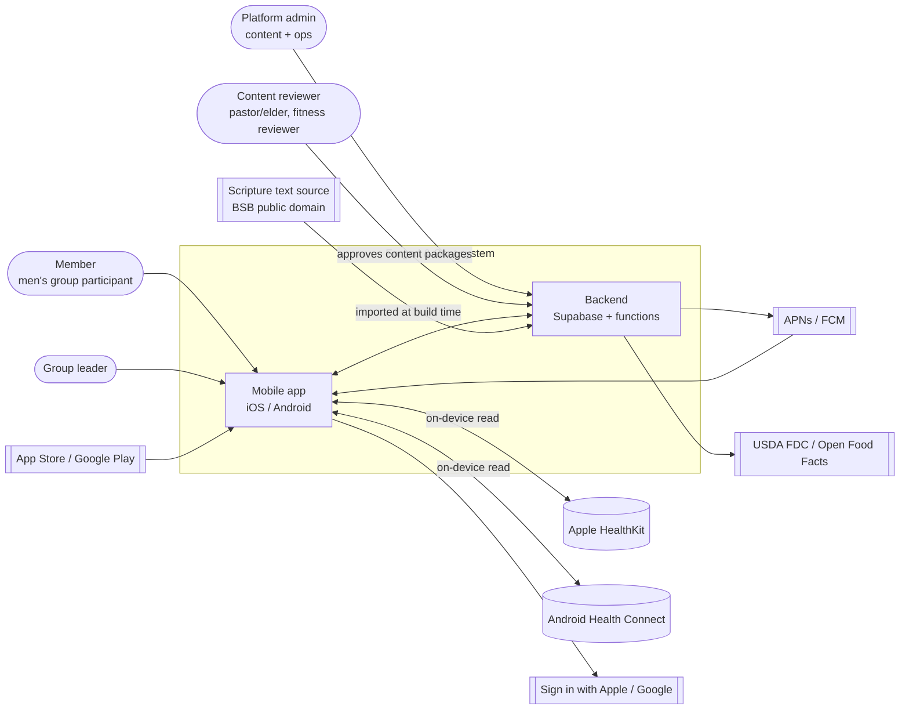

### 2. Container / deployment (Stage A → B)

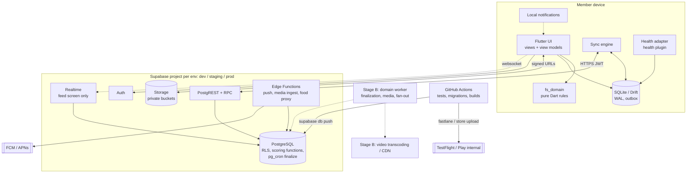

### 3. Logical components and allowed dependencies

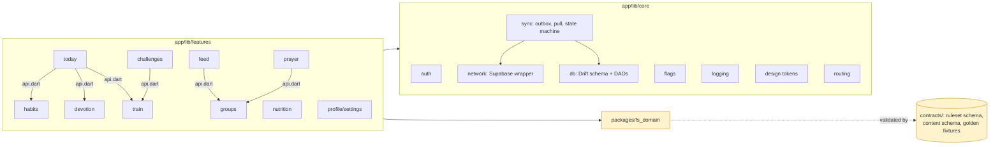

*Rule: arrows between features may target only `api.dart`. `core` never imports `features`. `fs_domain` imports nothing from Flutter.*

### 4. Domain model (conceptual, aggregates)

```mermaid
classDiagram
  direction LR
  class Member { userId; displayName; tz; birthYear }
  class Group { id; tz; settings }
  class Membership { role; state }
  class PrayerRequest { scope; status }
  class HabitDefinition { kind; scored; cadence }
  class HabitCheckin { localDate; source; performedAt }
  class ProgramVersion { slug; version }
  class SessionTemplate { templateDay; slots }
  class Enrollment { startDate; restDow; equipment }
  class WorkoutSession { state; leaseDevice; revision }
  class SetEntry { kind; load; reps; seconds }
  class MovementVariant { equipmentSetup }
  class PersonalRecord { metric; value }
  class Ruleset { version; body }
  class ChallengeInstance { state; opensAt; closesAt }
  class ChallengeAttempt { mode; value; performedAt; receivedAt }
  class ScoreEvent { points; ruleVersion; supersedes }
  Group "1" o-- "*" Membership
  Member "1" o-- "*" Membership
  Group "1" o-- "*" PrayerRequest
  Group "1" o-- "*" HabitDefinition
  HabitDefinition "1" --> "*" HabitCheckin
  ProgramVersion "1" *-- "*" SessionTemplate
  Enrollment --> ProgramVersion : pins
  Member "1" o-- "*" WorkoutSession
  WorkoutSession "1" *-- "*" SetEntry
  SetEntry --> MovementVariant
  PersonalRecord --> MovementVariant : keyed by
  ChallengeInstance --> Ruleset : pins
  ChallengeInstance "1" o-- "*" ChallengeAttempt
  ScoreEvent --> Ruleset : evaluated with
  ScoreEvent ..> HabitCheckin : derived from
  ScoreEvent ..> WorkoutSession : derived from
  ScoreEvent ..> ChallengeAttempt : derived from
```

### 5. Member and group use cases (informal; flowchart in place of UML use-case notation)

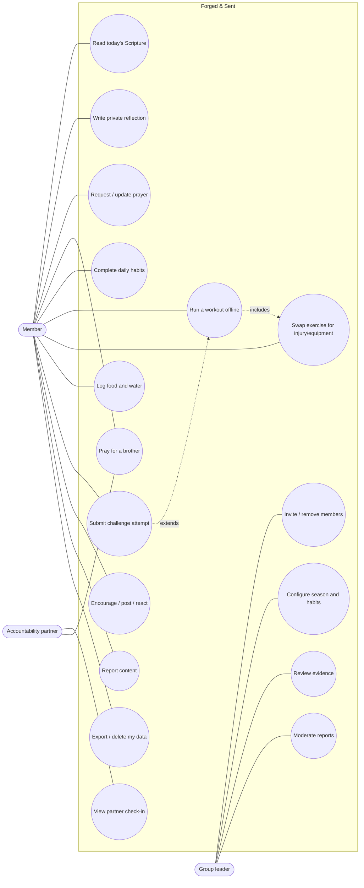

### 6. Workout execution sequence (offline-capable)

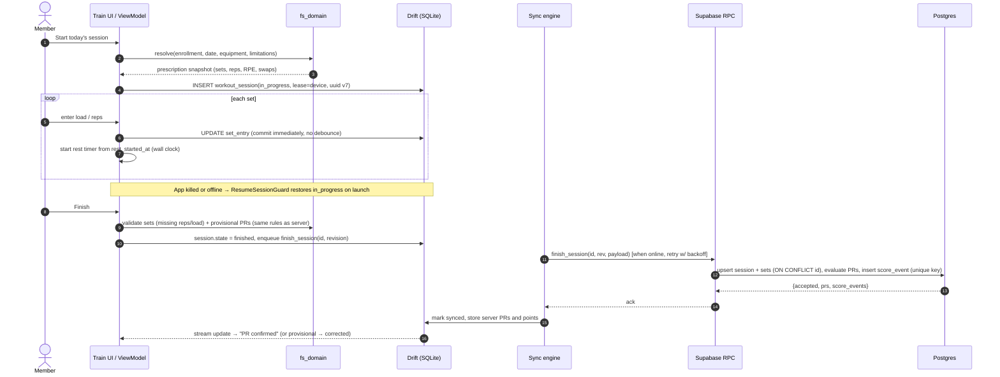

### 7. Habit completion and scoring sequence

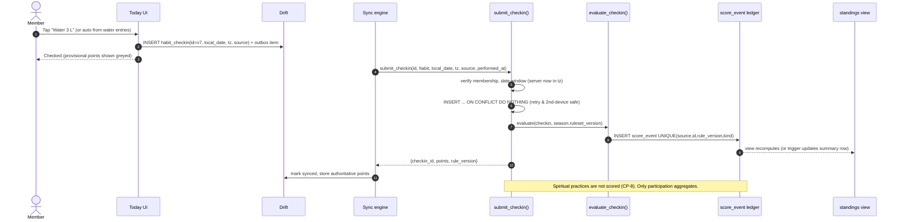

### 8. Offline synchronization: outbox item state machine

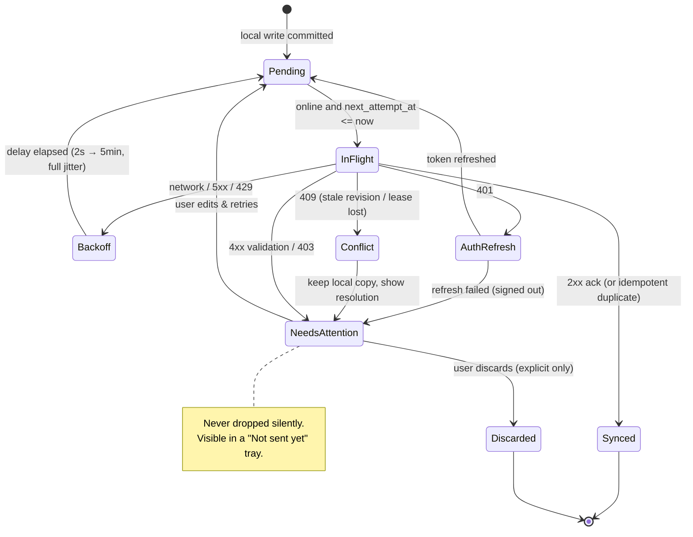

### 9. Challenge lifecycle state machine

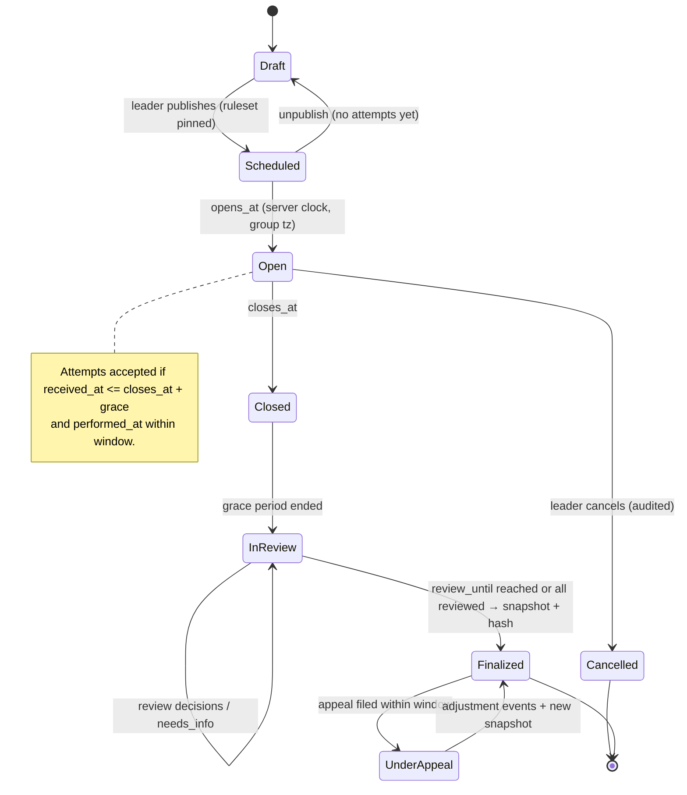

### 10. Requirements hierarchy (SysML-inspired) and traceability

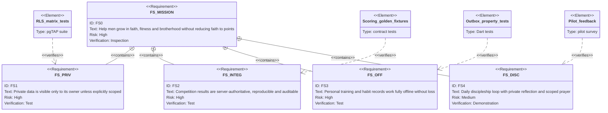

**Traceability matrix (seed set; maintain in `docs/requirements/requirements.yaml`)**

| ID | Requirement (shall) | Parent | Source / rationale | Component | Verification | ADR |
|---|---|---|---|---|---|---|
| FS-PRV-001 | Every `public` table shall have RLS enabled and forced, with at least one policy | FS1 | R1 | `supabase/migrations` | CI check + pgTAP | ADR-004 |
| FS-PRV-002 | A member shall not read any row of a group he is not an active member of | FS1 | R1, R11 | RLS policies | RLS matrix test | ADR-004 |
| FS-PRV-003 | Progress photos and body measurements shall be readable only by their owner | FS1 | E.8.6 | Storage + RLS | Integration test (other user → 403) | ADR-004 |
| FS-PRV-004 | Account deletion shall leave zero rows keyed by the user, except anonymized finalized snapshots | FS1 | R10, Apple 5.1.1(v) | `delete_account()` | Deletion sweep test | ADR-011 |
| FS-PRV-005 | Push payloads for prayer/private items shall contain no item content | FS1 | E.6.3 | push-dispatch fn | Payload snapshot test | — |
| FS-INT-001 | Clients shall not write any score-bearing column | FS2 | R2 | schema, RPC | Schema lint + test | ADR-005 |
| FS-INT-002 | Score shall be a deterministic function of facts and ruleset version | FS2 | R4 | `evaluate_*()` | Golden fixtures | ADR-005 |
| FS-INT-003 | Retrying any command shall not create duplicate facts or score events | FS2/FS3 | E.4 | RPC + unique keys | Retry-storm test | ADR-006 |
| FS-INT-004 | Deadlines shall be evaluated with server time in the group's time zone | FS2 | R3, R11 | `submit_attempt()` | Clock-skew test | ADR-005 |
| FS-INT-005 | Finalized results shall be immutable; corrections recorded as adjustments with actor and reason | FS2 | R4 | ledger, snapshot | Test + audit query | ADR-005 |
| FS-OFF-001 | A set entry shall be durable on device before the UI confirms it | FS3 | R5 | Drift DAO | Kill-app integration test | ADR-006 |
| FS-OFF-002 | In-progress sessions shall be resumable after process death | FS3 | R5 | ResumeSessionGuard | Integration test | ADR-006 |
| FS-OFF-003 | No queued mutation shall be discarded without explicit user action | FS3 | R5 | outbox | Property test | ADR-006 |
| FS-OFF-004 | Programs and today's devotional shall be available offline at first launch | FS3 | E.4 | bundled content | Airplane-mode E2E | ADR-008 |
| FS-TRN-010 | The displayed prescription shall include intensity (RPE/RIR) and deload status from the program | FS3 | E.8.1 | train/domain | Golden schedule test | ADR-008 |
| FS-DSC-001 | Devotional, prayer and reflection activity shall not contribute to individual public scores | FS4 | R13, CP-8 | ruleset | Ruleset schema test | ADR-012 (needs approval) |
| FS-DSC-002 | Reflection entries shall default to private | FS4/FS1 | E.7 | prayer/devotion | Unit + RLS test | — |
| FS-CNT-001 | Every content package shall record license and human approval before publish | FS0 | R12 | fs_content CLI | CI gate | ADR-009 |

---
## H. Migration strategy

### H.1 Disposition summary

| Preserve as-is (content) | Extract (rules and data, then re-implement) | Redesign | Discard / retire |
|---|---|---|---|
| Movement library (`movements.json`), substitution table (`alternates.json`), movement standards, coaching text, challenge definitions, program day data **from `seed/` (with RPE/RIR intact)**, season themes, mission copy (after editorial review) | Water and calorie window math, Mifflin-St Jeor calculator, prescription parser behavior (`parseSets`), ramp-set display, "last time" suggestion, PR rule (as a baseline to change), Sabbath rest rule, design tokens | Scoring, challenges, PRs, streaks, devotional flow, fasting, feed (group-scoped), habits (group versus personal), onboarding, account deletion, health contract | `B` adapter, `window.claude` coupling, `sample`-based nutrition, test-date control, `diag/` path, `versions/` directory (164 MB), embedded base64 assets, manual lift PR board, `dev/mock-claude.js` |

### H.2 Versioned assets to create (Phase 1)

| Asset | Source in prototype | Package id | Validation |
|---|---|---|---|
| Movements + variants | `seed/movements.json` (218) | `movements@1` | Every program slot resolves; every equipment setup resolves; video URL reachable (manual) |
| Substitutions | `seed/alternates.json` | `substitutions@1` | from/to exist; reasons ∈ typed set; disclaimer present |
| Programs ×4 | `seed/workouts.json` + `workout-meta.json` + `workout-themes.json` + `workout-programs.json` | `program/forged@1` … | **Round-trip**: `generate(templates) == seed rows` for all 1,460 days. RPE/RIR preserved. Duplicate warm-up movements reported (46) |
| Devotionals | `seed/devotionals.json` (366) | `devotional_plan/forged-daily@1` | See H.3 |
| Challenges + standards | `seed/weekly-challenges.json`, `movement-standards.json` | `challenges/year-1@1`, `standards@1` | Unit/scoredBy compatibility; target semantics; every movement in a description maps to a standard |
| Default group habits | `seed/tasks.json` | `habits/default@1` | Kinds ∈ supported set; points live in the **ruleset**, not the habit |
| Ruleset | constants scattered in idx (L1806-1820, L1945-1946, CHAL.scoring) | `ruleset/forged-season@1` | JSON-Schema + golden fixtures; **owner-approved** (CP-1…CP-10) |

### H.3 Validating the 366 devotionals

1. **Rights first (blocking).** Identify the author of "Daily Devotional: 365 Days for Men". If it was AI-generated for this project, record that and treat every entry as unreviewed. If it comes from a published book, obtain written permission or replace it.
2. **Scripture text check (automated).** Compare each `text` against the BSB source for `ref`, normalizing punctuation. Report mismatches, partial verses and range errors. `fs_content validate --scripture bsb`.
3. **Reference sanity (automated, already passing):** 366 distinct, well-formed refs; Feb 29 present [V].
4. **Theological review (human).** 12 monthly batches; two reviewers (pastor/elder + one layman); checklist: text in context (no proof-texting), doctrinal claims, tone (shame versus grace), assumptions about marriage and family, safety (fasting, confession, abuse scenarios that should route to a pastor, not an app). Record `approved_by` and `approved_at` per batch in the package.
5. **Editorial.** Reading level, length (currently 41-82 words plus the verse), consistent voice.
6. **Versioning.** Corrections publish `forged-daily@2`; completions reference the package version they used.

### H.4 Identifier continuity

| Prototype id | Production id | Rule |
|---|---|---|
| Challenge `w01-endure` … `w52-family` | Same text id in `challenges/year-1` | **Keep verbatim** (they appear in `chsubs` keys) |
| Movement names (`"Back Squat"`) | `back-squat`; variant `back-squat/full-gym` | Alias table maps every prototype name and equipment-resolved name |
| Programs `Forged`/`Built`/`Engine`/`Warrior` | `forged`, `built`, `engine`, `warrior` | Keep `day`, `week`, `block`, `templateDay` semantics |
| Tasks `t_devo`, `t_water`, … | Habit kinds `devotion`, `water`, … | Mapping table in `content/legacy-map.yaml` |
| Users (artifact-scoped opaque ids) | New auth UUIDs | Claim flow (H.5); never reuse |
| Dates `YYYY-MM-DD` (device-local) | `local_date` + `tz` = group tz (America/Phoenix) | Phoenix has no DST [V, prototype comment L4065], so the mapping is lossless for this group |

### H.5 Can existing user data be exported?

- **Shared collections** (`checkins`, `posts`, `replies`, `likes`, `profiles`, `chsubs`, `ideas`, `tasks`, `lifts`): the artifact owner can list them through the artifact database tooling [I, platform docs; not attempted].
- **Private per-member data** (`data/users/<id>/…`: food logs, workouts, photos, settings, onboarding): **not readable by the owner** ("private even from the owner", platform db docs) [V doc]. Each member would have to export it himself from inside the page; the page already has the `downloads` capability (`seed/db-rules.json`).
- **Is it worth it?** The prototype has existed since 2026-10-24 [V]. **Recommendation [P]:** do **not** migrate points or streaks; start fresh at the production launch. **Optionally** add one prototype feature, "Export my training history (JSON)", so men can import workout history and PR baselines later through a claim code. Decide in M-Q6.

### H.6 Should the prototype stay in the main repository?

**Yes, frozen and slimmed [P].** Tag `prototype-v154`. Move `index.html` and `seed/` snapshots to `legacy/prototype/` (read-only by CODEOWNERS). Delete `versions/` from the working tree; git history and the tag retain every version. The prototype keeps serving the current group until the production pilot replaces it.

### H.7 Comparing new behavior against the legacy prototype

1. **Characterization harness [P].** Extract the pure functions from `index.html` (`stepBonus`, `parseSets`, `topReps`, `calWindow`, `derive`, `chalStandings`, `chalBetter`, `lastWorking` logic) into a Node script that `eval`s only those function bodies against JSON fixtures. Generate `contracts/golden/legacy/*.json`.
2. Each golden case is tagged **`keep`** (production must match: e.g., ramp-set parsing, the water threshold) or **`changed-by:CP-n/ADR-n`** (production intentionally differs: e.g., volume PR points, Scaled 50).
3. The Dart domain package and SQL scoring functions run the same fixtures in CI. Any unexplained divergence fails the build.

### H.8 Phased roadmap (vertical slices; no dates by design)

| Phase | Depends on | Deliverables | Acceptance criteria | Key risks | Exit gate |
|---|---|---|---|---|---|
| **0. Decide and protect** | — | Answers to blocking questions (M); ADR-001…012 approved; prototype tagged; **interim prototype hardening decision** for the season starting 2026-11-02 (see note) | ADRs merged with owner sign-off | Analysis paralysis | Signed ADR set; scope cut list agreed |
| **1. Content and rules foundation** | 0 | `tools/fs_content` (validate, generate, package); content schemas in `contracts/`; program round-trip; devotional rights decision + validation reports; `ruleset v1` JSON; legacy golden fixtures | CI validates all content; `generate(templates) == seed` for 1,460 days; ruleset passes schema + goldens | Devotional rights unresolved | Content CI green; ruleset approved |
| **2. Walking skeleton** | 1 | Flutter app with flavors; auth (Apple, Google, email OTP); group create/invite/join; Supabase dev/staging/prod; migrations; RLS on all tables; RLS matrix tests; CI/CD to TestFlight + Play internal; crash reporting | Automated test: users in group A cannot read anything of group B; build reaches both stores' internal tracks | RLS complexity | Two-group isolation test green in CI; **contracts frozen v1** |
| **3. Slice: Train, offline** | 2 | Enrollment; computed schedule with RPE/deload shown; session logger on Drift; outbox; `finish_session` RPC; PR evaluation (CP-5); history | Airplane-mode full workout → kill app mid-set → resume → reconnect → exactly one session server-side; PR goldens pass | Sync bugs | FS-OFF-001…003 and FS-TRN-010 verified |
| **4. Slice: Today and discipleship** | 3 | Group habits + check-in RPC; scoring ledger; canonical group board; devotional package offline; private reflection; prayer list (personal); water/food (manual + FDC search); local reminders | Retry-storm test (100 duplicate submits → 1 fact, 1 event); board == ledger sum; no spiritual points (FS-DSC-001) | Scope creep into nutrition | Daily loop usable offline; ledger reproducible |
| **5. Slice: Brotherhood** | 4 | Group feed (text + photos), comments, reactions; prayer requests with scopes; accountability partner; report/block/moderation queue; push (no content in payloads) | Apple 1.2 checklist; push payload snapshots; block hides both ways | Moderation load | UGC + privacy tests green |
| **6. Pilot release (Stage A)** | 5 | Account deletion + export; privacy policy, terms, support contact; 18+ gate; store listings; Data safety form | Section E.6.4 gate all green; deletion sweep test; restore drill done | Store review | Group of 5-30 on TestFlight/closed testing for 2+ weeks with zero data-loss incidents |
| **7. Slice: Challenges** | 6 | Seasons, instances, attempts (photo evidence only), review queue, finalization job, snapshots, appeals | Lifecycle transition tests; finalize → re-run gives the identical hash | Policy disputes | First season run end-to-end in production |
| **8. Health and nutrition depth** | 6 | HealthKit/Health Connect import (steps, weight, workouts) with provenance and dedupe; OFF barcode | Dedupe tests; store health declarations approved | Platform review | Accepted by both stores |
| **Stage B** | 7-8 | Multi-group admin, org (optional), teams, domain worker, PITR, video (if approved) | Section K | — | — |

**Note on the 2026-11-02 season.** `CHAL.assumptions.week1Start` is `2026-11-02` [V], one week after this review, and the production app cannot exist by then. **Options [P]:** (a) run Season 1 in the prototype openly as honor-system scoring, with the "Testing: change the date" control hidden (a one-element change) and the scoring caveats explained to the men; (b) run challenges on paper or a spreadsheet and keep the app for daily habits; (c) delay the season. The platform's `{self}` rule pattern needs the document id to equal the user id [V, platform docs]. `checkins/{date}_{uid}` and auto-id `posts` therefore **cannot** be owner-protected without a data restructure [I]. Do not invest in deep prototype hardening; its useful life is short.

**Avoiding premature parallel work:** until the Phase 2 exit (contracts frozen v1), only one slice is in flight at a time and only one person or agent edits `contracts/` or `supabase/migrations/`. Parallel work starts in Phase 4+, and only across features that share no tables.

---

## I. Backlog and priority

Scoring is 1-5 (5 = high value or risk reduction; complexity 5 = hardest). **Priority = Value + Risk reduction − Complexity/2**, with dependencies respected.

### I.1 MVP: Release 1 "Pilot" (Stage A, one group)

| # | Item | Value | Risk ↓ | Complexity | Depends | Priority |
|---|---|---:|---:|---:|---|---:|
| 1 | Auth + single group + invites + roles + RLS matrix | 5 | 5 | 3 | — | 8.5 |
| 2 | Offline workout logging (programs from templates, swaps, timers, history) | 5 | 5 | 4 | 1 | 8.0 |
| 3 | Content pipeline + bundled content packages | 4 | 5 | 3 | — | 7.5 |
| 4 | Daily habits + check-in RPC + scoring ledger + one group board | 5 | 4 | 3 | 1 | 7.5 |
| 5 | Devotional (offline) + private reflection | 5 | 2 | 2 | 3 | 6.0 |
| 6 | Account deletion/export, privacy policy, age gate | 3 | 5 | 2 | 1 | 7.0 |
| 7 | Group feed (text + photo), reactions, comments | 4 | 2 | 3 | 1 | 4.5 |
| 8 | Report/block/moderation queue | 3 | 4 | 2 | 7 | 6.0 |
| 9 | Prayer requests with scopes + "I prayed" | 5 | 2 | 2 | 1 | 6.0 |
| 10 | Local reminders (devotional, check-in) | 4 | 1 | 1 | — | 4.5 |
| 11 | Water + simple manual food log (FDC search optional) | 3 | 1 | 2 | — | 3.0 |
| 12 | PR detection (variant-keyed, e1RM) | 4 | 3 | 2 | 2 | 6.0 |

### I.2 Release 2 (pilot feedback-driven)

Challenges with seasons, review and finalization (photo evidence) · accountability partners · push notifications · HealthKit/Health Connect steps and weight · group study prompts (weekly) · Scripture memory (private) · leader console in-app (configure habits and season) · fasting (private, safety screen) · progress photos (private bucket).

### I.3 Release 3 (Stage B)

Multiple groups per user and cross-group switching · organization layer (if a church asks) · teams and team aggregation · reading-plan library and translation choice per group · barcode food search · data export self-service · analytics for leaders (aggregate only) · domain worker · PITR.

### I.4 Deferred (needs explicit business case)

Video proof and transcoding · direct messaging and group chat (a moderation and safety burden; the feed plus prayer covers the pilot) · AI meal-photo estimation · AI "coach" chat · women's program (special-category data) · public cross-church leaderboards · youth participation · web app.

### I.5 What I would refuse to build yet

Per-man public rankings of spiritual practice, public fasting tags, video-required proof, DMs, cross-group public feeds, minors, payments/subscriptions, Kubernetes or microservices, a custom sync engine beyond the outbox, and SysML-formal models.

---
## J. Recommended engineering process and AI development setup

### J.1 Process for two developers plus Claude Code and Codex

| Area | Recommendation [P] |
|---|---|
| Repository | Monorepo as in E.2 (Dart pub workspace or melos). One repository keeps contracts, migrations and app changes in one reviewable PR. |
| Branching | Trunk-based. `main` protected; short-lived `feat/FS-XXX-nnn-slug` branches; squash-merge. A `release/x.y` branch only for store hotfixes. |
| Pull requests | Template fields: FS ids, ADR refs, screenshots/recordings for UI, test evidence (commands + results), data classification for new fields, "affects scoring?" checkbox. Required checks: analyze, unit/widget tests, pgTAP, content validate, zone guard, codegen-clean. **≤ ~400 changed non-generated lines.** |
| Code ownership | `CODEOWNERS`: `contracts/`, `supabase/migrations/`, `docs/adr/`, `docs/rules/`, `content/**/approved.yaml` → **both** humans (2 approvals). Everything else → either human (1 approval). Agents never approve. |
| ADRs | MADR format in `docs/adr/NNN-title.md`; status `proposed → accepted → superseded`. Required for anything listed in Section L or anything that changes a protected zone. |
| Requirements | `docs/requirements/requirements.yaml` (id, text, parent, rationale, verification, status). CI fails if an `accepted` requirement has no test whose name contains its id. |
| Coding standards | Effective Dart; `analysis_options.yaml` with `strict-casts`, `strict-inference`, `strict-raw-types`, a strict lint set (`very_good_analysis` or `flutter_lints` plus additions), bans on `print` and empty catches; `sqlfluff` for SQL; `deno lint` for Edge Functions. |
| Test layers | **Unit:** `fs_domain` (rules, prescription, PR, provisional scoring) and view models. **Widget:** each screen × {loading, empty, error, offline, data}. **Integration (`integration_test`):** Drift + local Supabase (CLI) for sync, kill-and-resume, retry storms. **E2E on device:** a small set of critical flows (airplane-mode workout, invite/join, delete account); evaluate Patrol or Maestro for native permission dialogs (HealthKit). **Contract:** golden fixtures shared by Dart and SQL; generated DB types must match the schema. **pgTAP:** the RLS matrix plus scoring functions. |
| Migration testing | CI runs `supabase db reset` (all migrations from zero) **and** applies new migrations to a schema-only snapshot of prod. Lint for destructive statements (`DROP`, `ALTER ... TYPE`) without an ADR label. Expand/contract for renames. |
| Seed/content validation | `fs_content validate` is a required check; content packages are built in CI and attached to releases. |
| CI/CD | GitHub Actions: PR → lint/test (Linux) + iOS build (macOS runner) + Android build. `main` → deploy migrations and functions to **staging**, build to TestFlight/Play internal. Tag `vX.Y.Z` → manual approval → prod migrations → store submission (fastlane). |
| Environments | `dev` (local Supabase CLI per developer), `staging`, `prod`: separate Supabase projects, FCM projects and app flavors (`main_dev.dart` …). No prod data in dev. |
| Secrets | GitHub Environments with required reviewers for prod; Supabase service-role key only in CI and Edge Functions; `gitleaks` in pre-commit and CI. |
| Dependency and security scanning | Dependabot (pub, npm/deno, GitHub Actions); `osv-scanner`; `gitleaks`; CodeQL for TypeScript Edge Functions (CodeQL does not analyze Dart). |
| **Definition of Ready** | FS id with acceptance criteria; data classification known; affected zones identified (needs ADR?); UX states listed (offline/error/empty); size estimate ≤ one PR, or split. |
| **Definition of Done** | Acceptance criteria demonstrated; tests per layer above; analyzer clean; no new warnings; docs/ADR updated; zone guard green; reviewed by a human (+ reviewer agent where J.2 says so); deployed to staging and smoke-tested. |
| **Release acceptance** | E.6.4 gate green; no open CRITICAL/HIGH defects; crash-free sessions ≥ the threshold agreed for the pilot on staging/TestFlight; migration rehearsal on a prod snapshot; restore drill within the last quarter; store metadata, privacy labels and Data safety form updated; release notes. |

**Keeping multiple AI agents from making incompatible changes to shared architecture.** Text instructions alone are not enforcement.

1. **Single-writer zones** (contracts, migrations, ADRs, rules, approvals) are guarded by `CODEOWNERS`, by the CI zone guard (`proposed-agent-config/tools/check_zones.sh`: label + ADR id required; merged migrations immutable) and, inside Claude Code, by a **PreToolUse hook**. Claude Code docs state that hooks, not instructions, are the way to block an action [V, code.claude.com memory docs].
2. **Generated code is regenerated in CI** (DB types, freezed/json/drift). Any diff fails, so two agents cannot hand-edit generated interfaces differently.
3. **One task, one branch, one worktree.** Claude subagents that write use `isolation: worktree` [V field]. Codex tasks run on their own branches.
4. **Serialize contract changes:** at most one open PR labelled `contract-change` at a time (a CI check queries open PRs). Feature PRs rebase onto it.
5. **Bounded tasks:** every agent task names its FS id, the allowed paths, and the acceptance tests. Reviewers reject PRs that touch paths outside the declared set.

### J.2 Agents and skills: the minimum useful set

**Principle:** use an *agent* only where independence matters (a reviewer that did not write the code) or tool permissions must differ. Use a *skill* for repeatable procedures. Everything else stays ordinary engineering. Drafts are in `proposed-agent-config/` (not installed; dot-folders renamed so nothing is discovered by accident).

**Verified conventions (2026-10-26).**

- Claude Code project subagents are Markdown files in `.claude/agents/` with YAML frontmatter. `name` and `description` are required; `tools`, `disallowedTools`, `model`, `skills`, `isolation`, `permissionMode` and `hooks` are supported ([sub-agents](https://code.claude.com/docs/en/sub-agents)).
- Claude Code project skills live at `.claude/skills/<name>/SKILL.md` ([skills](https://code.claude.com/docs/en/skills)).
- Codex discovers skills at `$REPO_ROOT/.agents/skills` (and from CWD upward); `SKILL.md` requires `name` and `description` ([Codex skills](https://developers.openai.com/codex/skills)).
- Claude Code reads `AGENTS.md` only when no `CLAUDE.md` exists, or through an `@AGENTS.md` import, and **does not read `.agents/`** ([memory](https://code.claude.com/docs/en/memory)).
- **Therefore:** `AGENTS.md` is canonical, and `CLAUDE.md` = `@AGENTS.md` + Claude specifics. Skills are canonical in `.agents/skills/` and **copied** to `.claude/skills/` by a sync script that CI checks for drift. Copy rather than symlink, because the repository is developed on Windows (`C:\ws_c\…`), where git symlinks need Developer Mode or `core.symlinks`.

#### Subagents (Claude Code)

| Agent | Purpose | Invoke when | Inputs | Allowed modifications | Required references | Outputs | Verification duty | Read-only? | Interaction / escalation |
|---|---|---|---|---|---|---|---|---|---|
| `architecture-reviewer` | Independent conformance review | PR touches more than one feature, a protected zone, `core/sync` or `fs_domain` | Diff range, FS id | **None** | AGENTS.md, ADRs, review §E-F, `contracts/` | Findings table + APPROVE / REQUEST CHANGES / ESCALATE | Runs zone guard and analyzer | **Yes** | ESCALATE on any ADR conflict; never resolves it. Humans decide and record an ADR. |
| `security-privacy-reviewer` | Threat-model review, RLS verification | Migrations, RLS, storage, auth, push, health, deletion/export, logging, sensitive content | Diff range | **None** (may run the local disposable Supabase) | §E.6 threat model + gate | Findings with proving tests; gate status | Runs pgTAP and RLS suites | **Yes** | ESCALATE on scope widening, a new data category, a new processor, minors, health or prayer flows |
| `test-engineer` | Fill test gaps without touching production code | After implementation, before review | FS ids, diff | Test directories only; golden *proposals* to `_proposed/` | Requirements yaml | Tests + results + bugs found | Runs suites; adds `FS-` named tests | No (tests only) | A bug found → failing test + report; never fixes production code |

#### Skills (shared by Claude Code and Codex)

| Skill | Purpose | Allowed modifications | Notes |
|---|---|---|---|
| `fs-feature-slice` | The vertical-slice recipe (E.2 rules) | One feature dir + tests | The default implementation procedure; runs in the main session |
| `fs-db-migration` | Migration + RLS + pgTAP + regen types | `supabase/` (protected zone → label + ADR) | Human approval mandatory |
| `fs-scoring-rule-change` | Ruleset version bump + goldens + SQL/Dart parity | `contracts/`, scoring SQL, `fs_domain` | Requires an approved CP-n policy |
| `fs-content-validate` | Validate, generate and package content; review packets | `content/` (never `approved.yaml`) | Feeds human theology and fitness review |
| `fs-architecture-review` | Review checklist | none | Preloaded by `architecture-reviewer`; used directly by Codex |
| `fs-security-review` | Security checklist | none | Preloaded by `security-privacy-reviewer`; used directly by Codex |
| dart-lang skills (already in your local `.agents/skills`, pinned in `skills-lock.json`) | Dart/Flutter mechanics (tests, mocks, analysis, JSON, routing) | per task | Keep; commit `skills-lock.json` to the new repo |

**Not agents (on purpose):**

- **Flutter implementation** is the main session's job, using the slice skill.
- **UI/UX and accessibility** stay human-led design plus widget-test checks; add an agent later if it would review against a written design system.
- **Theology and faith content** is human review. An optional later `content-reviewer` agent may *flag* proof-texting, tone and assumptions in review packets, but **approval is never delegated to AI**.
- **Exercise data validation** belongs to the `fs_content` CLI. Deterministic checks beat an LLM.
- **CI/CD and release** is a skill later if the release steps grow.
- **Generic "code review"** is covered by the two reviewers plus the human.

**Optional specialists later:** `content-reviewer` (flag-only, with the faith and fitness checklists), `release-engineer` (store metadata, privacy labels and Data safety diff), `sync-specialist` (if PowerSync is adopted).

---

## K. Scaling roadmap

| | **Stage A: private pilot (5-30)** | **Stage B: communities (100-5,000)** | **Stage C: platform (10,000-100,000+)** |
|---|---|---|---|
| Topology | One Supabase Pro project per env; Edge Functions; pg_cron | Same + **domain worker** (container on a managed runtime) for finalization, notification fan-out and media; read replica optional | Supabase Team/Enterprise or self-managed Postgres (exit via `pg_dump`); worker pool; CDN; possibly split media and messaging services |
| Database | Micro/Small compute; < 1 GB | Small → Large; indexes on `(group_id, local_date)` and `(user_id, local_date)`; summary tables for standings | Partition `habit_checkin`, `set_entry`, `score_event` by month; read replicas for feeds and leaderboards; connection pooling (Supavisor/pgBouncer) |
| Authorization | Group membership + roles in RLS | + org admin role; per-group settings; cross-group visibility off by default | + platform-level abuse tooling; RLS helper functions with careful indexing (RLS predicates on every query) |
| Bottlenecks | None technically; **human**: moderation, content review | RLS query cost on feeds; Realtime connection count (Pro includes 500 peak, then $10/1,000) [V]; push fan-out per group | Feed and leaderboard reads; media egress; noisy groups; support load |
| Scaling mechanisms | — | Summary tables updated by triggers; pagination with keyset cursors; per-group Realtime channels | Partitioning, replicas, caching standings snapshots at the CDN, queue-based fan-out |
| Background jobs | pg_cron: challenge finalize, orphan media sweep, reminders (server-side push) | Worker with a job table (`SKIP LOCKED` queue); idempotent jobs | Dedicated queue service if job volume demands |
| Monitoring | Crash reporting; Supabase logs; weekly manual review | SLOs (sync success rate, finalize on time, p95 RPC latency); alerting; audit-log dashboards | On-call rotation (or a managed provider); synthetic checks; cost dashboards |
| Backup / recovery | Daily backups (Pro, 7 days) [V]; monthly logical dump to separate storage; restore drill | **PITR** ($100/mo per 7 days) [V] before significant prayer data; quarterly drills | PITR with longer retention; cross-region dump; documented RPO/RTO |
| Security | E.6.4 gate | + penetration test before opening to churches; DPA with processors; leader training | + formal privacy program; regular external audits |
| Cost drivers | ≈$25/mo base [V price; scenario D.5] | Compute tier, **media**, Realtime | **Media egress/storage** (dominant if video), compute, staff |
| Transition to next stage | Add `organization_id` (nullable), worker, PITR, multi-group UX | Partitioning, replicas, operational staffing | — |

**Decisions now that avoid migrations later [P]:** UUID keys generated on the client; `group_id` on every shared row from day one; `local_date + tz` on every day-scoped fact; append-only facts and ledger; versioned content and rulesets; storage paths that include `group_id/owner_id`; no cross-group assumptions in RLS helpers; a feed API with keyset pagination from the start.

**Decisions deliberately deferred:** organizations, teams, video, chat, a read replica, partitioning, a custom API service, multi-region.

---

## L. Architecture Decision Records to approve before implementation

| ADR | Decision (proposed) | Alternatives considered | Consequences | Blocking? |
|---|---|---|---|---|
| ADR-001 | **Rebuild; do not port or wrap the prototype.** The prototype is a frozen spec and data source. | Capacitor wrap; incremental port of JS | + clean authority model; − weeks before parity; prototype serves meanwhile | **Yes** |
| ADR-002 | **Flutter** for iOS/Android | RN + Expo (fallback), KMP, native | + one UI engine, Drift, `health`; − no web reuse | **Yes** (needs M-Q1) |
| ADR-003 | **Supabase/Postgres** as the system of record | Firebase, custom API, self-host | + relational integrity, RLS, SQL; − sync not built in, RLS testing burden | **Yes** |
| ADR-004 | **Group as tenant; RLS deny-by-default; privacy scopes enum**; org deferred | Org-first; app-level authorization in an API | + simple pilot, additive org later | **Yes** |
| ADR-005 | **Server-authoritative scoring ledger + versioned rulesets + finalization** | Client scoring; recompute-on-read | + fair, auditable, reproducible; − more backend work up front | **Yes** |
| ADR-006 | **Offline: Drift + outbox + client UUIDv7 + idempotent RPCs; single-writer session lease** | PowerSync now; Firestore; online-only | + small surface, no vendor; − own the sync code | **Yes** |
| ADR-007 | **Defer PowerSync**; keep schema compatible | Adopt now | Revisit if shared mutable sync appears | No |
| ADR-008 | **Content as versioned packages built by `fs_content`; programs generated from templates; RPE/RIR restored** | Keep materialized 1,460 rows; CMS | + editable programs, smaller app; − build a CLI | **Yes** |
| ADR-009 | **Content governance:** license metadata + human approval required to publish; BSB default translation | Ship as-is; ESV licensing | Devotional rights become a launch blocker | **Yes** |
| ADR-010 | Observability: crash reporter choice (Sentry versus Crashlytics), redacted logging, audit log | None | Small cost; privacy review of the vendor | No (before pilot) |
| ADR-011 | **Account deletion and export as server jobs; tombstones for group content** | Client loop (current) | Meets Apple 5.1.1(v) | Before pilot |
| ADR-012 | **Faith-practice scoring firewall** (CP-8, CP-9): no individual points for devotion, prayer or reflection; fasting private | Keep current points | Product identity change; needs owner and pastor buy-in | **Yes (product)** |
| ADR-013 | **Challenge scoring policy** (CP-1…CP-7, CP-10) | Current flat-50 / leader-relative | Fairness; requires the season-1 decision | Before the challenges slice |
| ADR-014 | **No video in MVP**; photo evidence only | Video now | Big cost and privacy win; less "proof" | Before the challenges slice |
| ADR-015 | **18+ only in v1** | Youth allowed | Legal simplicity | Before pilot |
| ADR-016 | **Repository layout and protected zones** (J.1) | Polyrepo | Enforces agent safety | **Yes** |

---

## M. Questions for the project owners

### Blocking (answer before Phase 1)

1. **Q1. Team skills.** Who are the two developers, and what has each shipped (Flutter, React/TypeScript, SQL)? *Decides ADR-002 (Flutter versus Expo; D.3 sensitivity).*
2. **Q2. Product identity.** Is Forged & Sent primarily *a discipleship community that also trains*, or *a fitness competition with faith content*? Do you accept the scoring firewall (no individual points for devotion, prayer or reflection; fasting private)? *Decides ADR-012 and the shape of Today and the Board.*
3. **Q3. Competition stakes.** Will there ever be prizes, money, public cross-church rankings or official results? *Decides how much evidence and review the engine needs (CP-7, ADR-014) and the legal review.*
4. **Q4. Devotional rights.** Who wrote "Daily Devotional: 365 Days for Men"? Was it generated for this project, adapted from a book, or licensed? *Launch blocker (ADR-009).*
5. **Q5. Season 1 timing.** The challenge year starts 2026-11-02 in the prototype. Run it as honor-system in the prototype, run it off-app, or delay? *Decides Phase 0 work (H.8 note).*
6. **Q6. Prototype data.** Must any existing data (workout history, PRs, posts) carry over, or is a fresh start at production launch acceptable? *Decides whether to build the in-prototype export (H.5).*
7. **Q7. Audience boundary for v1.** One men's group only? Is any women's or youth participation planned within a year (the `seed/women/` branch suggests so)? *Decides the privacy design for cycle data and minors (ADR-015).*
8. **Q8. Prayer privacy default.** Should prayer requests default to *accountability partner*, *leaders*, or *whole group*? Who besides the author may ever see private prayers (no one, or an elder under defined circumstances)? *Decides RLS policies and the pastoral escalation path.*

### Important, can wait until the relevant slice

9. **Q9. Who governs content and theology?** Name the pastor or elder reviewers, which tradition(s) the content must respect, and who may change a published devotional. *(ADR-009 operating model.)*
10. **Q10. Challenge fairness policy.** Approve, modify or reject CP-1 to CP-7 (divisions, personal-improvement scoring, minimum bracket size, frozen brackets, the PR rule, the step cap, the evidence policy). *(ADR-013; before Phase 7.)*
11. **Q11. Leader powers.** Can a group leader edit group habits mid-season, remove members, see individual devotional participation, or only aggregates? *(E.6.1.)*
12. **Q12. Commercial intent.** Free forever, donation-supported, or paid? *Affects ESV/API licensing (non-commercial terms), Open Food Facts ODbL obligations, store billing and the Team-plan decision.*
13. **Q13. Family challenge inclusivity.** Provide variants for single, divorced, widowed and childless men, or keep a married-father focus by design? *(E.7.1.)*
14. **Q14. Health integration priority.** Is steps/weight import needed for the pilot, or can it wait for Release 2? *(Phase 8 ordering; store health declarations.)*
15. **Q15. Operations ownership.** Who is on the hook for moderation reports, account issues and incident response, with what response time? *(The E.6.4 gate needs a named owner.)*

---

## N. Professional recommendation

**What I would build first:** the walking skeleton with **isolation tests** (auth, one group, invites, RLS deny-by-default, CI to both store test tracks), then the **offline workout slice**, which is the product's strongest asset and its hardest technical requirement, then the **Today loop on the scoring ledger** with private reflection and prayer.

**What I would refuse to build yet:** video proof, chat/DMs, multi-church organizations, public cross-group leaderboards, AI nutrition or coaching features, the women's program with cycle data, youth accounts, custom sync beyond the outbox, microservices or Kubernetes, and per-man public rankings of spiritual activity.

**What I would preserve from the prototype:** the four programs (from `seed/`, with RPE/RIR intact), the movement, substitution and standards libraries, the 52-week challenge content and season arc, the devotional *structure* (Scripture → prayer → reflect → act), the Sabbath-rest principle, the grace-forward copy, the water coalescing and proof-kept-on-device instincts, the "Forged Iron" visual identity as tokens, and the prototype ids (`w01-endure`, program and day semantics).

**What I would redesign immediately:** authorization (deny by default, group-scoped), scoring (server ledger, versioned rules, finalization), PR detection (variant-keyed, e1RM, no volume points), the challenge incentive structure (divisions instead of flat 50), the faith experience (discipleship loop, scoring firewall, private fasting), the training data model (templates and a computed schedule), and account deletion.

**Technical decisions that could prove expensive mistakes:**

1. Wrapping or porting the prototype, which keeps client-authoritative scoring.
2. Choosing a document store for the scoring and tenancy core.
3. Shipping without RLS matrix tests: silent cross-group leaks.
4. Letting clients write points "temporarily".
5. Storing schedules as materialized per-day rows again.
6. Enabling video before a cost and moderation plan exists.
7. Building custom bidirectional sync for everything instead of append-only facts plus an outbox.
8. Device-local dates and a hard-coded time zone.
9. Letting AI agents edit migrations and contracts in parallel.
10. Launching with unverified devotional rights.

**The next three engineering tasks:**

1. **Decide and record.** Answer the 8 blocking questions. Accept ADR-001 to ADR-006, ADR-008, ADR-009, ADR-012 and ADR-016. Tag `prototype-v154`. Decide the Season 1 approach for 2026-11-02 (removing the date-override control from the live prototype is the one change worth making now).
2. **Build `tools/fs_content` with round-trip validation.** Schemas in `contracts/`; regenerate all 1,460 program days from templates with RPE/RIR restored and an exact-match test; validate movements, substitutions and challenges; produce the devotional review packet. This turns the prototype's most valuable asset into versioned, tested data and de-risks everything after it.
3. **Stand up the walking skeleton with the security spine.** A Flutter shell with flavors, Supabase dev/staging/prod, the first migrations (profile, group, membership, invite) with forced RLS and a generated pgTAP RLS matrix, CI to TestFlight and Play internal, and an automated two-group isolation test as the first required check.

---

*Prepared as an independent second opinion. It agrees with the earlier proposal on Flutter, Supabase, feature-first MVVM, repositories, server-authoritative scoring and a modular monolith, but each of those was re-derived here from the repository evidence, with conditions. It disagrees on several points: Flutter versus Expo is close to a tie that team skills decide; scoring must be a ledger with versioned rules and finalization rather than just "server-side"; the prototype should not be ported; spiritual practice should be removed from competitive scoring; and video should be deferred.*

---

## Addendum: re-verification at `b66e93e` (v162), 2026-10-27

After this review was written, 8 more commits landed (v155-v162, HEAD `b66e93ebb8a1e7be44368301c87a4ec87280b0e0`, 2026-10-26 22:08 MST). I re-ran every check against the new HEAD.

### What changed

`git diff a71efab b66e93e`, excluding `versions/`: `index.html` +262/−60, `seed/workout-themes.json` (a per-day `purpose` field), `seed/workout-meta.json` (a one-line note), `README.md` (version range). [V]

| Version | Change | Bearing on this review |
|---|---|---|
| v155-v157, v159-v160 | Coach Gideon guidance moved and folded; exercise page with Muscles, Video and Coach tabs; muscle thumbnails | UI only. No change to findings. |
| v158, v162 | **Pick 3 lifting days.** The week template's A/B/C days map onto three chosen weekdays, stored as effective-dated entries `plan.lifts: [{from, days}]` in private settings. A change applies from the next plan week while the current week stays locked. A back-to-back warning and confirmation are shown. | **Positive [V].** This is effective-dated, computed scheduling, the same shape the review proposes for `program_enrollment` + `schedule_override` (E.8.2). Carry it forward as `enrollment_lift_days(enrollment_id, effective_from, dows[3])`. The recovery-day warning is sound training guidance. |
| v161 | The Today progress ring counts the three custom habits | Reinforces E.5.1: self-defined habits keep equal weight with shared ones |

### Do the findings still hold?

**Yes. All 15 risks persist unchanged.** The seed audit produced identical results except for the shifted line numbers of the embedded data (`evidence/seed_audit.out.txt` was regenerated at the new HEAD). `seed/db-rules.json` is unchanged, so R1 stands. Every code construct cited for R2-R15 still exists byte-for-byte. Only its position moved (+51 lines before L2800, +159 to +201 after).

### Line-reference map (a71efab → b66e93e)

| Construct | a71efab | b66e93e |
|---|---|---|
| Test-date control UI | L1588 | L1639 |
| `B` adapter | L1631 | L1682 |
| `B.saveDay` | L1706 | L1757 |
| `watchLikes` | L1743 | L1794 |
| `deleteMyData` | L1770 | L1821 |
| `stepBonus` | L1810 | L1861 |
| `PR_PTS = 25` | L1820 | L1871 |
| `TEST_DATE` | L1881 | L1932 |
| `pointsOf` | L1920 | L1971 |
| `streak` | L1926 | L1977 |
| `derive` | L1949 | L2000 |
| Fast-day auto-check | L1966 | L2017 |
| `writeDay` | L2035 | L2086 |
| PR generic-name key | L2420 | L2471 |
| Deload hint | L2470 | L2521 |
| `awardPRs` | L2631 | L2682 |
| `parseSets` | L3080 | L3239 |
| `saveWkNow` (`catch(noop)`) | L3102 | L3261 |
| `chalDeadline` | L4066 | L4254 |
| `chalIsOpen` | L4071 | L4259 |
| `myBracket` | L4119 | L4307 |
| `chalStandings` | L4136 | L4324 |
| `max(flat, std)` | L4155 | L4343 |
| Submission-open check | L4658 | L4848 |
| `chalSave` | L4677 | L4867 |
| `drawBoard` | L4772 | L4962 |
| Fasting tag | L4813 | L5003 |
| `deletePost` | L5039 | L5229 |
| `report` | L5041 | L5231 |
| Check-in by any post | L5117 | L5307 |
| `openSteps` manual entry | L5432 | L5622 |
| `diag/` write | L5967 | L6168 |
| `setTestDate` | L6714 | L6915 |
| `start()` | L6825 | L7026 |

### Net effect on recommendations

None of the recommendations change. Two notes:

1. Add effective-dated lift-day selection to the schedule model (F.1 ProgramEnrollment, E.8.2) and to the legacy golden fixtures (H.7). It is now a **keep** behavior.
2. The prototype is still changing several times a day. Ask the developer to treat further prototype work as UX exploration only. **Freeze the prototype at a tag once Phase 0 starts**, so the characterization fixtures (H.7) aren't chasing a moving target.
