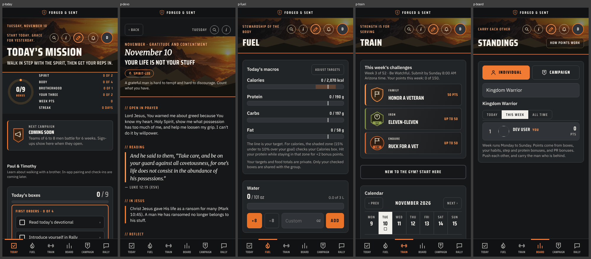

# Prototype-to-Flutter review

Reviewed 2026-11-10 against `main` at `94daa63`. Read-only review; nothing in the repository was changed.

> [!IMPORTANT] The answer in three lines
> 1. **The prototype is a coherent product.** Keep its design and its daily loop.
> 2. **The stack is right.** Riverpod, go_router, Drift, Firebase. Change nothing.
> 3. **The current plan will not build it.** `main` is 194 lines of Dart, and the only planned feature is a two-card demo that deliberately excludes the prototype's design, content, rules and saving.

## Do these, in this order

- [ ] **1. Decide.** Fill in five answers on the [Decisions](01-DECISIONS.md) page. About ten minutes.
- [ ] **Shortcut for steps 2 onward.** Paste [P00](prompts/P00-orchestrator-kickoff.md) into Claude Code. It runs the prompts below in order with Codex reviewing, and stops for your pushes and merges.
- [ ] **2. Unblock CI.** Answer A2, then paste [P12](prompts/P12-let-ci-accept-binary-assets.md). Today the required check rejects any pull request with an image or font, which every step below contains.
- [ ] **3. Publish.** Paste [P01](prompts/P01-publish-review-and-record-decisions.md) into an agent. It puts this review, your answers and the rules cleanup on `main`.
- [ ] **Optional. Let agents merge.** Answer A3, then paste [P13](prompts/P13-let-agents-merge-after-review.md) after P01 merges. Until then only you merge.
- [ ] **4. Hosts.** Paste [P03](prompts/P03-native-hosts-pr.md). It publishes your Android and iOS hosts.
- [ ] **5. Make it look right.** Paste [P04](prompts/P04-S0-design-foundation-and-shell.md): design tokens, fonts, six-tab shell.
- [ ] **6. Make it real.** Paste [P05](prompts/P05-S1-today-and-devotional.md): Today and Devotional, saved on the phone.

> [!TIP] You only fill things in once
> Every prompt reads your answers from the [Decisions](01-DECISIONS.md) page. You never edit a prompt.

## Stop doing, for now

- [ ] Hosted AI review gate (PR #48). Keep `ci-gate` required.
- [ ] Architecture Atlas and `CODE-MAP.md` upkeep.
- [ ] Obsidian first-use pilot.

Why: of 391 commits on `main` since 2026-10-27, 4 touched `mobile/lib`. See [Build plan](02-BUILD-PLAN.md).

## The blockers

| # | Blocker | Fixed by |
|---|---|---|
| 🔴 B1 | **Two prototypes.** `main` is v238 plus your privacy fixes. The live app is v254 on an unmerged branch: different tabs, two habits, new point sources, none of the fixes. | Q1, then P01 or P02 |
| 🔴 B2 | **Your 10-27 decisions are not on `main`.** They sit on an unmerged branch whose ADR numbers collide with `main`'s. The prototype conflicts with several of them. | Q2, then P01 |
| 🔴 B3 | **No plan reaches the prototype.** No feature contracts on `main`; a 7-row parity table for about 90 surfaces. | New work board and parity tracker, published by P01 |
| 🔴 B4 | **No design system.** The Flutter theme colour comes from a retired palette. | P04 |
| 🟠 B6 | **Effort is going to process.** | The stop list above |
| 🔴 A13 | **CI rejects every pull request that contains an image or font.** The hosts, the design foundation and this review all do. Found by running your policy check on the pending changes. | A2, then P12 |

Details: [Findings](04-FINDINGS.md).

## All pages

| Page | Open it when |
|---|---|
| [01 Decisions](01-DECISIONS.md) | You are ready to answer the questions. **The only page you edit.** |
| [02 Build plan](02-BUILD-PLAN.md) | You want the sequence S0 to S4 with done-checklists |
| [03 Agent prompts](03-AGENT-PROMPTS.md) | You want to hand work to Codex or Claude Code |
| [04 Findings](04-FINDINGS.md) | You want every issue with severity, evidence and fix |
| [05 Prototype](05-PROTOTYPE.md) | You want what the prototype does, what to keep, what is wrong |
| [06 Screens and UI](06-SCREENS-AND-UI.md) | You want the screen-by-screen matrix, colours, fonts, components |
| [07 Architecture](07-ARCHITECTURE.md) | You want the diagram, the boundaries and five traced journeys |
| [08 Evidence](08-EVIDENCE.md) | You want exactly what was checked and what was not |
| [09 Agent rules audit](09-AGENT-RULES-AUDIT.md) | You want to know why the Obsidian pages fell behind and what was changed in the agent rules |
| [Full report](FULL-REPORT.md) | You want it all as one file |

## All prompts

| # | Prompt | Step | Run when | You fill in | Reads answers |
|---|---|---|---|---|---|
| P01 | [Publish the review, my decisions and the rules cleanup](prompts/P01-publish-review-and-record-decisions.md) | Decide | You filled in the five TODO answers on the Decisions page | Nothing | Q1, Q2, Q5, Q6, Q7 |
| P02 | [Reconcile the two prototype forks](prompts/P02-reconcile-prototype-baseline.md) | Decide | P01 merged | Nothing | Q1 |
| P03 | [Publish the Android and iOS hosts](prompts/P03-native-hosts-pr.md) | Prepare | P12 merged: the host projects contain launcher icons | Nothing | None |
| P04 | [Design foundation and tab shell](prompts/P04-S0-design-foundation-and-shell.md) | S0 | P12 merged | Nothing | Q1 |
| P05 | [Today and Devotional, real and saved](prompts/P05-S1-today-and-devotional.md) | S1 | P04 merged | Nothing | Q5, Q6, Q7, Q9, Q10 |
| P06 | [Private journal](prompts/P06-S2-private-journal.md) | S2 | P05 merged | Nothing | Q8 |
| P07 | [Workout logging, one program](prompts/P07-S3-workout-logging.md) | S3 | P05 merged | Nothing | Q11, L11 |
| P08 | [S4 contract: sign-in, groups, first shared board (design only)](prompts/P08-S4-contract-identity-groups-board.md) | S4 | P05 merged | Nothing | Q2, Q3, Q4, Q9, Q10 |
| P09 | [S4 implementation](prompts/P09-S4-implement-identity-groups-board.md) | S4 | P08 merged and you changed its status to approved | Nothing | Q2, Q3, Q4 |
| P10 | [Independent review of a PR (give to the other AI)](prompts/P10-independent-review.md) | Any | An open PR written by a different agent than the one you paste this into | ==`<<FILL: PR number>>`==, ==`<<FILL: step>>`== | None |
| P11 | [Fix review findings (one round)](prompts/P11-address-review-findings.md) | Any | A review from P10 exists on the PR | ==`<<FILL: PR number>>`== | None |
| P12 | [Let CI accept reviewed images and fonts](prompts/P12-let-ci-accept-binary-assets.md) | Prepare | A2 answered on the Decisions page | Nothing | A2 |
| P13 | [Let agents merge after independent review](prompts/P13-let-agents-merge-after-review.md) | Prepare | P01 merged: this edits the rule files P01 publishes | Nothing | A3 |
| P14 | [Archive the Copilot and Gemini rule files](prompts/P14-archive-copilot-and-gemini-rules.md) | Prepare | P01 merged | Nothing | A1 |
| P00 | [Orchestrator kickoff: Claude builds, Codex reviews](prompts/P00-orchestrator-kickoff.md) | Run everything | Every answer on the Decisions page is filled in | Nothing | None |

## Reading the IDs

| Prefix | Meaning | Page |
|---|---|---|
| **Q** | A decision only you can make | [Decisions](01-DECISIONS.md) |
| **R** | A rule conflict behind a decision | [Decisions](01-DECISIONS.md) |
| **S** | A build step (S0 to S4) | [Build plan](02-BUILD-PLAN.md) |
| **P** | A ready-to-paste agent prompt | [Agent prompts](03-AGENT-PROMPTS.md) |
| **B / L / I** | Finding: blocker / before launch / later | [Findings](04-FINDINGS.md) |
| **U** | Prototype product or UX problem | [Prototype](05-PROTOTYPE.md) |
| **F** | UI fidelity difference | [Screens and UI](06-SCREENS-AND-UI.md) |
| **J** | A traced user journey | [Architecture](07-ARCHITECTURE.md) |

## If you follow the current plan exactly

**Missing: all of them.** The plan's product work ends at a synthetic two-card Today that deliberately excludes the prototype's design, content, rules and persistence, followed by one blocked line ("durable completion") and one deferred line ("Firebase and authorization"). There is no planned Devotional page, workout, journal, Fuel, Board, Campaign, Rally, Profile, Settings, onboarding or sign-in.

**Materially different, even where something is built:**

| Experience | How it would differ | Why |
|---|---|---|
| Look and feel | Stock Material widgets, olive seed colour, platform font | No tokens, fonts or shared components are planned; the seed colour comes from a retired palette |
| Today | Two placeholder cards and "Demo only" copy | FNS-001's contract |
| Which Today | Possibly the wrong one | The reference is forked and the live version is not on `main` |
| Scoring and boards | Undefined | The prototype's rules conflict with approved decisions that are not on `main` |
| Saving | In memory, reset on restart | Drift is accepted but unscheduled |

**Why:** the plan was built from the bottom up (tooling, review gates, hosts, a pattern demo) and never from the prototype down. Nothing in it names a prototype screen and says what "done" looks like.

**The smallest change that prevents this:**

1. **One decision meeting** covering Q1, Q2, Q5, Q6 and Q7, recorded on `main`.
2. **Replace the next three board items** (gate acceptance, Obsidian pilot, synthetic Today as its own milestone) with **S0 and S1**: merge the native hosts, land the design foundation and shell, and turn the Today demo into the real Today and Devotional saved in Drift, with the acceptance criteria in [section 7.3](02-BUILD-PLAN.md).
3. **Keep the seam, tests and safety rails you already have.** They are good. Point them at a real screen.

That is two pull requests of feature work and no change to any accepted technology choice.

> [!WARNING] What this review did not do
> Flutter was not run: no analyzer, tests, emulator or device. Statements about how the Flutter app looks are inferred from source. See [Evidence](08-EVIDENCE.md).
