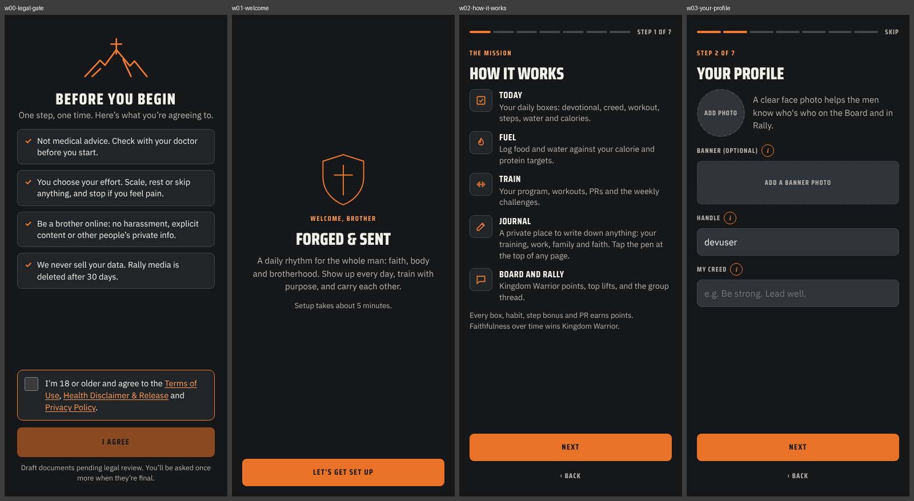
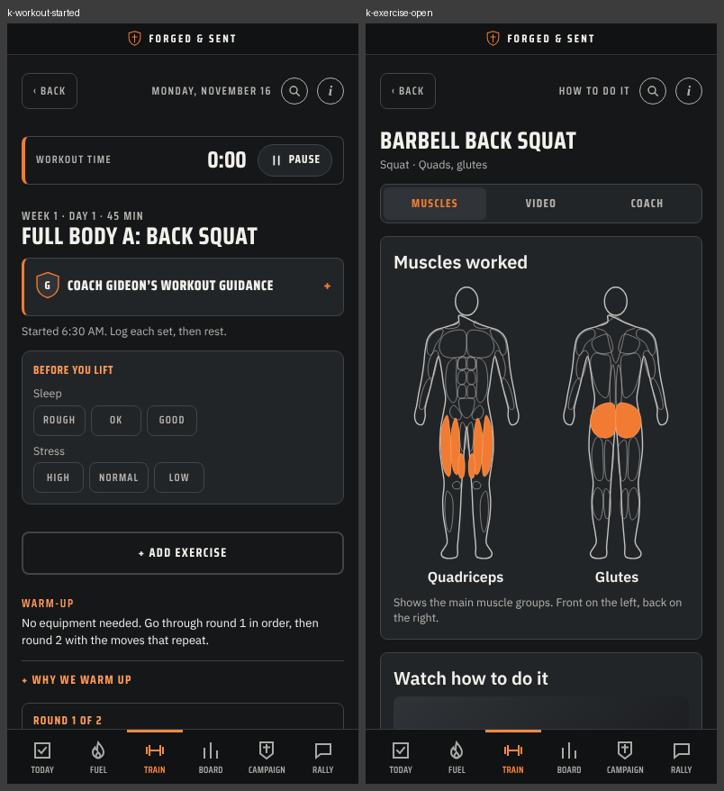

[Start here](00-START-HERE.md) · Back: [Findings](04-FINDINGS.md) · Next: [Screens and UI fidelity](06-SCREENS-AND-UI.md)

# Prototype assessment

> [!IMPORTANT] In one minute
> - **It works as a product.** Clear daily loop: Devotional, Workout, boxes that fill themselves, Rally.
> - **Keep:** the devotional structure, scroll-to-Amen, the workout prayer, grace language, the journal's save logic, the visual system.
> - **Do not carry over:** client-computed scores, silent save failures, history keyed by plan position, privacy copy that overstates what is private.
> - Rule conflicts that need your decision are on the [Decisions](01-DECISIONS.md) page (R1 to R8).

Line numbers refer to `index.html` at `main` commit `94daa63`.

## 3.1 The daily loop

**Open Today → Devotional → Workout → the boxes that fill themselves → Rally → mission complete.**

- **Today** shows a progress ring split into Spirit, Body, Brotherhood and personal habits, week points, streak, and a list of "boxes".
- **Devotional** (+2) opens a full page: prayer, reading, In Jesus, Reflect, Act, then an optional private "Write it down". The Amen button enables only after scrolling to the bottom.
- **Workout** (+3) is opened from Train. "Start workout" presents a workout prayer; the clock starts on Amen. Finishing the workout checks the box.
- **Water, Calories, Steps** check themselves from Fuel and from a steps dialog.
- **Daily Check-In** (+1) checks itself when the man posts in Rally.
- **Your three** are manual personal habits at +1 each.
- **Sabbath** (his chosen rest day) auto-credits the workout, lowers the step goal to 7,000, and adds weigh-in and progress photos.

Screens connect to this loop consistently. Tab highlighting follows the parent section for nested pages (L3346). Every page has a help bubble and a search ("Ask").

## 3.2 What is strong and should be preserved

| Preserve | Why |
|---|---|
| Devotional structure and the scroll-to-Amen gate | It is the product's voice and a deliberate, gentle friction |
| Workout prayer before the clock starts | This is how devotion is actually integrated into training in the prototype |
| Reflection never feeds scoring | Amen does not read the journal box; journal, legacy log and family report live in a private subtree (Verified, L3431–3437, L10513) |
| Boxes that check themselves from real activity | Removes honor-system tapping where the app already knows |
| Grace language: "Start today. Grace for yesterday.", grace reset, sit-out week | Central to the identity |
| Journal save logic on `main` | Stable entry id, confirmed-not-optimistic writes, a visible retry state. It is the best-specified persistence behavior in the prototype and a direct model for Flutter |
| Workout depth: readiness check, warm-up rounds, last-time values, weight recommendation, swaps by equipment or injury, locked summary | Tested programming content; 4 programs × 365 days |
| "Forged Iron" visual system | See [section 4](06-SCREENS-AND-UI.md) |

## 3.4 Product and UX problems (not shortcuts)

| # | Problem | Evidence | Certainty | Recommendation |
|---|---|---|---|---|
| U1 | **First-week dead zone.** A man who sets up on a Tuesday sees "Your plan starts Monday" and has no programmed workout for up to six days, while "First orders" asks him to log a workout | Rendered Train after setup; L4295 | Verified | **Correct.** Start the plan on his next lifting day |
| U2 | **A workout cannot cross midnight.** After midnight the started session is no longer "today", becomes read-only, and can never be finished | L5776, L5916 | Verified (code) | **Correct.** Bind a session to its start date |
| U3 | **Workout history is keyed by position in the current plan.** Changing program, Sabbath, lifting days or library content remaps or drops old logs, PR baselines and volumes | L3920, L4696–4701 | Reviewer-read | **Correct** in the Flutter model: store the movement id and prescription with the session |
| U4 | **Privacy copy overstates what is private.** "Only your checked boxes are shared", yet the shared check-in document also holds raw step count, protein bonus, the fasting flag, the PR list and a free-text workout note | L2005, L2504 vs L2664 | Verified | **Correct** the model, then the copy |
| U5 | **Habit titles are group-readable.** The prompt invites "ones you are putting to death by the Spirit" | `seed/db-rules.json` (`habits` read: view); L3786 | Verified | **Correct.** Titles private; only the tick is shared |
| U6 | **Body weight leaks indirectly.** Bodyweight-lift volume includes body weight and is posted on the shared workout card | L4704, L4210 | Reviewer-read | **Correct** |
| U7 | **Report and Block cannot be performed.** Settings says "Use Report on the post"; no control calls it | `B.report` defined at L2739, zero callers | Verified | **Correct** before any store submission (Apple guideline 1.2) |
| U8 | **"Delete my data" is incomplete** and then says everything was deleted. Misses weights, team posts, challenge submissions and proof, team documents | L2759–2783, L10987 | Reviewer-read; L2778 verified | **Correct** |
| U9 | **Team chat says "only your team sees this"** but nothing enforces it and replies sit in one global collection | L7475, L2732 | Verified | **Defer** team chat until membership rules exist; fix the copy now |
| U10 | **Saves fail silently everywhere except the journal.** Boxes, sets, water, settings and profile swallow errors; a tap made before data loads is retried for 15 s and then dropped | L2848–2859, L3247 | Verified | **Correct** in Flutter: every saved fact has a visible saved, pending or failed state |
| U11 | **Streak cannot exceed about 35 days** because it reads a 35-day window | L2879, L2926 | Verified | **Correct** |
| U12 | **Embedded content has drifted from `seed/`.** Scaled challenge points are 25 in the app and 50 in the seed; RPE/RIR appears 3,555 times in `seed/workouts.json` and 28 times in the embedded plan | Scripted comparison | Verified | **Clarify** which is the content source for Flutter |
| U13 | **All-time points change retroactively** when task point values or the campaign change | L2917, L7232 | Reviewer-read | **Correct** with a server ledger (already your stated direction) |
| U14 | Sabbath and "full rest" each award the 3 workout points | L3149, L3159 | Reviewer-read | **Preserve** if intended as grace; write it down as a rule |

## 3.5 Normal prototype shortcuts (not defects)

| Shortcut | Status |
|---|---|
| Identity, owner role and storage come from the claude.ai artifact runtime | Real persistence there; replaced by Firebase Auth and rules |
| One global group; no tenant id in any path | Replaced by group membership |
| Scores computed in each browser | Replaced by server computation |
| Reminders | Times are saved; no notifications ("turn on when the mobile app launches") |
| Health data | A `window.ForgedHealth` bridge contract; a stub on the web |
| Food search and photo estimates | AI estimates through the runtime |
| Exercise video | Outbound YouTube link |
| Day boundary is the device's local date; owner "test date" writes real records | Needs a stated rule in production (decision Q9) |

## 3.6 States

- **Present:** boot screen, signed-out and view-only notices, most empty states, journal saving and retry, campaign saving, upload and post errors, delete progress.
- **Absent:** any offline indicator, any permission-denied state (every listener's error handler is a no-op), any failed-save feedback outside the journal, loading indicators for Rally and journal.

## What the workout looks like

