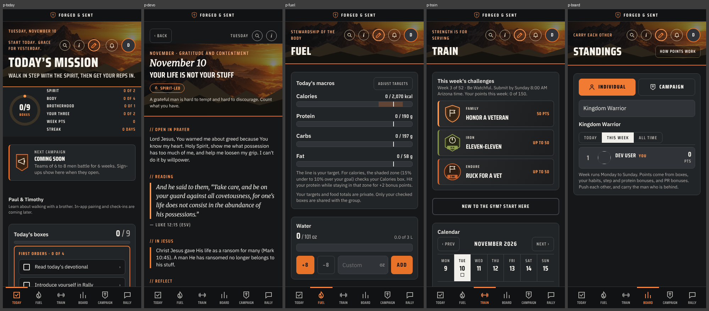
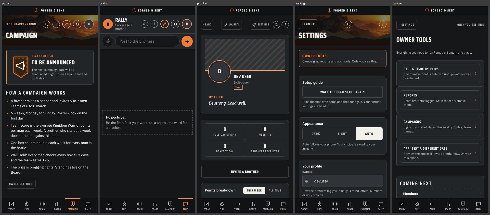
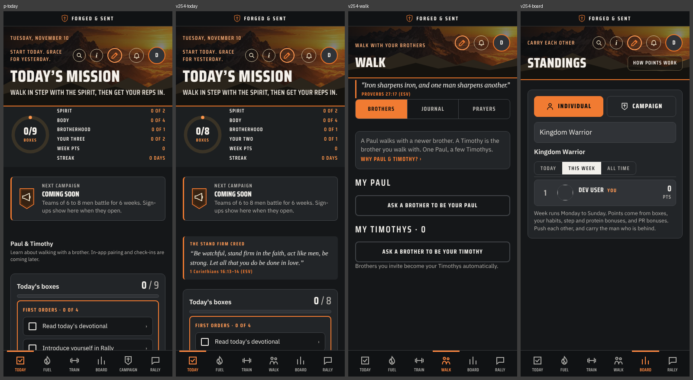

[Start here](00-START-HERE.md) · Back: [Prototype assessment](05-PROTOTYPE.md) · Next: [Architecture](07-ARCHITECTURE.md)

# Screens and UI fidelity

> [!IMPORTANT] In one minute
> - **21 rows traced.** One is "planned inconsistently" (Today). The rest are not planned beyond a one-line parity row.
> - **The look is not captured anywhere.** No tokens, fonts or shared components exist in Flutter yet. The tables below supply them.
> - **Two real drifts today:** the theme colour (F1) and missing typefaces (F2). Both are fixed in S0.

**`main` Today compared with the live v254 Today, Walk and Board**

## 4.1 Status vocabulary

| Status | Meaning here |
|---|---|
| **Not implemented yet** | Normal unfinished scope that has a real, specific plan |
| **Not planned** | No contract, task or acceptance criteria beyond a one-line parity row that the document itself calls "migration candidates, not a decision" |
| **Planned inconsistently** | A plan exists but targets something other than the prototype view |
| **Implemented incorrectly** | Code exists and contradicts the reference |

## 4.2 Every view at a glance

| View | Status | Biggest gap |
|---|---|---|
| Legal gate | Not planned | Prototype stores it in private settings and does not enforce it on writes |
| Setup wizard | Not planned | Body stats and injuries are sensitive; ADR-0005 defers storing them |
| Today | **Planned inconsistently** | FNS-001 is two synthetic cards with Material buttons; no header, ring, boxes or content |
| Devotional | Not planned |  |
| Journal editor and page | Not planned | Sensitive-field storage and sign-out retention are undecided (ADR-0005) |
| Train | Not planned | Plan-start dead zone (U1) |
| Workout | Not planned | Index-keyed history (U3); midnight (U2); rest timer silent when the phone is locked |
| Exercise detail | Not planned | Video is an outbound link |
| Weekly challenges | Not planned | Deadline enforced on the device clock; approved direction requires video capture in the first challenge release |
| Fuel | Not planned | Fasting rule (R3) |
| Board | Not planned | R1, R2; client-computed totals |
| Campaign and team | Not planned | Tab placement differs between forks |
| Rally | Not planned | Report and block unreachable (U7) |
| Profile | Not planned | Two unrelated PR systems |
| Settings | Not planned | Reminders and health are stubs; delete is incomplete (U8) |
| Owner tools | Not planned | Owner gating is hidden-flag only |
| Paul & Timothy | Not planned | The forks disagree; `main` deferred it for privacy |
| Legacy log, family report, junior challenge | Not planned | Family report sends personal text to a model without saying so |
| Help and Ask | Not planned |  |
| Sign-in | Not planned (design approved 2026-11-01) | No implementation plan |
| Developer status screen | Implemented; no product requirement | See 4.4 |

## 4.2 Full matrix

> [!NOTE]
> Wide table. Scroll sideways, or widen the pane.

All Flutter routes and components below are **proposed** unless a file path is given. Existing files are on `main` unless marked *(local branch)*.

| Prototype view and source | Key actions and states | Existing or proposed Flutter route / component | Required state, data, permissions, persistence | Status | UI / behavior gaps | Observable acceptance criteria |
|---|---|---|---|---|---|---|
| **Legal gate** `legalMaybe` L10176 | 18+ checkbox, agree; re-prompt on new version | Proposed `/agree` | Agreement version and time per user; server-recorded per `docs/design/sign-in.md` | Not planned | Prototype stores it in private settings and does not enforce it on writes | Cannot reach Today without agreeing; new version re-prompts; record survives reinstall after sign-in |
| **Setup wizard** `drawOnb` L9282, 8 steps | Profile, service record, goal and targets, training plan, habits; skip; replay | Proposed `/setup/:step` | Profile (shared), body and plan (private), habits | Not planned | Body stats and injuries are sensitive; ADR-0005 defers storing them | Each step saves on Next; killing the app mid-wizard resumes at the same step |
| **Today** `drawToday` L3691 | Ring by category, boxes, first orders, habits, grace and sit-out cards, mission-complete dialog | Existing *(local branch)*: `/today` → `today_screen.dart`. Proposed: real `TodayScreen` | Day state per (user, local date); task list; habits; streak | **Planned inconsistently** | FNS-001 is two synthetic cards with Material buttons; no header, ring, boxes or content | At 390×844 the header, ring and box rows match the prototype reference side by side, and the approved render is locked as a golden; a completed box survives restart |
| **Devotional** `drawDevo` L3392 | Scroll to bottom enables Amen; Amen checks the box; Undo | Proposed `/today/devotional` | Devotional content by date (366 days); completion event | Not planned | — | Amen disabled until end of scroll; completion persists; undo works; a screen-reader path exists |
| **Journal editor and page** `openJournal` L10418, `drawJournalPage` L10548 | New, resume draft, edit, tags, Praying for / Answered, search | Proposed `/journal`, `/journal/:id` | Private entries; stable entry id; pending, failed, saved | Not planned | Sensitive-field storage and sign-out retention are undecided (ADR-0005) | A failed save keeps the text and shows retry; a retried save never creates a second entry |
| **Train** `drawTrain` L7082 | Week calendar, day panel, move day, your week, volume, steps and weight charts, plan form | Proposed `/train` | Plan config; computed schedule; workout logs | Not planned | Plan-start dead zone (U1) | Selecting a day shows that day's session; a plan change never alters past logs |
| **Workout** `drawWorkoutPageNow` L5765 | Prayer gate, clock and pause, readiness, warm-up, set rows, auto-fill, rest timer, swaps, add exercise, finish, awards, locked summary, unlock | Proposed `/train/workout/:date` | Session with movement ids and prescription; sets saved as typed; timer from timestamps | Not planned | Index-keyed history (U3); midnight (U2); rest timer silent when the phone is locked | Kill the app mid-set and reopen: every entered set is present and the clock is correct; finishing twice does not double-credit |
| **Exercise detail** `drawVideoPage` L5144 | Muscles, video, coach tabs | Proposed `/train/exercise/:id` | Movement library | Not planned | Video is an outbound link | Muscle map and cues render offline |
| **Weekly challenges** `drawChallengePage` L6709 | Versions, standards, standings by age bracket, attempts, proof, stopwatch | Proposed `/train/challenge/:id` | Submissions (shared), proof media, server scoring | Not planned | Deadline enforced on the device clock; approved direction requires video capture in the first challenge release | A submission after the deadline is rejected by the server |
| **Fuel** `drawFuel` L3840 | Macro bars, water, fasting, food log, copy day, 7-day chart, meal ideas | Proposed `/fuel` | Private day log, targets | Not planned | Fasting rule (R3) | Water total survives restart; nothing private appears in any shared read |
| **Board** `drawBoard` L7659 | Individual / Campaign, board picker, Today / Week / All time, "How points work" | Proposed `/board` | Server-computed standings; membership | Not planned | R1, R2; client-computed totals | Standings equal the server ledger; a tampered client cannot change them |
| **Campaign and team** `drawCampPage` L7336, `drawTeamPage` L7378 | Phases, raise a team, invite, weekly double | Proposed `/board/campaign`, `/board/team/:id` | Teams, membership, owner writes | Not planned | Tab placement differs between forks | Roster locks at start; averages match the server |
| **Rally** `drawFeed` L7879 | Post, attach up to 4 media, replies, mentions, reactions, tag bell | Proposed `/rally` | Posts (group), media, moderation | Not planned | Report and block unreachable (U7) | Report and block work; a blocked author's posts disappear; posting checks the day's box exactly once |
| **Profile** `drawProfile` L8338 | Banner, creed, stats, points breakdown, lift PRs, progress photos, invite | Proposed `/profile/:uid` | Shared profile; private photos | Not planned | Two unrelated PR systems | Another man's profile never shows private fields |
| **Settings** `drawSettings` L10663, 16 sections | Appearance, profile, logging, service record, goal, food mode, targets, reminders, health, privacy, export, legal, delete | Proposed `/settings/...` | Private settings | Not planned | Reminders and health are stubs; delete is incomplete (U8) | Delete removes every document and file owned by the user, verified by an emulator test |
| **Owner tools** `drawOwner` L10640 | Reports queue, campaign settings, test date | Proposed `/owner` | Role from membership, enforced by rules | Not planned | Owner gating is hidden-flag only | A non-owner is denied by rules, not just hidden |
| **Paul & Timothy** `drawMentorPage` L10621 | Information only on `main`; live pairing in v254 | Proposed `/walk` if v254 is the baseline | Pair documents with private check-ins | Not planned | The forks disagree; `main` deferred it for privacy | Only the two men in a pair can read their check-ins |
| **Legacy log, family report, junior challenge** L3472, L3590 | Sabbath-only private writing; share or copy out | Proposed dialogs under Today | Private | Not planned | Family report sends personal text to a model without saying so | Nothing leaves the device unless he taps share |
| **Help and Ask** `openHelp` L8786, `openAsk` L9117 | Per-page help; keyword search with "take me there" | Proposed `HelpSheet`, `/ask` | Static content | Not planned | — | Each page's help opens and deep-links |
| **Sign-in** (approved design, `docs/design/sign-in.md`; not in the prototype) | Apple, Google, email; stay signed in; sign out everywhere | Proposed `/sign-in` | Firebase Auth | Not planned (design approved 2026-11-01) | No implementation plan | A second account on the same phone never sees the first account's data |
| **Developer status screen** | — | Existing: `FoundationHomeScreen` in `mobile/lib/src/app/forged_sent_app.dart` | — | Implemented; no product requirement | See 4.4 | — |

## 4.3 Traceability in both directions

**Prototype experiences with no credible Flutter path today:** all of them except a placeholder Today. `WORK.md` lists three product rows: native hosts (Ready), synthetic Today (Ready), durable completion (Blocked, no contract), plus "Firebase DEV and group authorization" (Later, no contract). `PROTOTYPE-PARITY.md` has seven rows and no acceptance criteria. No feature contract exists on `main`.

**Flutter-side work with no product requirement behind it**

| Item | Evidence | Assessment |
|---|---|---|
| Hosted AI review gate (ADR-0004 *Proposed*, PR #48, ruleset disabled) | `tooling/review`: 3,356 lines; the app it gates: 194 lines | Pause |
| Architecture Atlas and generated `CODE-MAP.md` | Maps three Dart files | Pause |
| Obsidian vault, `CURRENT` / `WORK` / `PR-STATUS` kept in parallel | Three status pages for one open PR | Collapse to one |
| Desktop targets (ADR-0003 *Proposed*) and the 720 px max-width and "larger width" tests in the demo | Android and iOS are the stated priority | Leave proposed; drop the wide-layout work |
| FNS-001's loading, empty and error views for an in-memory list that cannot fail | `today_screen.dart` *(local branch)* | Fine as a pattern demo; not product |

## 4.4 UI fidelity findings

**Design tokens to carry over** (Verified from the last-winning `:root` rules; the CSS still contains two superseded palettes underneath them)

| Token | Dark | Light |
|---|---|---|
| Background | `#151719` | `#f3f0eb` |
| Surface / raised surface | `#222528` / `#303337` | `#ffffff` / `#e4dfd8` |
| Text / muted text | `#f2f0eb` / `#b6b3ae` | `#292521` / `#68615b` |
| Hairline | `#414448` | `#d1c9c0` |
| Accent / text on accent | `#f17b32` / `#171411` | `#ae4514` / `#ffffff` |
| Highlight ("brass") | `#ff9a55` | `#9d3e13` |
| Danger | `#f08076` | `#a4281c` |
| Radius | 8 px base; 10 and 12 px on cards; full round for icon buttons | same |

| Role | Typeface |
|---|---|
| Brand wordmark | Saira Stencil One |
| Headings and labels (uppercase, tracked) | Saira Condensed 500–800 |
| Body | IBM Plex Sans 400–600 |
| Scripture | Merriweather italic |

Other measurable conventions: tap targets mostly 44–52 px; body text mostly 12–15 px; `safe-area-inset` used 32 times; reduced-motion handled; breakpoints only below 430 px (phone-only layout); Dark, Light and Auto themes.

**Reusable Flutter components needed** (all proposed, under a proposed `mobile/lib/src/design/`)

| Component | Used by |
|---|---|
| `FsTheme` (two `ColorScheme`s, `TextTheme`, spacing and radius constants) | Everything |
| `FsShell`: brand bar plus a six-destination tab bar with a top indicator | All top-level pages |
| `FsHeroHeader`: mountain photograph, kicker, title, round action buttons | Today, Fuel, Train, Board, Campaign, Settings, Devotional |
| `FsCard`, `FsSectionHead`, `FsLabelCaps` | Everything |
| `FsButton` (primary, ghost, mini), `FsIconAction` | Everything |
| `FsBoxRow`: checkbox, title, sub-line, points, chevron | Today, first orders, habits |
| `FsProgressRing`, `FsMeter` | Today, Fuel |
| `FsSegmented` | Board, Settings, Profile |
| `FsDialog`, `FsSheet` | About 40 dialogs |
| `FsScripture` block | Devotional, workout prayer, footers |
| `FsEmptyState` (dashed outline) | Rally, journal, boards |

**Differences, classified**

| # | Difference | Class | Smallest correction or adaptation |
|---|---|---|---|
| F1 | Flutter theme is seeded from `0xFF6B7C43`, an olive that matches the prototype's superseded first palette, not the current orange-on-charcoal | **Unintended drift** (Verified in source, `forged_sent_app.dart` L16) | Replace `ColorScheme.fromSeed` with explicit schemes from the table above |
| F2 | No typefaces configured; Flutter falls back to the platform default | **Unintended drift** | Bundle the four families as assets. Do not fetch fonts at runtime; the app must look right offline. All four are distributed through Google Fonts; confirm each licence before bundling |
| F3 | Demo Today uses stock Material `AppBar`, `Card`, `FilledButton`; no hero, ring or box rows | **Planned divergence** (FNS-001 says the design is not ported) | Build the real Today on the components above rather than restyling the demo |
| F4 | Prototype navigation is one scroll container with hand-drawn Back buttons and no history | **Necessary platform adaptation** | go_router `StatefulShellRoute` with six branches so each tab keeps its own stack and scroll position; Android system back and iOS swipe-back work without custom code |
| F5 | Six bottom destinations; Material guidance for `NavigationBar` is three to five | **Preserve** | Keep six with a custom `FsShell` bar; do not force it into `NavigationBar` |
| F6 | Prototype text is fixed-pixel and dense (many labels at 11–13 px) | **Necessary accessibility adaptation** | Flutter scales text with the system setting by default. Test every screen at 1.3× and 2.0×; allow rows to wrap. Minimum sizes are a **design decision** |
| F7 | Portrait lock is done with CSS rotation classes | **Necessary platform adaptation** | `SystemChrome.setPreferredOrientations` |
| F8 | Workout prayer dialog has no dismiss, Escape or backdrop exit (L8628–8640) | **Design change requiring a decision** | Android system back must do something. Either back cancels the start, or the gate is kept and back is consumed with a visible "Not now" |
| F9 | Scroll-to-Amen has no alternative path | **Necessary accessibility adaptation** | Keep the gate; expose an "I have read this" action to assistive technology |
| F10 | Rest-timer beeps depend on a page timer and stop when the phone locks | **Necessary platform adaptation** | Schedule a local notification for the end time; compute remaining time from timestamps on resume |
| F11 | Web dialogs and sheets | **Necessary platform adaptation** | `showDialog` / `showModalBottomSheet` wrapped by `FsDialog` / `FsSheet`, with keyboard insets handled once |
| F12 | Hero photograph is a 130 KB base64 string inside the CSS | **Necessary platform adaptation** | Ship it as an image asset with 2× and 3× variants |

**Is the plan specific enough to preserve unbuilt screens?** No. No document records tokens, typefaces, component names, reference screenshots or per-screen acceptance criteria. `PROTOTYPE-PARITY.md` asks for all of that per feature but supplies none. The reference screenshots I captured (delivered with this review) are the side-by-side reference for approving golden images; a Flutter golden cannot pixel-match a browser render.

