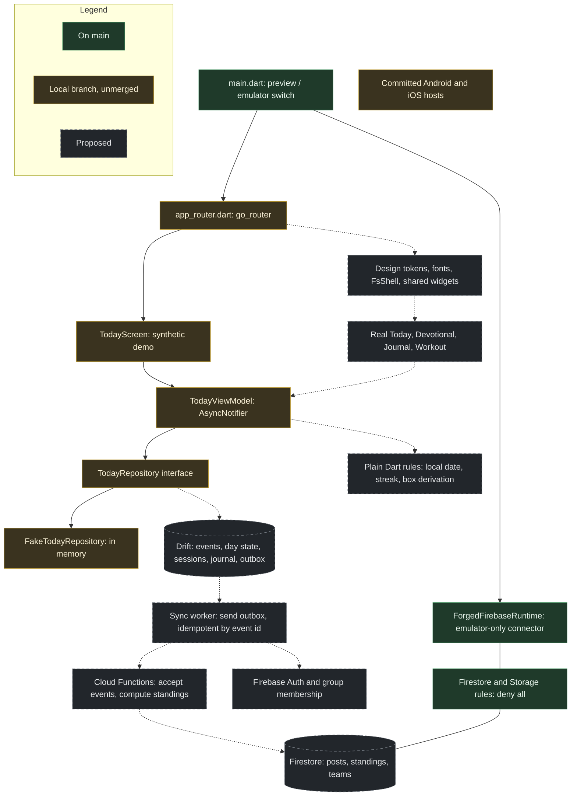

[Start here](00-START-HERE.md) · Back: [Screens and UI fidelity](06-SCREENS-AND-UI.md) · Next: [Evidence and limits](08-EVIDENCE.md)

# Architecture

> [!IMPORTANT] In one minute
> - **No accepted technology choice needs to change.**
> - **Five boundaries are cheap now and expensive later:** owner and date in the repository contract, events instead of flags, one local-date type, design tokens, one database file per user.
> - **Drift owns what a man creates. Firestore's cache serves shared feeds.** Do not mirror one into the other.
> - Keep what you have: fail-closed environments, deny-all rules, the view model and repository seam, provider-override tests.

## 5.1 Accepted, proposed, implemented, verified

| Layer | Accepted decision | Implemented on `main` | Local branch only | Verified by an actual check |
|---|---|---|---|---|
| Client framework | Flutter, Android and iOS first (ADR-0001) | Yes | — | CI builds web and a debug APK from temporary hosts |
| State | Riverpod, manual providers (ADR-0005) | No | `flutter_riverpod` in `today_view_model.dart` | Local tests only, per FNS-001 |
| Navigation | go_router (ADR-0005) | No | `app_router.dart`, two routes | Local tests only |
| Durable local store | Drift on native SQLite (ADR-0005) | No | No | — |
| Backend | Firebase Auth, Firestore, Functions, Storage (ADR-0001) | SDKs present; used only by an emulator smoke check | — | Not run by me |
| Rules | Deny by default (ADR-0001, 0002) | Yes: deny-all plus a `developer_smoke` path | — | No rules tests exist |
| Server scoring | "Server authoritative competition" (ADR-0001) | No Functions directory; no Functions emulator configured | — | — |
| Native hosts | "Later decision" (ADR-0003, Proposed) | Git-ignored, generated in CI | Committed hosts | Android builds locally, per `WORK.md`; iOS not verified |
| Targets beyond mobile | ADR-0003 is **Proposed** | Web preview only | — | — |
| Hosted AI review gate | ADR-0004 is **Proposed** | Tooling merged; ruleset disabled | — | Partially, per `CURRENT.md` |

**Conflicts between the stated direction, repository decisions and code**

- None in the stack. Pubspec, ADR-0005 and the local branch agree.
- `mobile/pubspec.yaml` declares Dart `>=3.9.0`, while the committed lockfile requires `>=3.13.0`. Tighten the constraint so a contributor on an older SDK gets a clear error instead of a churned lockfile (Verified).
- **Decision records are split.** *As found at the reviewed commit:* `main` had ADR-0001…0005. The unmerged `arch/firebase-reconciliation` branch had a different ADR-0001…0019 covering group isolation, the scoring ledger, the devotional-workout engine, competition, proof media and faith-participation privacy. The numbers collided (`main` ADR-0005 is the client stack; the branch's ADR-0005 is the scoring ledger). The product decisions approved on 2026-10-27 existed only there and in the Claude Project. *Since 2026-11-19:* the four decisions that answer Q4 carries forward are on `main` as [ADR-0006 to ADR-0009](../../architecture/SYSTEM.md), so on `main` each number means one decision. The branch keeps its own numbers, and its other fifteen records are still only there.

## 5.2 Diagram

## 5.3 What is good and should stay

- **Fail-closed environment handling.** Cloud modes are refused; the emulator project id must be `demo-*` at runtime; no silent fallback (`main.dart`, `forged_firebase_runtime.dart`).
- **Deny-all rules as the starting point.**
- **The seam on the local branch:** screen → `AsyncNotifier` → repository interface → fake. This is the shape Flutter's architecture guidance strongly recommends (views and view models, repositories, fakes for tests), and it is not over-built. No use-case layer, no service locator, no code generation yet.
- **Disabling Riverpod's automatic retry** for a user-facing load so failures are deterministic.
- **A test that feature code imports no Firebase SDK.**
- **CI is already path-filtered,** so onboarding jobs do not run on Flutter-only changes.

## 5.4 What needs a boundary now

These are cheap now and expensive after two or three screens exist.

| Boundary | Problem today | Smallest adequate form |
|---|---|---|
| **Owner and date in the repository contract** | `TodayRepository.loadToday()` takes no user and no date *(local branch)*. Every later screen needs both | `watchDay(ownerId, localDate)` returning a `Stream`; `record(CompletionEvent)` |
| **Events, not flags** | `setCompleted(id, completed)` overwrites state. A retry, a second device or an undo cannot be told apart | An append-only event with a client-generated id, plus a derived day-state row written in the same transaction |
| **Local date as a value** | The prototype reads the device clock wherever it needs "today"; midnight and travel bugs follow | One `LocalDate` type and one injected clock provider; the date is stamped on the event when the tap happens |
| **Design tokens** | None | [Section 4.4](06-SCREENS-AND-UI.md) |
| **Per-user storage** | Not designed; ADR-0005 lists sign-out retention as open | One Drift database file per signed-in user id, closed on sign-out. This keeps the previous user's **Drift rows** out of reach of the next session. It does nothing for Firestore's cache or listeners; see the note under this table |

**Account change and Firestore.** The per-user Drift file covers Drift only. Firestore keeps its own on-device cache, and it is not per user:

- The cache is on by default on Android and iOS and is not cleared between sessions or on sign-out ([Firebase: access data offline](https://firebase.google.com/docs/firestore/manage-data/enable-offline)).
- Cached documents are not separated by user, and a read answered from the cache is not checked against security rules. A Firebase engineer states the client treats the device account as the user and does not try to protect data inside it ([firebase-js-sdk #449](https://github.com/firebase/firebase-js-sdk/issues/449)). So the next user can be shown the previous user's cached feed, standings or roster before the server answers.
- A listener left open across sign-out keeps the old user's query and delivers its cached results. Rules then reject it on the server, but only after the cached snapshot has been shown.

So an account change needs a defined Firestore step, chosen in the S4 contract ([P08](prompts/P08-S4-contract-identity-groups-board.md), "Sign-out and account switching"):

| Option | What happens on account change | Cost |
|---|---|---|
| **A. Memory-only Firestore cache** (`persistenceEnabled: false`) | Nothing is written to disk, but the running instance still holds the previous user's documents in memory. Cancel every listener, then `terminate()` the instance and create a new one before the next sign-in, so that memory is discarded. Cancelling listeners alone is not enough | Shared feeds are not readable offline after a restart. Firebase strongly recommends this where cached data must not pass between user sessions ([`clearPersistence` docs](https://pub.dev/documentation/cloud_firestore/latest/cloud_firestore/FirebaseFirestore/clearPersistence.html)) |
| **B. Persistent cache, wiped on sign-out** | Cancel every listener, `terminate()`, `clearPersistence()`, then create a new instance before the next sign-in | Documented as mainly for tests; it does not securely erase data; it also drops Firestore's own pending writes. Acceptable only because Drift's outbox, not Firestore, owns everything the man creates (section 5.6). A crash between sign-out and the wipe leaves the cache in place |

Either way, every Firestore listener is session-scoped (section 5.7) and is cancelled **before** sign-out completes, and the next user's listeners start only after the new session exists. Recommendation, not a decision: **A** for the pilot, because the only Firestore data is shared group data (5.6) and offline reading of it after a restart is a small loss; revisit if a feed must work offline from a cold start. Listener behaviour across sign-out is from Firebase's documentation and issue thread, not tested here: NOT VERIFIED. So is creating a new Firestore instance in the same process after `terminate()` on Flutter: the JavaScript reference says to create a new instance, and the Flutter documentation only says that nothing but `clearPersistence()` may be called afterwards. If that cannot be done, option A is not enough by itself.

Whichever option is chosen, S4 proves it with a test before anything ships: load user A's group data, sign out, go offline, sign in as user B, and assert that no document of A's is emitted. The option is not accepted until that test passes on a device or emulator.

## 5.5 What can stay simple, and what should wait

- **Stay simple:** manual Riverpod providers; no domain use-case layer until logic spans repositories; hand-written immutable classes until there are more than a handful (then `freezed`); one Drift database class.
- **Wait:** the sync worker and Functions until a second user needs to see anything; Firestore data modelling for feeds; App Check; health integrations; desktop and durable web.
- **Do not build:** a generic offline framework. Flutter's offline-first guide describes exactly the needed pattern: write locally first, flag unsynchronized rows, let the repository own the merge.

## 5.6 Division of responsibility: Drift, outbox, Firestore cache

Firestore's client persistence is on by default on Android and iOS and queues writes while offline. It is a cache with last-write-wins, not a ledger, and ADR-0005 already says so. Pick one owner per kind of data:

| Data | Owner | Reason |
|---|---|---|
| Facts the man creates: completions, sets, journal, food, water, weigh-ins | **Drift**, then an outbox | Must survive restart, retry and conflict; must be idempotent |
| Shared, read-mostly data: Rally feed, standings, team rosters | **Firestore listeners with the SDK cache** | Do not mirror feeds into Drift; that is two caches to keep consistent |
| Content: devotionals, programs, movements | **Bundled assets** first | 366 devotionals and 4 × 365 workouts already exist as JSON; no network needed for slice 1 |
| Private journal and body data | **Drift only** until decision Q8 is made | Nothing sensitive reaches a server before rules and tests exist |

## 5.7 Riverpod lifetimes

- **App-scoped, kept alive:** database handle, clock, router.
- **Session-scoped, keyed by user id:** repositories and anything holding user data. On sign-out, close the database and invalidate the family so nothing from the previous user remains in memory.
- **Screen-scoped, auto-disposed:** view models. An in-progress workout must not live only here; its truth is in Drift so navigating away and back loses nothing.
- **Async work:** every notifier method that awaits must check `ref.mounted` before setting state, as the demo already does.

## 5.8 Journeys traced

Legend: **E** exists on `main` · **L** local branch · **M** missing with no plan · **P** planned in one line only

**J1. Devotional completion (core)**

| Step | Prototype | Flutter |
|---|---|---|
| Tap the Devotional row on Today | `drawToday` L3691 | **L** synthetic card, no navigation |
| Read; scroll to the end | `devoScroll` L3376 | **M** |
| Tap Amen | `wireDevo` L3431 | **L** toggle button with demo copy |
| Rule: mark devotional done for today's local date | `toggle` L3318, `writeDay` L3247 | **L** flips a boolean; no date, no owner |
| Save | `flushDay` L2848: whole-document set, errors swallowed | **L** in memory; **P** Drift ("Blocked") |
| Resulting state: ring, tally, streak, mission complete | `drawHeader`, `streak` L2921 | **M** |
| Feedback | Checkbox and tally; no failure state | **L** "Completed in this demo" |

Stress: *double tap* → in the prototype, check then uncheck. *Reload mid-save* → the write may or may not land, with no indication. *Two devices* → whole-document last-write-wins. Proposed design: the tap writes one event row and updates day state in one Drift transaction; the UI reads from a Drift stream, so restart shows the same state. The event's key is set out below.

> [!IMPORTANT]
> **Decided by the maintainer on 2026-11-11: option A, the event id is the completion event's only key.** The options are kept below as the record of why. An earlier version of this review made (owner, date, item) the event row's unique key. That allows one event per item per day, so "complete, undo, complete again" cannot be stored, and an undo would have to overwrite the completion, which is the flag model 5.4 rejects.

| Option | Unique key on the event row | Complete → undo → complete | Same event sent twice (retry, sync replay) | Two devices | Cost |
|---|---|---|---|---|---|
| **A. Event id only** *(chosen)* | The client-generated event id. Day state is a separate row keyed by (owner, date, item) | Three rows | Second insert is a no-op on the id | Both devices' events are kept; day state follows the latest event (rule below) | Needs an ordering rule for the derived state that does not trust the phone's clock |
| **B. (owner, date, item, sequence)** | A per-item, per-day counter assigned in the transaction | Three rows, sequence 1 to 3 | Only safe if the sequence travels with the event; a fresh retry gets a new number | Two devices both write sequence 1; the server must renumber or reject | Breaks "document id equal to the event id" in J4 |
| **C. (owner, date, item) on a state row, no event table** | One mutable row per item per day | Overwrites | Idempotent | Last write wins, history lost | This is the flag model again; no audit for scoring |
| **D. (owner, date, item, kind)** | One "complete" and one "undo" per item per day | The second "complete" is refused | Idempotent | As A | Re-completing after an undo is impossible |

**Why A.** It is the only option that stores every real action, makes a replayed event a no-op by construction, keeps J4's "document id equal to the event id", and matches P05's acceptance test 2 ("replaying the same event id leaves exactly one completion"). What comes with it:

- **Events state the target, not a toggle.** Each event says `done: true` or `done: false`. A tap whose target equals the current day state writes nothing, so a double tap on Amen cannot complete and then undo.
- **Ordering rule for day state.** The latest event wins, and "latest" never comes from the phone's clock: a clock that is wrong, or moved back, would let an older tap outrank a newer one.
  - *On one device* (all that exists before S4): each event gets the next value of a counter kept in that user's Drift file, assigned in the same transaction. The highest counter is the latest.
  - *Across devices* (from S4): each event also names the event it replaces, the one that set the day state when the tap was made. Which event wins when more than one is left unreplaced is rule R2, under **Which unreplaced event wins** below. An earlier version of this page said only that the Cloud Function picks between two events that replace the same one, by the order it received them and then by event id. That left the day state undefined when the events left over replace different ones, and said nothing about an event that arrives before the one it replaces.
  - The time of the tap, with its UTC offset, is still stored. It places the event in the man's local day (Q9) and is shown to him. It is not used to order events.
- **Tests that go with the rule.** Complete, move the clock back an hour within the same day, undo: the item is not done. Complete, move the clock back a day, tap the box: the tap belongs to the earlier date, and the first date's completion is unchanged. Two devices with clocks an hour apart complete and undo the same item: the result follows rule R2 below, whatever the stamps say. Replaying any of those events changes nothing. The further tests are listed under the rule.
- **Scoring.** Credit, when it exists, is derived from the final day state per (owner, date, item), never by counting events, so undo and redo cannot earn twice. How credit is computed stays with S4.
- **Event id form.** A random UUID minted once per tap and kept through retries. A time-ordered UUID would also do; the choice does not change the key design.

**Which unreplaced event wins: rule R2, longest chain, then event id** *(the maintainer's choice of 2026-11-19; not built)*

The maintainer chose R2 on 2026-11-19, from three candidates. The choice is not yet on the [Decisions](01-DECISIONS.md) page, which only he edits. Nothing here is implemented: S1 stores `replacesEventId` and a per-device counter, and has no chain length.

The gap this closes. Take four events for one man, one date and one item:

| Event | Made on | Asks for | Replaces | What the device had seen |
|---|---|---|---|---|
| A | Phone | done | nothing | No events |
| B | Phone | not done | A | A |
| C | Tablet | not done | A | A only |
| D | Phone | done | B | A and B |

A and B are named as replaced. C and D are not, and they replace different events, so "pick between two events that replace the same one" does not apply. One says not done, the other says done.

The rule:

- It is applied separately to each (owner, date, item).
- A new tap replaces the event that sets the day state on that device at that moment, as S1 already does (`replacesEventId`).
- Each event carries a **chain length**: 1 when it replaces nothing, otherwise one more than the chain length of the event it replaces. The device that makes the event writes the number, and it travels with the event.
- The time of the tap is never used to order events. Replaying an event changes nothing: the event id is the key.

**Three states.** The carried number is checked, never trusted. Every held event is in exactly one of three states. The Rejected checks come first: an event that meets any of them is rejected, even if it would otherwise be confirmed. The state depends only on which events are held, never on the order they arrived, so every device and Function holding the same events gives each event the same state.

| State | When | What the event does |
|---|---|---|
| **Confirmed** | It replaces nothing, its chain length is 1 and it asks for done. Or: the event it replaces is held and confirmed, its chain length is exactly one more, and it asks for the opposite | Counts for day state and for scoring, and supersedes the event it replaces |
| **Rejected** | Any one of these. Its id is not a lowercase UUID. It names itself. It names a held event of another owner, date or item. It is on a loop of links. It replaces nothing, and its chain length is not 1 or it asks for not done. The event it replaces is held, and its own chain length is not exactly one more or it asks for the same thing. The event it replaces is held and rejected | Kept for the record. Counts for nothing and supersedes nothing |
| **Provisional** | Every other case: the event it replaces is not held yet, or is held and is itself provisional | Counts for nothing and supersedes nothing, for now |

- **A provisional event is waiting, not wrong.** An event is never rejected because an earlier event in its chain has not arrived. Rejection comes only from a check that fails between two held events, or from a rejected event further up the chain.
- **States are worked out again when an event arrives.** When a missing event arrives, every event whose chain leads back to it is checked again, in order from the arrival outward: each becomes confirmed, rejected, or stays provisional if something further up is still missing.
- **A missing event can still come.** A device can only replace an event it holds, and it got that event from itself or from the server. So a missing event is either on the server already or still in the outbox of the device that made it, which sends it again. Until it comes, the events that wait for it do not count.
- **A device's own taps are confirmed on that device at once.** A tap replaces the event that sets the day state there, and only a confirmed event sets it.
- An honest client cannot make a loop or a wrong chain length, because a tap can only name an event that already existed. The rejected state is there for a faulty or altered client.

**The winner.** An event is **superseded** when a confirmed event names it as replaced. The **unreplaced** events are the confirmed events that are not superseded. The winner is the unreplaced event with the greatest chain length. If several share it, the winner is the one whose event id sorts last, comparing the ids as text, exactly as stored. Event ids are lowercase UUIDs, so two ids never differ only by case. With no confirmed event the item is not done.

- Among confirmed events, chain length fixes the target: odd is done, even is not done. So a tie on chain length is always between events that ask for the same thing. The event id decides which event is recorded as the winner; it never decides what the man sees.
- A new tap always wins on the device that made it, and on every device that has seen no more than that device had: its chain length is one more than that of any event that counted there.

The example. "Arrival order" is the order one device, or the server, receives the events.

| Arrival order | What happens | Result once all are held |
|---|---|---|
| A, B, C, D | A is 1, B and C are 2, D is 3. Each is confirmed as it arrives. C and D are unreplaced | **D wins: done** |
| A, B, D, C (the tablet syncs last) | The same states. C arrives last and is shorter than D | **D wins: done** |
| D, C, A, B (D arrives before B, which it replaces) | D is provisional, because B is not held. C is provisional, because A is not held. Not done so far. A arrives: A and C are confirmed, and C wins, not done. B arrives: B and D are confirmed | **D wins: done** |
| D, B, A, C (two events arrive before the first one) | D is provisional, because B is not held. B arrives: B is provisional, because A is not held, and D stays provisional. Neither is rejected. Not done so far. A arrives: A, then B, then D are confirmed, and D wins. C arrives and is confirmed at 2 | **D wins: done** |
| A, B, C only (D not made yet) | B and C are both 2. The id that sorts last is recorded as the winner | **Not done** either way |
| A, then X, which replaces A, asks for not done and claims chain length 5 | X is rejected: 5 is not one more than 1. A is not superseded. An event that replaces X is rejected too | **A wins: done** |

While an event is provisional, the answer on the way can differ from the final one. Once the same events are held, every device gives the same answer.

**Cost and weakness.** One new column on the event row; the check, with its three states, on the phone and later in the Function; and a migration that fills the column for S1's rows by following the replacement links within each owner, date and item. S1's counter cannot be copied: it counts every event in the database, across all items, so an item's second event can hold counter 3. Within one item on one device, a higher counter does mean a longer chain. Weakness: when two devices tapped without seeing each other, the device with more taps wins, which is not always the later tap.

**Considered and not chosen:**

- **Server arrival order.** The server numbers each event as it receives it, and the highest number wins. The answer would depend on which device syncs last, not on which tap came last: a tablet left offline for a week would override everything newer when it reconnects. Devices could not agree until the server had answered.
- **Done wins.** An unreplaced "done" beats "not done", with no number at all. An undo could fail to take: with two unreplaced events asking for done, a new undo replaces only one, and the box stays checked.

Tests the rule needs, beyond those above:

- The four events in every arrival order give D, done, once all four are held, and give the table's answers on the way.
- Two devices given the same events in different orders agree, with no server number and no clock.
- An event that arrives before the one it replaces is provisional, and does not count or supersede until its whole chain is held.
- D, B, A: D and B stay provisional, and neither is rejected, until A arrives. Then all three are confirmed, without any of them being sent again.
- When an event arrives before the one it replaces **and is then confirmed**, the one that arrived late never wins. When the early event is rejected instead, it supersedes nothing, and the late event can win.
- An event with a forged chain length is rejected, and so is every event that replaces it. Neither day state nor credit changes.
- An event that arrives first and is shown to be wrong when the event it replaces arrives is rejected then.
- An event that names itself is rejected. Two events that name each other are both rejected, whichever arrives first, and the day state is the same in both orders. A link to an event of another owner, date or item is rejected.
- A tie on chain length is broken by event id, and both tied events ask for the same thing. An event whose id is not a lowercase UUID is rejected, so two ids that differ only by case can never tie. A first event that is valid in every other way but has such an id never changes the day state. Two events that claim the same chain length with different targets cannot both be confirmed.
- A new tap beats everything that counted on the device.
- The migration is tested with writes to two items interleaved, and gives each row the chain length its links imply, whatever its counter.

**J2. Workout (core, most demanding)**

| Step | Prototype | Flutter |
|---|---|---|
| Train → day panel → open session | `drawDayWorkout` L4603 | **M** |
| Start → prayer → Amen starts the clock | `openWorkoutPrayer` L8628 | **M** |
| Enter sets | Saved 700 ms after typing, on blur, on leaving the page (L5023, L4877) | **M** |
| Rule: resolve today's session from plan, lifting days, Sabbath | `workoutFor` L4391 | **M** |
| Save | Whole-document set, errors swallowed; a failed read is treated as empty and the next save overwrites (L4885) | **M** |
| Finish → PR check → awards → box → share | L5928–5938 | **M** |
| Feedback | Locked summary | **M** |

Stress: *app killed mid-set* → up to 700 ms of typing lost; clock survives because it is derived from timestamps (good, preserve). *Past midnight* → cannot finish (U2). *Finish tapped twice* → PR count is replaced rather than added, so no double PR credit (good). *Plan changed later* → history remapped (U3). Proposed design: session row plus set rows keyed by a generated id, each carrying movement id and prescription text; write on every field change and flush on `AppLifecycleState.paused`; session bound to its start date.

**J3. Private journal entry (persistent user input)**

| Step | Prototype | Flutter |
|---|---|---|
| Write under the devotional or from the pen | `wireJournal` L10538, `openJournal` L10418 | **M** |
| Save | Stable id minted once per draft; in-flight identical write reused; state changes only after acknowledgement; 15 s deadline; retry notice (L10344–10404) | **M** |
| Feedback | "Saving…", "Saved to your journal", retry panel | **M** |

This is the model to copy. In Flutter the acknowledgement is the local transaction, so "Saved" is immediate and truthful; "synced" is a separate, later state that only matters once Q8 allows sync.

**J4. Standings (shared read, trust)**

| Step | Prototype | Flutter |
|---|---|---|
| Open Board | `drawBoard` L7659 | **M** |
| Compute | Each browser reads every member's check-in rows and sums points locally | **M**; ADR-0001 requires server authority; no Functions exist |
| Authorization | None expressed for `checkins` | Deny-all rules; no membership model on `main` |

Stress: *tampered client* → can write any `steps`, `prs.n` or `done` for itself; nothing in the repository prevents writing another man's row. Proposed design: clients send events only; a Function validates and writes totals; rules make totals read-only and events create-only with the document id equal to the event id.

**J5. Rally post that checks a box (shared write with a side effect)**

| Step | Prototype | Flutter |
|---|---|---|
| Compose, attach, send | Awaited, button disabled, error shown (L8086–8115) | **M** |
| Side effect: check Daily Check-In | Client toggles its own box after the post succeeds (L8109) | **M** |
| Delete the post | Box stays checked | **M** |

Stress: *retry after timeout* → could create two posts; the box is a boolean so credit is not doubled. Proposed design: the post carries a client id; the server derives the check-in credit from the post's existence.

## 5.9 Tests proportionate to risk

| Risk | Test | When |
|---|---|---|
| Day boundary, streak, box derivation | Plain Dart unit tests with an injected clock | Slice 1 |
| Durability and idempotency | Drift tests on a real file: write, close, reopen; replay the same event id | Slice 1 |
| Screen states | Widget tests with provider overrides (pattern already in the local branch) | Every slice |
| Visual parity | Golden tests for five reference screens with bundled fonts at 390×844, dark and light, plus 1.3× text | From the design-foundation PR |
| One real device path | One `integration_test` per slice on the Android emulator | Every slice |
| Authorization | Emulator rules tests, including negative cases for another user and another group | The first PR that adds any rule beyond deny-all; not before |
