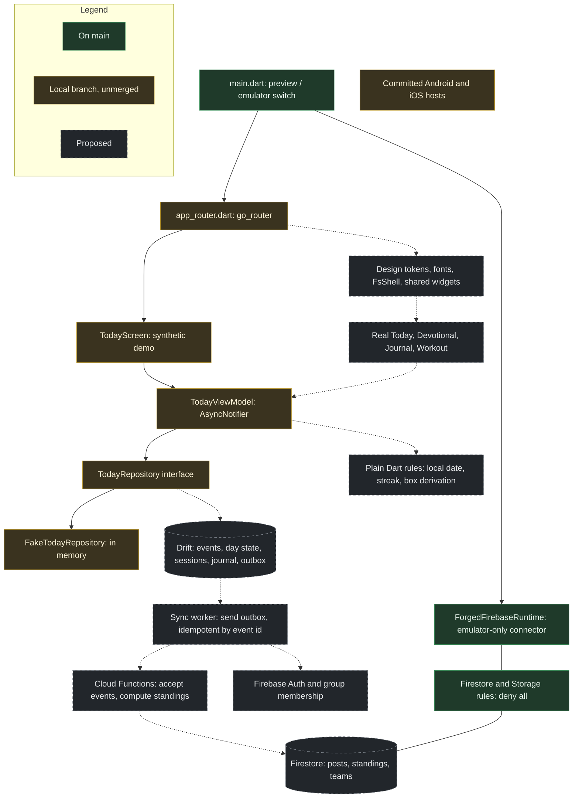

[Start here](00-START-HERE.md) · Back: [Screens and UI fidelity](06-SCREENS-AND-UI.md) · Next: [Evidence and limits](08-EVIDENCE.md)

# Architecture

> [!IMPORTANT] In one minute
> - **No accepted technology choice needs to change.**
> - **Five boundaries are cheap now and expensive later:** owner and date in the repository contract, events instead of flags, one local-date type, design tokens, one database file per user.
> - **Drift owns what a man creates. Firestore's cache serves shared feeds.** Do not mirror one into the other.
> - Keep what you have: fail-closed environments, deny-all rules, the view model and repository seam, provider-override tests.

## 5.1 Accepted, proposed, implemented, verified

| Layer | Accepted decision | Implemented on `main` | Local branch only | Verified by an actual check |
|---|---|---|---|---|
| Client framework | Flutter, Android and iOS first (ADR-0001) | Yes | — | CI builds web and a debug APK from temporary hosts |
| State | Riverpod, manual providers (ADR-0005) | No | `flutter_riverpod` in `today_view_model.dart` | Local tests only, per FNS-001 |
| Navigation | go_router (ADR-0005) | No | `app_router.dart`, two routes | Local tests only |
| Durable local store | Drift on native SQLite (ADR-0005) | No | No | — |
| Backend | Firebase Auth, Firestore, Functions, Storage (ADR-0001) | SDKs present; used only by an emulator smoke check | — | Not run by me |
| Rules | Deny by default (ADR-0001, 0002) | Yes: deny-all plus a `developer_smoke` path | — | No rules tests exist |
| Server scoring | "Server authoritative competition" (ADR-0001) | No Functions directory; no Functions emulator configured | — | — |
| Native hosts | "Later decision" (ADR-0003, Proposed) | Git-ignored, generated in CI | Committed hosts | Android builds locally, per `WORK.md`; iOS not verified |
| Targets beyond mobile | ADR-0003 is **Proposed** | Web preview only | — | — |
| Hosted AI review gate | ADR-0004 is **Proposed** | Tooling merged; ruleset disabled | — | Partially, per `CURRENT.md` |

**Conflicts between the stated direction, repository decisions and code**

- None in the stack. Pubspec, ADR-0005 and the local branch agree.
- `mobile/pubspec.yaml` declares Dart `>=3.9.0`, while the committed lockfile requires `>=3.13.0`. Tighten the constraint so a contributor on an older SDK gets a clear error instead of a churned lockfile (Verified).
- **Decision records are split.** `main` has ADR-0001…0005. The unmerged `arch/firebase-reconciliation` branch has a different ADR-0001…0019 covering group isolation, the scoring ledger, the devotional-workout engine, competition, proof media and faith-participation privacy. The numbers collide (`main` ADR-0005 is the client stack; the branch's ADR-0005 is the scoring ledger). The product decisions approved on 2026-10-27 exist only there and in the Claude Project.

## 5.2 Diagram

## 5.3 What is good and should stay

- **Fail-closed environment handling.** Cloud modes are refused; the emulator project id must be `demo-*` at runtime; no silent fallback (`main.dart`, `forged_firebase_runtime.dart`).
- **Deny-all rules as the starting point.**
- **The seam on the local branch:** screen → `AsyncNotifier` → repository interface → fake. This is the shape Flutter's architecture guidance strongly recommends (views and view models, repositories, fakes for tests), and it is not over-built. No use-case layer, no service locator, no code generation yet.
- **Disabling Riverpod's automatic retry** for a user-facing load so failures are deterministic.
- **A test that feature code imports no Firebase SDK.**
- **CI is already path-filtered,** so onboarding jobs do not run on Flutter-only changes.

## 5.4 What needs a boundary now

These are cheap now and expensive after two or three screens exist.

| Boundary | Problem today | Smallest adequate form |
|---|---|---|
| **Owner and date in the repository contract** | `TodayRepository.loadToday()` takes no user and no date *(local branch)*. Every later screen needs both | `watchDay(ownerId, localDate)` returning a `Stream`; `record(CompletionEvent)` |
| **Events, not flags** | `setCompleted(id, completed)` overwrites state. A retry, a second device or an undo cannot be told apart | An append-only event with a client-generated id, plus a derived day-state row written in the same transaction |
| **Local date as a value** | The prototype reads the device clock wherever it needs "today"; midnight and travel bugs follow | One `LocalDate` type and one injected clock provider; the date is stamped on the event when the tap happens |
| **Design tokens** | None | [Section 4.4](06-SCREENS-AND-UI.md) |
| **Per-user storage** | Not designed; ADR-0005 lists sign-out retention as open | One database file per signed-in user id, closed on sign-out. Account switching then cannot leak rows by construction |

## 5.5 What can stay simple, and what should wait

- **Stay simple:** manual Riverpod providers; no domain use-case layer until logic spans repositories; hand-written immutable classes until there are more than a handful (then `freezed`); one Drift database class.
- **Wait:** the sync worker and Functions until a second user needs to see anything; Firestore data modelling for feeds; App Check; health integrations; desktop and durable web.
- **Do not build:** a generic offline framework. Flutter's offline-first guide describes exactly the needed pattern: write locally first, flag unsynchronized rows, let the repository own the merge.

## 5.6 Division of responsibility: Drift, outbox, Firestore cache

Firestore's client persistence is on by default on Android and iOS and queues writes while offline. It is a cache with last-write-wins, not a ledger, and ADR-0005 already says so. Pick one owner per kind of data:

| Data | Owner | Reason |
|---|---|---|
| Facts the man creates: completions, sets, journal, food, water, weigh-ins | **Drift**, then an outbox | Must survive restart, retry and conflict; must be idempotent |
| Shared, read-mostly data: Rally feed, standings, team rosters | **Firestore listeners with the SDK cache** | Do not mirror feeds into Drift; that is two caches to keep consistent |
| Content: devotionals, programs, movements | **Bundled assets** first | 366 devotionals and 4 × 365 workouts already exist as JSON; no network needed for slice 1 |
| Private journal and body data | **Drift only** until decision Q8 is made | Nothing sensitive reaches a server before rules and tests exist |

## 5.7 Riverpod lifetimes

- **App-scoped, kept alive:** database handle, clock, router.
- **Session-scoped, keyed by user id:** repositories and anything holding user data. On sign-out, close the database and invalidate the family so nothing from the previous user remains in memory.
- **Screen-scoped, auto-disposed:** view models. An in-progress workout must not live only here; its truth is in Drift so navigating away and back loses nothing.
- **Async work:** every notifier method that awaits must check `ref.mounted` before setting state, as the demo already does.

## 5.8 Journeys traced

Legend: **E** exists on `main` · **L** local branch · **M** missing with no plan · **P** planned in one line only

**J1. Devotional completion (core)**

| Step | Prototype | Flutter |
|---|---|---|
| Tap the Devotional row on Today | `drawToday` L3691 | **L** synthetic card, no navigation |
| Read; scroll to the end | `devoScroll` L3376 | **M** |
| Tap Amen | `wireDevo` L3431 | **L** toggle button with demo copy |
| Rule: mark devotional done for today's local date | `toggle` L3318, `writeDay` L3247 | **L** flips a boolean; no date, no owner |
| Save | `flushDay` L2848: whole-document set, errors swallowed | **L** in memory; **P** Drift ("Blocked") |
| Resulting state: ring, tally, streak, mission complete | `drawHeader`, `streak` L2921 | **M** |
| Feedback | Checkbox and tally; no failure state | **L** "Completed in this demo" |

Stress: *double tap* → in the prototype, check then uncheck. *Reload mid-save* → the write may or may not land, with no indication. *Two devices* → whole-document last-write-wins. Proposed design: the tap writes one event row and updates day state in one Drift transaction; the UI reads from a Drift stream, so restart shows the same state. The event's key is set out below.

> [!IMPORTANT]
> **Decided by the maintainer on 2026-11-11: option A, the event id is the completion event's only key.** The options are kept below as the record of why. An earlier version of this review made (owner, date, item) the event row's unique key. That allows one event per item per day, so "complete, undo, complete again" cannot be stored, and an undo would have to overwrite the completion, which is the flag model 5.4 rejects.

| Option | Unique key on the event row | Complete → undo → complete | Same event sent twice (retry, sync replay) | Two devices | Cost |
|---|---|---|---|---|---|
| **A. Event id only** *(chosen)* | The client-generated event id. Day state is a separate row keyed by (owner, date, item) | Three rows | Second insert is a no-op on the id | Both devices' events are kept; day state follows the latest event (rule below) | Needs an ordering rule for the derived state that does not trust the phone's clock |
| **B. (owner, date, item, sequence)** | A per-item, per-day counter assigned in the transaction | Three rows, sequence 1 to 3 | Only safe if the sequence travels with the event; a fresh retry gets a new number | Two devices both write sequence 1; the server must renumber or reject | Breaks "document id equal to the event id" in J4 |
| **C. (owner, date, item) on a state row, no event table** | One mutable row per item per day | Overwrites | Idempotent | Last write wins, history lost | This is the flag model again; no audit for scoring |
| **D. (owner, date, item, kind)** | One "complete" and one "undo" per item per day | The second "complete" is refused | Idempotent | As A | Re-completing after an undo is impossible |

**Why A.** It is the only option that stores every real action, makes a replayed event a no-op by construction, keeps J4's "document id equal to the event id", and matches P05's acceptance test 2 ("replaying the same event id leaves exactly one completion"). What comes with it:

- **Events state the target, not a toggle.** Each event says `done: true` or `done: false`. A tap whose target equals the current day state writes nothing, so a double tap on Amen cannot complete and then undo.
- **Ordering rule for day state.** The latest event wins, and "latest" never comes from the phone's clock: a clock that is wrong, or moved back, would let an older tap outrank a newer one.
  - *On one device* (all that exists before S4): each event gets the next value of a counter kept in that user's Drift file, assigned in the same transaction. The highest counter is the latest.
  - *Across devices* (from S4): each event also names the event it replaces, the one that set the day state when the tap was made. An event that is named as replaced is superseded. Two events that replace the same one were made without seeing each other; the Cloud Function picks between them by the order it received them, then by event id.
  - The time of the tap, with its UTC offset, is still stored. It places the event in the man's local day (Q9) and is shown to him. It is not used to order events.
- **Tests that go with the rule.** Complete, move the clock back a day, undo: the item is not done. Two devices with clocks an hour apart complete and undo the same item: the result follows the order the server received them, whatever the stamps say. Replaying any of those events changes nothing.
- **Scoring.** Credit, when it exists, is derived from the final day state per (owner, date, item), never by counting events, so undo and redo cannot earn twice. How credit is computed stays with S4.
- **Event id form.** A random UUID minted once per tap and kept through retries. A time-ordered UUID would also do; the choice does not change the key design.

**J2. Workout (core, most demanding)**

| Step | Prototype | Flutter |
|---|---|---|
| Train → day panel → open session | `drawDayWorkout` L4603 | **M** |
| Start → prayer → Amen starts the clock | `openWorkoutPrayer` L8628 | **M** |
| Enter sets | Saved 700 ms after typing, on blur, on leaving the page (L5023, L4877) | **M** |
| Rule: resolve today's session from plan, lifting days, Sabbath | `workoutFor` L4391 | **M** |
| Save | Whole-document set, errors swallowed; a failed read is treated as empty and the next save overwrites (L4885) | **M** |
| Finish → PR check → awards → box → share | L5928–5938 | **M** |
| Feedback | Locked summary | **M** |

Stress: *app killed mid-set* → up to 700 ms of typing lost; clock survives because it is derived from timestamps (good, preserve). *Past midnight* → cannot finish (U2). *Finish tapped twice* → PR count is replaced rather than added, so no double PR credit (good). *Plan changed later* → history remapped (U3). Proposed design: session row plus set rows keyed by a generated id, each carrying movement id and prescription text; write on every field change and flush on `AppLifecycleState.paused`; session bound to its start date.

**J3. Private journal entry (persistent user input)**

| Step | Prototype | Flutter |
|---|---|---|
| Write under the devotional or from the pen | `wireJournal` L10538, `openJournal` L10418 | **M** |
| Save | Stable id minted once per draft; in-flight identical write reused; state changes only after acknowledgement; 15 s deadline; retry notice (L10344–10404) | **M** |
| Feedback | "Saving…", "Saved to your journal", retry panel | **M** |

This is the model to copy. In Flutter the acknowledgement is the local transaction, so "Saved" is immediate and truthful; "synced" is a separate, later state that only matters once Q8 allows sync.

**J4. Standings (shared read, trust)**

| Step | Prototype | Flutter |
|---|---|---|
| Open Board | `drawBoard` L7659 | **M** |
| Compute | Each browser reads every member's check-in rows and sums points locally | **M**; ADR-0001 requires server authority; no Functions exist |
| Authorization | None expressed for `checkins` | Deny-all rules; no membership model on `main` |

Stress: *tampered client* → can write any `steps`, `prs.n` or `done` for itself; nothing in the repository prevents writing another man's row. Proposed design: clients send events only; a Function validates and writes totals; rules make totals read-only and events create-only with the document id equal to the event id.

**J5. Rally post that checks a box (shared write with a side effect)**

| Step | Prototype | Flutter |
|---|---|---|
| Compose, attach, send | Awaited, button disabled, error shown (L8086–8115) | **M** |
| Side effect: check Daily Check-In | Client toggles its own box after the post succeeds (L8109) | **M** |
| Delete the post | Box stays checked | **M** |

Stress: *retry after timeout* → could create two posts; the box is a boolean so credit is not doubled. Proposed design: the post carries a client id; the server derives the check-in credit from the post's existence.

## 5.9 Tests proportionate to risk

| Risk | Test | When |
|---|---|---|
| Day boundary, streak, box derivation | Plain Dart unit tests with an injected clock | Slice 1 |
| Durability and idempotency | Drift tests on a real file: write, close, reopen; replay the same event id | Slice 1 |
| Screen states | Widget tests with provider overrides (pattern already in the local branch) | Every slice |
| Visual parity | Golden tests for five reference screens with bundled fonts at 390×844, dark and light, plus 1.3× text | From the design-foundation PR |
| One real device path | One `integration_test` per slice on the Android emulator | Every slice |
| Authorization | Emulator rules tests, including negative cases for another user and another group | The first PR that adds any rule beyond deny-all; not before |
