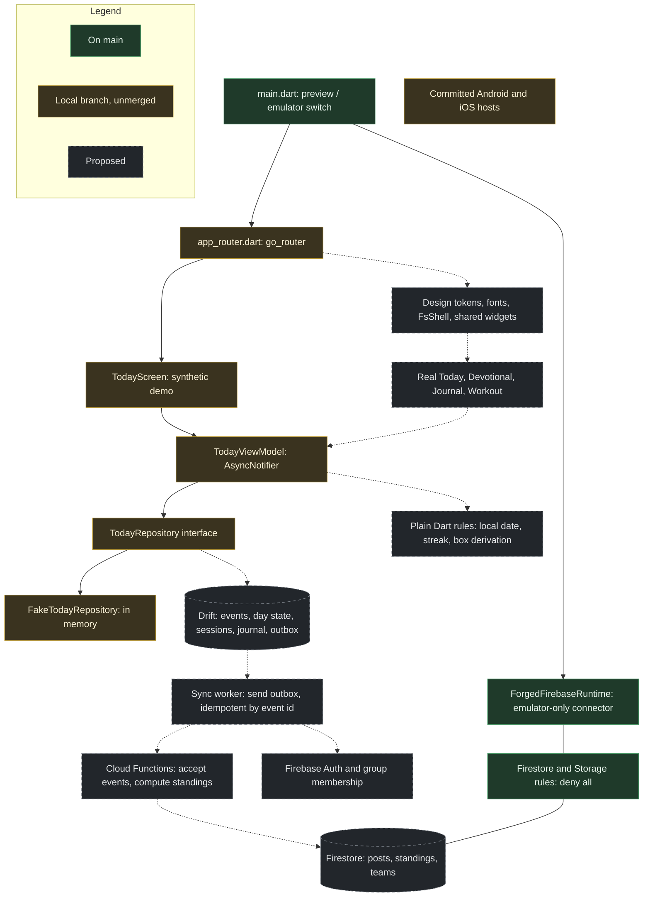

[Start here](00-START-HERE.md)

> [!NOTE]
> The same review as one file. The numbered pages are easier to read; section numbers here match the references in them.

# Forged & Sent: prototype-to-Flutter review

**Date:** 2026-11-10 (Phoenix) · **Reviewer:** Claude, independent, read-only · **Repository:** `Forged-Sent/ForgedAndSentFitness`

Nothing in the repository, on GitHub, or in your local folder was edited. Rendering used an isolated copy of the prototype with the repo's in-memory mock backend.

**Line references** are `index.html` at `main` commit `94daa63` unless noted. Open any of them at
`https://github.com/Forged-Sent/ForgedAndSentFitness/blob/94daa63fe1dea96398bcb3f2286baa1906c44ec0/index.html#L<line>`.

**Certainty labels used throughout**

| Label | Meaning |
|---|---|
| **Verified** | I read the source or observed the behavior in a rendered run myself |
| **Reviewer-read** | One of three parallel reviewers read it and cited lines; I spot-checked a sample but not this item |
| **Inferred** | Follows from the code but was not executed |

---

## 1. Executive verdict

**Does the prototype describe a coherent product?** Yes. It is a real, working product with a clear daily loop, a distinctive visual identity, and far more depth than the documentation implies: 17 page containers and on the order of 90 dialogs, sheets and variants. The devotional and the workout are the centre of it, and private writing is kept out of scoring in the code, not just in the copy.

It has three problems that matter for the rebuild, and none of them is "the backend is simulated":

1. **It is a moving target with two live forks.** `main` holds v238 plus privacy hardening. An unmerged branch holds v239–v254, the version the men are actually using, with a different tab bar, two habits instead of three, new point sources, and none of the hardening.
2. **Several of its rules conflict with decisions you approved on 2026-10-27**, and those decisions are not on `main` at all.
3. **Its trust model cannot ship.** Every score is computed on each phone from self-reported shared documents.

**Will the current Flutter architecture and plan deliver it faithfully?**

- **The stack direction is sound.** Riverpod, go_router, Drift on native SQLite, Firebase, emulator-first. I recommend no change to any accepted choice.
- **The plan will not deliver the prototype.** On `main` the app is 194 lines of Dart showing a status screen. The only planned feature work is a synthetic two-card "Today (demo)" that, by its own contract, does not port the prototype's design, content, rules or persistence. After every item on the active board merges, the number of prototype screens a man could recognize in the Flutter app is zero.
- There is no design system, no screen-level contract for any real view, and a parity table with 7 rows for roughly 90 surfaces.

**What must change first**

| # | Change | Why first |
|---|---|---|
| 1 | Freeze one prototype baseline and reconcile the two forks | Every parity decision depends on which Today, which tab bar and which point rules are the reference |
| 2 | Decide four rule conflicts (section 3.3: individual board, faith points, fasting, streak) | They decide what the first real screen shows |
| 3 | Land a design foundation before any feature screen: tokens, the four typefaces, the tab shell | Otherwise each slice re-invents the look and drifts |
| 4 | Make the first feature slice real: Today plus Devotional, real content, saved in Drift | It is the core loop and needs no account, group or server |
| 5 | Pause the hosted AI review gate, Atlas and Obsidian work | Since 2026-10-27, 4 of 391 commits on `main` touched `mobile/lib` |

---

## 2. Reviewed scope, revisions, evidence and limitations

### 2.1 Revisions

| Item | Revision | Status |
|---|---|---|
| Default branch `main` | `94daa63fe1dea96398bcb3f2286baa1906c44ec0` (2026-11-10 00:09 -0700, PR #52) | Reviewed baseline |
| Open PR #48, hosted AI review acceptance | head `97acf7a1` | Tooling only; no app code. Only open PR |
| `app/v241-bold` (remote, unmerged) | `3ff4a6f3` | Prototype snapshots v239–v254 under `versions/` |
| `arch/firebase-reconciliation` (remote, unmerged) | `0d21d21d` (2026-10-27) | Phase 0 set: ADR-0001…0019, `requirements.yaml`, data architecture, roadmap |
| `workout-library-seed` (remote, unmerged) | `79994241` (2026-11-08) | Coach Gideon content library |
| `codex/native-host-skeleton` (local only) | `bc4fd82b` | Committed Android and iOS hosts |
| `codex/native-host-acceptance` (local only) | `b638041b` | Hosts plus current `main` merged in |
| `codex/today-demo-contract` (local only) | `54be9449` | FNS-001 synthetic Today demo; based on `61e1b7d`, 4 commits behind `main`; does **not** contain the native hosts |

How the open-PR list was established: only PR #48 has a live `refs/pull/48/merge` ref, and `docs/knowledge/PR-STATUS.md` agrees. The GitHub API was not available to me, and the public pulls page I could fetch was a stale copy (it listed #30 and #42 as open; both are merged in `main` history).

Local branches were read from `C:\ws_c\ForgedAndSent\ForgedAndSentFitness\.git` with read-only git commands. The three relevant worktrees had no uncommitted changes under `mobile/` or `docs/features/`. **None of the local work is treated as available on `main`.**

### 2.2 The authoritative prototype: a conflict

| Candidate | What it is | Evidence |
|---|---|---|
| `main:index.html` | v238 plus nine hardening merges on 2026-11-05 (awaited journal saves with retry, mentoring deferred, superset permissions, bodyweight volume refresh). Not archived as a version file | Differs from `versions/app-v238.html` in 34 hunks; contains `jrPendingWrites` and "Pair management is deferred" |
| `versions/app-v254.html` on `app/v241-bold` | Sixteen later snapshots described as the "live working app" | Tab bar is Today, Fuel, Train, **Walk**, Board, Rally; wizard step is "Your **two**"; contains "Bold Step" and Instagram sharing; contains none of the hardening markers |
| `versions/app-v1…v238.html` on `main` | Append-only history | 238 files, 346 MB |

`AGENTS.md` and `PROTOTYPE-PARITY.md` name `index.html` as the active prototype. The 2026-10-27 workshop default (W12) says the prototype "keeps evolving independently". Both are happening, in different places.

**Provisional baseline for this review:** `main:index.html` at `94daa63` for all code-level analysis, because it is what the repository declares, what CI tests, and what carries your privacy fixes. Differences in v254 that affect a finding are called out. I did not merge the two.

Observed v238 → v254 differences that affect the rebuild (Verified by rendering both):

| Area | `main` (v238+) | v254 |
|---|---|---|
| Bottom tabs | Today, Fuel, Train, Board, **Campaign**, Rally | Today, Fuel, Train, **Walk**, Board, Rally; Campaign moves under Board |
| Personal habits | "Your three" | "Your two" |
| Creed box | "Morning Motto / My Creed" | "My Mission" |
| Today rows | Plain boxes | Boxes tagged Stand Firm / In Love / Be Strong; creed card at top; "This week's Bold Step +25" |
| Mentoring | Information only, deferred for privacy | Live pairing: "Ask a brother to be your Paul" |
| New point sources | none | Bold Step +25 a week; Share to Instagram +5 a day (per commit message at `2b42a0b`) |

### 2.3 What I inspected

- **Prototype:** static HTML for all 17 pages (L1952–2557); CSS tokens and media queries (L6–1924); JavaScript L2561–9487 and L10151–11165 through three parallel reviewers with line-cited reports; `seed/*.json`; `dev/mock-claude.js`; `seed/db-rules.json`.
- **Flutter on `main`:** every file under `mobile/` (3 source files, 2 test files, pubspec, lockfile header, analysis options).
- **Flutter on local branches:** all 8 new or changed source files and the test inventory of `codex/today-demo-contract`; the file tree and Android settings of `codex/native-host-acceptance`.
- **Firebase:** `firebase.json`, `.firebaserc`, both rules files.
- **Decisions and plans:** ADR-0001…0005, `SYSTEM.md`, `CODE-MAP.md`, `CURRENT.md`, `WORK.md`, `PR-STATUS.md`, `PROTOTYPE-PARITY.md`, `FLUTTER-PLATFORMS.md`, `docs/features/*`, `docs/design/sign-in.md`, `docs/architecture-notes.md`, the archived execution blueprint header, and the 2026-10-27 workshop, reconciliation matrix and executive assessment held in the Claude Project.
- **CI:** `ci-gate.yml` job list and path filters.

### 2.4 What I ran

| Check | Result |
|---|---|
| Prototype in headless Chrome at 390×844, dark theme, real typefaces served locally, repo mock backend | Legal gate → 8-step setup wizard → Today, Devotional, Fuel, Train, Board, Campaign, Rally, Profile, Settings, Owner tools. No console errors |
| Same, clock advanced to the plan's first day | Train day panel → workout page → prayer gate → started workout → exercise detail |
| v254 snapshot, same harness | Wizard, Today, Walk, Board |
| Embedded content vs `seed/` | Scripted comparison of challenge scoring and RPE/RIR text |
| Reviewer claims | 16 line references re-read by me; all held |

### 2.5 What I could not verify

- **Flutter was not run.** No Flutter SDK in my environment. No `flutter analyze`, `flutter test`, build, emulator or device run. Every statement about how the Flutter app looks is **inferred from source**.
- **Firebase emulators and rules tests were not run.** There are no rules tests in the repository to run.
- **Package pins on the local branch.** `flutter_riverpod 3.5.0` and `go_router 18.1.4` did not appear in the pub.dev listings I could reach (latest shown: 3.4.3 and 18.1.1; the listing looked about two weeks old). The branch lockfile resolves them and its contract records 34 passing tests locally, so they probably exist. Treat as unconfirmed by me.
- **Prototype lines 9487–10150** (photo-upload diagnostic, confirm dialog, the food-logging UI) were not systematically read. `compressVideo` (L10725–10760) was not read. "My routine" (L8811–9084) was skimmed.
- **Not exercised in the browser:** light theme, text scaling, Rally with posts, anything multi-user, food logging, challenge submission, set entry (the harness reached the open workout but not a typed set).
- **The claude.ai runtime's real access control** for paths that `seed/db-rules.json` does not mention. The repository cannot show it.
- The prototype has no doctype, charset or viewport tag; the claude.ai host supplies them. My preview copy added them. Without the viewport tag the page renders at desktop width on a phone.

---

## 3. Prototype and product assessment

### 3.1 The daily loop

**Open Today → Devotional → Workout → the boxes that fill themselves → Rally → mission complete.**

- **Today** shows a progress ring split into Spirit, Body, Brotherhood and personal habits, week points, streak, and a list of "boxes".
- **Devotional** (+2) opens a full page: prayer, reading, In Jesus, Reflect, Act, then an optional private "Write it down". The Amen button enables only after scrolling to the bottom.
- **Workout** (+3) is opened from Train. "Start workout" presents a workout prayer; the clock starts on Amen. Finishing the workout checks the box.
- **Water, Calories, Steps** check themselves from Fuel and from a steps dialog.
- **Daily Check-In** (+1) checks itself when the man posts in Rally.
- **Your three** are manual personal habits at +1 each.
- **Sabbath** (his chosen rest day) auto-credits the workout, lowers the step goal to 7,000, and adds weigh-in and progress photos.

Screens connect to this loop consistently. Tab highlighting follows the parent section for nested pages (L3346). Every page has a help bubble and a search ("Ask").

### 3.2 What is strong and should be preserved

| Preserve | Why |
|---|---|
| Devotional structure and the scroll-to-Amen gate | It is the product's voice and a deliberate, gentle friction |
| Workout prayer before the clock starts | This is how devotion is actually integrated into training in the prototype |
| Reflection never feeds scoring | Amen does not read the journal box; journal, legacy log and family report live in a private subtree (Verified, L3431–3437, L10513) |
| Boxes that check themselves from real activity | Removes honor-system tapping where the app already knows |
| Grace language: "Start today. Grace for yesterday.", grace reset, sit-out week | Central to the identity |
| Journal save logic on `main` | Stable entry id, confirmed-not-optimistic writes, a visible retry state. It is the best-specified persistence behavior in the prototype and a direct model for Flutter |
| Workout depth: readiness check, warm-up rounds, last-time values, weight recommendation, swaps by equipment or injury, locked summary | Tested programming content; 4 programs × 365 days |
| "Forged Iron" visual system | See section 4 |

### 3.3 Rule conflicts that need a decision

These are product conflicts, not prototype shortcuts. "Approved 10-27" refers to the reconciliation matrix and workshop in the Claude Project; those documents are not on `main` (finding B2).

| # | Conflict | Evidence | Recommendation |
|---|---|---|---|
| R1 | **Individual ranking vs team-first.** The Board's default view ranks every man by points. Approved 10-27: team-first boards; individual views show personal progress only | Rendered Board; L7659–7731; reconciliation D24 and D09, workshop W04 | **Clarify.** This is the largest open product question. Either is buildable; they need different data and different rules |
| R2 | **Faith points on an individual board.** Devotional is +2 on the individual board. Approved 10-27 default: 1 a day, team total only, never on an individual board | `seed/tasks.json`; W04 option A | **Clarify** with R1 |
| R3 | **Fasting is scored and shown.** A fast day auto-checks Calories and shows a "Fasting" tag on the Board. Approved 10-27 (D10): private, unscored | L3168, L7722; the UI does disclose it (L3240) | **Clarify.** The prototype's version is intentional ("so the brothers can pray for you"), so this is a real choice |
| R4 | **Three definitions of a streak.** README: consecutive days with the devotional. Code: every daily box except weigh-in and photos, habits excluded. "Mission complete": every box including habits | `README.md` L100; L2921–2932; L3277 | **Clarify**, then one definition in one place |
| R5 | **PR points: 25 in code, "+2 / +1" on screen and in the README** | `PR_PTS = 25` at L2812; static copy at L2112 (Verified) | **Correct.** At 25 per lift against 1-point boxes, PRs dominate the board, and a volume PR can be manufactured with "+ Add set" |
| R6 | **Step bonus has no ceiling.** +1 per 1,000 from 10k to 15k, then +0.5 per 1,000 with no cap; steps can be typed in by hand | L2802 (Verified); manual-entry limit of 200,000 is Reviewer-read | **Correct.** Cap it and prefer health-sourced counts when available |
| R7 | **New point sources in v254** (Bold Step +25, Instagram +5) have no recorded decision | `app/v241-bold` commits `2b42a0b`, `53e998b` | **Clarify** before they become requirements by default |
| R8 | **Scripture translation.** The prototype quotes ESV throughout. Approved 10-27 (D15): BSB default, ESV only with notice or licence | Settings › Scripture notice (L2518) | **Clarify.** Affects bundled content in the first slice |

### 3.4 Product and UX problems (not shortcuts)

| # | Problem | Evidence | Certainty | Recommendation |
|---|---|---|---|---|
| U1 | **First-week dead zone.** A man who sets up on a Tuesday sees "Your plan starts Monday" and has no programmed workout for up to six days, while "First orders" asks him to log a workout | Rendered Train after setup; L4295 | Verified | **Correct.** Start the plan on his next lifting day |
| U2 | **A workout cannot cross midnight.** After midnight the started session is no longer "today", becomes read-only, and can never be finished | L5776, L5916 | Verified (code) | **Correct.** Bind a session to its start date |
| U3 | **Workout history is keyed by position in the current plan.** Changing program, Sabbath, lifting days or library content remaps or drops old logs, PR baselines and volumes | L3920, L4696–4701 | Reviewer-read | **Correct** in the Flutter model: store the movement id and prescription with the session |
| U4 | **Privacy copy overstates what is private.** "Only your checked boxes are shared", yet the shared check-in document also holds raw step count, protein bonus, the fasting flag, the PR list and a free-text workout note | L2005, L2504 vs L2664 | Verified | **Correct** the model, then the copy |
| U5 | **Habit titles are group-readable.** The prompt invites "ones you are putting to death by the Spirit" | `seed/db-rules.json` (`habits` read: view); L3786 | Verified | **Correct.** Titles private; only the tick is shared |
| U6 | **Body weight leaks indirectly.** Bodyweight-lift volume includes body weight and is posted on the shared workout card | L4704, L4210 | Reviewer-read | **Correct** |
| U7 | **Report and Block cannot be performed.** Settings says "Use Report on the post"; no control calls it | `B.report` defined at L2739, zero callers | Verified | **Correct** before any store submission (Apple guideline 1.2) |
| U8 | **"Delete my data" is incomplete** and then says everything was deleted. Misses weights, team posts, challenge submissions and proof, team documents | L2759–2783, L10987 | Reviewer-read; L2778 verified | **Correct** |
| U9 | **Team chat says "only your team sees this"** but nothing enforces it and replies sit in one global collection | L7475, L2732 | Verified | **Defer** team chat until membership rules exist; fix the copy now |
| U10 | **Saves fail silently everywhere except the journal.** Boxes, sets, water, settings and profile swallow errors; a tap made before data loads is retried for 15 s and then dropped | L2848–2859, L3247 | Verified | **Correct** in Flutter: every saved fact has a visible saved, pending or failed state |
| U11 | **Streak cannot exceed about 35 days** because it reads a 35-day window | L2879, L2926 | Verified | **Correct** |
| U12 | **Embedded content has drifted from `seed/`.** Scaled challenge points are 25 in the app and 50 in the seed; RPE/RIR appears 3,555 times in `seed/workouts.json` and 28 times in the embedded plan | Scripted comparison | Verified | **Clarify** which is the content source for Flutter |
| U13 | **All-time points change retroactively** when task point values or the campaign change | L2917, L7232 | Reviewer-read | **Correct** with a server ledger (already your stated direction) |
| U14 | Sabbath and "full rest" each award the 3 workout points | L3149, L3159 | Reviewer-read | **Preserve** if intended as grace; write it down as a rule |

### 3.5 Normal prototype shortcuts (not defects)

| Shortcut | Status |
|---|---|
| Identity, owner role and storage come from the claude.ai artifact runtime | Real persistence there; replaced by Firebase Auth and rules |
| One global group; no tenant id in any path | Replaced by group membership |
| Scores computed in each browser | Replaced by server computation |
| Reminders | Times are saved; no notifications ("turn on when the mobile app launches") |
| Health data | A `window.ForgedHealth` bridge contract; a stub on the web |
| Food search and photo estimates | AI estimates through the runtime |
| Exercise video | Outbound YouTube link |
| Day boundary is the device's local date; owner "test date" writes real records | Needs a stated rule in production (decision Q9) |

### 3.6 States

- **Present:** boot screen, signed-out and view-only notices, most empty states, journal saving and retry, campaign saving, upload and post errors, delete progress.
- **Absent:** any offline indicator, any permission-denied state (every listener's error handler is a no-op), any failed-save feedback outside the journal, loading indicators for Rally and journal.

---

## 4. Traceability matrix and UI fidelity

### 4.1 Status vocabulary

| Status | Meaning here |
|---|---|
| **Not implemented yet** | Normal unfinished scope that has a real, specific plan |
| **Not planned** | No contract, task or acceptance criteria beyond a one-line parity row that the document itself calls "migration candidates, not a decision" |
| **Planned inconsistently** | A plan exists but targets something other than the prototype view |
| **Implemented incorrectly** | Code exists and contradicts the reference |

### 4.2 Prototype-to-Flutter matrix

All Flutter routes and components below are **proposed** unless a file path is given. Existing files are on `main` unless marked *(local branch)*.

| Prototype view and source | Key actions and states | Existing or proposed Flutter route / component | Required state, data, permissions, persistence | Status | UI / behavior gaps | Observable acceptance criteria |
|---|---|---|---|---|---|---|
| **Legal gate** `legalMaybe` L10176 | 18+ checkbox, agree; re-prompt on new version | Proposed `/agree` | Agreement version and time per user; server-recorded per `docs/design/sign-in.md` | Not planned | Prototype stores it in private settings and does not enforce it on writes | Cannot reach Today without agreeing; new version re-prompts; record survives reinstall after sign-in |
| **Setup wizard** `drawOnb` L9282, 8 steps | Profile, service record, goal and targets, training plan, habits; skip; replay | Proposed `/setup/:step` | Profile (shared), body and plan (private), habits | Not planned | Body stats and injuries are sensitive; ADR-0005 defers storing them | Each step saves on Next; killing the app mid-wizard resumes at the same step |
| **Today** `drawToday` L3691 | Ring by category, boxes, first orders, habits, grace and sit-out cards, mission-complete dialog | Existing *(local branch)*: `/today` → `today_screen.dart`. Proposed: real `TodayScreen` | Day state per (user, local date); task list; habits; streak | **Planned inconsistently** | FNS-001 is two synthetic cards with Material buttons; no header, ring, boxes or content | At 390×844 the header, ring and box rows match the prototype reference side by side, and the approved render is locked as a golden; a completed box survives restart |
| **Devotional** `drawDevo` L3392 | Scroll to bottom enables Amen; Amen checks the box; Undo | Proposed `/today/devotional` | Devotional content by date (366 days); completion event | Not planned | — | Amen disabled until end of scroll; completion persists; undo works; a screen-reader path exists |
| **Journal editor and page** `openJournal` L10418, `drawJournalPage` L10548 | New, resume draft, edit, tags, Praying for / Answered, search | Proposed `/journal`, `/journal/:id` | Private entries; stable entry id; pending, failed, saved | Not planned | Sensitive-field storage and sign-out retention are undecided (ADR-0005) | A failed save keeps the text and shows retry; a retried save never creates a second entry |
| **Train** `drawTrain` L7082 | Week calendar, day panel, move day, your week, volume, steps and weight charts, plan form | Proposed `/train` | Plan config; computed schedule; workout logs | Not planned | Plan-start dead zone (U1) | Selecting a day shows that day's session; a plan change never alters past logs |
| **Workout** `drawWorkoutPageNow` L5765 | Prayer gate, clock and pause, readiness, warm-up, set rows, auto-fill, rest timer, swaps, add exercise, finish, awards, locked summary, unlock | Proposed `/train/workout/:date` | Session with movement ids and prescription; sets saved as typed; timer from timestamps | Not planned | Index-keyed history (U3); midnight (U2); rest timer silent when the phone is locked | Kill the app mid-set and reopen: every entered set is present and the clock is correct; finishing twice does not double-credit |
| **Exercise detail** `drawVideoPage` L5144 | Muscles, video, coach tabs | Proposed `/train/exercise/:id` | Movement library | Not planned | Video is an outbound link | Muscle map and cues render offline |
| **Weekly challenges** `drawChallengePage` L6709 | Versions, standards, standings by age bracket, attempts, proof, stopwatch | Proposed `/train/challenge/:id` | Submissions (shared), proof media, server scoring | Not planned | Deadline enforced on the device clock; approved direction requires video capture in the first challenge release | A submission after the deadline is rejected by the server |
| **Fuel** `drawFuel` L3840 | Macro bars, water, fasting, food log, copy day, 7-day chart, meal ideas | Proposed `/fuel` | Private day log, targets | Not planned | Fasting rule (R3) | Water total survives restart; nothing private appears in any shared read |
| **Board** `drawBoard` L7659 | Individual / Campaign, board picker, Today / Week / All time, "How points work" | Proposed `/board` | Server-computed standings; membership | Not planned | R1, R2; client-computed totals | Standings equal the server ledger; a tampered client cannot change them |
| **Campaign and team** `drawCampPage` L7336, `drawTeamPage` L7378 | Phases, raise a team, invite, weekly double | Proposed `/board/campaign`, `/board/team/:id` | Teams, membership, owner writes | Not planned | Tab placement differs between forks | Roster locks at start; averages match the server |
| **Rally** `drawFeed` L7879 | Post, attach up to 4 media, replies, mentions, reactions, tag bell | Proposed `/rally` | Posts (group), media, moderation | Not planned | Report and block unreachable (U7) | Report and block work; a blocked author's posts disappear; posting checks the day's box exactly once |
| **Profile** `drawProfile` L8338 | Banner, creed, stats, points breakdown, lift PRs, progress photos, invite | Proposed `/profile/:uid` | Shared profile; private photos | Not planned | Two unrelated PR systems | Another man's profile never shows private fields |
| **Settings** `drawSettings` L10663, 16 sections | Appearance, profile, logging, service record, goal, food mode, targets, reminders, health, privacy, export, legal, delete | Proposed `/settings/...` | Private settings | Not planned | Reminders and health are stubs; delete is incomplete (U8) | Delete removes every document and file owned by the user, verified by an emulator test |
| **Owner tools** `drawOwner` L10640 | Reports queue, campaign settings, test date | Proposed `/owner` | Role from membership, enforced by rules | Not planned | Owner gating is hidden-flag only | A non-owner is denied by rules, not just hidden |
| **Paul & Timothy** `drawMentorPage` L10621 | Information only on `main`; live pairing in v254 | Proposed `/walk` if v254 is the baseline | Pair documents with private check-ins | Not planned | The forks disagree; `main` deferred it for privacy | Only the two men in a pair can read their check-ins |
| **Legacy log, family report, junior challenge** L3472, L3590 | Sabbath-only private writing; share or copy out | Proposed dialogs under Today | Private | Not planned | Family report sends personal text to a model without saying so | Nothing leaves the device unless he taps share |
| **Help and Ask** `openHelp` L8786, `openAsk` L9117 | Per-page help; keyword search with "take me there" | Proposed `HelpSheet`, `/ask` | Static content | Not planned | — | Each page's help opens and deep-links |
| **Sign-in** (approved design, `docs/design/sign-in.md`; not in the prototype) | Apple, Google, email; stay signed in; sign out everywhere | Proposed `/sign-in` | Firebase Auth | Not planned (design approved 2026-11-01) | No implementation plan | A second account on the same phone never sees the first account's data |
| **Developer status screen** | — | Existing: `FoundationHomeScreen` in `mobile/lib/src/app/forged_sent_app.dart` | — | Implemented; no product requirement | See 4.4 | — |

### 4.3 Traceability in both directions

**Prototype experiences with no credible Flutter path today:** all of them except a placeholder Today. `WORK.md` lists three product rows: native hosts (Ready), synthetic Today (Ready), durable completion (Blocked, no contract), plus "Firebase DEV and group authorization" (Later, no contract). `PROTOTYPE-PARITY.md` has seven rows and no acceptance criteria. No feature contract exists on `main`.

**Flutter-side work with no product requirement behind it**

| Item | Evidence | Assessment |
|---|---|---|
| Hosted AI review gate (ADR-0004 *Proposed*, PR #48, ruleset disabled) | `tooling/review`: 3,356 lines; the app it gates: 194 lines | Pause |
| Architecture Atlas and generated `CODE-MAP.md` | Maps three Dart files | Pause |
| Obsidian vault, `CURRENT` / `WORK` / `PR-STATUS` kept in parallel | Three status pages for one open PR | Collapse to one |
| Desktop targets (ADR-0003 *Proposed*) and the 720 px max-width and "larger width" tests in the demo | Android and iOS are the stated priority | Leave proposed; drop the wide-layout work |
| FNS-001's loading, empty and error views for an in-memory list that cannot fail | `today_screen.dart` *(local branch)* | Fine as a pattern demo; not product |

### 4.4 UI fidelity findings

**Design tokens to carry over** (Verified from the last-winning `:root` rules; the CSS still contains two superseded palettes underneath them)

| Token | Dark | Light |
|---|---|---|
| Background | `#151719` | `#f3f0eb` |
| Surface / raised surface | `#222528` / `#303337` | `#ffffff` / `#e4dfd8` |
| Text / muted text | `#f2f0eb` / `#b6b3ae` | `#292521` / `#68615b` |
| Hairline | `#414448` | `#d1c9c0` |
| Accent / text on accent | `#f17b32` / `#171411` | `#ae4514` / `#ffffff` |
| Highlight ("brass") | `#ff9a55` | `#9d3e13` |
| Danger | `#f08076` | `#a4281c` |
| Radius | 8 px base; 10 and 12 px on cards; full round for icon buttons | same |

| Role | Typeface |
|---|---|
| Brand wordmark | Saira Stencil One |
| Headings and labels (uppercase, tracked) | Saira Condensed 500–800 |
| Body | IBM Plex Sans 400–600 |
| Scripture | Merriweather italic |

Other measurable conventions: tap targets mostly 44–52 px; body text mostly 12–15 px; `safe-area-inset` used 32 times; reduced-motion handled; breakpoints only below 430 px (phone-only layout); Dark, Light and Auto themes.

**Reusable Flutter components needed** (all proposed, under a proposed `mobile/lib/src/design/`)

| Component | Used by |
|---|---|
| `FsTheme` (two `ColorScheme`s, `TextTheme`, spacing and radius constants) | Everything |
| `FsShell`: brand bar plus a six-destination tab bar with a top indicator | All top-level pages |
| `FsHeroHeader`: mountain photograph, kicker, title, round action buttons | Today, Fuel, Train, Board, Campaign, Settings, Devotional |
| `FsCard`, `FsSectionHead`, `FsLabelCaps` | Everything |
| `FsButton` (primary, ghost, mini), `FsIconAction` | Everything |
| `FsBoxRow`: checkbox, title, sub-line, points, chevron | Today, first orders, habits |
| `FsProgressRing`, `FsMeter` | Today, Fuel |
| `FsSegmented` | Board, Settings, Profile |
| `FsDialog`, `FsSheet` | About 40 dialogs |
| `FsScripture` block | Devotional, workout prayer, footers |
| `FsEmptyState` (dashed outline) | Rally, journal, boards |

**Differences, classified**

| # | Difference | Class | Smallest correction or adaptation |
|---|---|---|---|
| F1 | Flutter theme is seeded from `0xFF6B7C43`, an olive that matches the prototype's superseded first palette, not the current orange-on-charcoal | **Unintended drift** (Verified in source, `forged_sent_app.dart` L16) | Replace `ColorScheme.fromSeed` with explicit schemes from the table above |
| F2 | No typefaces configured; Flutter falls back to the platform default | **Unintended drift** | Bundle the four families as assets. Do not fetch fonts at runtime; the app must look right offline. All four are distributed through Google Fonts; confirm each licence before bundling |
| F3 | Demo Today uses stock Material `AppBar`, `Card`, `FilledButton`; no hero, ring or box rows | **Planned divergence** (FNS-001 says the design is not ported) | Build the real Today on the components above rather than restyling the demo |
| F4 | Prototype navigation is one scroll container with hand-drawn Back buttons and no history | **Necessary platform adaptation** | go_router `StatefulShellRoute` with six branches so each tab keeps its own stack and scroll position; Android system back and iOS swipe-back work without custom code |
| F5 | Six bottom destinations; Material guidance for `NavigationBar` is three to five | **Preserve** | Keep six with a custom `FsShell` bar; do not force it into `NavigationBar` |
| F6 | Prototype text is fixed-pixel and dense (many labels at 11–13 px) | **Necessary accessibility adaptation** | Flutter scales text with the system setting by default. Test every screen at 1.3× and 2.0×; allow rows to wrap. Minimum sizes are a **design decision** |
| F7 | Portrait lock is done with CSS rotation classes | **Necessary platform adaptation** | `SystemChrome.setPreferredOrientations` |
| F8 | Workout prayer dialog has no dismiss, Escape or backdrop exit (L8628–8640) | **Design change requiring a decision** | Android system back must do something. Either back cancels the start, or the gate is kept and back is consumed with a visible "Not now" |
| F9 | Scroll-to-Amen has no alternative path | **Necessary accessibility adaptation** | Keep the gate; expose an "I have read this" action to assistive technology |
| F10 | Rest-timer beeps depend on a page timer and stop when the phone locks | **Necessary platform adaptation** | Schedule a local notification for the end time; compute remaining time from timestamps on resume |
| F11 | Web dialogs and sheets | **Necessary platform adaptation** | `showDialog` / `showModalBottomSheet` wrapped by `FsDialog` / `FsSheet`, with keyboard insets handled once |
| F12 | Hero photograph is a 130 KB base64 string inside the CSS | **Necessary platform adaptation** | Ship it as an image asset with 2× and 3× variants |

**Is the plan specific enough to preserve unbuilt screens?** No. No document records tokens, typefaces, component names, reference screenshots or per-screen acceptance criteria. `PROTOTYPE-PARITY.md` asks for all of that per feature but supplies none. The reference screenshots I captured (delivered with this review) are the side-by-side reference for approving golden images; a Flutter golden cannot pixel-match a browser render.

---

## 5. Architecture assessment

### 5.1 Accepted, proposed, implemented, verified

| Layer | Accepted decision | Implemented on `main` | Local branch only | Verified by an actual check |
|---|---|---|---|---|
| Client framework | Flutter, Android and iOS first (ADR-0001) | Yes | — | CI builds web and a debug APK from temporary hosts |
| State | Riverpod, manual providers (ADR-0005) | No | `flutter_riverpod` in `today_view_model.dart` | Local tests only, per FNS-001 |
| Navigation | go_router (ADR-0005) | No | `app_router.dart`, two routes | Local tests only |
| Durable local store | Drift on native SQLite (ADR-0005) | No | No | — |
| Backend | Firebase Auth, Firestore, Functions, Storage (ADR-0001) | SDKs present; used only by an emulator smoke check | — | Not run by me |
| Rules | Deny by default (ADR-0001, 0002) | Yes: deny-all plus a `developer_smoke` path | — | No rules tests exist |
| Server scoring | "Server authoritative competition" (ADR-0001) | No Functions directory; no Functions emulator configured | — | — |
| Native hosts | "Later decision" (ADR-0003, Proposed) | Git-ignored, generated in CI | Committed hosts | Android builds locally, per `WORK.md`; iOS not verified |
| Targets beyond mobile | ADR-0003 is **Proposed** | Web preview only | — | — |
| Hosted AI review gate | ADR-0004 is **Proposed** | Tooling merged; ruleset disabled | — | Partially, per `CURRENT.md` |

**Conflicts between the stated direction, repository decisions and code**

- None in the stack. Pubspec, ADR-0005 and the local branch agree.
- `mobile/pubspec.yaml` declares Dart `>=3.9.0`, while the committed lockfile requires `>=3.13.0`. Tighten the constraint so a contributor on an older SDK gets a clear error instead of a churned lockfile (Verified).
- **Decision records are split.** `main` has ADR-0001…0005. The unmerged `arch/firebase-reconciliation` branch has a different ADR-0001…0019 covering group isolation, the scoring ledger, the devotional-workout engine, competition, proof media and faith-participation privacy. The numbers collide (`main` ADR-0005 is the client stack; the branch's ADR-0005 is the scoring ledger). The product decisions approved on 2026-10-27 exist only there and in the Claude Project.

### 5.2 Diagram

### 5.3 What is good and should stay

- **Fail-closed environment handling.** Cloud modes are refused; the emulator project id must be `demo-*` at runtime; no silent fallback (`main.dart`, `forged_firebase_runtime.dart`).
- **Deny-all rules as the starting point.**
- **The seam on the local branch:** screen → `AsyncNotifier` → repository interface → fake. This is the shape Flutter's architecture guidance strongly recommends (views and view models, repositories, fakes for tests), and it is not over-built. No use-case layer, no service locator, no code generation yet.
- **Disabling Riverpod's automatic retry** for a user-facing load so failures are deterministic.
- **A test that feature code imports no Firebase SDK.**
- **CI is already path-filtered,** so onboarding jobs do not run on Flutter-only changes.

### 5.4 What needs a boundary now

These are cheap now and expensive after two or three screens exist.

| Boundary | Problem today | Smallest adequate form |
|---|---|---|
| **Owner and date in the repository contract** | `TodayRepository.loadToday()` takes no user and no date *(local branch)*. Every later screen needs both | `watchDay(ownerId, localDate)` returning a `Stream`; `record(CompletionEvent)` |
| **Events, not flags** | `setCompleted(id, completed)` overwrites state. A retry, a second device or an undo cannot be told apart | An append-only event with a client-generated id, plus a derived day-state row written in the same transaction |
| **Local date as a value** | The prototype reads the device clock wherever it needs "today"; midnight and travel bugs follow | One `LocalDate` type and one injected clock provider; the date is stamped on the event when the tap happens |
| **Design tokens** | None | Section 4.4 |
| **Per-user storage** | Not designed; ADR-0005 lists sign-out retention as open | One database file per signed-in user id, closed on sign-out. Account switching then cannot leak rows by construction |

### 5.5 What can stay simple, and what should wait

- **Stay simple:** manual Riverpod providers; no domain use-case layer until logic spans repositories; hand-written immutable classes until there are more than a handful (then `freezed`); one Drift database class.
- **Wait:** the sync worker and Functions until a second user needs to see anything; Firestore data modelling for feeds; App Check; health integrations; desktop and durable web.
- **Do not build:** a generic offline framework. Flutter's offline-first guide describes exactly the needed pattern: write locally first, flag unsynchronized rows, let the repository own the merge.

### 5.6 Division of responsibility: Drift, outbox, Firestore cache

Firestore's client persistence is on by default on Android and iOS and queues writes while offline. It is a cache with last-write-wins, not a ledger, and ADR-0005 already says so. Pick one owner per kind of data:

| Data | Owner | Reason |
|---|---|---|
| Facts the man creates: completions, sets, journal, food, water, weigh-ins | **Drift**, then an outbox | Must survive restart, retry and conflict; must be idempotent |
| Shared, read-mostly data: Rally feed, standings, team rosters | **Firestore listeners with the SDK cache** | Do not mirror feeds into Drift; that is two caches to keep consistent |
| Content: devotionals, programs, movements | **Bundled assets** first | 366 devotionals and 4 × 365 workouts already exist as JSON; no network needed for slice 1 |
| Private journal and body data | **Drift only** until decision Q8 is made | Nothing sensitive reaches a server before rules and tests exist |

### 5.7 Riverpod lifetimes

- **App-scoped, kept alive:** database handle, clock, router.
- **Session-scoped, keyed by user id:** repositories and anything holding user data. On sign-out, close the database and invalidate the family so nothing from the previous user remains in memory.
- **Screen-scoped, auto-disposed:** view models. An in-progress workout must not live only here; its truth is in Drift so navigating away and back loses nothing.
- **Async work:** every notifier method that awaits must check `ref.mounted` before setting state, as the demo already does.

### 5.8 Journeys traced

Legend: **E** exists on `main` · **L** local branch · **M** missing with no plan · **P** planned in one line only

**J1. Devotional completion (core)**

| Step | Prototype | Flutter |
|---|---|---|
| Tap the Devotional row on Today | `drawToday` L3691 | **L** synthetic card, no navigation |
| Read; scroll to the end | `devoScroll` L3376 | **M** |
| Tap Amen | `wireDevo` L3431 | **L** toggle button with demo copy |
| Rule: mark devotional done for today's local date | `toggle` L3318, `writeDay` L3247 | **L** flips a boolean; no date, no owner |
| Save | `flushDay` L2848: whole-document set, errors swallowed | **L** in memory; **P** Drift ("Blocked") |
| Resulting state: ring, tally, streak, mission complete | `drawHeader`, `streak` L2921 | **M** |
| Feedback | Checkbox and tally; no failure state | **L** "Completed in this demo" |

Stress: *double tap* → in the prototype, check then uncheck. *Reload mid-save* → the write may or may not land, with no indication. *Two devices* → whole-document last-write-wins. Proposed design: the tap writes one event row and updates day state in one Drift transaction; the UI reads from a Drift stream, so restart shows the same state. The event's key is set out below.

> [!IMPORTANT]
> **Proposed, needs the maintainer's decision: the completion event's key.** An earlier version of this review made (owner, date, item) the event row's unique key. That allows one event per item per day, so "complete, undo, complete again" cannot be stored, and an undo would have to overwrite the completion, which is the flag model 5.4 rejects.

| Option | Unique key on the event row | Complete → undo → complete | Same event sent twice (retry, sync replay) | Two devices | Cost |
|---|---|---|---|---|---|
| **A. Event id only** *(recommended)* | The client-generated event id. Day state is a separate row keyed by (owner, date, item) | Three rows | Second insert is a no-op on the id | Both devices' events are kept; day state follows the latest event (rule below) | Needs an ordering rule for the derived state |
| **B. (owner, date, item, sequence)** | A per-item, per-day counter assigned in the transaction | Three rows, sequence 1 to 3 | Only safe if the sequence travels with the event; a fresh retry gets a new number | Two devices both write sequence 1; the server must renumber or reject | Breaks "document id equal to the event id" in J4 |
| **C. (owner, date, item) on a state row, no event table** | One mutable row per item per day | Overwrites | Idempotent | Last write wins, history lost | This is the flag model again; no audit for scoring |
| **D. (owner, date, item, kind)** | One "complete" and one "undo" per item per day | The second "complete" is refused | Idempotent | As A | Re-completing after an undo is impossible |

**Recommendation: A.** It is the only option that stores every real action, makes a replayed event a no-op by construction, keeps J4's "document id equal to the event id", and matches P05's acceptance test 2 ("replaying the same event id leaves exactly one completion"). Details to settle with it:

- **Events state the target, not a toggle.** Each event says `done: true` or `done: false`. A tap whose target equals the current day state writes nothing, so a double tap on Amen cannot complete and then undo.
- **Ordering rule for day state.** Latest by the time stamped at the tap (with its UTC offset, Q9), then by event id to break ties. The same rule runs on the device and, from S4, in the Cloud Function.
- **Scoring.** Credit, when it exists, is derived from the final day state per (owner, date, item), never by counting events, so undo and redo cannot earn twice. How credit is computed stays with S4.
- **Event id form.** A random UUID minted once per tap and kept through retries. A time-ordered UUID would also do; the choice does not change the key design.

**J2. Workout (core, most demanding)**

| Step | Prototype | Flutter |
|---|---|---|
| Train → day panel → open session | `drawDayWorkout` L4603 | **M** |
| Start → prayer → Amen starts the clock | `openWorkoutPrayer` L8628 | **M** |
| Enter sets | Saved 700 ms after typing, on blur, on leaving the page (L5023, L4877) | **M** |
| Rule: resolve today's session from plan, lifting days, Sabbath | `workoutFor` L4391 | **M** |
| Save | Whole-document set, errors swallowed; a failed read is treated as empty and the next save overwrites (L4885) | **M** |
| Finish → PR check → awards → box → share | L5928–5938 | **M** |
| Feedback | Locked summary | **M** |

Stress: *app killed mid-set* → up to 700 ms of typing lost; clock survives because it is derived from timestamps (good, preserve). *Past midnight* → cannot finish (U2). *Finish tapped twice* → PR count is replaced rather than added, so no double PR credit (good). *Plan changed later* → history remapped (U3). Proposed design: session row plus set rows keyed by a generated id, each carrying movement id and prescription text; write on every field change and flush on `AppLifecycleState.paused`; session bound to its start date.

**J3. Private journal entry (persistent user input)**

| Step | Prototype | Flutter |
|---|---|---|
| Write under the devotional or from the pen | `wireJournal` L10538, `openJournal` L10418 | **M** |
| Save | Stable id minted once per draft; in-flight identical write reused; state changes only after acknowledgement; 15 s deadline; retry notice (L10344–10404) | **M** |
| Feedback | "Saving…", "Saved to your journal", retry panel | **M** |

This is the model to copy. In Flutter the acknowledgement is the local transaction, so "Saved" is immediate and truthful; "synced" is a separate, later state that only matters once Q8 allows sync.

**J4. Standings (shared read, trust)**

| Step | Prototype | Flutter |
|---|---|---|
| Open Board | `drawBoard` L7659 | **M** |
| Compute | Each browser reads every member's check-in rows and sums points locally | **M**; ADR-0001 requires server authority; no Functions exist |
| Authorization | None expressed for `checkins` | Deny-all rules; no membership model on `main` |

Stress: *tampered client* → can write any `steps`, `prs.n` or `done` for itself; nothing in the repository prevents writing another man's row. Proposed design: clients send events only; a Function validates and writes totals; rules make totals read-only and events create-only with the document id equal to the event id.

**J5. Rally post that checks a box (shared write with a side effect)**

| Step | Prototype | Flutter |
|---|---|---|
| Compose, attach, send | Awaited, button disabled, error shown (L8086–8115) | **M** |
| Side effect: check Daily Check-In | Client toggles its own box after the post succeeds (L8109) | **M** |
| Delete the post | Box stays checked | **M** |

Stress: *retry after timeout* → could create two posts; the box is a boolean so credit is not doubled. Proposed design: the post carries a client id; the server derives the check-in credit from the post's existence.

### 5.9 Tests proportionate to risk

| Risk | Test | When |
|---|---|---|
| Day boundary, streak, box derivation | Plain Dart unit tests with an injected clock | Slice 1 |
| Durability and idempotency | Drift tests on a real file: write, close, reopen; replay the same event id | Slice 1 |
| Screen states | Widget tests with provider overrides (pattern already in the local branch) | Every slice |
| Visual parity | Golden tests for five reference screens with bundled fonts at 390×844, dark and light, plus 1.3× text | From the design-foundation PR |
| One real device path | One `integration_test` per slice on the Android emulator | Every slice |
| Authorization | Emulator rules tests, including negative cases for another user and another group | The first PR that adds any rule beyond deny-all; not before |

---

## 6. Prioritized findings

**Type:** D = confirmed defect · R = evidence-backed risk · P = preference

### 6.1 Immediate blockers

| ID | Sev | Type | Finding | Location | Evidence | User impact | Certainty | Smallest adequate correction |
|---|---|---|---|---|---|---|---|---|
| B1 | High | D | The prototype reference is forked | `main:index.html` vs `app/v241-bold:versions/app-v254.html` | Section 2.2 | Screens get rebuilt against a version the men no longer see, or privacy fixes are lost | Verified | Decide the baseline (Q1); land one reconciled `index.html` plus its version file; tag it |
| B2 | High | D | Approved product decisions are not on `main`; two ADR series collide | `docs/architecture/ADR-000x` vs `arch/firebase-reconciliation:docs/adr/` | Section 5.1 | Builders and agents cannot see the rules that settle R1–R3 | Verified | Bring the still-valid decisions onto `main` in one short decisions page; renumber or mark the old set superseded |
| B3 | High | D | The plan has no path to the prototype | `WORK.md`, `PROTOTYPE-PARITY.md`, `docs/features/` (templates only) | Section 4.3 | Following the plan yields no recognizable screen | Verified | Adopt the sequence in section 7 |
| B4 | High | D | No design system; theme uses a superseded palette | `mobile/lib/src/app/forged_sent_app.dart` L13–19 | F1, F2 | Each new screen drifts from the reference | Verified (source) | Design-foundation PR (S0) |
| B5 | Med | R | The repository contract omits owner and date and models state as a flag | `today_repository.dart` *(local)* | Section 5.4 | The view model and tests are rewritten when Drift arrives | Verified (source) | Reshape before merging FNS-001, or fold FNS-001 into slice 1 |
| B6 | Med | R | Engineering effort is going to process, not product | 391 commits on `main` since 10-27: `tooling` 107, `docs` 81, `.github` 52, `mobile/lib` 4. `tooling/` holds 18,179 tracked lines; the app holds 194 | Git history | Months pass with no feature | Verified | Section 7.4 |

### 6.2 Needed before launch

| ID | Sev | Type | Finding | Location | Certainty | Smallest adequate correction |
|---|---|---|---|---|---|---|
| L1 | High | R | Scores are client-computed and self-reported | L2664, L7659 | Verified | Events in, server totals out; never port client totals |
| L2 | High | D | Shared documents hold more than the copy admits; habit titles readable | U4, U5 | Verified | Split shared ticks from private detail in the Flutter data model |
| L3 | High | D | Report and Block unreachable | U7 | Verified | Wire both into the post menu; rules-tested |
| L4 | High | D | Account deletion incomplete | U8 | Reviewer-read | One server-side deletion routine with an emulator test listing every owned path |
| L5 | High | R | No membership or group model on `main`; all shared features depend on it | `firebase/firestore.rules` | Verified | High-risk contract before S4 (decision Q4) |
| L6 | Med | D | Silent save failures | U10 | Verified | Saved / pending / failed on every persisted control |
| L7 | Med | D | Workout history keyed by plan position | U3 | Reviewer-read | Store movement id and prescription per set |
| L8 | Med | D | Workouts cannot cross midnight | U2 | Verified (code) | Bind the session to its start date |
| L9 | Med | D | Streak window cap; three streak definitions | U11, R4 | Verified | One rule, unit-tested |
| L10 | Med | D | PR copy vs code; uncapped step bonus | R5, R6 | Verified / Reviewer-read | Decide values; cap; one constants file |
| L11 | Med | D | Embedded content differs from `seed/` | U12 | Verified | Name the source of truth; generate the other from it |
| L12 | Med | D | First-week dead zone | U1 | Verified | Start on the next lifting day |
| L13 | Low | D | SDK constraint looser than the lockfile; two pins I could not confirm | `mobile/pubspec.yaml` L7; *(local)* pubspec | Verified / unconfirmed | `sdk: '>=3.13.0 <4.0.0'`; confirm pins on pub.dev when adding them |
| L14 | Low | R | Android app label is `forged_and_sent`; release build uses the debug signing config | *(local)* `AndroidManifest.xml` L3, `build.gradle.kts` L36 | Verified (source) | Fix the label now; signing before any distribution |

### 6.3 Worthwhile later

| ID | Type | Finding | Note |
|---|---|---|---|
| I1 | D | Rest-timer audio fails when the phone is locked | F10 |
| I2 | P | Units are pounds, ounces and miles only | Fine for the pilot |
| I3 | D | Dead code and stale copy: hold-to-react, `lookupFood`, tour text, README scoring section | Do not port |
| I4 | D | "Rally media is deleted after 30 days" is promised; no retention code exists | Storage lifecycle rule when media ships |
| I5 | R | Replies load oldest-first with a limit of 500; posts capped at 50 with no paging | Design paging in the Flutter feed |
| I6 | P | Demo failure handling replaces the whole list with an error view when one toggle fails | Keep the list; flag the item |

---

## 7. Recommended build sequence

### 7.1 Is the current sequence sound?

Current order from `WORK.md` and `CURRENT.md`: (1) hosted review gate acceptance, (2) Obsidian pilot, (3) native hosts PR, (4) synthetic Today PR, (5) durable completion (blocked), (6) Firebase DEV and authorization (later).

- Items 1 and 2 ship nothing a man can use.
- Item 3 is right and ready.
- Item 4 is a throwaway by contract. Its 290-line screen and 252-line screen test assert demo copy that must be deleted. What survives is the router, `StartupStatus`, the seam and the test pattern, about a third of it.
- Item 5 is the first real work and has no contract.
- Nothing after item 6 exists.

**Avoidable rework if followed exactly:** the Today screen and its tests, the repository interface, and every screen built before tokens exist.

### 7.2 Prerequisites for the first slice

| Prerequisite | Needed? | Note |
|---|---|---|
| Prototype baseline (Q1) | **Yes** | Today differs between forks |
| Decisions R1, R2, R4 at least for what Today displays (Q2, Q5, Q6) | **Yes** | Whether the row shows "+2 PTS", and what "streak" means |
| Scripture translation (Q7) | **Yes** | Content is bundled |
| Native hosts merged | **Yes** | Drift needs real Android and iOS builds |
| Sign-in, groups, rules, Functions | **No** | Slice 1 is single-user and local |
| An owner id on every row | **Yes, cheaply** | Generate a local profile id on first run and store it with every row. When Firebase Auth arrives, the first sign-in adopts that profile. Ownership is in the schema from day one without building auth |
| Sensitive-data policy (Q8) | **No for slice 1** | Completion events are not sensitive. It gates S2 |

### 7.3 Sequence

**S0. Design foundation and shell** (after merging the native-hosts branch)

| | |
|---|---|
| User-visible result | The app opens looking like Forged & Sent: brand bar, hero header, six-tab bar, light and dark. Tabs other than Today show a titled placeholder |
| Prototype views | Shell, tab bar, header pattern |
| Dependencies and decisions | Q1 (which six tabs) |
| Extend | `mobile/lib/src/app/forged_sent_app.dart`, `app_router.dart` *(local)*, `mobile/pubspec.yaml` (fonts and assets) |
| Proposed additions | `mobile/lib/src/design/` (tokens, theme, `FsShell`, `FsHeroHeader`, `FsCard`, `FsButton`, `FsLabelCaps`), `mobile/assets/fonts/`, `mobile/assets/images/hero.jpg` |
| Acceptance | Golden images at 390×844, dark and light, are approved side by side against the prototype reference and then locked as the baseline; no overflow at 1.3× text; Android back from a nested page returns to its tab; each tab keeps its scroll position |
| Most valuable validation | Goldens plus one Android emulator run |
| Defer | Round action buttons' behavior, help, search |

**S1. First complete vertical slice: Today and Devotional, real and durable**

| | |
|---|---|
| User-visible result | Today shows the date, the mission line, the ring and the box list. Tapping Devotional opens today's real reading. Scrolling to the end enables Amen. Amen checks the box, updates the ring and streak, and it is still checked after the app is killed and reopened. Undo works |
| Prototype views | Today (header, ring, box list), Devotional |
| Business rules | Local date stamped at tap time; devotional completion; streak per Q6 |
| Persistence | Drift: `completion_event` (id, owner, local date, item, action, occurred-at, sync state) and `day_state`, written in one transaction |
| Feedback | The row shows saved state from the database stream; a write failure keeps the row unchecked and shows a retry message |
| Extend | `today_repository.dart`, `today_view_model.dart`, `today_screen.dart`, tests *(all local branch)* |
| Proposed additions | `features/today/data/drift_today_repository.dart`, `features/devotional/…`, `core/clock.dart`, `core/local_date.dart`, `data/app_database.dart`, bundled `assets/content/devotionals.json` from `seed/devotionals.json` |
| Acceptance | (1) Complete, kill, relaunch: still complete. (2) Replaying the same event id leaves one completion. (3) With the clock moved past midnight, Today shows a new unchecked day and yesterday counts toward the streak. (4) Amen is disabled until the end of the scroll and reachable by a screen reader. (5) Other boxes render but are visibly not yet active. (6) Nothing is written to Firebase |
| Most valuable validation | Drift reopen test, clock-injected unit tests, one Android integration test doing complete-kill-relaunch |
| Defer | Points display if Q5 says so, habits, first orders, mission-complete dialog, sync |

**S2. Private journal**

| | |
|---|---|
| User-visible result | "Write it down" under the devotional saves to a private journal; the Journal page lists, edits and deletes entries |
| Dependencies | Q8 |
| Proposed additions | `features/journal/…`; journal table |
| Acceptance | A failed save keeps the text and offers retry; retry never duplicates; entries survive restart; a test proves no journal data reaches any Firebase call |
| Defer | Prayer tabs, tags, search, export, sync |

**S3. Workout logging, one program**

| | |
|---|---|
| User-visible result | Train shows this week; today's session opens; prayer, then sets with previous values; rest timer; finish; locked summary; the Workout box on Today checks |
| Dependencies | Content source decided (L11); W07 default of the Forged program only |
| Proposed additions | `features/train/…`; session and set tables; `assets/content/` program and movements |
| Acceptance | Kill mid-set and relaunch: all sets present, clock correct. Finish twice: one completion. A session started at 23:50 can be finished at 00:10. Changing the plan afterwards does not alter the finished session |
| Defer | Swaps, add exercise, supersets, PR points, share, image, charts, plan editor |

**S4. Identity, group membership and the first shared read**

| | |
|---|---|
| User-visible result | Sign in (approved design). The local profile is adopted. Completion events sync. A server-computed board for his group, as defined by my Q2 answer |
| Dependencies | Q2, Q3, Q4; high-risk contract with design and tasks; Functions emulator added to `firebase.json` |
| Proposed additions | `features/auth/…`, `data/sync/outbox.dart`, `functions/`, real rules, emulator rules tests |
| Acceptance | Rules tests: a member cannot read another group, cannot write another member's events, cannot write totals. Airplane-mode completions appear on the board after reconnect, once. Signing out and into a second account shows none of the first account's data |
| Defer | Rally, campaigns, challenges and video proof, Fuel, health, owner tools |

After S4 the order follows your staged plan: brotherhood (Rally with report and block), then challenges with video proof, then nutrition and health.

### 7.4 Work to stop or simplify

| Work | Action | Reason |
|---|---|---|
| Hosted AI review gate: PR #48 acceptance matrix, `tooling/review` | **Pause.** Keep `ci-gate` required | It protects 194 lines. Revisit when rules, auth or scoring code exists; run a non-author review by hand on S4 |
| Architecture Atlas, `CODE-MAP.md` generation and its CI check | **Pause** | No value below a few dozen Dart files |
| `CURRENT.md` + `WORK.md` + `PR-STATUS.md` + per-task handoffs | **Collapse** to `WORK.md` plus the PR description | Three snapshots of one open PR |
| Obsidian first-use pilot | **Defer** | Not on the path to a feature |
| Feature-contract metadata (12 front-matter fields, CI validation) for low-risk UI | **Simplify** to the light template: user outcome, acceptance, evidence | Keep the heavy template for auth, rules, scoring, private data |
| ADR-0003 desktop and durable-web scope | **Leave proposed**; stop testing wide layouts | Not in the approved platform priority |
| Unlabelled prototype feature work on a side branch | **Stop the drift,** not the work | Each prototype change lands on `main` with its version file, or is labelled as not yet a requirement |

---

## 8. Questions the repository cannot answer

| # | Decision | Why it blocks | My recommendation |
|---|---|---|---|
| Q1 | Which prototype is the reference: `main` (v238 plus hardening) or v254 (live)? | S0 tab bar; S1 Today | v254 for layout and navigation because it is what the men use; `main`'s data-handling behavior for saves and privacy. Reconcile once and tag it |
| Q2 | Individual points board, or team-first with personal progress only? Are devotional points on any individual board? | Board, Today's "+2 PTS", the scoring model | Your 10-27 direction is the safer reading of the product's own values; confirm or reverse it explicitly |
| Q3 | Fasting: scored and tagged for prayer, or private and unscored? | Fuel, Board | Private by default with an explicit "ask the brothers to pray" action and no points |
| Q4 | Is the Phase 0 ADR set on `arch/firebase-reconciliation` still authoritative, in whole or in part? | S4 and everything shared | Carry forward group isolation, the scoring ledger, membership-document authorization and faith-participation privacy; drop the rest until needed |
| Q5 | Does the app display points before server scoring exists? | S1 | Show boxes and streak; hide point values until S4 |
| Q6 | What is a streak? | S1 | Consecutive days with the devotional done. It is the simplest, matches the README, and keeps the centre of the product at the centre |
| Q7 | ESV or BSB in the bundled content? | S1 | Follow your 10-27 default unless an ESV licence is in hand |
| Q8 | Journal and body data: device-only for the pilot, or synced? Encrypted? Kept after sign-out? | S2 | Device-only with manual export for the pilot |
| Q9 | Day boundary: device local date at the moment of the action? What about travel? | S1 rules | Yes, stamped on the event with the UTC offset; the server later accepts a bounded window |
| Q10 | May a man use the app before signing in, with a local profile adopted at first sign-in? | S1 schema | Yes |
| Q11 | Is the workout prayer gate dismissible? | S3, Android back | Keep it, add a visible "Not now" that returns without starting |
| Q12 | Who owns prototype changes, and how are they marked as requirement or experiment? | B1 recurring | One owner; every version commit says which |

---

## 9. The closing question

**"If we follow the current plan exactly, which prototype experiences will be missing or materially different, why, and what is the smallest change that prevents that outcome?"**

**Missing: all of them.** The plan's product work ends at a synthetic two-card Today that deliberately excludes the prototype's design, content, rules and persistence, followed by one blocked line ("durable completion") and one deferred line ("Firebase and authorization"). There is no planned Devotional page, workout, journal, Fuel, Board, Campaign, Rally, Profile, Settings, onboarding or sign-in.

**Materially different, even where something is built:**

| Experience | How it would differ | Why |
|---|---|---|
| Look and feel | Stock Material widgets, olive seed colour, platform font | No tokens, fonts or shared components are planned; the seed colour comes from a retired palette |
| Today | Two placeholder cards and "Demo only" copy | FNS-001's contract |
| Which Today | Possibly the wrong one | The reference is forked and the live version is not on `main` |
| Scoring and boards | Undefined | The prototype's rules conflict with approved decisions that are not on `main` |
| Saving | In memory, reset on restart | Drift is accepted but unscheduled |

**Why:** the plan was built from the bottom up (tooling, review gates, hosts, a pattern demo) and never from the prototype down. Nothing in it names a prototype screen and says what "done" looks like.

**The smallest change that prevents this:**

1. **One decision meeting** covering Q1, Q2, Q5, Q6 and Q7, recorded on `main`.
2. **Replace the next three board items** (gate acceptance, Obsidian pilot, synthetic Today as its own milestone) with **S0 and S1**: merge the native hosts, land the design foundation and shell, and turn the Today demo into the real Today and Devotional saved in Drift, with the acceptance criteria in section 7.3.
3. **Keep the seam, tests and safety rails you already have.** They are good. Point them at a real screen.

That is two pull requests of feature work and no change to any accepted technology choice.

---

## Sources

- Repository at the pinned revisions in section 2.1.
- Claude Project documents: `planning/2026-10-27-decision-workshop.md`, `architecture/2026-10-27-reconciliation-matrix.md`, `planning/2026-10-27-executive-assessment.md`.
- [Flutter architecture recommendations](https://docs.flutter.dev/app-architecture/recommendations)
- [Flutter offline-first design pattern](https://docs.flutter.dev/app-architecture/design-patterns/offline-first)
- [Cloud Firestore: access data offline](https://firebase.google.com/docs/firestore/manage-data/enable-offline)
- [go_router: nested stateful navigation with shell routes](https://flutter.googlesource.com/mirrors/packages/+/refs/tags/go_router-v7.1.0%5E%21/)
- [pub.dev: flutter_riverpod versions](https://pub.dev/packages/flutter_riverpod/versions), [go_router versions](https://pub.dev/packages/go_router/versions), [drift versions](https://pub.dev/packages/drift/versions)
